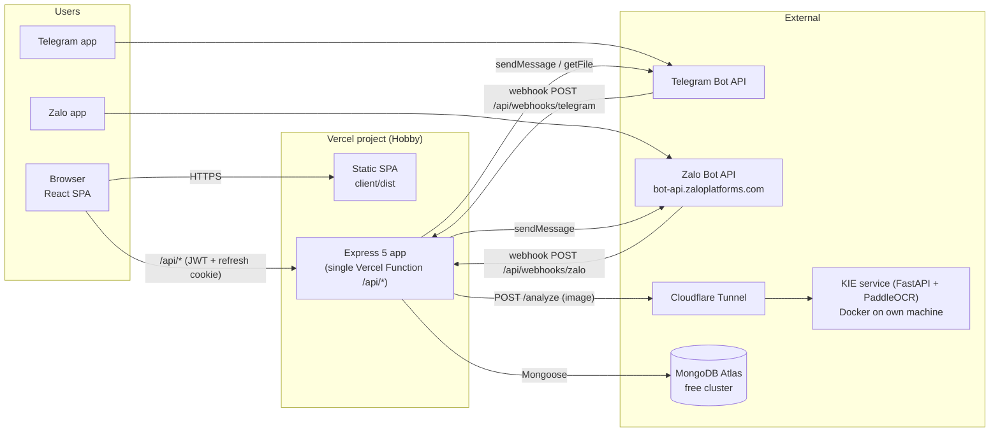
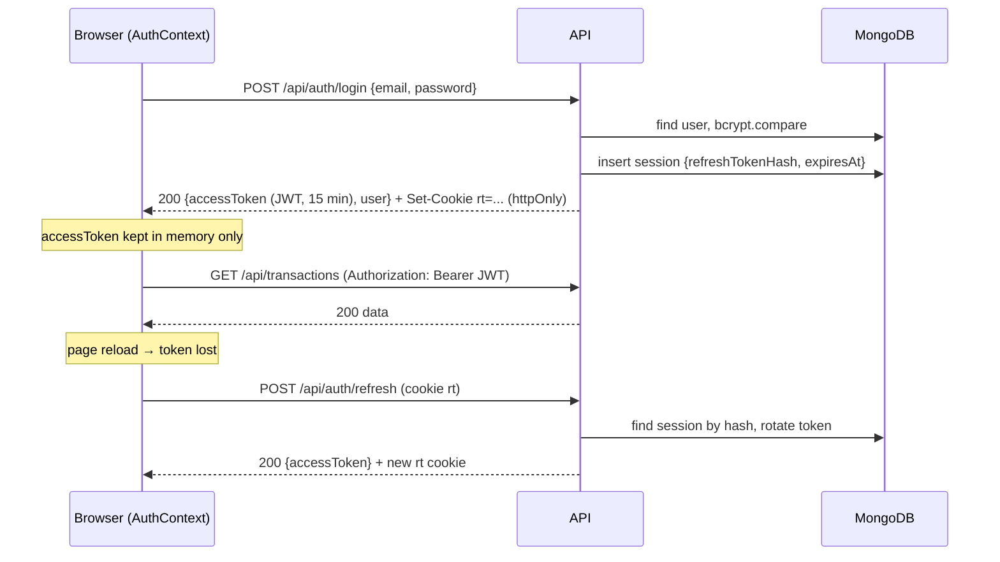
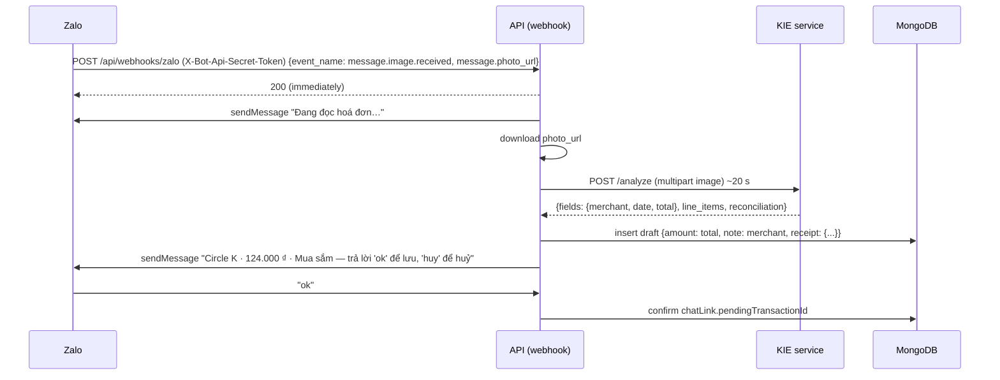

# 1. Architecture & Tech Stack

## 1.1 Overview

The system has **three runtime pieces**:

1. **One Vercel project.** It serves the React SPA as static files and the Express API as a single Vercel Function under `/api/*`. The web app and the API share one origin, so the refresh-token cookie works without CORS or third-party cookies.
2. **MongoDB Atlas free cluster.** It holds all application data.
3. **KIE service (Python, Docker).** It reads receipt photos. It cannot run on Vercel (PaddleOCR needs a large bundle and about 20 s of CPU per image), so it runs on a machine with Docker and is exposed over HTTPS with a Cloudflare Tunnel.

Telegram and Zalo push messages to **webhooks** on the same Vercel API.



## 1.2 Components

| Component | Responsibility | Notes |
|---|---|---|
| **SPA (client/)** | All screens in **TypeScript**: quick-add box and full forms for typing transactions on the web, i18n (vi/en), light/dark theme, charts | Built by Vite into static files and served from Vercel's CDN |
| **API (server/)** | REST API, auth, validation, statistics, bot logic, KIE client | One Express app exported for Vercel; also runs locally with `node` |
| **Bot core (server/src/bot/)** | Platform-independent: parse text → draft → confirm, plus commands | Telegram and Zalo are thin **adapters** that send and receive messages |
| **Text parser** | Rule-based Vietnamese/English parsing of `phở 45k`, `+lương 15tr`, `grab 32k hôm qua` | **No AI fallback**: if nothing parses, the bot replies with usage help |
| **KIE client** | Sends an image to the KIE service and maps its result to a draft transaction | 120 s timeout. When it fails, the bot asks the user to type the amount |
| **KIE service** | OpenCV preprocessing → PaddleOCR → spatial KIE → line items → total reconciliation | We only call `POST /analyze`, which saves nothing. Its own SQLite and UI are unused |
| **MongoDB Atlas** | Users, sessions, wallets, categories, transactions, budgets, chat links, link codes | See [03-database.md](03-database.md) |

## 1.3 Request flows

### Web login and silent refresh



### Telegram text message → draft → confirm

```mermaid
sequenceDiagram
    participant T as Telegram
    participant A as API (webhook)
    participant D as MongoDB
    T->>A: POST /api/webhooks/telegram (secret header) {message: "phở 45k"}
    A-->>T: 200 (immediately)
    Note over A: waitUntil(process update)
    A->>D: chatLink by telegram user id → userId
    A->>A: parse → {expense, 45000, Ăn uống, Tiền mặt, now}
    A->>D: insert transaction {status: draft, source: telegram}
    A->>T: sendMessage "🍜 Ăn uống · 45.000 ₫ · Tiền mặt" + buttons [✅ Lưu][❌ Huỷ]
    T->>A: callback_query "c:<txId>"
    A->>D: status → confirmed; check budget
    A->>T: answerCallbackQuery + edit message "Đã lưu ✅ (budget 72%)"
```

### Zalo receipt photo → KIE → draft



## 1.4 Tech stack

Versions are the latest on npm on 2026-11-20. Pin them in `package.json` when scaffolding.

### Frontend (`client/`)

| Concern | Choice | Version | Why |
|---|---|---|---|
| Language | **TypeScript** (`strict: true`) | 7.0.2 | Typed components, store and API responses; `tsc --noEmit` runs on every build |
| UI library | React (+ `@types/react`, `@types/react-dom`) | 19.3.1 (types 19.3.0) | Required by the slides |
| Build tool | Vite | 8.3.8 | Required; fast dev server with `/api` proxy |
| Routing | React Router | 8.5.2 | Required |
| Global state + data fetching | Redux Toolkit (RTK Query) + react-redux | 2.15.0 / 9.3.1 | Required (Redux Toolkit); RTK Query gives caching and refetch-on-change for free |
| Auth state | React Context (`AuthContext`) | — | Required ("Context cho đăng nhập") |
| Components & theming | MUI (Material UI) + icons | 9.5.0 | Responsive grid and drawer, built-in light/dark palettes |
| i18n | i18next + react-i18next + browser language detector | 27.2.2 / 18.0.3 / 8.3.1 | vi/en UI strings, plus number and date formatting |
| Charts | Recharts | 3.11.0 | Pie (by category) and bar (daily trend) |

### Backend (`server/`)

| Concern | Choice | Version | Why |
|---|---|---|---|
| Runtime | Node.js | 22 LTS | Vercel default family; built-in `fetch`, `FormData`, `Blob` |
| Web framework | Express | 5.3.0 | Required; zero-config on Vercel; async errors reach the error middleware |
| ODM | Mongoose | 9.12.2 | Required |
| JWT | jsonwebtoken | 9.0.3 | Access tokens (HS256) |
| Password hashing | bcryptjs | 3.0.3 | Pure JS, so there is no native build step on Vercel |
| Validation | zod | 4.6.7 | One schema per request body or query |
| Cookies | cookie-parser | 1.4.7 | Reads the refresh-token cookie |
| Security headers | helmet | 8.3.0 | Sensible defaults |
| Rate limiting | express-rate-limit | 8.7.5 | Login and register brute-force guard (per instance, see backend doc) |
| Vercel helpers | @vercel/functions | 3.11.3 | `waitUntil` (finish bot work after replying 200), `attachDatabasePool` |
| Telegram / Zalo | plain `fetch` (no SDK) | — | Both are small HTTP APIs (`sendMessage`, `getFile`); about 30 lines each, so nothing extra to explain at the defense |

### Data and infra

| Concern | Choice |
|---|---|
| Database | MongoDB Atlas free cluster (512 MB) |
| Hosting (web + API) | Vercel Hobby (free) |
| Receipt service | Document-Intelligence-KIE: Python 3.10, FastAPI, PaddleOCR 3.x, OpenCV, in Docker |
| Public URL for KIE | Cloudflare Tunnel (`cloudflared`; already installed on the dev server) |

## 1.5 Repository layout

```text
Zalo-Tele-intergrated-financial-apps/
├── api/
│   └── index.js            # Vercel Function entry: export default app from server/src/app.js
├── client/                 # React + Vite SPA, TypeScript
│   ├── src/
│   │   ├── app/            # store.ts, hooks.ts (typed useAppDispatch/useAppSelector), api.ts (RTK Query), uiSlice.ts
│   │   ├── auth/           # AuthContext.tsx, ProtectedRoute.tsx, AdminRoute.tsx
│   │   ├── components/     # AppLayout, QuickAdd, MoneyText, ThemeToggle, LanguageSwitch, ... (.tsx)
│   │   ├── features/       # dashboard/, transactions/, wallets/, categories/, budgets/, bot/, settings/, admin/
│   │   ├── types/          # api.ts: request/response types matching docs/04-backend.md
│   │   ├── i18n/           # index.ts, vi.json, en.json
│   │   ├── theme/          # theme.ts (light/dark palettes)
│   │   └── main.tsx
│   ├── e2e/                # Playwright tests (TypeScript)
│   ├── tsconfig.json       # strict
│   └── vite.config.ts      # dev proxy /api → http://localhost:3000; Vitest config
├── server/
│   └── src/
│       ├── app.js          # builds the Express app (no listen)
│       ├── local.js        # app.listen(3000) for local dev
│       ├── config/         # env.js (validated with zod), db.js (cached Mongoose connection)
│       ├── models/         # User, Session, Wallet, Category, Transaction, Budget, ChatLink, LinkCode
│       ├── middleware/     # auth.js, requireRole.js, validate.js, error.js, notFound.js
│       ├── routes/         # one router per resource
│       ├── controllers/
│       ├── services/       # stats, budgets, receipts (KIE client), links
│       ├── bot/            # core.js, parser.js, messages.{vi,en}.js, telegram.js, zalo.js
│       └── seed/           # default categories, first admin
├── docs/                   # this specification
│   └── testing/            # test-cases.json, bugs.json, test-report.xlsx, recordings/
├── tools/test-report/      # build-report.mjs: JSON + test results → Excel
├── .env.example            # every variable, no values
├── vercel.json             # rewrites: /api/* → api/index.js, SPA fallback
└── package.json            # npm workspaces: client, server
```

## 1.6 Key decisions

| Decision | Chosen | Rejected | Reason |
|---|---|---|---|
| Hosting shape | One Vercel project (SPA + `/api` function) | Two projects (client + API) | Same origin, so the refresh cookie works with `SameSite=Strict`, no CORS, one deploy |
| Bot updates | Webhooks + `waitUntil` | Long polling | Polling needs an always-on process, which Vercel does not have. Webhooks reply 200 at once and finish the work (KIE ~20 s) inside the 300 s function limit |
| Text understanding | Rule-based parser only | LLM fallback | Your decision: deterministic, free, and fully explainable at the defense |
| Receipt understanding | External KIE service | Running OCR inside the API | PaddleOCR is too heavy for a Vercel Function (250 MB bundle limit, ~20 s CPU per image) |
| Bot SDKs | Plain `fetch` | grammY / Zalo SDKs | Two endpoints each; fewer dependencies to justify |
| Drafts | `transactions.status = 'draft'` | Separate drafts collection | One model and one list UI; confirming a draft is just a status change |
| Money | Integer VND | Float | No rounding errors (same idea as ezBookkeeping's int64 amounts) |
| Deleting | Soft delete (`deletedAt`) | Hard delete | Statistics stay consistent and deletes can be undone (ezBookkeeping uses the same pattern) |

## 1.7 What we take from ezBookkeeping

We take ideas only. ezBookkeeping is Go/Vue/SQL; we rebuild in MERN.

| Area | Take | Adapt | Skip |
|---|---|---|---|
| Data model | Wallet (account) / category / transaction split; integer amounts; soft delete | Categories get per-language default names and **keywords** for the bot parser | Tags, templates, transfers, multi-currency, sub-accounts |
| Auth | Sessions stored in the DB (from its `token_record`), so logout and "log out other devices" are real | Implemented as JWT access token + rotating refresh token | Its custom encrypted token format, 2FA, OAuth |
| AI/receipts | The *idea* of "message or photo → draft → user confirms" | Text: rule-based parser. Photo: KIE service | LLM prompts (no AI fallback in this project) |
| Statistics | Monthly totals and by-category breakdown | Done with MongoDB aggregation | Insights explorer |
