# 1. Architecture & Tech Stack

## 1.1 Overview

The system has **three runtime pieces**:

1. **Vercel: one project per environment.** Production (`sochitieu-btl`) and staging (`sochitieu-btl-staging`, database `finance_staging`) are built from the same repo. Each serves the React SPA as static files and the Express API as a single Vercel Function under `/api/*`, so the web app and the API share one origin and the refresh-token cookie works without CORS or third-party cookies. The projects are not Git-connected: `tools/deploy.sh staging|production` deploys the current checkout with the Vercel CLI.
2. **MongoDB Atlas free cluster.** It holds all application data.
3. **KIE service (Python, Docker).** It reads receipt photos. It cannot run on Vercel (PaddleOCR needs a large bundle and about 20 s of CPU per image), so it runs on a machine with Docker and is exposed over HTTPS with a Cloudflare Tunnel.

Telegram and Zalo push messages to **webhooks** on the same Vercel API.

**Built ([§2.10](02-features.md#210-one-tap-linking-and-whatsapp-planned), card T34 #74):** WhatsApp is a third chat app through **Meta's WhatsApp Cloud API**, with the same webhook pattern and bot core as Telegram and Zalo. It stays off until the four WhatsApp settings are set (the owner's Meta setup is in [06-deployment.md §6.12](06-deployment.md#612-whatsapp-cloud-api-meta-setup-planned-210)). Dashed lines in the diagram are planned. Every part of this document marked "planned" describes a change against today's code, not something that exists. Each build PR updates the planned sections in the docs its card's Scope lists; where a card's Scope doesn't list them (T32), the orchestrator opens a docs-only follow-up PR after the merge.

**Planned ([§2.11](02-features.md#211-assistant-and-agent-features-planned), not built yet):** the bots and the web answer questions about the user's own money, read receipt photos with a local model, and suggest a category when the rules fall back to Khác/Other. A fourth runtime piece does this: an **agent service** (Python 3.12, FastAPI + LangGraph) next to a **vLLM** server that serves **Qwen3.5-2B**, both on the team's GPU host and reached server-to-server through a Cloudflare tunnel, like KIE. Express stays the only public API. It keeps capture (text parser, drafts, ok/huy, buttons), `classify`, the plain commands, auth, **every write** and the cron entry point. A **daily Vercel cron** asks the agent service for the opted-in digests and reports. The rules from §2.11 hold everywhere: nothing goes to a third-party model; a typed amount is parsed only by the rule parser; the bot never saves or changes money data without the user's confirmation; every number in a reply comes from our code and MongoDB. KIE is retired once the local model passes the receipt eval ([§2.11.4 "Local model layer (Qwen3.5-2B on vLLM)"](02-features.md#2114-local-model-layer-qwen35-2b-on-vllm)). The agent design is in §1.9.

**Planned ([§2.12](02-features.md#212-email-codes-verified-sign-up-and-password-reset-planned), not built yet):** the API sends 6-digit email codes for sign-up and password reset through **Gmail SMTP**.

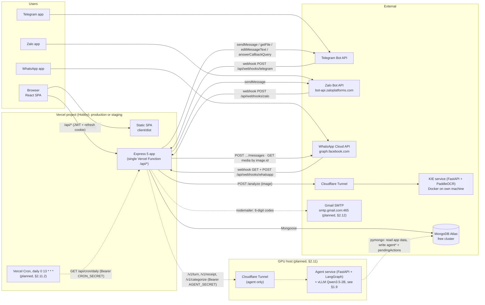

## 1.2 Components

| Component | Responsibility | Notes |
|---|---|---|
| **SPA (client/)** | All screens in **TypeScript**: quick-add box and full forms for typing transactions on the web, Bot inbox (link code + QR, drafts from the bots, receipt photo upload via `POST /api/receipts`), i18n (vi/en), light/dark theme, charts | Built by Vite into static files and served from Vercel's CDN |
| **API (server/)** | REST API, auth, validation, statistics, bot logic, KIE client | One Express app exported for Vercel; also runs locally with `node` |
| **Bot core (server/src/bot/)** | Platform-independent: parse text → draft → confirm, plus commands | Telegram and Zalo are thin **adapters** that send and receive messages |
| **WhatsApp adapter (§2.10.4)** | Maps WhatsApp Cloud API webhook payloads to bot core messages and button presses; sends text and reply-button messages through the Graph API | `server/src/bot/whatsapp.js`, a third adapter beside Telegram and Zalo, same bot core. The signature check and the setup `GET` are in `routes/webhooks.js` |
| **Chat linking (§2.10.2–2.10.3)** | Website side: the link card has one button per app from `links: { telegram, whatsapp, zalo }`. Chat side: the bot hands an unlinked chat a claim link, confirmed on the `/link` screen, and the Bot inbox then shows a "Not you? [Unlink]" notice for that link until dismissed | `services/chatLinks.js`. Website codes and claim links share the `linkCodes` collection (exactly one of `userId` or `chat` per row) |
| **Question path (planned, §2.11.1–2.11.3)** | `classify(text, { followUp })` (pure, in `bot/ask.js`, rules of §2.11.1 unchanged) splits a message into **question** or **capture** before `createDrafts`. A question goes to the agent service's `POST /v1/turn`, which answers with text, facts, sources and an optional confirm card | One entry point for the bots, the web drawer (`POST /api/assistant/chat`) and the QuickAdd chip. No database or model in `classify`. Agent service down → the help text and the plain commands |
| **Agent client (planned, §2.11)** | `services/agent.js`: one client for the agent service (`AGENT_URL`, `AGENT_SECRET`, timeouts 25 s in chat, 40 s on the web, 60 s for receipts, 3 s for a category, `requestId` passthrough). Maps a 503 or a timeout to the help text, `AGENT_UNAVAILABLE` or `AGENT_BUSY` | Replaces the KIE client when `RECEIPT_READER=qwen`. Performs no model call itself |
| **Agent service (planned, §2.11, `agent/`)** | Python 3.12, FastAPI + LangGraph on the GPU host. One compiled graph for turns (chat, confirm, schedule, event) and two small graphs for receipts and categories. Skills and tools are registries in MongoDB; the bge-m3 embedder runs in the same process. Details in §1.9 | Its MongoDB user reads app data and writes only `agent*` collections and `pendingActions` proposals. Every endpoint except `GET /health` needs `Bearer AGENT_SECRET` |
| **vLLM (planned, §2.11)** | Serves `Qwen/Qwen3.5-2B` as `qwen3.5-2b` on `127.0.0.1:8300` (OpenAI-compatible API), non-thinking mode, guided JSON for structured answers | Only the agent service reaches it. It is never on the tunnel |
| **Daily cron and notices (planned, §2.11.2)** | One Vercel cron calls `GET /api/cron/daily` once a day. It loops over opted-in users, asks the agent service for each message due today (`/v1/turn`, `trigger: schedule`, §1.3), and sends it. Recurring-bill drafts (B3) are built in Express. A `notices` row (unique `(userId, kind, key)`) is inserted before each send, and `channelUsage` counts Zalo and WhatsApp sends | Checked with `CRON_SECRET` through the existing `sameSecret()`. Admins can run it by hand with `POST /api/admin/cron/daily`, because crons don't fire locally |
| **Mailer and email codes (planned, §2.12)** | `services/mail.js` sends one plain-text + simple-HTML mail, `sendCode({ to, purpose, code, language })`, through Gmail SMTP with `nodemailer`. `emailCodes` holds a pending sign-up or a reset: the code's SHA-256 hash, tries, send times, and for sign-up the bcrypt hash of the password | No account exists until the code is right (§2.12.2). Without the Gmail settings, development logs the code and production registers as today (§2.12.4) |
| **Text parser** | Rule-based Vietnamese/English parsing of `phở 45k`, `+lương 15tr`, `grab 32k hôm qua` | **No AI fallback**: if nothing parses, the bot replies with usage help |
| **KIE client** | Sends an image to the KIE service and maps its result to a draft transaction | 120 s timeout. When it fails, the bot asks the user to type the amount. Planned: used only while `RECEIPT_READER=kie`, removed when KIE is retired (§2.11) |
| **KIE service** | OpenCV preprocessing → PaddleOCR → spatial KIE → line items → total reconciliation | We only call `POST /analyze`, which saves nothing. Its own SQLite and UI are unused. Planned: retired after the receipt eval passes (§2.11) |
| **MongoDB Atlas** | Users, sessions, wallets, categories, transactions, budgets, chat links, link codes. Planned: `pendingActions`, `notices`, `channelUsage`, `appSettings`, the agent's `agentSkills`, `agentTools`, `agentTurns`, `agentMemory`, `agentCategoryVectors`, `receiptReads` (§2.11.6) and `emailCodes` (§2.12.5) | See [03-database.md](03-database.md) |

## 1.3 Request flows

### Web login and silent refresh

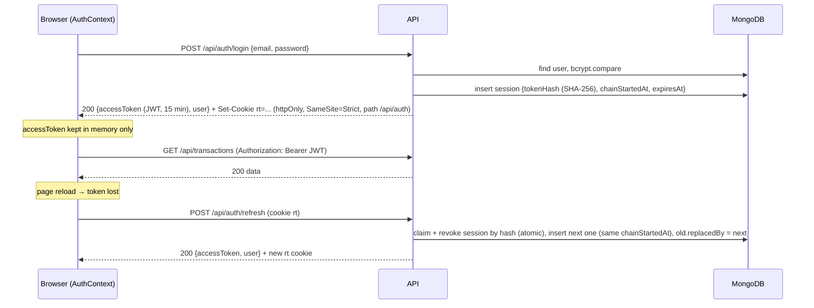

- **Reuse of a rotated token:** within 30 s of its rotation (`REUSE_GRACE_MS`), when the replacement was never used, the API revokes the replacement and rotates again (the browser most likely lost the answer). Otherwise it revokes every session of that user and answers 401. Two cases come first and revoke nothing: a locked account gets 403 `ACCOUNT_LOCKED`, and a token that was never rotated (expired, or revoked by a logout) just gets 401.
- **Logout** revokes this device's whole rotation chain (`chainEndedAt`), so a refresh running in another tab at the same moment cannot keep it logged in.
- **Tabs:** in `client/src/auth/session.ts`, calls in one tab share one running refresh, and a Web Lock (`auth-refresh`) makes tabs take turns, so the second tab sends the already-rotated cookie.

### Telegram text message → draft → confirm

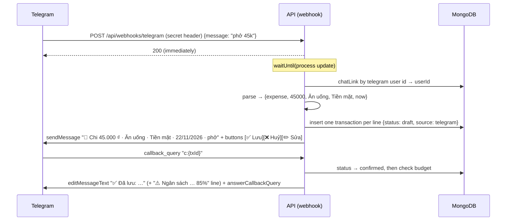

The ✏️ button is a URL button to `<APP_URL>/bot` and is only added when `APP_URL` is `https://`. The budget line is only added when the category or overall budget for that month is at least 80 % used (🚨 at 100 %). Reply texts are in `server/src/bot/messages.vi.js` / `messages.en.js`.

### Zalo receipt photo → KIE → draft

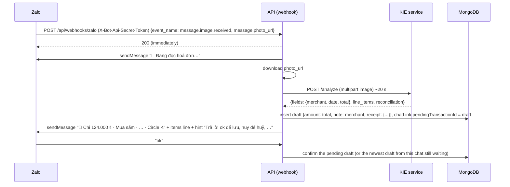

Zalo has no buttons: a typed `ok` / `huy` acts on `chatLink.pendingTransactionId` while it is still a draft, else on the newest waiting draft from that chat. A reply that is only an amount (`55k`) corrects that draft's amount and sends it again.

Planned (§2.11): with `RECEIPT_READER=qwen` the photo goes to the agent service instead of KIE (see "Receipt photo → local model" below). The draft and the `ok` / `huy` steps stay as above.

### WhatsApp message → draft → confirm (§2.10.4)

The flow is the Telegram one above with Meta's payloads, and a signature check in place of the shared secret (built by card T34, #74).

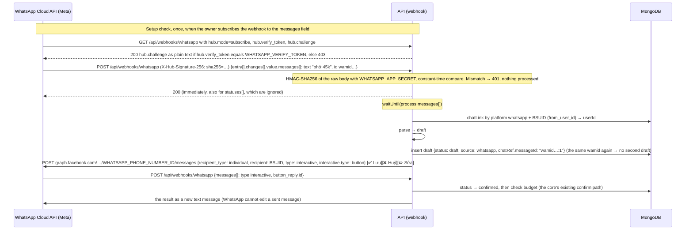

How it differs from the Telegram and Zalo webhooks (`server/src/routes/webhooks.js`, `server/src/bot/whatsapp.js`):

- **A signature instead of a shared secret.** `/telegram` and `/zalo` compare a header with a secret the API chose (`sameSecret`, constant time). Meta signs each delivery instead: `X-Hub-Signature-256: sha256=<hex HMAC-SHA256 of the raw body with WHATSAPP_APP_SECRET>`, also compared in constant time. A mismatch answers 401 and nothing is processed.
- **The raw body, kept by the global parser.** `server/src/app.js` runs `express.json({ limit: '1mb', verify })` for every route ahead of `/api`; re-serialising `req.body` does not give back the bytes Meta signed (Meta writes non-ASCII characters as `\uXXXX`, so a Vietnamese profile name changes the bytes). `verify` keeps the bytes as `req.rawBody` when `req.originalUrl` starts with `/api/webhooks/whatsapp`, and the route computes the HMAC over `req.rawBody`. Every other route parses as before.
- **A `GET` setup check.** Telegram and Zalo are registered by `server/src/scripts/setWebhooks.js` and have no `GET` route. WhatsApp's `GET` answers Meta's verify-token check shown above. Meta takes the callback URL in its app dashboard, so for WhatsApp `setWebhooks.js` only prints what to enter there (or `skipped` when the settings are missing).
- **Off without its settings.** With any of `WHATSAPP_ACCESS_TOKEN`, `WHATSAPP_PHONE_NUMBER_ID`, `WHATSAPP_APP_SECRET`, `WHATSAPP_VERIFY_TOKEN` unset, both routes answer 503 `FEATURE_NOT_CONFIGURED` and process nothing, and the link card gets no WhatsApp link (`whatsappConfigured()` in `config/env.js`).
- **200 first, work in `waitUntil`.** Unchanged pattern. `entry[].changes[].value.messages[]` are handled; `statuses[]` (sent/delivered/read) are ignored; both get 200 so Meta doesn't retry.
- **No second draft for a second delivery.** The message `id` (`wamid…`) goes into `chatRef.messageId`, like Telegram's and Zalo's `message_id`, so the unique `chatRef` index on `transactions` (`platform`, `chatId`, `messageId`) stops the copy. Only drafts are deduplicated: as on the other platforms, a redelivered command may be answered twice.
- **Every closed list of platforms gains `whatsapp` (§2.10.5).** The Mongoose enums `chatLinks.platform`, `transactions.source` and `transactions.chatRef.platform` (without the last, every WhatsApp draft fails validation, so the dedup above never runs), the zod `source` filter in `server/src/routes/transactions.js`, and the platform/source lists of the admin stats in `server/src/services/admin.js`.
- **Mapping into the core.** `platformUserId` and `chatId` are the user's **business-scoped user ID** (BSUID: `from_user_id` on the message, `user_id` on the contact). Meta omits `from` (the phone number) for users who adopted a WhatsApp username, so the phone number is never the key and is never stored. The contact with that BSUID gives `profile.name` as `displayName`; `text.body` is the text; an `image.id` is the photo; a `button_reply.id` is a button press into the core's `handleButton`, carrying the same action and draft id as Telegram's `c:<id>` / `x:<id>` callback data (`e:<id>` for ✏️ Sửa). Other message types get the help text. A message with no `from_user_id` (no safe key: the phone number is never one), a message from a group (`group_id`: other people would see the money), an emoji reaction and a `system` message (Meta's note that a user's ID changed) are ignored; the first is logged without the number.
- **Buttons.** ✅ Lưu, ❌ Huỷ and ✏️ Sửa use all three reply buttons WhatsApp allows (titles ≤ 20 characters, body ≤ 1024, ids `c:`/`x:`/`e:` + the 24-character draft id). ✏️ Sửa is a reply button, not a URL button as in Telegram, so pressing it makes the bot reply with `<APP_URL>/bot`; without `APP_URL` the button is left out. The result of ✅ / ❌ is a new text message, because WhatsApp cannot edit a sent one, so the buttons stay on the old draft message and pressing ✅ twice answers "already saved".
- **Receipts.** `GET /<image.id>` with `WHATSAPP_ACCESS_TOKEN` returns a `url` valid for 5 minutes; the adapter downloads it with the same token (the URL must be `https`) and passes it to KIE as for the other platforms.
- **Sending.** `POST https://graph.facebook.com/<version>/<WHATSAPP_PHONE_NUMBER_ID>/messages` with `messaging_product: "whatsapp"`, `recipient_type: "individual"` and `recipient: <BSUID>` (no `to`: Meta reserves `to` for phone numbers, and BSUIDs go in `recipient`). The Graph API version is one constant in the adapter (`GRAPH_VERSION`, `v26.0`). Replies longer than 4096 characters are split at the last line break that fits.

### Linking from the website: link card (planned, §2.10.2)

Not built yet. Today `POST /api/chat-links/code` returns `{ code, expiresAt, telegramDeepLink }` (`createLinkCode` in `server/src/services/chatLinks.js`), and Zalo users type `/link CODE` by hand. Planned: it returns `{ code, expiresAt, links: { telegram, whatsapp, zalo } }`, each a URL or `null`, and the client changes in the same PR.

| App | Link | How the code reaches the bot |
|---|---|---|
| Telegram | `https://t.me/<bot>?start=<CODE>` (as today) | The bot receives `/start <CODE>` after the user taps Start |
| WhatsApp | `https://wa.me/<WHATSAPP_NUMBER>?text=%2Flink%20<CODE>` | The chat opens with `/link CODE` typed; the user taps Send |
| Zalo | `ZALO_BOT_URL` (Zalo bot links carry no payload) | The card copies `/link CODE` to the clipboard first; the user pastes and sends |

The bot side does not change: every app delivers an ordinary `/start CODE` or `/link CODE` message, which `redeemLinkCode` already handles. An app whose settings are missing gets `null` and is hidden in the card.

### Linking from the chat: claim link → `/link` → Confirm (§2.10.3)

A chat that found the bot first links without typing: the bot sends it a one-time link, and the user confirms it on the website.

```mermaid
sequenceDiagram
    participant C as Chat (Telegram or Zalo)
    participant A as API
    participant D as MongoDB
    participant B as Browser (/link screen)
    C->>A: webhook: any message from a chat with no chatLink (a wrong or expired code counts)
    A->>D: one atomic upsert per chat: linkCodes {SHA-256 of a 32-char token, chat: {platform, platformUserId, chatId, displayName}, expiresAt: now + 10 min}, no userId
    A->>C: "please link" text (vi + en) + "Or tap to link: APP_URL/link?t=TOKEN (valid 10 minutes)"
    C->>B: the user taps the link → /link?t=…
    Note over B: as the app starts, t moves into sessionStorage and history.replaceState removes it from the address bar; log in first if needed
    B->>A: POST /api/chat-links/claim/preview {token} (JWT)
    A->>D: find a live claim link by hash
    A-->>B: 200 {platform, displayName}, or 404 LINK_TOKEN_INVALID
    Note over B: "Link Zalo · Anh to your name (your email)?" + warning "Only confirm if you just messaged the bot yourself. The chat you link can see your spending and record money in this account." [Confirm] [Cancel]
    B->>A: POST /api/chat-links/claim {token} (JWT)
    A->>D: one atomic update: unused, unexpired and has chat → mark used
    A->>D: insert chatLinks {userId: the logged-in user, platform, platformUserId, chatId, displayName, viaClaim: true}
    A-->>B: 201 {id, platform, displayName, createdAt, viaClaim: true}, or 404 LINK_TOKEN_INVALID, or 409 CHAT_ALREADY_LINKED
    A->>C: "Đã liên kết với tài khoản …" in the user's language (in waitUntil, after the 201)
    Note over B: /bot shows "Linked ✓ Zalo · Anh" and the notice "New chat linked from a chat link: Zalo · Anh. Not you? [Unlink]"
```

How it works:

- **The only thing stored for an unlinked chat is its claim link.** It is a random 32-character base64url token (24 bytes), valid 10 minutes, single use, kept only as its SHA-256 in `linkCodes` with the `chat` sub-document; no message text. Each new message replaces it (one atomic upsert, backed by a partial unique index on `chat.platform` + `chat.platformUserId`), so a chat has at most one, even when two messages arrive at once. The TTL index on `expiresAt` removes the row.
- **`linkCodes` holds two kinds of row.** Exactly one of `userId` (a code made on the website) or `chat` (a claim link made by the bot) is set. Redeeming in the chat (`/link CODE`, `redeemLinkCode`) only matches rows with `userId`; claiming on the website only matches rows with `chat`, so neither works in the other's place.
- **Same claim pattern as codes.** Checking unused + unexpired and marking used is one atomic update, as in `redeemLinkCode`. If the chat was linked meanwhile, the unique `chatLinks` index on (`platform`, `platformUserId`) refuses the new row: 409 `CHAT_ALREADY_LINKED`, and the token stays spent.
- **The token stays out of URLs the API logs.** Both endpoints need login and take the token in the body. `ProtectedRoute` redirects to `/login` before a page's code runs and keeps `pathname + search` as the return path, so `/link` sits outside it, and `t` leaves the address bar as the app starts, before its first request ([05-frontend.md §5.9.2](05-frontend.md#592-link-screen-planned-2103)). The first page load itself still has the token in its address, because that is the link the chat taps.
- **The bot speaks from a web request.** After a claim, the API sends the success text to the chat through the adapter for `chat.platform`. It runs in `waitUntil`, like the webhook work; a failed send is only logged and the link stays.
- **Confirm, not auto-link, and a notice afterwards.** See §1.6 for the threat. `chatLinks.viaClaim` marks a link made this way; the Bot inbox shows "New chat linked from a chat link: **Zalo · Anh**. Not you? [Unlink]" while `viaClaim && !claimNoticeDismissedAt`. Unlink uses `DELETE /api/chat-links/:id`; dismissing calls `PATCH /api/chat-links/:id/claim-notice` (own links only, no body → 204; 404 for another user's or an unknown id).

### Question → agent service (planned, §2.11.1–2.11.4)

Not built yet. Today every text that isn't a command becomes a draft, so "tháng 10 thu bao nhiêu" can turn into a 10.000 ₫ draft. Planned: `handleMessage` asks `classify` first (the order is in §2.11.1), and the web asks the same function. A question goes to the agent service; the graph's nodes are described in §1.9.

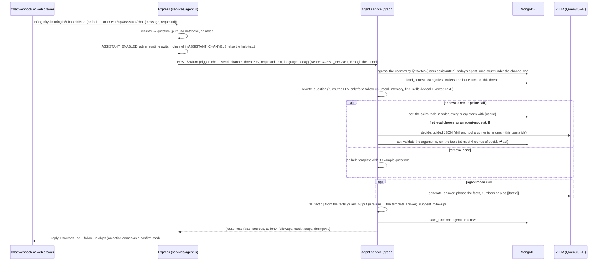

What changes against today:

- **A question never becomes money data.** `classify` runs before `createDrafts`, and `POST /api/transactions/parse` returns `question: true` for a question, so QuickAdd's Enter saves nothing (§2.11.1).
- **Express decides whether to ask; the graph decides how to answer.** Express checks the env switch, the admin runtime switch and the channel. The agent service checks the user's own "Trợ lý" switch (`users.assistantOn`, on by default) and the daily cap: 30 questions a day on the web, 20 on Telegram, 10 on Zalo, 5 on WhatsApp, counted from `agentTurns`.
- **The badge.** A pipeline skill's answer is a template ("Theo mẫu"). An answer phrased by the model keeps the "AI" badge, which now means the local model.
- **When the agent service is down or busy**, the chat gets the help text plus the plain commands (`/today`, `/month` …), and the web gets 503 `AGENT_UNAVAILABLE` or `AGENT_BUSY`. Capture never waits on the agent service.
- **Logs** carry only the request id, the node and the error class, never the question, notes, figures or tool arguments.

### Receipt photo → local model (planned, §2.11, after the receipt eval)

Not built yet. Today every photo goes to KIE (above). Planned: `RECEIPT_READER=qwen|kie` picks the reader. It stays `kie` until the receipt eval passes (Qwen reads at least as many true payable totals as KIE on the eval set, [§2.11.4 "Local model layer (Qwen3.5-2B on vLLM)"](02-features.md#2114-local-model-layer-qwen35-2b-on-vllm)); then the default flips to `qwen` and KIE is retired.

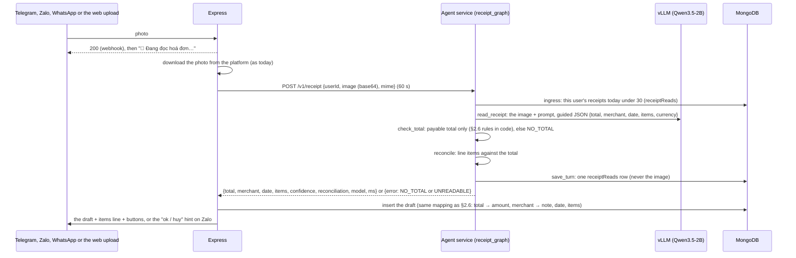

- **`check_total` is code, not the model.** The total must be a money-shaped number on a TOTAL / TỔNG CỘNG / THANH TOÁN line, or the largest money value after VAT. Years, dates, phone numbers, numbers with a leading zero and document numbers are rejected. Otherwise `NO_TOTAL`, and the bot asks the user to type the amount, as today.
- **The user still confirms.** The model only fills a draft; nothing is saved until ✅ or `ok`.
- **Agent service down:** KIE reads the photo when `KIE_URL` is set, else the bot asks for the amount.

### Category suggestion on a Khác/Other draft (planned, §2.11, A7)

Not built yet. Today a draft whose note matches no keyword lands in Khác/Other, and A7 offers the top 3 expense categories. Planned: the agent service suggests one first. The rules still run first, and the draft is never held back.

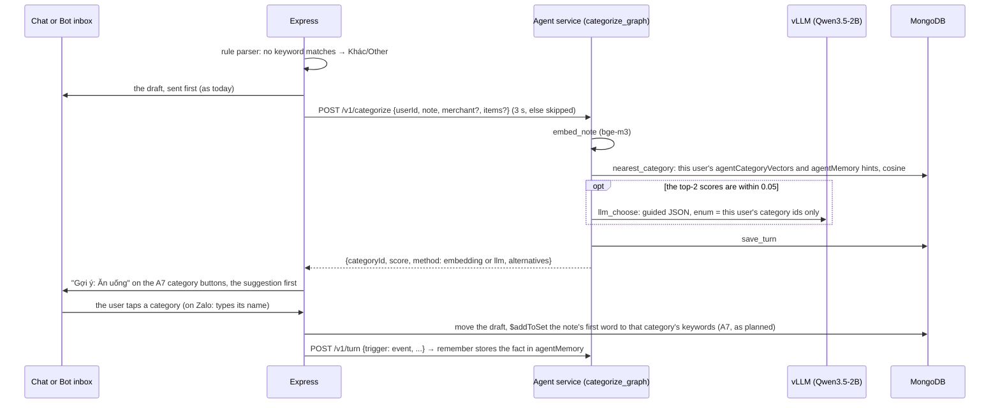

The suggestion is only a suggestion: the draft stays in Khác/Other until the user taps.

### Daily cron → agent service → notices (planned, §2.11.2)

Not built yet. Today the bot only answers; nothing runs on a schedule. Planned: one entry in `vercel.json` `crons`, `0 13 * * *` (20:00–20:59 Vietnam time). On Vercel Hobby it runs once a day, on production deployments only, with no retry. That one run decides what is due for each user:

| Due when | Skill (`trigger: schedule`) | Feature |
|---|---|---|
| Every day | `ban_tin_toi` | B1 evening digest (opt-in, `/nhac toi`) |
| Every day from day 5, when the B2 rule fires | `du_bao_cuoi_thang` | B2 early over-budget warning, inside the digest |
| Sunday | `tong_ket_tuan` | B4 weekly report |
| Day 1 of the month | `tong_ket_thang` | B4 monthly report with next month's suggested budgets ([Chép T11] [Dùng gợi ý]) |
| The day before a recurring bill is due | none: Express rules (`detectRecurring()`) | B3 recurring draft |

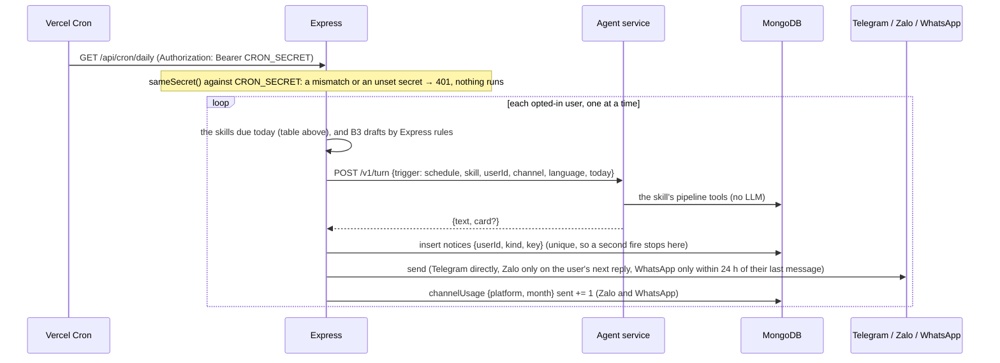

A recurring bill becomes a **draft** the user confirms, never a confirmed transaction. A user linked on several apps gets proactive messages on Telegram only. If the agent service does not answer, that user's message is skipped for the night and no `notices` row is written. The admin "Chạy ngay" button (`POST /api/admin/cron/daily`) runs the same loop for the demo.

### Confirm a proposed action (planned, §2.11.4, C3)

The model may propose a write (set a budget, copy budgets, delete a transaction). It never makes one: the agent service only inserts a `pendingActions` row, and Express performs the write after the user confirms.

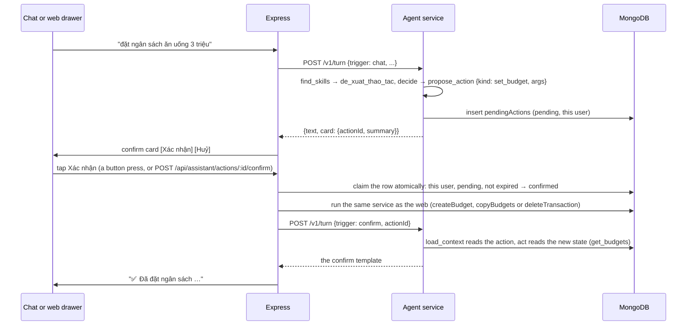

A declined or expired action goes straight to `generate_answer` with its template; nothing is written.

### Sign-up with an email code (planned, §2.12.2)

Not built yet. Today `POST /api/auth/register` creates the user at once and logs them in.

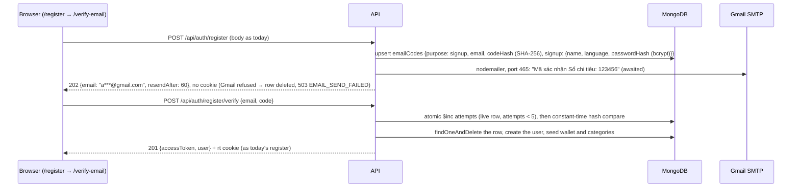

What changes against today:

- **No unverified user ever exists.** The account is created only by the right code, so login, refresh, sessions, `requireAuth` and the bots don't change (§2.12, option B).
- **Forgot password** uses the same codes: `POST /api/auth/password/forgot` always answers 202 and sends inside `waitUntil()` (so a known and an unknown address answer equally fast); `POST /api/auth/password/reset` sets the new hash and revokes every session of that user (§2.12.3).
- **Limits** (§2.12.1): 10 minutes per code, 5 tries, a resend after 60 s and at most 5 sends per address per hour, and 10 code emails per IP per 15 minutes (`mailRateLimit`), which protects the Gmail account from being stopped.
- **Without the Gmail settings** (§2.12.4): development writes the code to the server log; production registers as today (201) and `forgot` answers 503 `FEATURE_NOT_CONFIGURED`.

## 1.4 Tech stack

Versions are pinned exactly in the `package.json` files (root, `client/`, `server/`); this table follows them.

### Frontend (`client/`)

| Concern | Choice | Version | Why |
|---|---|---|---|
| Language | **TypeScript** (`strict: true`) | 6.0.3 | Typed components, store and API responses; `tsc --noEmit` runs on every build |
| UI library | React (+ `@types/react`, `@types/react-dom`) | 19.3.1 (types 19.3.0) | Required by the slides |
| Build tool | Vite | 8.3.8 | Required; fast dev server with `/api` proxy |
| Routing | React Router | 8.5.2 | Required |
| Global state + data fetching | Redux Toolkit (RTK Query) + react-redux | 2.15.0 / 9.3.1 | Required (Redux Toolkit); RTK Query gives caching and refetch-on-change for free |
| Auth state | React Context (`AuthContext`) | — | Required ("Context cho đăng nhập") |
| Components & theming | MUI (Material UI) + icons | 9.5.0 | Responsive grid and drawer, built-in light/dark palettes |
| Icons | lucide-react | 1.66.0 | Line icons, imported one file each (`components/icons.ts`) |
| Font | @fontsource/be-vietnam-pro | 5.3.0 | Self-hosted Be Vietnam Pro (Vietnamese glyphs), no font CDN |
| i18n | i18next + react-i18next + browser language detector | 27.2.2 / 18.0.3 / 8.3.1 | vi/en UI strings, plus number and date formatting |
| Charts | Recharts | 3.11.0 | Bar chart (this month vs last month, weekly columns); the category breakdown is a ranked list |

### Backend (`server/`)

| Concern | Choice | Version | Why |
|---|---|---|---|
| Runtime | Node.js | 22 LTS | Vercel default family; built-in `fetch`, `FormData`, `Blob` |
| Web framework | Express | 5.3.0 | Required; zero-config on Vercel; async errors reach the error middleware |
| ODM | Mongoose | 9.12.2 | Required |
| JWT | jsonwebtoken | 9.0.3 | Access tokens (HS256) |
| Password hashing | bcryptjs | 3.0.3 | Pure JS, so there is no native build step on Vercel |
| Validation | zod | 4.6.7 | One schema per request body or query |
| Cookies | cookie-parser | 1.4.7 | Reads the refresh-token cookie |
| Security headers | helmet | 8.3.0 | Sensible defaults |
| Rate limiting | express-rate-limit | 8.7.5 | Login and register brute-force guard (per instance, see backend doc) |
| Vercel helpers | @vercel/functions | 3.11.3 | `waitUntil` (finish bot work after replying 200), `attachDatabasePool` |
| Telegram / Zalo | plain `fetch` (no SDK) | — | Both are small HTTP APIs (Telegram: `sendMessage`, `getFile`, `editMessageText`, `answerCallbackQuery`; Zalo: `sendMessage`); about 50 to 70 lines each, so nothing extra to explain at the defense |
| WhatsApp (§2.10) | Meta's WhatsApp Cloud API, called directly | Graph API `v26.0`, pinned in `bot/whatsapp.js` | One more adapter behind the same bot core and webhook pattern; no provider such as Twilio, no unofficial library. Calls: `POST /<WHATSAPP_PHONE_NUMBER_ID>/messages` (text and reply buttons), `GET /<image.id>` then the media download |
| Agent client (planned, §2.11) | plain `fetch` (no SDK) | — | `services/agent.js` calls the agent service's four endpoints (§1.9). Express loads no model and no AI SDK |
| Email (planned, §2.12.5) | nodemailer | pinned at build time | Gmail SMTP on port 465 with an app password; one module, `services/mail.js` |

### Agent service (`agent/`, §2.11)

Built so far (T44): the scaffold, with these pins in `agent/requirements.txt`. `sentence-transformers` (and the torch it brings) is in `agent/requirements-model.txt`, which only the Dockerfile installs: CI and the tests never download it or a model. The rest of the service comes with the cards that follow.

| Concern | Choice | Version | Why |
|---|---|---|---|
| Runtime | Python | 3.12 | The embedder and the model client are Python; the reference repo (Energy Copilot) is Python |
| HTTP | FastAPI + uvicorn | 0.162.5 / 0.54.0 | Four small JSON endpoints with pydantic validation |
| Agent graph | LangGraph | 1.2.24 | One compiled `StateGraph` with explicit nodes, as in the reference repo's `copilot_graph` |
| Database | pymongo | 4.18.3 | Reads app data with the read-only `sochitieu_agent` user |
| Model client | openai (Python) | 3.59.0 | vLLM speaks the OpenAI-compatible API; structured outputs through `response_format: {type: json_schema}` |
| Embeddings | sentence-transformers + `BAAI/bge-m3` | 6.3.0 | 1024 dimensions, multilingual (Vietnamese too), normalised for cosine; runs on the GPU in the agent process |
| Model server | vLLM, image `vllm/vllm-openai` | 0.31.0 | Serves `Qwen/Qwen3.5-2B` (Apache-2.0, 2B parameters, vision-language, non-thinking mode only) |

### Data and infra

| Concern | Choice |
|---|---|
| Database | MongoDB Atlas free cluster (512 MB) |
| Hosting (web + API) | Vercel Hobby (free): two projects, production and staging, deployed by `tools/deploy.sh` |
| Receipt service | Document-Intelligence-KIE: Python 3.10, FastAPI, PaddleOCR 3.x, OpenCV, in Docker. Planned (§2.11): Qwen3.5-2B in the agent service once the receipt eval passes, then KIE is retired |
| Public URL for KIE | Cloudflare Tunnel (`cloudflared`; already installed on the dev server) |
| WhatsApp number (planned, §2.10.1) | A Meta app with the WhatsApp use case, a Meta business portfolio, a phone number not already on WhatsApp, an approved display name, a permanent (system user) access token, and a payment method once past the free replies |
| Scheduler (planned, §2.11.2) | Vercel Cron Jobs: one daily entry in `vercel.json`, secured with `CRON_SECRET` |
| Model host (planned, §2.11) | The team's GPU host (RTX 5880 Ada, 48 GB, about 30 GB already used by other services): one `docker compose` project `sochitieu-agent` with `vllm`, `agent` and `tunnel`. No paid API; data stays on our machines and Atlas ([06-deployment.md §6.13](06-deployment.md#613-agent-service-and-local-model-planned-211)) |
| Mail (planned, §2.12) | A Gmail account with 2-Step Verification and an app password, sending through `smtp.gmail.com:465` (about 500 mails a day, no domain needed) |

## 1.5 Repository layout

```text
Zalo-Tele-intergrated-financial-apps/
├── api/
│   └── index.js            # Vercel Function entry: export default app from server/src/app.js
├── client/                 # React + Vite SPA, TypeScript
│   ├── src/
│   │   ├── app/            # store.ts, hooks.ts (typed useAppDispatch/useAppSelector), api.ts (RTK Query), uiSlice.ts
│   │   ├── auth/           # AuthContext.tsx, session.ts (token + shared refresh), useAuth.ts, usersApi.ts, claimToken.ts, ProtectedRoute.tsx, AdminRoute.tsx
│   │   ├── components/     # AppLayout, QuickAdd, MoneyText, ThemeToggle, LanguageSwitch, ... (.tsx)
│   │   ├── features/       # auth/, dashboard/, transactions/, wallets/, categories/, budgets/, bot/, link/, settings/, admin/, notFound/
│   │   ├── types/          # api.ts: request/response types matching docs/04-backend.md
│   │   ├── i18n/           # index.ts, format.ts, errors.ts; vi/ and en/ with one JSON file per namespace
│   │   ├── theme/          # theme.ts (light/dark palettes), AppThemeProvider.tsx
│   │   └── main.tsx
│   ├── e2e/                # Playwright tests (TypeScript; run from the root playwright.config.ts)
│   ├── tsconfig.json       # strict
│   └── vite.config.ts      # dev server on VITE_PORT (default 5300), proxy /api → localhost:PORT (default 4100); Vitest config
├── server/
│   ├── src/
│   │   ├── app.js          # builds the Express app (no listen)
│   │   ├── local.js        # app.listen(env.PORT) for local dev (default 4100)
│   │   ├── config/         # env.js (validated with zod), db.js (cached Mongoose connection)
│   │   ├── models/         # User, Session, Wallet, Category, Transaction, Budget, ChatLink, LinkCode
│   │   ├── middleware/     # auth.js, requireRole.js, connectDb.js, rateLimit.js, requestId.js, error.js, notFound.js
│   │   ├── routes/         # one router per resource; request bodies are parsed with zod inline (no controllers/)
│   │   ├── services/       # admin, auth, budgets, categories, chatLinks, receipts (KIE client), sessions, stats, transactions, users, wallets
│   │   ├── bot/            # core.js, parser.js, messages.{vi,en}.js, telegram.js, zalo.js
│   │   ├── utils/          # AppError.js, normalize.js, vnTime.js
│   │   ├── scripts/        # setWebhooks.js: points both bots at a deployed URL
│   │   └── seed/           # default categories, first admin
│   ├── test/               # Vitest + supertest + mongodb-memory-server; fixtures/, helpers/
│   └── vitest.config.js
├── docs/                   # this specification
│   └── testing/            # test-cases.json, bugs.json, runs.json, results.json, bot-e2e.md, test-report.xlsx
├── tools/
│   ├── deploy.sh           # deploy the checkout to staging or production (pinned Vercel CLI)
│   ├── vercel-env-push.sh  # copy server/.env into a Vercel project's env vars (values never printed)
│   ├── set-secret.sh       # paste a secret into server/.env without showing it, then push it
│   ├── wt-env.sh           # per-worktree ports and dev database
│   ├── bot-e2e/            # real-chat bot checker: bot-e2e.mjs, scenarios.json
│   └── test-report/        # build-report.mjs: JSON + test results → Excel
├── .github/workflows/ci.yml # npm ci, typecheck, lint, test, then the agent's pytest, on every PR and push to main
├── .claude/agents/         # coder, reviewer, merger agent definitions
├── playwright.config.ts    # e2e: client/e2e against a test API + Vite
├── eslint.config.js
├── treehouse.toml          # worktree pool settings
├── .worktreeinclude        # git-ignored files copied into each worktree (server/.env)
├── .env.example            # the app's variables, no values; tool-only keys (VERCEL_*, PROD_URL, KIE_PUBLIC_URL, ...) are listed in 06-deployment.md §6.3
├── vercel.json             # npm ci, build client, output client/dist, maxDuration 300; rewrites /api/* → api/index.js, SPA fallback
└── package.json            # npm workspaces: client, server
```

Built (§2.10, card T34): the WhatsApp adapter `server/src/bot/whatsapp.js` beside the Telegram and Zalo ones, and the route `/api/webhooks/whatsapp` in `routes/webhooks.js`. The new variables are `WHATSAPP_ACCESS_TOKEN`, `WHATSAPP_PHONE_NUMBER_ID`, `WHATSAPP_APP_SECRET`, `WHATSAPP_VERIFY_TOKEN`, `WHATSAPP_NUMBER` (international format, digits only, for `wa.me`) and `ZALO_BOT_URL` (the bot's share link from Zalo Bot Creator). A platform with missing settings is skipped by the webhook-registration script and hidden in the link card.

Planned (§2.11), in Express: `server/src/bot/ask.js` (`classify`), `services/agent.js` (the agent client), `routes/assistant.js` (the drawer's endpoints), the cron route `GET /api/cron/daily` and the admin `POST /api/admin/cron/daily`, a `crons` entry in `vercel.json`, and the drawer in `client/src/features/assistant/`. The question engine (skills, router, typed query, templates) is not in Express: it lives in the agent service. New Vercel variables: `AGENT_URL`, `AGENT_SECRET`, `RECEIPT_READER`, `ASSISTANT_ENABLED`, `ASSISTANT_CHANNELS` and `CRON_SECRET`, all optional: a missing one turns its feature off (§2.11.6). `AGENT_URL` comes from `AGENT_PUBLIC_URL`, as `KIE_URL` comes from `KIE_PUBLIC_URL`.

A top-level `agent/` folder (Python, runs on the GPU host, not on Vercel; `.vercelignore` keeps it out of Vercel uploads). **Built (T44, the scaffold):** `app.py` (FastAPI: `/health`, the bearer check, Express's error shape, the log line), `config.py` (settings; the service refuses to start without `AGENT_SECRET`, which must be at least 32 characters, or `MONGODB_URI_AGENT`), `embedder.py` (the `Embedder` interface, a fake for tests, and the bge-m3 loader that imports sentence-transformers lazily at the `models.lock` revision), `setup.py` (`python -m agent.setup`: collections, indexes and the `usersForAgent` view), `role.json` (the one definition of the `sochitieu_agent` role), `models.lock`, `requirements*.txt`, `Dockerfile`, `docker-compose.yml` (`agent` and `tunnel`), `.env.example` and `tests/` (pytest, run by `npm run test:agent` and by CI). **Planned (§2.11), later cards:** the graphs, `tools/` (one handler per tool), `skills/*.yaml` (the skill registry's seed), `prompts/` (one system prompt per node, vi and en) and `eval/` (skill, receipt and categorizer evals). File names of the planned parts are left to the builder.

Planned (§2.12): `services/mail.js`, the `emailCodes` model, the auth routes `register/verify`, `register/resend`, `password/forgot` and `password/reset`, and the `/verify-email` and `/forgot-password` screens. New variables: `GMAIL_USER` and `GMAIL_APP_PASSWORD`, both optional and both needed for mail (§2.12.4).

File layout inside these folders is left to the builder. **Where the new secrets live:** like the bot tokens, only in `server/.env` (git-ignored) and in the environment variables of the two Vercel projects, put there by `tools/set-secret.sh` ([06-deployment.md §6.13–6.14](06-deployment.md#613-agent-service-and-local-model-planned-211)). They are read only by the server; none of them reaches the client bundle, and none is logged. The agent service's own secrets (`AGENT_SECRET` again, `MONGODB_URI_AGENT`) live only in `agent/.env` on the GPU host.

## 1.6 Key decisions

| Decision | Chosen | Rejected | Reason |
|---|---|---|---|
| Hosting shape | One Vercel project per environment (SPA + `/api` function); production and staging are two such projects, deployed by `tools/deploy.sh` | Separate client and API projects | Same origin, so the refresh cookie works with `SameSite=Strict`, no CORS, one deploy per environment |
| Bot updates | Webhooks + `waitUntil` | Long polling | Polling needs an always-on process, which Vercel does not have. Webhooks reply 200 at once and finish the work (KIE ~20 s) inside the 300 s function limit |
| Text understanding | Rule-based parser only | LLM fallback | Your decision: deterministic, free, and fully explainable at the defense |
| Receipt understanding | External KIE service | Running OCR inside the API | PaddleOCR is too heavy for a Vercel Function (250 MB bundle limit, ~20 s CPU per image) |
| Bot SDKs | Plain `fetch` | grammY / Zalo SDKs | A few methods each (four for Telegram, one for Zalo); fewer dependencies to justify |
| Drafts | `transactions.status = 'draft'` | Separate drafts collection | One model and one list UI; confirming a draft is just a status change |
| Money | Integer VND | Float | No rounding errors (same idea as ezBookkeeping's int64 amounts) |
| Deleting | Soft delete (`deletedAt`) | Hard delete | Statistics stay consistent and deletes can be undone (ezBookkeeping uses the same pattern) |
| WhatsApp (§2.10) | Meta's WhatsApp Cloud API directly: one more adapter behind the bot core and the webhook pattern, on Vercel | A provider such as Twilio; unofficial WhatsApp libraries | §2.10 decides this without giving reasons. Ours: webhooks fit the existing `waitUntil` design on Vercel (see "Bot updates"), so the adapter is built the same way as the Telegram and Zalo ones |
| Linking from the chat (§2.10.3) | Claim link + **Confirm** on the website, with a warning, and a "Not you? [Unlink]" notice afterwards | Auto-link: the chat is linked to whoever opens the link | A claim link links the chat that asked for it to whoever opens it, so it can be used for phishing: an attacker messages the bot from their own unlinked chat and sends the claim link to a victim; if the victim confirms, the attacker's chat is linked to the victim's account and can read `/today` and `/month` and create and confirm transactions there. The display name on the confirm screen comes from the chat app and can be faked, so it is not proof. It can't take over the web login. Mitigations: the warning on the confirm screen ("Only confirm if you just messaged the bot yourself…"), the 10-minute single-use token, and the Bot inbox notice "New chat linked from a chat link: … Not you? [Unlink]" until dismissed (`chatLinks.viaClaim`, `claimNoticeDismissedAt`). Linking from the website has no such risk, because the code starts in the logged-in account |
| Claim link storage (§2.10.5) | The existing `linkCodes` collection: a row has exactly one of `userId` (website code) or `chat` (claim link) | A new collection | Keeps the TTL index and hash-only storage; each lookup only matches its own kind, so neither works in the other's place |
| Questions (planned, §2.11) | Skills first (pipeline skills with templates, no LLM); the local model only to pick among close skills, fill tool arguments as guided JSON, or phrase an agent-mode answer, always through our own read-only tools | An LLM parsing typed amounts; an LLM writing the numbers | Every number shown comes from our code and MongoDB (the guard rejects any other digit), and typed capture stays rule-based, so the "Text understanding" row above stays true for typed text. That row's wording, and §1.7's "AI/receipts" row, change in the first Stage AI PR (§2.11.6–2.11.7) |
| Model (planned, §2.11) | ⚑ Qwen3.5-2B on our own GPU with vLLM, one model for questions, receipts and categories | Claude through the Anthropic API (the earlier §2.11 design); a larger local model | Data never leaves our machines, so no AI opt-in, admin grant or spend caps are needed; no per-question cost. The 2B model fits beside the services already on the GPU (about 12 GB with KV cache). Its weaker reasoning is why skills, templates, guided JSON and the output guard do the work, and the model fills gaps. Non-thinking mode only: the model card warns the 2B model loops in thinking mode |
| Agent backend (planned, §2.11) | ⚑ Python: FastAPI + LangGraph on the GPU host, called by Express through the tunnel | LangGraph.js inside the Express function, calling vLLM through the tunnel | The embedder and the model are Python and GPU-bound anyway, and the reference repo's graph, skill search and evals are Python and can be copied. Cost: a second service to run and a second language. The alternative stays possible: the graph and the tool contracts are the same in both |
| Vector search (planned, §2.11) | ⚑ In memory in the agent service: vectors stored in MongoDB documents, hybrid ranking (lexical + cosine, RRF k = 60) | Atlas Vector Search | A few dozen skills and a few hundred categories and memory rows per user fit in memory; the same ranking as the reference repo's `find_skills`; no search index to manage. Atlas Vector Search is the upgrade path if the counts grow |
| Writes (planned, §2.11) | ⚑ Only Express writes app data; the agent service returns proposals | Giving the agent service write access to `transactions` and `budgets` | One place for validation, confirm rules and audit. A model mistake can at worst create a `pendingActions` row the user declines |
| Scheduled messages (planned, §2.11.2) | One daily Vercel cron + a `notices` row inserted before each send | An always-on worker; one schedule per user | Vercel has no always-on process, and Hobby crons run once a day. The unique `notices` index makes a double fire send nothing twice |
| Mail (planned, §2.12) | Gmail SMTP with `nodemailer` and an app password | Resend's free plan | Free, about 500 a day, no domain needed. Resend sends to other people only from a domain verified with DNS records, and the app lives on `*.vercel.app` |
| Sign-up check (planned, §2.12) | A 6-digit code; no account until it is entered (pending sign-up in `emailCodes`) | A link; an unverified user plus checks in every route and bot | Mail scanners "click" links and use them up. With no unverified user, login, refresh, sessions and the bots don't change, and nobody can squat another person's address |

## 1.7 What we take from ezBookkeeping

We take ideas only. ezBookkeeping is Go/Vue/SQL; we rebuild in MERN.

| Area | Take | Adapt | Skip |
|---|---|---|---|
| Data model | Wallet (account) / category / transaction split; integer amounts; soft delete | Categories get per-language default names and **keywords** for the bot parser | Tags, templates, transfers, multi-currency, sub-accounts |
| Auth | Sessions stored in the DB (from its `token_record`), so logout and "log out other devices" are real | Implemented as JWT access token + rotating refresh token | Its custom encrypted token format, 2FA, OAuth |
| AI/receipts | The *idea* of "message or photo → draft → user confirms" | Text: rule-based parser. Photo: KIE service | LLM prompts (no AI fallback in this project) |
| Statistics | Monthly totals and by-category breakdown | Done with MongoDB aggregation | Insights explorer |

Planned (§2.11): the "AI/receipts" row changes when Stage AI ships. Typed capture stays rule-based. A local model (Qwen3.5-2B on our own GPU) answers questions through our own read-only functions, suggests a category when the rules fall back to Khác/Other, and reads receipt photos once it passes the receipt eval (replacing KIE). The user confirms every draft.

## 1.8 Chat platform limits (planned, §2.10)

The limits that shape the planned design are listed once, in [§2.10.1](02-features.md#2101-platform-facts-this-design-rests-on) and [06-deployment.md §6.1](06-deployment.md#61-free-tier-facts-checked-2026-11-20): Zalo's free Basic plan (50 users per bot, 3,000 messages a month, which applies today too) and WhatsApp's free replies (1,000 a month per business number) and 24-hour reply window. Two consequences: the bot never writes first, since every reply answers a message that came in by webhook (the claim success message goes out within the claim link's 10 minutes, which start with the user's own message); and a claim link costs no extra message, because it goes in the same reply as the "please link" text (§2.10.3 step 3).

**With §2.11 (planned), the bot writes first on Telegram only.** The daily cron sends opt-in messages directly on Telegram. On Zalo a proactive message rides on the user's next reply, and on WhatsApp it goes out only within 24 h of the user's last message, so the limits above still hold there. Every Zalo and WhatsApp send is counted in `channelUsage`: on Zalo agent answers turn off at 2,400 messages a month, proactive sends stop at 2,000, and from 2,850 only capture replies go out; on WhatsApp agent answers turn off at 800 and all replies stop at 950 (§2.11.2, §2.11.6). These limits count messages, not model cost: the local model costs nothing per answer.

## 1.9 Agent service and local model (planned, §2.11)

Not built yet. This section is the architecture of [§2.11](02-features.md#211-assistant-and-agent-features-planned) (its [§2.11.4 "Local model layer (Qwen3.5-2B on vLLM)"](02-features.md#2114-local-model-layer-qwen35-2b-on-vllm)). The graph, skills and tools follow the Energy Copilot in `github.com/dangnguyenducanh/environmental-text2sql-`. Choices marked ⚑ are recommendations the owner may change.

### Components and what each arrow carries

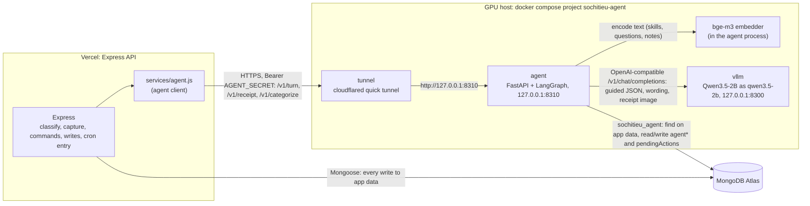

- **Only the agent service is on the tunnel.** vLLM listens on the host's loopback only and has no route from outside the GPU host.
- **Express never talks to vLLM**, and the agent service never talks to the chat platforms. Express downloads photos and sends every reply.

### Endpoints

All `POST` with JSON and `Authorization: Bearer ${AGENT_SECRET}`, except `/health`. Time budgets: 25 s in chat, 40 s on the web, 60 s for receipts, 3 s for a category.

| Endpoint | Request | Response |
|---|---|---|
| `/v1/turn` | `{trigger: chat\|confirm\|schedule\|event, userId, channel, threadKey, requestId, text?, actionId?, skill?, language, today}` | `{route: rules\|agent, text, facts[], sources[], action?, followups[], card?, steps[], timingsMs}` |
| `/v1/receipt` | `{userId, image (base64, or a short-lived URL Express fetched from the platform), mime}` | `{total, merchant, date, items[], currency, confidence, reconciliation, model, ms}` or `{error: NO_TOTAL\|UNREADABLE}` |
| `/v1/categorize` | `{userId, note, merchant?, items?}` | `{categoryId, score, method: embedding\|llm, alternatives[2]}` |
| `GET /health` | none (no auth, no data) | `{vllm: ok\|down, embedder: ok, model, gpuFreeMb}` |

`today` is the local date in Asia/Ho_Chi_Minh. Beyond 8 requests in vLLM (`--max-num-seqs 8`) the agent service queues at most 16; the next one gets 503 `AGENT_BUSY`.

### The graph

One compiled LangGraph `StateGraph`, after the reference repo's `copilot_graph`. The trigger picks the path after `load_context`.

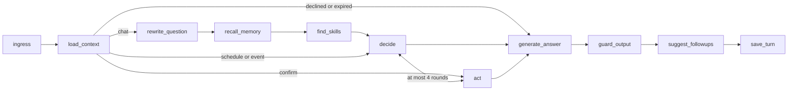

| Node | LLM? | What it does |
|---|---|---|
| `ingress` | no | Input guard: length ≤ 500, strips control characters, checks the daily cap and the runtime switch |
| `load_context` | no | User, language, categories, wallets; the last 6 turns of this thread (`agentTurns`, short-term memory); a pending action when the message confirms or declines one |
| `rewrite_question` | rules first, LLM only for a follow-up | Links words to the user's categories and wallets (accent-folded lexicon), resolves dates with `period.py` (same rules as §2.11.3: "hôm qua", "tuần trước" Mon–Sun, "tháng 10", "20/11"), and turns a follow-up ("còn tháng trước?") into a standalone question |
| `recall_memory` | no | Embeds the standalone question once; reads the user's long-term memory rows (`agentMemory`) by cosine ≥ 0.6 |
| `find_skills` | no | Hybrid search (lexical triggers + vector, RRF) over enabled skills; returns the top 3 with scores; `retrieval: direct` (one clear winner: score gap ≥ 0.15 or an exact trigger), `choose`, or `none` |
| `decide` | only for `choose` and for agent-mode skills | Picks the skill among the top 3 and fills the tool arguments as **guided JSON** (vLLM structured outputs; enums = the user's category and wallet ids, the skill's allowed periods). A pipeline skill needs no LLM |
| `act` | no (the LLM only inside `read_receipt`) | Runs the tool calls: preset arguments over LLM arguments → pydantic validation → handler with a timeout; at most `max_steps` (4) rounds of decide ⇄ act. A write tool only creates a `pendingActions` proposal |
| `generate_answer` | template, or LLM wording | Templates for cards, no data, failures and every pipeline skill; the LLM only phrases agent-mode answers, writing `[[factId]]` placeholders that our code fills |
| `guard_output` | no | Every digit, number word and verdict word must come from the facts; no ids, JSON, URLs or emails; no claim of a change that did not happen. A failure → the template answer |
| `suggest_followups` | no | The skill's `followups` (2–3 chips) |
| `save_turn` | no | One `agentTurns` row with the steps, timings and tool calls |

**Two small graphs** in the same service, with no chat state:

- `receipt_graph`: `ingress → read_receipt (VLM, guided JSON) → check_total → reconcile → save_turn`. `check_total` applies §2.6's "payable total only" rules in code (§1.3).
- `categorize_graph`: `embed_note → nearest_category → (tie) llm_choose → save_turn`. A tie is a top-2 gap within 0.05; `llm_choose` picks from the user's own category ids only.

**Prompts:** one system prompt per node in `agent/prompts/` (vi and en), non-thinking mode. Temperature 0.2 for `decide` and `llm_choose`; 0.7 with top_p 0.8 for `read_receipt` and wording (the model card's settings for vision-language use); `max_tokens` 512 (1024 for receipts).

### Skills

Skill registry: the `agentSkills` collection, seeded from `agent/skills/*.yaml` and synced when the service starts. System skills have `userId: null`. A **pipeline** skill runs fixed tools and a template, with no LLM. An **agent** skill lets `decide` choose tools.

| Skill | Mode | Triggers | Tools (in order) | Example |
|---|---|---|---|---|
| `thu_chi_ky` | pipeline | chat | `get_period_summary` | "hôm nay tiêu bao nhiêu?" |
| `tong_ket_tuan` | pipeline | chat, schedule (Sun) | `get_period_summary`, `get_category_totals`, `get_budget_pace` | "tổng kết tuần trước", `/tuan` |
| `tong_ket_thang` | pipeline | chat, schedule (day 1) | `get_period_summary`, `get_category_totals`, `get_budgets`, `suggest_budgets` | "tổng kết tháng 10", `/thang` |
| `chi_theo_danh_muc` | pipeline | chat | `get_category_totals` | "tháng này ăn uống hết bao nhiêu?" |
| `so_sanh_ky` | pipeline | chat | `compare_periods` | "tháng này so với tháng trước?" |
| `top_khoan_chi` | pipeline | chat | `list_transactions` | "5 khoản chi lớn nhất tuần trước" |
| `so_du_vi` | pipeline | chat | `get_wallet_balances` | "momo còn bao nhiêu?" |
| `ngan_sach_con_lai` | pipeline | chat | `get_budgets`, `get_budget_pace` | "ngân sách ăn uống còn bao nhiêu" |
| `du_bao_cuoi_thang` | pipeline | chat, schedule | `get_budget_pace` | `/dubao` |
| `giai_thich_tang_chi` | pipeline | chat | `compare_periods`, `find_unusual`, `pick_tip` | `/visao` |
| `tim_giao_dich` | pipeline | chat | `search_transactions` | "đã mua gì ở Circle K tháng này" |
| `hoi_tu_do` | agent | chat | any read tool + `query_transactions`, ≤ 4 steps | a question no pipeline skill fits |
| `de_xuat_thao_tac` | agent | chat | read tools + `propose_action` | "đặt ngân sách ăn uống 3 triệu" |
| `ban_tin_toi` | pipeline | schedule (20:00) | `get_period_summary`, `list_drafts`, `get_budget_pace`, `get_streak` | B1 digest |

### Tools

Tool registry: the `agentTools` collection, from the handlers in `agent/tools/`. Every tool is read-only unless marked. Every query a tool runs starts with `{userId}` from the request context.

| Tool | Side effect | Arguments (LLM-visible) | Reads collections |
|---|---|---|---|
| `get_period_summary` | read | `start`, `end` (local days) | `transactions` (confirmed, not deleted) |
| `get_category_totals` | read | `start`, `end`, `type`, `categoryIds?`, `top?` | `transactions`, `categories` |
| `compare_periods` | read | `start`, `end`, `categoryIds?` (previous period = the same days one unit back, §2.11.3) | `transactions`, `categories` |
| `list_transactions` | read | `start`, `end`, `type?`, `categoryIds?`, `walletIds?`, `order`, `limit ≤ 20` | `transactions`, `categories`, `wallets` |
| `search_transactions` | read | `text`, `start`, `end`, `limit ≤ 20` (accent-folded on `note`, `receipt.merchant`) | `transactions` |
| `query_transactions` | read | the typed query (IR) of §2.11.3: `measure`, `filters`, `groupBy`, `period`, `order`, `limit`; compiled by our code to a MongoDB aggregation (never raw MongoDB from the model) | `transactions`, `categories`, `wallets` |
| `get_wallet_balances` | read | `walletIds?` | `wallets`, `transactions` |
| `get_budgets` | read | `month`, `categoryIds?` | `budgets`, `transactions`, `categories` |
| `get_budget_pace` | read | `month`, `categoryIds?` | `budgets`, `transactions` |
| `suggest_budgets` | read | `month` (median of the last 3 months, rounded up to 50.000 ₫) | `transactions`, `budgets` |
| `find_unusual` | read | `start`, `end` (> 3× the category's 90-day median) | `transactions` |
| `pick_tip` | read | none (numbered rules R2, R3, R5) | `transactions`, `budgets` |
| `list_drafts` | read | none | `transactions` (status draft) |
| `get_streak` | read | none | `transactions` |
| `propose_action` | **write-proposal** | `kind` ∈ set_budget, copy_budgets, delete_transaction; `args` | writes `pendingActions` only |
| `read_receipt` | read | (the image comes from the request, not the LLM) | none (vLLM) |
| `suggest_category` | read | `note`, `merchant?` | `categories`, `agentCategoryVectors`, `agentMemory` |
| `remember` | write (agent*) | `fact` (e.g. "cafe → Ăn uống"), only after a confirmed A7 tap | `agentMemory` |

### Embedding space

One model, `BAAI/bge-m3` (1024 dimensions, normalised, cosine). Vectors live in MongoDB documents and are searched in memory in the agent service. Ranking is hybrid: lexical (accent-folded keyword and trigger match) plus vector cosine, fused with reciprocal-rank fusion (RRF, k = 60).

| What is embedded | Text | Stored in | Searched by |
|---|---|---|---|
| Skills | `labelVi`, `labelEn`, description, examples, triggers | `agentSkills.embedding` (1024 floats) + `embedHash` | `find_skills` |
| Tool descriptions | name + description | `agentTools.embedding` | `decide` (agent mode: offer the 6 closest tools) |
| User categories | name + keywords (vi, accent-folded) | `agentCategoryVectors` `{userId, categoryId, embedding, embedHash}` | `suggest_category` |
| Long-term memory | short facts the user confirmed ("cafe → Ăn uống", "ví chính là MoMo") | `agentMemory.embedding` | `recall_memory`, `suggest_category` |

Re-embedding: a row whose `embedHash` (SHA-256 of its text) changed is re-embedded on the next start or the next read; nothing else. Collection fields are in [03-database.md](03-database.md).

### Trust boundaries

- **What reaches the model.** The standalone question, the names and ids of this user's categories and wallets (as enums), the facts the tools returned (for agent-mode wording), a receipt image, and a draft's note for a category tie. Never the user's id, name, email, phone, chat names or chat ids, and never a token. All of it stays on the GPU host: nothing goes to a third-party model.
- **The model cannot choose whose data it reads.** `FORBIDDEN_ARGS` in the tool registry (`userId`, `token`, `query`) are never in a tool's LLM-visible schema and are dropped if the model sends them. Every tool closes over `userId` from the request context, and preset arguments win over LLM arguments.
- **The model cannot write numbers.** `generate_answer` writes `[[factId]]` placeholders that our code fills; `guard_output` rejects any digit, number word or verdict word not in the facts and falls back to the template.
- **The agent service cannot change money data or read password hashes.** Its MongoDB user `sochitieu_agent` has a custom role (`agent/role.json`): `find` on `usersForAgent`, a view on `users` that projects only `_id`, `language` and `assistantOn`, and on `categories`, `wallets`, `transactions`, `budgets`; `find`/`insert`/`update` on `pendingActions`; `find`/`insert`/`update`/`remove` on `agentSkills`, `agentTools`, `agentTurns`, `agentMemory`, `agentCategoryVectors`, `receiptReads`. It has **no right on `users`** (a role cannot limit fields, so `find` on `users` would expose every hash; decision D15) and no index or collection right (D14): `python -m agent.setup`, run with the app user, creates them. Writes to app data happen only in Express, through the same services as the web, after the user's confirm where §2.11 requires one.
- **Express ↔ agent service.** Server-to-server only, `Authorization: Bearer ${AGENT_SECRET}` compared in constant time; the browser and the chat apps never call the agent service. The tunnel exposes the agent's port only; `GET /health` answers without auth and returns no user data.
- **Logs** on both sides carry the request id, node, timing and error class, never the question, notes, figures, tool arguments or the image. `agentTurns` keeps the turn for 30 days (TTL) for caps and debugging; admins never see it.
