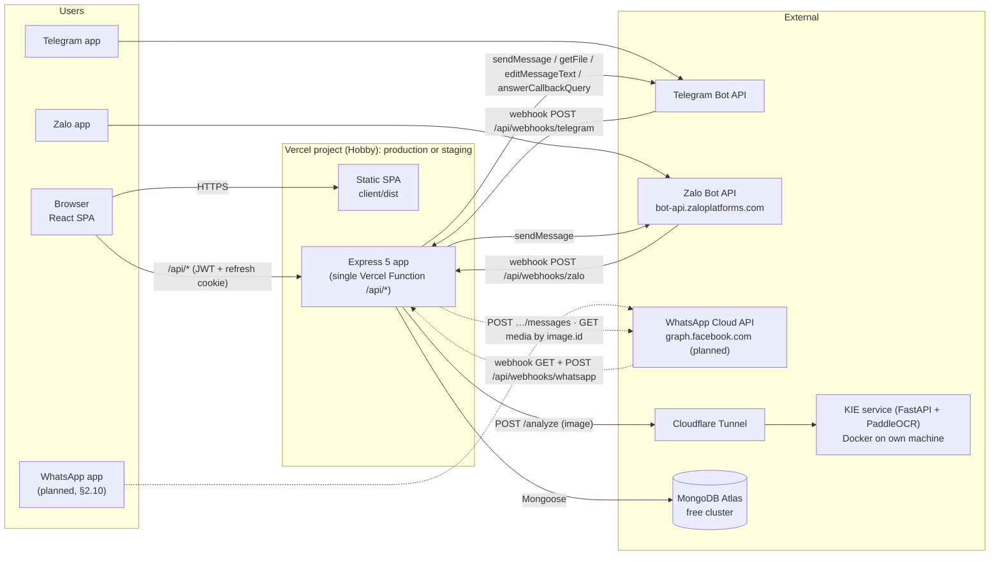
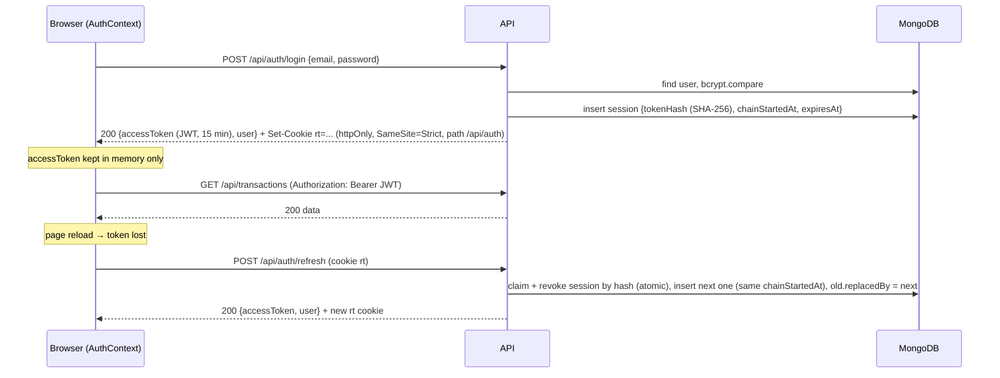
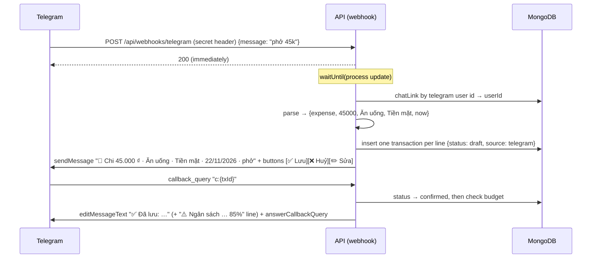
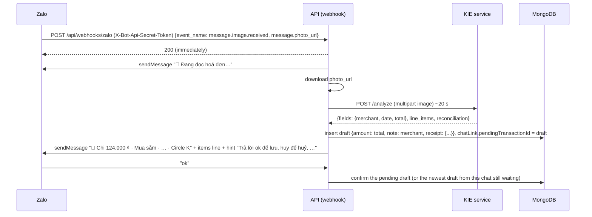
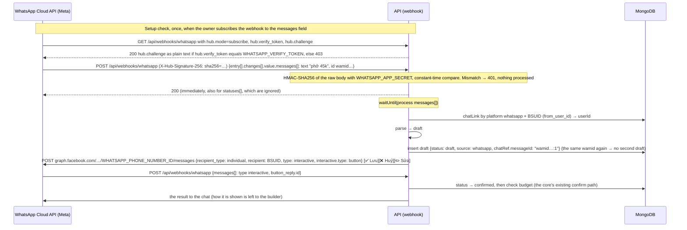
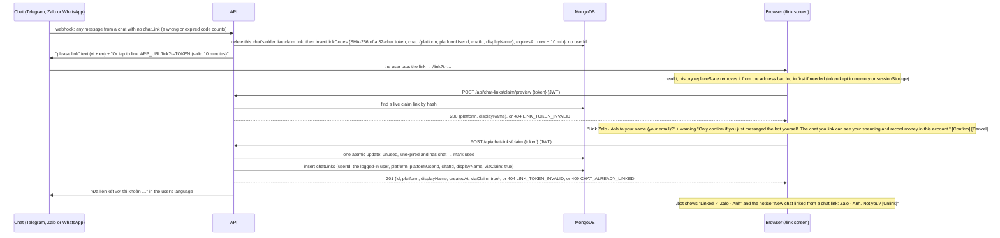

# 1. Architecture & Tech Stack

## 1.1 Overview

The system has **three runtime pieces**:

1. **Vercel: one project per environment.** Production (`sochitieu-btl`) and staging (`sochitieu-btl-staging`, database `finance_staging`) are built from the same repo. Each serves the React SPA as static files and the Express API as a single Vercel Function under `/api/*`, so the web app and the API share one origin and the refresh-token cookie works without CORS or third-party cookies. The projects are not Git-connected: `tools/deploy.sh staging|production` deploys the current checkout with the Vercel CLI.
2. **MongoDB Atlas free cluster.** It holds all application data.
3. **KIE service (Python, Docker).** It reads receipt photos. It cannot run on Vercel (PaddleOCR needs a large bundle and about 20 s of CPU per image), so it runs on a machine with Docker and is exposed over HTTPS with a Cloudflare Tunnel.

Telegram and Zalo push messages to **webhooks** on the same Vercel API.

**Planned ([§2.10](02-features.md#210-one-tap-linking-and-whatsapp-planned), not built yet):** WhatsApp joins as a third chat app through **Meta's WhatsApp Cloud API**, with the same webhook pattern and bot core as Telegram and Zalo. Dashed lines in the diagram are planned. Every part of this document marked "planned" describes a change against today's code, not something that exists. Each build PR updates the planned sections in the docs its card's Scope lists; where a card's Scope doesn't list them (T32), the orchestrator opens a docs-only follow-up PR after the merge.



## 1.2 Components

| Component | Responsibility | Notes |
|---|---|---|
| **SPA (client/)** | All screens in **TypeScript**: quick-add box and full forms for typing transactions on the web, Bot inbox (link code + QR, drafts from the bots, receipt photo upload via `POST /api/receipts`), i18n (vi/en), light/dark theme, charts | Built by Vite into static files and served from Vercel's CDN |
| **API (server/)** | REST API, auth, validation, statistics, bot logic, KIE client | One Express app exported for Vercel; also runs locally with `node` |
| **Bot core (server/src/bot/)** | Platform-independent: parse text → draft → confirm, plus commands | Telegram and Zalo are thin **adapters** that send and receive messages |
| **WhatsApp adapter (planned, §2.10.4)** | Maps WhatsApp Cloud API webhook payloads to bot core messages and button presses; sends text and reply-button messages through the Graph API | A third adapter beside Telegram and Zalo, same bot core. File name and layout are left to the builder |
| **Chat linking (planned changes, §2.10.2–2.10.3)** | Website side: the link card gets one button per app from `links: { telegram, whatsapp, zalo }`. Chat side: the bot hands an unlinked chat a claim link, confirmed on the new `/link` screen, and the Bot inbox then shows a "Not you? [Unlink]" notice for that link until dismissed | Website codes and claim links share the `linkCodes` collection (exactly one of `userId` or `chat` per row) |
| **Text parser** | Rule-based Vietnamese/English parsing of `phở 45k`, `+lương 15tr`, `grab 32k hôm qua` | **No AI fallback**: if nothing parses, the bot replies with usage help |
| **KIE client** | Sends an image to the KIE service and maps its result to a draft transaction | 120 s timeout. When it fails, the bot asks the user to type the amount |
| **KIE service** | OpenCV preprocessing → PaddleOCR → spatial KIE → line items → total reconciliation | We only call `POST /analyze`, which saves nothing. Its own SQLite and UI are unused |
| **MongoDB Atlas** | Users, sessions, wallets, categories, transactions, budgets, chat links, link codes | See [03-database.md](03-database.md) |

## 1.3 Request flows

### Web login and silent refresh



- **Reuse of a rotated token:** within 30 s of its rotation (`REUSE_GRACE_MS`), when the replacement was never used, the API revokes the replacement and rotates again (the browser most likely lost the answer). Otherwise it revokes every session of that user and answers 401. Two cases come first and revoke nothing: a locked account gets 403 `ACCOUNT_LOCKED`, and a token that was never rotated (expired, or revoked by a logout) just gets 401.
- **Logout** revokes this device's whole rotation chain (`chainEndedAt`), so a refresh running in another tab at the same moment cannot keep it logged in.
- **Tabs:** in `client/src/auth/session.ts`, calls in one tab share one running refresh, and a Web Lock (`auth-refresh`) makes tabs take turns, so the second tab sends the already-rotated cookie.

### Telegram text message → draft → confirm



The ✏️ button is a URL button to `<APP_URL>/bot` and is only added when `APP_URL` is `https://`. The budget line is only added when the category or overall budget for that month is at least 80 % used (🚨 at 100 %). Reply texts are in `server/src/bot/messages.vi.js` / `messages.en.js`.

### Zalo receipt photo → KIE → draft



Zalo has no buttons: a typed `ok` / `huy` acts on `chatLink.pendingTransactionId` while it is still a draft, else on the newest waiting draft from that chat. A reply that is only an amount (`55k`) corrects that draft's amount and sends it again.

### WhatsApp message → draft → confirm (planned, §2.10.4)

Not built yet. The flow is the Telegram one above with Meta's payloads, and a signature check in place of the shared secret.



What changes against today's webhooks (`server/src/routes/webhooks.js`):

- **A signature instead of a shared secret.** `/telegram` and `/zalo` compare a header with a secret the API chose (`sameSecret`, constant time). Meta signs each delivery instead: `X-Hub-Signature-256: sha256=<hex HMAC-SHA256 of the raw body with WHATSAPP_APP_SECRET>`, also compared in constant time. A mismatch answers 401 and nothing is processed.
- **The raw body, kept by the global parser.** Today `server/src/app.js` runs `express.json({ limit: '1mb' })` for every route ahead of `/api`, so a route only sees the parsed object, and re-serialising `req.body` does not give back the bytes Meta signed. §2.10.4 changes that one line to `express.json({ limit, verify: (req, res, buf) => { if (req.originalUrl.startsWith('/api/webhooks/whatsapp')) req.rawBody = buf } })`, and the route computes the HMAC over `req.rawBody`. Every other route parses as before.
- **A `GET` setup check.** Telegram and Zalo are registered by `server/src/scripts/setWebhooks.js` and have no `GET` route. WhatsApp's `GET` answers Meta's verify-token check shown above.
- **200 first, work in `waitUntil`.** Unchanged pattern. `entry[].changes[].value.messages[]` are handled; `statuses[]` (sent/delivered/read) are ignored; both get 200 so Meta doesn't retry.
- **No second draft for a second delivery.** The message `id` (`wamid…`) goes into `chatRef.messageId`, like Telegram's and Zalo's `message_id` today, so the unique `chatRef` index on `transactions` (`platform`, `chatId`, `messageId`) stops the copy. Only drafts are deduplicated: as on the other platforms, a redelivered command may be answered twice.
- **Every closed list of platforms gains `whatsapp` (§2.10.5).** The Mongoose enums `chatLinks.platform`, `transactions.source` and `transactions.chatRef.platform` (without the last, every WhatsApp draft fails validation, so the dedup above never runs), the zod `source` filter in `server/src/routes/transactions.js`, and the platform/source lists of the admin stats in `server/src/services/admin.js`.
- **Mapping into the core.** `platformUserId` and `chatId` are the user's **business-scoped user ID** (BSUID: `from_user_id` on the message, `user_id` on the contact). Meta omits `from` (the phone number) for users who adopted a WhatsApp username, so the phone number is never the key and is never stored. `value.contacts[0].profile.name` is `displayName`; `text.body` is the text; an `image.id` is the photo; a `button_reply.id` is a button press into the core's `handleButton`, carrying the same action and draft id as Telegram's `c:<id>` / `x:<id>` callback data. Other message types get the help text.
- **Buttons.** ✅ Lưu, ❌ Huỷ and ✏️ Sửa use all three reply buttons WhatsApp allows. ✏️ Sửa is a reply button, not a URL button as in Telegram, so pressing it makes the bot reply with `<APP_URL>/bot`.
- **Receipts.** `GET /<image.id>` with `WHATSAPP_ACCESS_TOKEN` returns a `url` valid for 5 minutes; the adapter downloads it with the same token and passes it to KIE as for the other platforms.
- **Sending.** `POST https://graph.facebook.com/<version>/<WHATSAPP_PHONE_NUMBER_ID>/messages` with `messaging_product: "whatsapp"`, `recipient_type: "individual"` and `recipient: <BSUID>` (no `to`: Meta reserves `to` for phone numbers, and BSUIDs go in `recipient`). The Graph API version is one constant in the adapter. Replies longer than 4096 characters are split.

### Linking from the website: link card (planned, §2.10.2)

Not built yet. Today `POST /api/chat-links/code` returns `{ code, expiresAt, telegramDeepLink }` (`createLinkCode` in `server/src/services/chatLinks.js`), and Zalo users type `/link CODE` by hand. Planned: it returns `{ code, expiresAt, links: { telegram, whatsapp, zalo } }`, each a URL or `null`, and the client changes in the same PR.

| App | Link | How the code reaches the bot |
|---|---|---|
| Telegram | `https://t.me/<bot>?start=<CODE>` (as today) | The bot receives `/start <CODE>` after the user taps Start |
| WhatsApp | `https://wa.me/<WHATSAPP_NUMBER>?text=%2Flink%20<CODE>` | The chat opens with `/link CODE` typed; the user taps Send |
| Zalo | `ZALO_BOT_URL` (Zalo bot links carry no payload) | The card copies `/link CODE` to the clipboard first; the user pastes and sends |

The bot side does not change: every app delivers an ordinary `/start CODE` or `/link CODE` message, which `redeemLinkCode` already handles. An app whose settings are missing gets `null` and is hidden in the card.

### Linking from the chat: claim link → `/link` → Confirm (planned, §2.10.3)

Not built yet. Today an unlinked chat only gets the "please link" text, a wrong or expired code gets the "invalid code" text, and nothing is stored for an unlinked chat (`handleMessage` in `server/src/bot/core.js`).



What changes against today:

- **The bot stores something for an unlinked chat.** The claim link is a random 32-character base64url token (24 bytes), valid 10 minutes, single use, kept only as its SHA-256 in `linkCodes` with the `chat` sub-document. An older live claim link for the same chat is deleted first, so a chat has at most one. The existing TTL index on `expiresAt` removes the row.
- **`linkCodes` holds two kinds of row.** `userId` becomes optional and exactly one of `userId` (a code made on the website) or `chat` (a claim link made by the bot) is set. Redeeming in the chat (`/link CODE`, `redeemLinkCode`) only matches rows with `userId`; claiming on the website only matches rows with `chat`, so neither works in the other's place.
- **Same claim pattern as codes.** Checking unused + unexpired and marking used is one atomic update, as `redeemLinkCode` does today. If the chat was linked meanwhile, the unique `chatLinks` index on (`platform`, `platformUserId`) refuses the new row: 409 `CHAT_ALREADY_LINKED`, and the token stays spent.
- **The token stays out of URLs the server logs.** Both endpoints need login and take the token in the body. In the SPA, `ProtectedRoute` today redirects to `/login` before the page's code runs and keeps `pathname + search` as the return path, so behind it `?t=` would travel through the login page and back. `/link` therefore sits outside `<ProtectedRoute>` and removes `t` itself before sending the user to log in ([05-frontend.md §5.9.2](05-frontend.md#592-link-screen-planned-2103)); route layout is otherwise left to the builder.
- **The bot speaks from a web request.** After a claim, the API sends the success text to the chat through the adapter for `chat.platform`. Today the bot only sends messages while handling a webhook; this is the first web route that makes it talk. Whether that send is awaited or put in `waitUntil` is left to the builder.
- **Confirm, not auto-link, and a notice afterwards.** See §1.6 for the threat. `chatLinks` gains `viaClaim` (boolean, default `false`; `true` for a link made by a claim link) and `claimNoticeDismissedAt` (date or `null`), both returned by `GET /api/chat-links`. The Bot inbox shows "New chat linked from a chat link: **Zalo · Anh**. Not you? [Unlink]" for every link with `viaClaim && !claimNoticeDismissedAt`; Unlink uses today's `DELETE /api/chat-links/:id`, and dismissing calls the new `PATCH /api/chat-links/:id/claim-notice` (own links only, no body → 204; 404 for another user's or an unknown id), which sets `claimNoticeDismissedAt = now`.

## 1.4 Tech stack

Versions are pinned exactly in the `package.json` files (root, `client/`, `server/`); this table follows them.

### Frontend (`client/`)

| Concern | Choice | Version | Why |
|---|---|---|---|
| Language | **TypeScript** (`strict: true`) | 6.0.3 | Typed components, store and API responses; `tsc --noEmit` runs on every build |
| UI library | React (+ `@types/react`, `@types/react-dom`) | 19.3.1 (types 19.3.0) | Required by the slides |
| Build tool | Vite | 8.3.8 | Required; fast dev server with `/api` proxy |
| Routing | React Router | 8.5.2 | Required |
| Global state + data fetching | Redux Toolkit (RTK Query) + react-redux | 2.15.0 / 9.3.1 | Required (Redux Toolkit); RTK Query gives caching and refetch-on-change for free |
| Auth state | React Context (`AuthContext`) | — | Required ("Context cho đăng nhập") |
| Components & theming | MUI (Material UI) + icons | 9.5.0 | Responsive grid and drawer, built-in light/dark palettes |
| Icons | lucide-react | 1.66.0 | Line icons, imported one file each (`components/icons.ts`) |
| Font | @fontsource/be-vietnam-pro | 5.3.0 | Self-hosted Be Vietnam Pro (Vietnamese glyphs), no font CDN |
| i18n | i18next + react-i18next + browser language detector | 27.2.2 / 18.0.3 / 8.3.1 | vi/en UI strings, plus number and date formatting |
| Charts | Recharts | 3.11.0 | Bar chart (this month vs last month, weekly columns); the category breakdown is a ranked list |

### Backend (`server/`)

| Concern | Choice | Version | Why |
|---|---|---|---|
| Runtime | Node.js | 22 LTS | Vercel default family; built-in `fetch`, `FormData`, `Blob` |
| Web framework | Express | 5.3.0 | Required; zero-config on Vercel; async errors reach the error middleware |
| ODM | Mongoose | 9.12.2 | Required |
| JWT | jsonwebtoken | 9.0.3 | Access tokens (HS256) |
| Password hashing | bcryptjs | 3.0.3 | Pure JS, so there is no native build step on Vercel |
| Validation | zod | 4.6.7 | One schema per request body or query |
| Cookies | cookie-parser | 1.4.7 | Reads the refresh-token cookie |
| Security headers | helmet | 8.3.0 | Sensible defaults |
| Rate limiting | express-rate-limit | 8.7.5 | Login and register brute-force guard (per instance, see backend doc) |
| Vercel helpers | @vercel/functions | 3.11.3 | `waitUntil` (finish bot work after replying 200), `attachDatabasePool` |
| Telegram / Zalo | plain `fetch` (no SDK) | — | Both are small HTTP APIs (Telegram: `sendMessage`, `getFile`, `editMessageText`, `answerCallbackQuery`; Zalo: `sendMessage`); about 50 to 70 lines each, so nothing extra to explain at the defense |
| WhatsApp (planned, §2.10) | Meta's WhatsApp Cloud API, called directly | Graph API version pinned at build time | One more adapter behind the same bot core and webhook pattern; no provider such as Twilio, no unofficial library. Calls: `POST /<WHATSAPP_PHONE_NUMBER_ID>/messages` (text and reply buttons), `GET /<image.id>` then the media download |

### Data and infra

| Concern | Choice |
|---|---|
| Database | MongoDB Atlas free cluster (512 MB) |
| Hosting (web + API) | Vercel Hobby (free): two projects, production and staging, deployed by `tools/deploy.sh` |
| Receipt service | Document-Intelligence-KIE: Python 3.10, FastAPI, PaddleOCR 3.x, OpenCV, in Docker |
| Public URL for KIE | Cloudflare Tunnel (`cloudflared`; already installed on the dev server) |
| WhatsApp number (planned, §2.10.1) | A Meta app with the WhatsApp use case, a Meta business portfolio, a phone number not already on WhatsApp, an approved display name, a permanent (system user) access token, and a payment method once past the free replies |

## 1.5 Repository layout

```text
Zalo-Tele-intergrated-financial-apps/
├── api/
│   └── index.js            # Vercel Function entry: export default app from server/src/app.js
├── client/                 # React + Vite SPA, TypeScript
│   ├── src/
│   │   ├── app/            # store.ts, hooks.ts (typed useAppDispatch/useAppSelector), api.ts (RTK Query), uiSlice.ts
│   │   ├── auth/           # AuthContext.tsx, session.ts (token + shared refresh), useAuth.ts, usersApi.ts, ProtectedRoute.tsx, AdminRoute.tsx
│   │   ├── components/     # AppLayout, QuickAdd, MoneyText, ThemeToggle, LanguageSwitch, ... (.tsx)
│   │   ├── features/       # auth/, dashboard/, transactions/, wallets/, categories/, budgets/, bot/, settings/, admin/, notFound/
│   │   ├── types/          # api.ts: request/response types matching docs/04-backend.md
│   │   ├── i18n/           # index.ts, format.ts, errors.ts; vi/ and en/ with one JSON file per namespace
│   │   ├── theme/          # theme.ts (light/dark palettes), AppThemeProvider.tsx
│   │   └── main.tsx
│   ├── e2e/                # Playwright tests (TypeScript; run from the root playwright.config.ts)
│   ├── tsconfig.json       # strict
│   └── vite.config.ts      # dev server on VITE_PORT (default 5300), proxy /api → localhost:PORT (default 4100); Vitest config
├── server/
│   ├── src/
│   │   ├── app.js          # builds the Express app (no listen)
│   │   ├── local.js        # app.listen(env.PORT) for local dev (default 4100)
│   │   ├── config/         # env.js (validated with zod), db.js (cached Mongoose connection)
│   │   ├── models/         # User, Session, Wallet, Category, Transaction, Budget, ChatLink, LinkCode
│   │   ├── middleware/     # auth.js, requireRole.js, connectDb.js, rateLimit.js, requestId.js, error.js, notFound.js
│   │   ├── routes/         # one router per resource; request bodies are parsed with zod inline (no controllers/)
│   │   ├── services/       # admin, auth, budgets, categories, chatLinks, receipts (KIE client), sessions, stats, transactions, users, wallets
│   │   ├── bot/            # core.js, parser.js, messages.{vi,en}.js, telegram.js, zalo.js
│   │   ├── utils/          # AppError.js, normalize.js, vnTime.js
│   │   ├── scripts/        # setWebhooks.js: points both bots at a deployed URL
│   │   └── seed/           # default categories, first admin
│   ├── test/               # Vitest + supertest + mongodb-memory-server; fixtures/, helpers/
│   └── vitest.config.js
├── docs/                   # this specification
│   └── testing/            # test-cases.json, bugs.json, runs.json, results.json, bot-e2e.md, test-report.xlsx
├── tools/
│   ├── deploy.sh           # deploy the checkout to staging or production (pinned Vercel CLI)
│   ├── vercel-env-push.sh  # copy server/.env into a Vercel project's env vars (values never printed)
│   ├── set-secret.sh       # paste a secret into server/.env without showing it, then push it
│   ├── wt-env.sh           # per-worktree ports and dev database
│   ├── bot-e2e/            # real-chat bot checker: bot-e2e.mjs, scenarios.json
│   └── test-report/        # build-report.mjs: JSON + test results → Excel
├── .github/workflows/ci.yml # npm ci, typecheck, lint, test on every PR and push to main
├── .claude/agents/         # coder, reviewer, merger agent definitions
├── playwright.config.ts    # e2e: client/e2e against a test API + Vite
├── eslint.config.js
├── treehouse.toml          # worktree pool settings
├── .worktreeinclude        # git-ignored files copied into each worktree (server/.env)
├── .env.example            # the app's variables, no values; tool-only keys (VERCEL_*, PROD_URL, KIE_PUBLIC_URL, ...) are listed in 06-deployment.md §6.3
├── vercel.json             # npm ci, build client, output client/dist, maxDuration 300; rewrites /api/* → api/index.js, SPA fallback
└── package.json            # npm workspaces: client, server
```

Planned (§2.10): a WhatsApp adapter beside the Telegram and Zalo ones, the routes `/api/webhooks/whatsapp`, `POST /api/chat-links/claim/preview`, `POST /api/chat-links/claim` and `PATCH /api/chat-links/:id/claim-notice`, a `/link` screen in the SPA, and the "Not you? [Unlink]" notice in the Bot inbox. File names and component layout are left to the builder. The new variables are `WHATSAPP_ACCESS_TOKEN`, `WHATSAPP_PHONE_NUMBER_ID`, `WHATSAPP_APP_SECRET`, `WHATSAPP_VERIFY_TOKEN`, `WHATSAPP_NUMBER` (international format, digits only, for `wa.me`) and `ZALO_BOT_URL` (the bot's share link from Zalo Bot Creator). A platform with missing settings is skipped by the webhook-registration script and hidden in the link card.

## 1.6 Key decisions

| Decision | Chosen | Rejected | Reason |
|---|---|---|---|
| Hosting shape | One Vercel project per environment (SPA + `/api` function); production and staging are two such projects, deployed by `tools/deploy.sh` | Separate client and API projects | Same origin, so the refresh cookie works with `SameSite=Strict`, no CORS, one deploy per environment |
| Bot updates | Webhooks + `waitUntil` | Long polling | Polling needs an always-on process, which Vercel does not have. Webhooks reply 200 at once and finish the work (KIE ~20 s) inside the 300 s function limit |
| Text understanding | Rule-based parser only | LLM fallback | Your decision: deterministic, free, and fully explainable at the defense |
| Receipt understanding | External KIE service | Running OCR inside the API | PaddleOCR is too heavy for a Vercel Function (250 MB bundle limit, ~20 s CPU per image) |
| Bot SDKs | Plain `fetch` | grammY / Zalo SDKs | A few methods each (four for Telegram, one for Zalo); fewer dependencies to justify |
| Drafts | `transactions.status = 'draft'` | Separate drafts collection | One model and one list UI; confirming a draft is just a status change |
| Money | Integer VND | Float | No rounding errors (same idea as ezBookkeeping's int64 amounts) |
| Deleting | Soft delete (`deletedAt`) | Hard delete | Statistics stay consistent and deletes can be undone (ezBookkeeping uses the same pattern) |
| WhatsApp (planned, §2.10) | Meta's WhatsApp Cloud API directly: one more adapter behind the bot core and the webhook pattern, on Vercel | A provider such as Twilio; unofficial WhatsApp libraries | §2.10 decides this without giving reasons. Ours: webhooks fit the existing `waitUntil` design on Vercel (see "Bot updates"), so the adapter is built the same way as the Telegram and Zalo ones |
| Linking from the chat (planned, §2.10.3) | Claim link + **Confirm** on the website, with a warning, and a "Not you? [Unlink]" notice afterwards | Auto-link: the chat is linked to whoever opens the link | A claim link links the chat that asked for it to whoever opens it, so it can be used for phishing: an attacker messages the bot from their own unlinked chat and sends the claim link to a victim; if the victim confirms, the attacker's chat is linked to the victim's account and can read `/today` and `/month` and create and confirm transactions there. The display name on the confirm screen comes from the chat app and can be faked, so it is not proof. It can't take over the web login. Mitigations: the warning on the confirm screen ("Only confirm if you just messaged the bot yourself…"), the 10-minute single-use token, and the Bot inbox notice "New chat linked from a chat link: … Not you? [Unlink]" until dismissed (`chatLinks.viaClaim`, `claimNoticeDismissedAt`). Linking from the website has no such risk, because the code starts in the logged-in account |
| Claim link storage (planned, §2.10.5) | The existing `linkCodes` collection: a row has exactly one of `userId` (website code) or `chat` (claim link) | A new collection | Keeps the TTL index and hash-only storage; each lookup only matches its own kind, so neither works in the other's place |

## 1.7 What we take from ezBookkeeping

We take ideas only. ezBookkeeping is Go/Vue/SQL; we rebuild in MERN.

| Area | Take | Adapt | Skip |
|---|---|---|---|
| Data model | Wallet (account) / category / transaction split; integer amounts; soft delete | Categories get per-language default names and **keywords** for the bot parser | Tags, templates, transfers, multi-currency, sub-accounts |
| Auth | Sessions stored in the DB (from its `token_record`), so logout and "log out other devices" are real | Implemented as JWT access token + rotating refresh token | Its custom encrypted token format, 2FA, OAuth |
| AI/receipts | The *idea* of "message or photo → draft → user confirms" | Text: rule-based parser. Photo: KIE service | LLM prompts (no AI fallback in this project) |
| Statistics | Monthly totals and by-category breakdown | Done with MongoDB aggregation | Insights explorer |

## 1.8 Chat platform limits (planned, §2.10)

The limits that shape the planned design are listed once, in [§2.10.1](02-features.md#2101-platform-facts-this-design-rests-on) and [06-deployment.md §6.1](06-deployment.md#61-free-tier-facts-checked-2026-11-20): Zalo's free Basic plan (50 users per bot, 3,000 messages a month, which applies today too) and WhatsApp's free replies (1,000 a month per business number) and 24-hour reply window. Two consequences: the bot never writes first, since every reply answers a message that came in by webhook (the claim success message goes out within the claim link's 10 minutes, which start with the user's own message); and a claim link costs no extra message, because it goes in the same reply as the "please link" text (§2.10.3 step 3).
