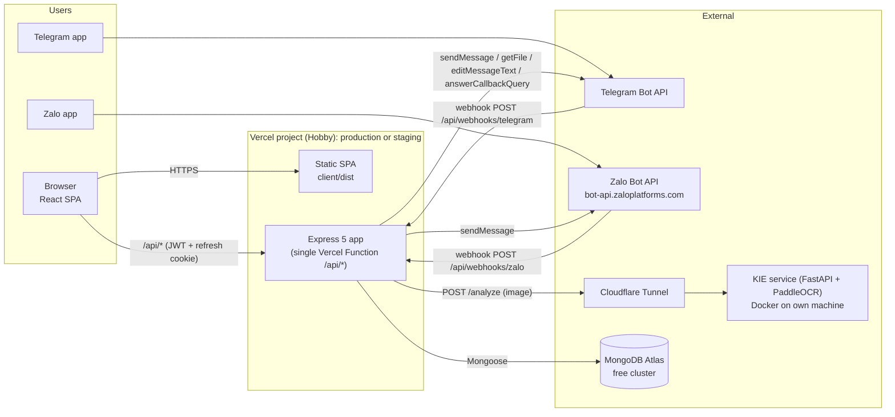
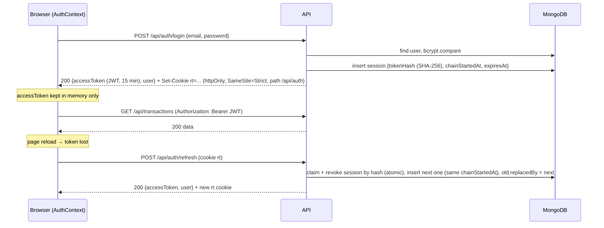
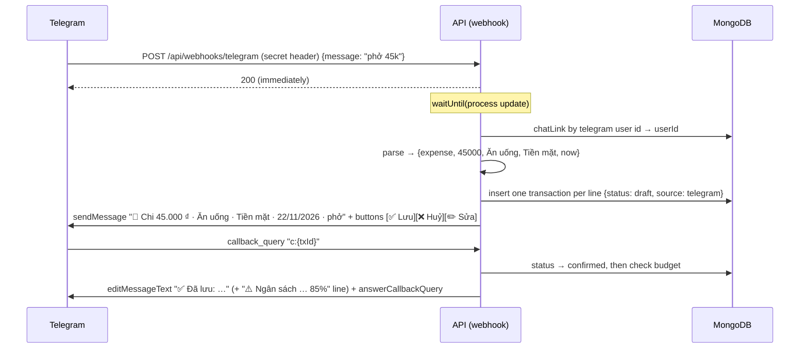
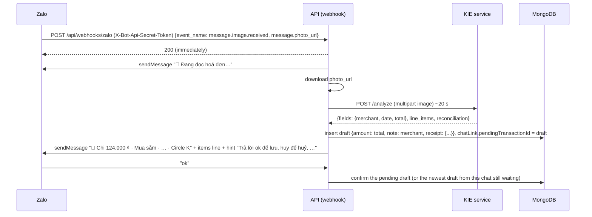

# 1. Architecture & Tech Stack

## 1.1 Overview

The system has **three runtime pieces**:

1. **Vercel: one project per environment.** Production (`sochitieu-btl`) and staging (`sochitieu-btl-staging`, database `finance_staging`) are built from the same repo. Each serves the React SPA as static files and the Express API as a single Vercel Function under `/api/*`, so the web app and the API share one origin and the refresh-token cookie works without CORS or third-party cookies. The projects are not Git-connected: `tools/deploy.sh staging|production` deploys the current checkout with the Vercel CLI.
2. **MongoDB Atlas free cluster.** It holds all application data.
3. **KIE service (Python, Docker).** It reads receipt photos. It cannot run on Vercel (PaddleOCR needs a large bundle and about 20 s of CPU per image), so it runs on a machine with Docker and is exposed over HTTPS with a Cloudflare Tunnel.

Telegram and Zalo push messages to **webhooks** on the same Vercel API.



## 1.2 Components

| Component | Responsibility | Notes |
|---|---|---|
| **SPA (client/)** | All screens in **TypeScript**: quick-add box and full forms for typing transactions on the web, Bot inbox (link code + QR, drafts from the bots, receipt photo upload via `POST /api/receipts`), i18n (vi/en), light/dark theme, charts | Built by Vite into static files and served from Vercel's CDN |
| **API (server/)** | REST API, auth, validation, statistics, bot logic, KIE client | One Express app exported for Vercel; also runs locally with `node` |
| **Bot core (server/src/bot/)** | Platform-independent: parse text → draft → confirm, plus commands | Telegram and Zalo are thin **adapters** that send and receive messages |
| **Text parser** | Rule-based Vietnamese/English parsing of `phở 45k`, `+lương 15tr`, `grab 32k hôm qua` | **No AI fallback**: if nothing parses, the bot replies with usage help |
| **KIE client** | Sends an image to the KIE service and maps its result to a draft transaction | 120 s timeout. When it fails, the bot asks the user to type the amount |
| **KIE service** | OpenCV preprocessing → PaddleOCR → spatial KIE → line items → total reconciliation | We only call `POST /analyze`, which saves nothing. Its own SQLite and UI are unused |
| **MongoDB Atlas** | Users, sessions, wallets, categories, transactions, budgets, chat links, link codes | See [03-database.md](03-database.md) |

## 1.3 Request flows

### Web login and silent refresh



- **Reuse of a rotated token:** within 30 s of its rotation (`REUSE_GRACE_MS`), when the replacement was never used, the API revokes the replacement and rotates again (the browser most likely lost the answer). Otherwise it revokes every session of that user and answers 401. Two cases come first and revoke nothing: a locked account gets 403 `ACCOUNT_LOCKED`, and a token that was never rotated (expired, or revoked by a logout) just gets 401.
- **Logout** revokes this device's whole rotation chain (`chainEndedAt`), so a refresh running in another tab at the same moment cannot keep it logged in.
- **Tabs:** in `client/src/auth/session.ts`, calls in one tab share one running refresh, and a Web Lock (`auth-refresh`) makes tabs take turns, so the second tab sends the already-rotated cookie.

### Telegram text message → draft → confirm



The ✏️ button is a URL button to `<APP_URL>/bot` and is only added when `APP_URL` is `https://`. The budget line is only added when the category or overall budget for that month is at least 80 % used (🚨 at 100 %). Reply texts are in `server/src/bot/messages.vi.js` / `messages.en.js`.

### Zalo receipt photo → KIE → draft



Zalo has no buttons: a typed `ok` / `huy` acts on `chatLink.pendingTransactionId` while it is still a draft, else on the newest waiting draft from that chat. A reply that is only an amount (`55k`) corrects that draft's amount and sends it again.

## 1.4 Tech stack

Versions are pinned exactly in the `package.json` files (root, `client/`, `server/`); this table follows them.

### Frontend (`client/`)

| Concern | Choice | Version | Why |
|---|---|---|---|
| Language | **TypeScript** (`strict: true`) | 6.0.3 | Typed components, store and API responses; `tsc --noEmit` runs on every build |
| UI library | React (+ `@types/react`, `@types/react-dom`) | 19.3.1 (types 19.3.0) | Required by the slides |
| Build tool | Vite | 8.3.8 | Required; fast dev server with `/api` proxy |
| Routing | React Router | 8.5.2 | Required |
| Global state + data fetching | Redux Toolkit (RTK Query) + react-redux | 2.15.0 / 9.3.1 | Required (Redux Toolkit); RTK Query gives caching and refetch-on-change for free |
| Auth state | React Context (`AuthContext`) | — | Required ("Context cho đăng nhập") |
| Components & theming | MUI (Material UI) + icons | 9.5.0 | Responsive grid and drawer, built-in light/dark palettes |
| Icons | lucide-react | 1.66.0 | Line icons, imported one file each (`components/icons.ts`) |
| Font | @fontsource/be-vietnam-pro | 5.3.0 | Self-hosted Be Vietnam Pro (Vietnamese glyphs), no font CDN |
| i18n | i18next + react-i18next + browser language detector | 27.2.2 / 18.0.3 / 8.3.1 | vi/en UI strings, plus number and date formatting |
| Charts | Recharts | 3.11.0 | Bar chart (this month vs last month, weekly columns); the category breakdown is a ranked list |

### Backend (`server/`)

| Concern | Choice | Version | Why |
|---|---|---|---|
| Runtime | Node.js | 22 LTS | Vercel default family; built-in `fetch`, `FormData`, `Blob` |
| Web framework | Express | 5.3.0 | Required; zero-config on Vercel; async errors reach the error middleware |
| ODM | Mongoose | 9.12.2 | Required |
| JWT | jsonwebtoken | 9.0.3 | Access tokens (HS256) |
| Password hashing | bcryptjs | 3.0.3 | Pure JS, so there is no native build step on Vercel |
| Validation | zod | 4.6.7 | One schema per request body or query |
| Cookies | cookie-parser | 1.4.7 | Reads the refresh-token cookie |
| Security headers | helmet | 8.3.0 | Sensible defaults |
| Rate limiting | express-rate-limit | 8.7.5 | Login and register brute-force guard (per instance, see backend doc) |
| Vercel helpers | @vercel/functions | 3.11.3 | `waitUntil` (finish bot work after replying 200), `attachDatabasePool` |
| Telegram / Zalo | plain `fetch` (no SDK) | — | Both are small HTTP APIs (Telegram: `sendMessage`, `getFile`, `editMessageText`, `answerCallbackQuery`; Zalo: `sendMessage`); about 50 to 70 lines each, so nothing extra to explain at the defense |

### Data and infra

| Concern | Choice |
|---|---|
| Database | MongoDB Atlas free cluster (512 MB) |
| Hosting (web + API) | Vercel Hobby (free): two projects, production and staging, deployed by `tools/deploy.sh` |
| Receipt service | Document-Intelligence-KIE: Python 3.10, FastAPI, PaddleOCR 3.x, OpenCV, in Docker |
| Public URL for KIE | Cloudflare Tunnel (`cloudflared`; already installed on the dev server) |

## 1.5 Repository layout

```text
Zalo-Tele-intergrated-financial-apps/
├── api/
│   └── index.js            # Vercel Function entry: export default app from server/src/app.js
├── client/                 # React + Vite SPA, TypeScript
│   ├── src/
│   │   ├── app/            # store.ts, hooks.ts (typed useAppDispatch/useAppSelector), api.ts (RTK Query), uiSlice.ts
│   │   ├── auth/           # AuthContext.tsx, session.ts (token + shared refresh), useAuth.ts, usersApi.ts, ProtectedRoute.tsx, AdminRoute.tsx
│   │   ├── components/     # AppLayout, QuickAdd, MoneyText, ThemeToggle, LanguageSwitch, ... (.tsx)
│   │   ├── features/       # auth/, dashboard/, transactions/, wallets/, categories/, budgets/, bot/, settings/, admin/, notFound/
│   │   ├── types/          # api.ts: request/response types matching docs/04-backend.md
│   │   ├── i18n/           # index.ts, format.ts, errors.ts; vi/ and en/ with one JSON file per namespace
│   │   ├── theme/          # theme.ts (light/dark palettes), AppThemeProvider.tsx
│   │   └── main.tsx
│   ├── e2e/                # Playwright tests (TypeScript; run from the root playwright.config.ts)
│   ├── tsconfig.json       # strict
│   └── vite.config.ts      # dev server on VITE_PORT (default 5300), proxy /api → localhost:PORT (default 4100); Vitest config
├── server/
│   ├── src/
│   │   ├── app.js          # builds the Express app (no listen)
│   │   ├── local.js        # app.listen(env.PORT) for local dev (default 4100)
│   │   ├── config/         # env.js (validated with zod), db.js (cached Mongoose connection)
│   │   ├── models/         # User, Session, Wallet, Category, Transaction, Budget, ChatLink, LinkCode
│   │   ├── middleware/     # auth.js, requireRole.js, connectDb.js, rateLimit.js, requestId.js, error.js, notFound.js
│   │   ├── routes/         # one router per resource; request bodies are parsed with zod inline (no controllers/)
│   │   ├── services/       # admin, auth, budgets, categories, chatLinks, receipts (KIE client), sessions, stats, transactions, users, wallets
│   │   ├── bot/            # core.js, parser.js, messages.{vi,en}.js, telegram.js, zalo.js
│   │   ├── utils/          # AppError.js, normalize.js, vnTime.js
│   │   ├── scripts/        # setWebhooks.js: points both bots at a deployed URL
│   │   └── seed/           # default categories, first admin
│   ├── test/               # Vitest + supertest + mongodb-memory-server; fixtures/, helpers/
│   └── vitest.config.js
├── docs/                   # this specification
│   └── testing/            # test-cases.json, bugs.json, runs.json, results.json, bot-e2e.md, test-report.xlsx
├── tools/
│   ├── deploy.sh           # deploy the checkout to staging or production (pinned Vercel CLI)
│   ├── vercel-env-push.sh  # copy server/.env into a Vercel project's env vars (values never printed)
│   ├── set-secret.sh       # paste a secret into server/.env without showing it, then push it
│   ├── wt-env.sh           # per-worktree ports and dev database
│   ├── bot-e2e/            # real-chat bot checker: bot-e2e.mjs, scenarios.json
│   └── test-report/        # build-report.mjs: JSON + test results → Excel
├── .github/workflows/ci.yml # npm ci, typecheck, lint, test on every PR and push to main
├── .claude/agents/         # coder, reviewer, merger agent definitions
├── playwright.config.ts    # e2e: client/e2e against a test API + Vite
├── eslint.config.js
├── treehouse.toml          # worktree pool settings
├── .worktreeinclude        # git-ignored files copied into each worktree (server/.env)
├── .env.example            # the app's variables, no values; tool-only keys (VERCEL_*, PROD_URL, KIE_PUBLIC_URL, ...) are listed in 06-deployment.md §6.3
├── vercel.json             # npm ci, build client, output client/dist, maxDuration 300; rewrites /api/* → api/index.js, SPA fallback
└── package.json            # npm workspaces: client, server
```

## 1.6 Key decisions

| Decision | Chosen | Rejected | Reason |
|---|---|---|---|
| Hosting shape | One Vercel project per environment (SPA + `/api` function); production and staging are two such projects, deployed by `tools/deploy.sh` | Separate client and API projects | Same origin, so the refresh cookie works with `SameSite=Strict`, no CORS, one deploy per environment |
| Bot updates | Webhooks + `waitUntil` | Long polling | Polling needs an always-on process, which Vercel does not have. Webhooks reply 200 at once and finish the work (KIE ~20 s) inside the 300 s function limit |
| Text understanding | Rule-based parser only | LLM fallback | Your decision: deterministic, free, and fully explainable at the defense |
| Receipt understanding | External KIE service | Running OCR inside the API | PaddleOCR is too heavy for a Vercel Function (250 MB bundle limit, ~20 s CPU per image) |
| Bot SDKs | Plain `fetch` | grammY / Zalo SDKs | A few methods each (four for Telegram, one for Zalo); fewer dependencies to justify |
| Drafts | `transactions.status = 'draft'` | Separate drafts collection | One model and one list UI; confirming a draft is just a status change |
| Money | Integer VND | Float | No rounding errors (same idea as ezBookkeeping's int64 amounts) |
| Deleting | Soft delete (`deletedAt`) | Hard delete | Statistics stay consistent and deletes can be undone (ezBookkeeping uses the same pattern) |

## 1.7 What we take from ezBookkeeping

We take ideas only. ezBookkeeping is Go/Vue/SQL; we rebuild in MERN.

| Area | Take | Adapt | Skip |
|---|---|---|---|
| Data model | Wallet (account) / category / transaction split; integer amounts; soft delete | Categories get per-language default names and **keywords** for the bot parser | Tags, templates, transfers, multi-currency, sub-accounts |
| Auth | Sessions stored in the DB (from its `token_record`), so logout and "log out other devices" are real | Implemented as JWT access token + rotating refresh token | Its custom encrypted token format, 2FA, OAuth |
| AI/receipts | The *idea* of "message or photo → draft → user confirms" | Text: rule-based parser. Photo: KIE service | LLM prompts (no AI fallback in this project) |
| Statistics | Monthly totals and by-category breakdown | Done with MongoDB aggregation | Insights explorer |
