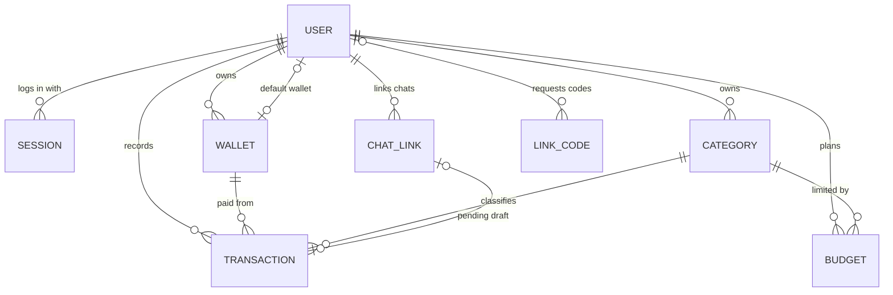

# 3. Database (MongoDB Atlas + Mongoose)

## 3.1 Rules that apply to every collection

- **Ownership:** every user-owned document has `userId` (ref `User`). Every query filters by the `userId` from the JWT.
- **Money:** integer **VND** (`Number`, validated `Number.isSafeInteger`, `> 0` for amounts). One value (amount, opening balance, budget limit) is at most **10^13 ₫** (±10^13 for an opening balance), so sums of them stay below 2^53 and exact. The models check the ceiling for `transactions.amount` and `wallets.initialBalance`; for `budgets.limit` only the route (zod) checks it. No floats, no currency field.
- **Soft delete:** `wallets`, `categories` and `transactions` have `deletedAt: Date | null`. Normal queries add `deletedAt: null`, and "delete" sets the date (as in ezBookkeeping). `budgets` and `chatLinks` are deleted for real; `sessions` and `linkCodes` are removed by their TTL index.
- **Timestamps:** `timestamps: true` on all schemas (`createdAt`, `updatedAt`).
- **IDs:** MongoDB `ObjectId`.
- **Time zone:** dates are stored in UTC. Day and month boundaries are computed in `Asia/Ho_Chi_Minh` (UTC+7) for statistics and budgets.

## 3.2 Relationships

8 collections. The slides require at least 3 with relations.

A `linkCodes` row belongs to one user (a code made on the website) or to none (a claim link made by the bot for a chat that is not linked yet).

*Planned (§2.11, see §3.7):* ten new collections. `agentTurns`, `agentMemory`, `agentCategoryVectors`, `receiptReads`, `pendingActions` and `notices` belong to a user (`USER ||--o{ AGENT_TURN`, `USER ||--o{ AGENT_MEMORY`, `USER ||--o{ AGENT_CATEGORY_VECTOR`, `USER ||--o{ RECEIPT_READ`, `USER ||--o{ PENDING_ACTION`, `USER ||--o{ NOTICE`), and each category has at most one vector (`CATEGORY ||--o| AGENT_CATEGORY_VECTOR`). An `agentSkills` row belongs to one user or, for a system skill, to none (`USER |o--o{ AGENT_SKILL`). `agentTools`, `channelUsage` and `appSettings` belong to no user. `chatLinks.lastConfirmedId` adds `CHAT_LINK |o--o| TRANSACTION : "last confirmed"`.

*Planned (§2.12, see §3.8):* one new collection, `emailCodes`, with no relation: a sign-up row is for an email that has no user yet, and a reset row finds its user by email.

## 3.3 Collections

### `users`

| Field | Type | Notes |
|---|---|---|
| `email` | String | required, lower-cased, **unique** |
| `passwordHash` | String | bcrypt hash (cost 10); `select: false` |
| `name` | String | 1–60 chars |
| `role` | String | `user` \| `admin`, default `user` |
| `status` | String | `active` \| `locked`, default `active` |
| `language` | String | `vi` \| `en`, default `vi` |
| `theme` | String | `light` \| `dark` \| `system`, default `system` |
| `defaultWalletId` | ObjectId → Wallet \| null | used by the bot parser and for receipt drafts; cleared when that wallet is archived or deleted. `PATCH /users/me` accepts any of the user's own non-deleted wallets, archived ones included. |
| `sessionsRevokedAt` | Date \| null | set by "revoke every session" (theft, admin lock) and by "log out other devices" / a password change (BUG-010) **before** they revoke sessions; a refresh that was already rotating re-reads it after opening its new session and revokes that session too if the stamp is not older than the chain's login (`sessions.chainStartedAt`) (BUG-006). Never sent to the client. |

Indexes: `{ email: 1 }` unique.

*Planned (§2.11, see §3.7):* two fields: `assistantOn` and `notify`. *Planned (§2.12, see §3.8):* no change.

### `sessions` (refresh tokens)

| Field | Type | Notes |
|---|---|---|
| `userId` | ObjectId → User | required |
| `tokenHash` | String | SHA-256 of the refresh token; **unique** |
| `userAgent`, `ip` | String | shown on the Settings → Sessions list |
| `expiresAt` | Date | now + 7 days |
| `lastUsedAt` | Date | updated on refresh |
| `revokedAt` | Date \| null | set by logout, "log out others", admin lock, reuse detection |
| `replacedBy` | ObjectId → Session | rotation chain, used to detect a stolen token being reused |
| `chainStartedAt` | Date | when the login that began this rotation chain happened; set at login/register and copied forward by every rotation. A revoke-all kills every chain whose login is not newer than `users.sessionsRevokedAt` (BUG-006); "log out others" first moves the kept session's value just past its stamp (BUG-010). Rows from before T22 lack it and fall back to `createdAt`. |
| `chainEndedAt` | Date \| null | set on **every** row of a chain when that one device is logged out (logout, Settings → log out this device), before its live row is revoked; a refresh that was already rotating re-reads it on the rows it claimed and revokes its new session too (BUG-010). |

Indexes: `{ tokenHash: 1 }` unique; `{ userId: 1, revokedAt: 1 }`; **TTL** `{ expiresAt: 1 }, expireAfterSeconds: 0` (Atlas deletes expired sessions automatically).

### `wallets`

| Field | Type | Notes |
|---|---|---|
| `userId` | ObjectId → User | required |
| `name` | String | 1–40 chars, unique per user among non-deleted, ignoring case (duplicate → 409 `NAME_TAKEN`); an archived wallet keeps its name |
| `type` | String | `cash` \| `bank` \| `ewallet` \| `credit` |
| `initialBalance` | Number (int) | ±10^13; below 0 only when `type` is `credit` (a model `pre('validate')` hook checks it when the wallet is created or its `type` or `initialBalance` changes, so older rows can still be renamed or archived, and then saves both fields together, so two edits at once cannot mix their halves; BUG-038) |
| `aliases` | [String] | bot shortcuts, e.g. `["mm","momo"]` |
| `color`, `icon` | String | UI only |
| `archived` | Boolean | hidden from pickers, kept in stats; archiving the user's default wallet clears `users.defaultWalletId` |
| `deletedAt` | Date \| null | soft delete; blocked (409) while confirmed transactions use it; deleting the user's default wallet also clears `users.defaultWalletId` |

Current balance is computed, not stored: `initialBalance + Σincome − Σexpense` over confirmed, non-deleted transactions (one aggregation).

Indexes: `{ userId: 1, deletedAt: 1 }`; `{ userId: 1, name: 1 }` **unique, partial** (only `deletedAt: null`), collation `vi` strength 2 (case-insensitive).

### `categories`

| Field | Type | Notes |
|---|---|---|
| `userId` | ObjectId → User \| **null** | `null` = **system default template** (managed by admin) |
| `type` | String | `expense` \| `income` |
| `name` | String | ≤ 40 chars; display name for user-created categories and renamed copies. Unique per user and type among non-deleted, ignoring case, also against both `names.vi`/`names.en` of unrenamed default copies (duplicate → 409 `NAME_TAKEN`). Checked in the service, not by an index. |
| `names` | `{ vi: String, en: String }` | for defaults; shown in the current UI language |
| `keywords` | [String] | stored lower-case without diacritics; used by the bot parser |
| `icon`, `color` | String | |
| `isFallback` | Boolean | marks the "Khác / Other" category per type |
| `deletedAt` | Date \| null | soft delete; its transactions move to the fallback of the same type. The fallback cannot be deleted (409). |

On **register**, every template (`userId: null`) is copied to the new user. Admin edits to templates affect only users who register afterwards.

Indexes: `{ userId: 1, type: 1, deletedAt: 1 }`.

*Planned (§2.11.2 A7, see §3.7):* the bot also adds words to `keywords`.

### `transactions`

| Field | Type | Notes |
|---|---|---|
| `userId` | ObjectId → User | required |
| `walletId` | ObjectId → Wallet | required |
| `categoryId` | ObjectId → Category | required |
| `type` | String | `expense` \| `income` |
| `amount` | Number (int) | > 0, VND |
| `note` | String | ≤ 200 chars |
| `occurredAt` | Date | when the money moved |
| `status` | String | `draft` \| `confirmed` (web entries are created `confirmed`) |
| `source` | String | `web` \| `telegram` \| `zalo` \| `receipt` |
| `chatRef` | `{ platform, chatId, messageId }` | for bot drafts; used to edit/answer the bot message and for idempotency |
| `receipt` | `{ merchant, address, date, total, items:[{name, quantity, unitPrice, amount}], reconciled: Boolean, kieMs: Number, fileRef: String }` | only for receipt drafts |
| `deletedAt` | Date \| null | |

Indexes:
- `{ userId: 1, status: 1, occurredAt: -1 }`: lists, dashboard
- `{ userId: 1, categoryId: 1, occurredAt: -1 }`: budgets, stats by category
- `{ userId: 1, walletId: 1 }`: wallet balance
- `{ "chatRef.platform": 1, "chatRef.chatId": 1, "chatRef.messageId": 1 }` **unique, partial** (only when `chatRef` exists). `messageId` is `"<platform message id>:<line>"` (a receipt uses line 1). If Telegram/Zalo retries the same webhook, no second draft is created.

*Planned (§2.10, see §3.6):* `source` and `chatRef.platform` gain `whatsapp`.

*Planned (§2.11, see §3.7):* `note` and `receipt.merchant` are saved NFC-normalized, and drafts made by the daily cron use `chatRef.messageId = rec:<date>:<key>`.

### `budgets`

| Field | Type | Notes |
|---|---|---|
| `userId` | ObjectId → User | required |
| `categoryId` | ObjectId → Category \| null | `null` = overall monthly budget; otherwise one of the user's non-deleted **expense** categories (not found → 404, income → 400) |
| `month` | String | `YYYY-MM` (Vietnam time) |
| `limit` | Number (int) | > 0 VND, ≤ 10^13 (ceiling checked by the route) |

Indexes: `{ userId: 1, month: 1, categoryId: 1 }` **unique** (one budget per category per month; duplicates → 409).
Budget usage = Σ confirmed expenses in that category and month (aggregation).
A budget whose category was deleted is hidden from the list and skipped by "copy last month".

### `chatLinks`

| Field | Type | Notes |
|---|---|---|
| `userId` | ObjectId → User | required |
| `platform` | String | `telegram` \| `zalo` |
| `platformUserId` | String | Telegram `from.id` / Zalo `from.id` |
| `chatId` | String | where to send replies |
| `displayName` | String | shown on the Bot inbox |
| `pendingTransactionId` | ObjectId → Transaction \| null | the draft a typed `ok`/`huy` (Telegram and Zalo) or a Zalo amount-only correction acts on; set by text and receipt drafts. If it is no longer a waiting draft, the newest waiting draft from that chat is used. |
| `viaClaim` | Boolean | default `false`; `true` for a link made by a claim link (§2.10.5). Older rows read as `false` through the default, so no migration |
| `claimNoticeDismissedAt` | Date \| null | when the user dismissed the "Not you? [Unlink]" notice; the Bot inbox shows it while `viaClaim && !claimNoticeDismissedAt` |

Indexes: `{ platform: 1, platformUserId: 1 }` **unique** (one web account per chat account, and the backstop when a chat was linked between its claim link and Confirm); `{ userId: 1 }`.

Rows are created two ways: by `/start CODE` / `/link CODE` in the chat (from the message plus the code's `userId`) and by `POST /api/chat-links/claim` (from the claim link's `chat` plus the logged-in user, with `viaClaim: true`).

*Planned (§2.10, see §3.6):* `platform` gains `whatsapp`; for WhatsApp, `platformUserId` and `chatId` are the user's business-scoped user ID (BSUID), never the phone number.

*Planned (§2.11, see §3.7):* one field, `lastConfirmedId`, for fixing or undoing from chat.

### `linkCodes`

A one-time secret that links a chat to a web account. Two kinds of row:

| Field | Type | Notes |
|---|---|---|
| `userId` | ObjectId → User | set only on a **code**, made on the website |
| `chat` | `{ platform, platformUserId, chatId, displayName }` | set only on a **claim link**, made by the bot; the four fields mean the same as in `chatLinks` (whose model checks the platform) |
| `codeHash` | String | SHA-256 of the 6-char code (A–Z, 2–9, no look-alikes), or of the claim link's token |
| `expiresAt` | Date | now + 10 minutes |
| `usedAt` | Date \| null | one-time use |

| | Code (F7) | Claim link (§2.10.3) |
|---|---|---|
| Created by | `POST /api/chat-links/code` on the website | the bot, when a chat that is not linked sends anything except a valid `/start CODE` or `/link CODE` (a wrong or expired code counts as anything) |
| Secret | 6 characters | 24 random bytes as a 32-character base64url token |
| Used by | the chat: `/start CODE` (Telegram deep link) or `/link CODE` | the website: `POST /api/chat-links/claim { token }`, after `/link?t=<token>` and Confirm |
| Matches only rows with | `userId` | `chat` |
| How many | at most 5 new codes per user per 10 minutes (rate limit) | at most one live claim link per chat |

- **Exactly one of `userId` and `chat` is set**, checked by a model validator.
- **Neither kind works in the other's place.** Each lookup is one atomic update (`codeHash`, `usedAt: null`, `expiresAt` in the future → set `usedAt`) that also requires `userId` (redeeming in the chat) or `chat` (claiming on the website). `POST /api/chat-links/claim/preview` matches the same way and changes nothing, so Cancel leaves the token to expire. No match (unknown, used, expired, or the other kind) → 404 `LINK_TOKEN_INVALID` on the website.
- **Hashing.** Both kinds are stored as a SHA-256 (hex). A code is trimmed and upper-cased before hashing; base64url is case-sensitive, so a token is hashed exactly as received.
- **One claim link per chat.** The bot writes it with one atomic upsert on (`chat.platform`, `chat.platformUserId`), which replaces the chat's older row, so the older link stops working.

Indexes: `{ codeHash: 1 }` unique; **TTL** `{ expiresAt: 1 }`; `{ 'chat.platform': 1, 'chat.platformUserId': 1 }` **unique, partial** (only rows with `chat.platformUserId`), which keeps "one claim link per chat" true when two messages of a chat are handled at the same moment (MongoDB retries the losing upsert).

**Privacy.** The only thing stored for a chat that is not linked is its one claim-link row (the chat's ids and display name; no message text), which the TTL index removes. MongoDB's TTL sweep runs about once a minute, so a row can outlive `expiresAt` briefly; every lookup checks `expiresAt` itself. Only the SHA-256 of a token is stored. The token travels in the bot's reply, in `/link?t=…` (which the page removes from the address bar) and in request bodies.

## 3.4 Key aggregations

| Purpose | Pipeline sketch |
|---|---|
| Month summary | `$match {userId, status:'confirmed', deletedAt:null, occurredAt in month}` → `$group {_id:'$type', total:{$sum:'$amount'}}` |
| By category | same `$match` + `type` (query param, `expense` by default, `income` allowed) → `$group {_id:'$categoryId', total}` → names from the user's categories (deleted ones too) |
| Daily trend | same `$match` → `$group {_id:{$dateToString:{format:'%Y-%m-%d', date:'$occurredAt', timezone:'Asia/Ho_Chi_Minh'}}, total}` |
| Wallet balances | `$match {userId, status:'confirmed', deletedAt:null}` → `$group {_id:'$walletId', net:{$sum: income ? amount : -amount}}`; no join: the code adds `initialBalance + net` to each wallet in JS, on every read |
| Budget usage | by-category result joined with `budgets` for the month |

## 3.5 Seed data

**Admin user:** created by `npm run seed` from `SEED_ADMIN_EMAIL` / `SEED_ADMIN_PASSWORD` (env only, never committed). `npm run seed:test` also creates userA and userB from `TEST_USER_A_EMAIL` / `TEST_USER_A_PASSWORD` and `TEST_USER_B_EMAIL` / `TEST_USER_B_PASSWORD`. Accounts are only created when missing.

**Older accounts:** every seed run gives the default wallet and categories to any account that has no wallets / no categories yet.

**Default categories (templates):**

| Type | vi | en | Keywords (examples) |
|---|---|---|---|
| expense | Ăn uống | Food & drinks | pho, bun, com, banh mi, cafe, ca phe, tra sua, an sang, an trua, coffee, lunch, dinner |
| expense | Đi lại | Transport | grab, be, xanh sm, taxi, xang, gui xe, bus, ve xe, parking, fuel |
| expense | Mua sắm | Shopping | shopee, lazada, tiki, quan ao, giay, sieu thi, circle k, winmart, shopping |
| expense | Hoá đơn | Bills | dien, nuoc, internet, wifi, dien thoai, 4g, electricity, water |
| expense | Nhà ở | Housing | tien nha, tien tro, thue nha, rent |
| expense | Giải trí | Entertainment | phim, cgv, netflix, spotify, game, movie |
| expense | Sức khoẻ | Health | thuoc, kham, benh vien, nha khoa, pharmacy |
| expense | Giáo dục | Education | sach, hoc phi, khoa hoc, book, course |
| expense | Khác *(fallback)* | Other | — |
| income | Lương | Salary | luong, salary |
| income | Thưởng | Bonus | thuong, bonus |
| income | Được tặng | Gifts | li xi, qua, gift |
| income | Thu khác *(fallback)* | Other income | nhan, received |

**Default wallets on register:** "Tiền mặt / Cash" (`cash`, aliases `tm`, `cash`) set as the default wallet.

## 3.6 One-tap linking and WhatsApp (planned, §2.10)

Not built yet (linking from the chat is, and is described in §3.3). It lists what docs/02 §2.10 still changes against §3.3; as each part is built, its change moves into §3.3 and is removed here. Each build PR updates the planned sections in the docs its card's Scope lists; where a card's Scope doesn't list them (T32), the orchestrator opens a docs-only follow-up PR after the merge. These parts add no collection and no index.

### `chatLinks` (planned)

| Field | Today | Planned |
|---|---|---|
| `platform` | `telegram` \| `zalo` | `telegram` \| `zalo` \| `whatsapp` |
| `platformUserId` | Telegram / Zalo `from.id` | WhatsApp: the user's business-scoped user ID (BSUID): `from_user_id` on the message, `user_id` on the contact. Meta omits `from` (the phone number) for users who adopted a WhatsApp username, so the phone number is never the key |
| `chatId` | where to send replies | WhatsApp: the same BSUID; replies are sent with `recipient_type: "individual"` and `recipient: <BSUID>`, never `to` (§2.10.4) |
| `displayName` | shown on the Bot inbox | WhatsApp: `value.contacts[0].profile.name` |

- WhatsApp rows are created the same two ways as today's (§3.3).
- Indexes unchanged. `{ platform: 1, platformUserId: 1 }` unique then also means one web account per WhatsApp user (BSUID).

### `transactions` (planned)

| Field | Today | Planned |
|---|---|---|
| `source` | `web` \| `telegram` \| `zalo` \| `receipt` | adds `whatsapp` for drafts from the WhatsApp bot, text and receipt photos alike (a bot photo already takes its platform as `source`; `receipt` stays for web uploads) |
| `chatRef.platform` | `telegram` \| `zalo` | adds `whatsapp` (§2.10.5); without it every WhatsApp draft fails validation |
| `chatRef.chatId` | the chat's `chatId` | WhatsApp: the BSUID, not a phone number |
| `chatRef.messageId` | `"<platform message id>:<line>"` | WhatsApp: `"<wamid>:<line>"`, from the message `id` (§2.10.4) |

- Indexes unchanged. The unique partial `chatRef` index is what turns a second delivery of the same `wamid` into no second draft (§2.10.4).
- Adding enum values needs no data migration.

### Privacy (planned)

- **WhatsApp: no phone number is stored.** The key is the BSUID (§2.10.4), so `chatLinks`, `linkCodes.chat` and `transactions.chatRef` hold the BSUID, never a phone number. The web shows `displayName` (the WhatsApp profile name), and admin stats count chats per platform without identifiers. Transaction responses still carry `chatRef` as today (the model's `toJSON` keeps it), so a WhatsApp draft's response carries the BSUID, not a phone number.

## 3.7 Assistant and agent features (planned, §2.11)

None of this is built yet. It lists what docs/02 §2.11 adds to §3.3; as each part is built, its change moves into §3.3 and is removed here. The questions, receipt reading and category suggestions run in the **agent service** (Python, FastAPI + LangGraph) on the GPU host, next to vLLM serving Qwen3.5-2B (§2.11.4); the backend side is in [04-backend.md §4.11](04-backend.md). Where a shape is not named in §2.11, this section says so or leaves it to the builder.

Two rules shape every row below:
- **Writes stay in Express.** The agent service writes only its own collections (`agentSkills`, `agentTools`, `agentTurns`, `agentMemory`, `agentCategoryVectors`, `receiptReads`) and inserts proposals into `pendingActions`. Every money write (a confirmed action card, a receipt draft, a category move, an A7 keyword) is done by Express through the same services as the web.
- **Every agent query starts with `{ userId }`** from the request context. Express sends the `userId`; the model never sees or sets it.

### New collections (planned)

| Collection | One row per | Written by | Indexes | Removed by |
|---|---|---|---|---|
| `agentSkills` | skill; system skills have `userId: null` | agent service: synced from `agent/skills/*.yaml` on start | `{ code: 1, userId: 1 }` **unique** | never (the sync updates rows; what happens to a skill removed from the YAML is left to the builder) |
| `agentTools` | tool in `agent/tools/` | agent service: synced from the tool registry on start | `{ name: 1 }` **unique** | never |
| `agentTurns` (replaces `askTurns`) | question, scheduled message, confirm reply or category suggestion | agent service (Express sets only `clearedAt`) | `{ userId: 1, requestId: 1 }` **unique**; `{ userId: 1, createdAt: -1 }` | **TTL** 30 days on `createdAt` |
| `agentMemory` | short fact the user confirmed | agent service (`remember`) | `{ userId: 1, text: 1 }` **unique** | at most 200 per user; the oldest unused (`lastUsedAt`) is dropped first |
| `agentCategoryVectors` | user category | agent service (`categorize_graph`) | `{ userId: 1, categoryId: 1 }` **unique** | never; a stale row is re-embedded, a deleted category's row is skipped |
| `receiptReads` | receipt photo read, by either reader | agent service (`receipt_graph`, and the receipt eval for KIE rows) | `{ userId: 1, createdAt: -1 }` | **TTL** 90 days on `createdAt` |
| `pendingActions` | action card the agent proposed (C3, §2.11.4) | agent service inserts; Express flips the status | not named in §2.11 | **TTL** 10 minutes after `expiresAt` |
| `notices` | proactive message sent (B tier, §2.11.2) | Express | `{ userId: 1, kind: 1, key: 1 }` **unique** | not stated |
| `channelUsage` | platform and month | Express | not named in §2.11 | not stated |
| `appSettings` | — (a single row) | Express (admin) | `_id` only | never |

The agent service creates the indexes of its own collections on start.

#### `agentTurns` (planned)

One row per turn of the graph. It replaces the `askTurns` collection of the earlier plan.

| Field | Type | Notes |
|---|---|---|
| `userId` | ObjectId → User | required; every read filters by it |
| `channel` | String | `telegram` \| `zalo` \| `whatsapp` \| `web` |
| `threadKey` | String | the conversation: the chat's `chatId`, or `"web"` for the drawer |
| `requestId` | String | **unique per user**. In chat, Express sends the chatRef `<platform>:<chatId>:<messageId>`; on the web, the drawer's `requestId`. What the cron and a category suggestion send is left to the builder. `ingress` inserts the row before anything else runs, and `save_turn` completes it, so a redelivered message answers once and runs the model at most once |
| `trigger` | String | `chat` \| `confirm` \| `schedule` \| `event` |
| `question` | String \| null | NFC-normalized, at most 500 characters; `null` for a scheduled message |
| `standalone` | String \| null | the question after `rewrite_question` (a follow-up turned into a full question) |
| `skill` | String \| null | the code of the skill that ran |
| `retrieval` | String | `direct` \| `choose` \| `none` (`find_skills`) |
| `toolCalls` | `[{ tool, args, ok, ms, error? }]` | `args` after presets and validation; never a `userId` |
| `facts` | [Object] | the figures the tools returned, each with the id that the answer's `[[factId]]` placeholders point to |
| `answer` | String | the reply that was sent |
| `route` | String | `rules` (pipeline skill, no model) \| `agent` (the model chose or worded) |
| `guard` | String | `pass` \| `fail` (`guard_output`; a fail sent the template answer) |
| `model` | String \| null | `qwen3.5-2b` when the model ran |
| `promptTokens`, `completionTokens` | Number (int) | vLLM's usage for the turn; 0 for a `rules` turn |
| `steps` | [String] | the nodes the turn passed, in order |
| `timingsMs` | [Object] | time per node |
| `clearedAt` | Date \| null | set by "Xoá" in the drawer; the thread hides the row, it is never deleted |
| `createdAt` | Date | |

- **Short-term memory.** `load_context` reads the last 6 turns of `(userId, channel, threadKey)` with `clearedAt: null`. §2.11 lists no separate thread collection.
- **Daily caps come from these rows** (§2.11.4): per user and channel, today's (Vietnam day) questions, the rows with `trigger: 'chat'`: 30 on the web, 20 on Telegram, 10 on Zalo, 5 on WhatsApp. Over the cap, `ingress` answers one line saying so, plus the plain commands. "Xoá" only sets `clearedAt`, so it does not reset the count.
- **Ask-back.** With the model off, `choose` asks back with numbered options (10 minutes, §2.11.3). §2.11.6's field list has no place for the open options (the earlier plan kept them in `pendingAsk`); where they live is left to the builder.
- It holds questions about money and their answers, so **admins never see it**, the same rule as for transactions.

#### `agentSkills` (planned)

| Field | Type | Notes |
|---|---|---|
| `code` | String | e.g. `thu_chi_ky`; **unique with `userId`** |
| `userId` | ObjectId → User \| null | `null` = system skill from the YAML |
| `labelVi`, `labelEn`, `description` | String | shown in help and embedded |
| `examples`, `triggers` | [String] | sample questions; lexical triggers (accent-folded) |
| `mode` | String | `pipeline` (tools in a fixed order, no model) \| `agent` (the model picks tools, at most `maxSteps` rounds) |
| `schedule` | String \| null | for B-tier skills, e.g. Sunday or day 1; format left to the builder |
| `tools` | `[{ name, ord, preset }]` | the tools in order; `preset` holds fixed arguments that win over the model's |
| `followups` | [String] | 2–3 chips after the answer |
| `maxSteps` | Number (int) | default 4 |
| `enabled` | Boolean | `find_skills` searches only enabled skills |
| `version` | Number (int) | bumped by the YAML |
| `embedding`, `embedHash` | [Number] (1024), String | see **Embedding space** |

#### `agentTools` (planned)

| Field | Type | Notes |
|---|---|---|
| `name` | String | **unique**, e.g. `get_period_summary` |
| `description` | String | shown to the model and embedded |
| `parameters` | Object | JSON Schema from the tool's pydantic model, without the forbidden arguments (`userId`, `token`, `query`) |
| `sideEffect` | String | `read` \| `proposal` (`propose_action`) \| `write_agent` (`remember`) |
| `timeoutMs` | Number (int) | per call |
| `collections` | [String] | the collections the tool reads or writes (the tool matrix below) |
| `enabled`, `version` | Boolean, Number | |
| `embedding`, `embedHash` | [Number] (1024), String | |

#### `agentMemory` (planned)

| Field | Type | Notes |
|---|---|---|
| `userId` | ObjectId → User | required |
| `text` | String | a short fact, e.g. "cafe → Ăn uống", "ví chính là MoMo"; **unique per user**, so a repeated fact updates the row |
| `kind` | String | `alias` \| `category_hint` \| `preference` |
| `source` | String | `a7_tap` \| `settings`: written only after the user confirmed it |
| `embedding`, `embedHash` | [Number] (1024), String | |
| `createdAt`, `lastUsedAt` | Date | `lastUsedAt` is set when `recall_memory` or `suggest_category` uses the row |

#### `agentCategoryVectors` (planned)

| Field | Type | Notes |
|---|---|---|
| `userId` | ObjectId → User | required |
| `categoryId` | ObjectId → Category | **unique with `userId`** |
| `embedding`, `embedHash` | [Number] (1024), String | from the category's name and `keywords` |

The candidate list always comes from the user's non-deleted `categories`, so a row of a deleted category is never suggested.

#### `receiptReads` (planned)

| Field | Type | Notes |
|---|---|---|
| `userId` | ObjectId → User | required |
| `platform` | String | `web` \| `telegram` \| `zalo` \| `whatsapp` |
| `fileRef` | String | the same reference as `transactions.receipt.fileRef`; **never the image** |
| `reader` | String | `qwen` \| `kie` |
| `total`, `merchant`, `date`, `itemsCount` | Number, String, String, Number | what was read |
| `reconciliation`, `confidence` | Object, Number | whether the items add up to the total; the model's confidence |
| `ms` | Number (int) | read time |
| `error` | String \| null | `NO_TOTAL` \| `UNREADABLE` |
| `createdAt` | Date | |

- Kept for the receipt eval (Qwen against KIE) and for debugging. In production only `reader: 'qwen'` rows appear (with `RECEIPT_READER=kie`, Express calls KIE directly); the eval runner writes both.
- The receipt cap counts today's rows per user: 30 a day.

#### `pendingActions` (planned)

| Field | Type | Notes |
|---|---|---|
| `userId` | ObjectId → User | required; the confirm and cancel queries filter by it |
| `channel`, `threadKey` | String | where the card was shown |
| `kind` | String | `set_budget` \| `copy_budgets` \| `delete_transaction` |
| `args` | Object | checked twice. The agent's `propose_action` checks them before it inserts the row: a budget limit is the one amount the `findAmount()` rule finds in the user's own message, never a model value; a transaction id must be one `list_transactions` returned in this turn. Express checks them again before the write (the amount against the turn's `question`, ids by the usual `userId` query) |
| `summary` | String | the card text, rendered by our code |
| `status` | String | `pending` → `done`. What `/cancel` writes is not stated in §2.11 |
| `expiresAt` | Date | now + 10 minutes |

- **TTL** `{ expiresAt: 1 }` with `expireAfterSeconds: 600` ("TTL 10 minutes after expiry", §2.11.6).
- The tap flips the row in one atomic update in Express, `{ _id, userId, status: 'pending', expiresAt: { $gt: now } }` → `status: 'done'`, and only then runs the money service. So no money data is written until the user confirms, and a double tap runs it once.
- One pending action per thread is the intent; §2.11 names no index for it.

#### `notices` (planned)

| Field | Type | Notes |
|---|---|---|
| `userId` | ObjectId → User | required |
| `kind` | String | which proactive message (digest, early warning, weekly or monthly report…); the exact values are left to the builder |
| `key` | String | what makes it unique within its kind, e.g. the day, the week, or the budget and week for B2 (at most one warning per budget per week) |

- Indexes: `{ userId: 1, kind: 1, key: 1 }` **unique**. The cron inserts the row **before** it sends, so a second run of the same day hits E11000 and sends nothing twice.
- §2.11 names no TTL, so rows build up (one per user per message sent); adding one is left to the builder.

#### `channelUsage` (planned)

| Field | Type | Notes |
|---|---|---|
| `platform` | String | `zalo` \| `whatsapp` |
| `month` | String | the counted month; its format is not stated (`budgets.month` uses `YYYY-MM`) |
| `sent` | Number (int) | messages sent this month, increased on **every** Zalo and WhatsApp send (replies, captures and proactive messages alike) |

- Thresholds read from it (§2.11.2, §2.11.6): Zalo proactive sends stop at 2,000, the model turns off at 2,400, and from 2,850 only capture replies are sent. WhatsApp: the model turns off at 800, and at 950 every reply stops (captures still land in the Bot inbox).
- §2.11 names no index. One row per `(platform, month)` makes a unique index on that pair the natural choice; left to the builder.

#### `appSettings` (planned)

One document, `{ _id: 'global', assistantEnabled: Boolean }`: the admin's runtime switch for the local model. Express reads it on every question, so turning the model off needs no redeploy. A missing document means the value of `ASSISTANT_ENABLED` ([04-backend.md §4.2](04-backend.md)). The agent service never reads it: Express sends the result of the gate with each turn.

### Embedding space (planned)

One model, `BAAI/bge-m3`, loaded in the agent service on the GPU: **1024 dimensions**, multilingual (Vietnamese included), vectors normalized, so cosine similarity is a dot product.

| What is embedded | Text | Stored in | Searched by |
|---|---|---|---|
| Skills | `labelVi`, `labelEn`, `description`, `examples`, `triggers` | `agentSkills.embedding` | `find_skills` |
| Tool descriptions | name + description | `agentTools.embedding` | `decide` (agent mode: the 6 closest tools are offered) |
| User categories | name + `keywords` (vi, accent-folded) | `agentCategoryVectors.embedding` | `suggest_category`, `categorize_graph` |
| Long-term memory | the facts the user confirmed | `agentMemory.embedding` | `recall_memory` (cosine ≥ 0.6), `suggest_category` |

- **`embedHash`** is the SHA-256 of the embedded text. A row whose text changed (a renamed category, new keywords, an edited skill) is re-embedded on the next start or the next read; nothing else is. The hash covers the text only, so changing the embedding model means clearing every `embedding`.
- **Search is in memory**, in the agent service: skills and tools are loaded on start; a user's category vectors and memory rows (at most about 200 + 20) are read per request. Ranking is hybrid: a lexical score (accent-folded keyword and trigger match) and the vector cosine are fused with reciprocal-rank fusion (RRF, k = 60).
- **Size.** A 1024-number array stored as BSON doubles takes about 14 KB, so a user with 200 memory rows and 20 categories holds about 3 MB of vectors. Storing them as a binary float32 vector (about 4 KB) is the cheap fix if space runs short.
- **Upgrade path, not used now:** Atlas Vector Search (`$vectorSearch` with an index on `embedding`, 1024 dimensions, cosine, filtered by `userId`), once a collection grows past what fits in memory.

### Who reaches which collection (planned)

Every turn passes the same graph, so every skill also reads `users`, `categories` and `wallets` (`load_context`), `agentTurns` (the last 6 turns), `agentMemory` and `agentSkills`, and writes one `agentTurns` row. The matrices below show only what differs. R = read, W = write, P = insert a proposal.

**By skill** (the app's collections the skill's tools reach):

| Skill | `transactions` | `categories` | `wallets` | `budgets` | `pendingActions` |
|---|---|---|---|---|---|
| `thu_chi_ky` | R | | | | |
| `tong_ket_tuan` | R | R | | R | |
| `tong_ket_thang` | R | R | | R | |
| `chi_theo_danh_muc` | R | R | | | |
| `so_sanh_ky` | R | R | | | |
| `top_khoan_chi` | R | R | R | | |
| `so_du_vi` | R | | R | | |
| `ngan_sach_con_lai` | R | R | | R | |
| `du_bao_cuoi_thang` | R | | | R | |
| `giai_thich_tang_chi` | R | R | | R | |
| `tim_giao_dich` | R | | | | |
| `hoi_tu_do` | R | R | R | R | |
| `de_xuat_thao_tac` | R | R | R | R | P |
| `ban_tin_toi` | R | | | R | |

**By tool:**

| Tool | Side effect | `transactions` | `categories` | `wallets` | `budgets` | `pendingActions` | `agentCategoryVectors` | `agentMemory` |
|---|---|---|---|---|---|---|---|---|
| `get_period_summary` | read | R | | | | | | |
| `get_category_totals` | read | R | R | | | | | |
| `compare_periods` | read | R | R | | | | | |
| `list_transactions` | read | R | R | R | | | | |
| `search_transactions` | read | R | | | | | | |
| `query_transactions` | read | R | R | R | | | | |
| `get_wallet_balances` | read | R | | R | | | | |
| `get_budgets` | read | R | R | | R | | | |
| `get_budget_pace` | read | R | | | R | | | |
| `suggest_budgets` | read | R | | | R | | | |
| `find_unusual` | read | R | | | | | | |
| `pick_tip` | read | R | | | R | | | |
| `list_drafts` | read | R (drafts) | | | | | | |
| `get_streak` | read | R | | | | | | |
| `propose_action` | proposal | | | | | P | | |
| `read_receipt` | read | | | | | | | |
| `suggest_category` | read | | R | | | | R | R |
| `remember` | write (agent) | | | | | | | W |

`read_receipt` reaches no collection: it sends the image to vLLM. Every read of `transactions` keeps `status: 'confirmed'` and `deletedAt: null`, except `list_drafts`, which reads the user's drafts.

**By agent component:**

| Component | Reads | Writes |
|---|---|---|
| start-up sync | `agentSkills`, `agentTools` | `agentSkills`, `agentTools` (rows and embeddings), indexes of the agent collections |
| `ingress` | `agentTurns` (cap count) | `agentTurns` (inserts the turn's row) |
| `load_context` | `users`, `categories`, `wallets`, `agentTurns`, `pendingActions` (the action a confirm points at) | — |
| `rewrite_question` | — (uses the context already loaded) | — |
| `recall_memory` | `agentMemory` | `agentMemory.lastUsedAt` |
| `find_skills` | `agentSkills` (in memory) | — |
| `decide` | `agentTools` (in memory) | — |
| `act` | what its tools read (above) | what its tools write: `pendingActions` (`propose_action`), `agentMemory` (`remember`) |
| `generate_answer`, `guard_output`, `suggest_followups` | — (the turn's state) | — |
| `save_turn` | — | `agentTurns` (completes the row) |
| `receipt_graph` | `receiptReads` (cap count) | `receiptReads` |
| `categorize_graph` | `categories`, `agentCategoryVectors`, `agentMemory` | `agentCategoryVectors` (re-embeds), `agentTurns` |
| Express (app user) | everything | everything except the agent collections; the one exception is `agentTurns.clearedAt` ("Xoá"). It also reads `agentTurns` for the drawer's thread and the "còn N câu hỏi" count |

**By collection, and the MongoDB user `sochitieu_agent`.** The agent service connects as its own database user (`MONGODB_URI_AGENT`) with one custom role. Express keeps its user with `readWrite` on the database (§4.10 of docs/04).

| Collection | Actions in the `sochitieu_agent` role | Used by |
|---|---|---|
| `users` | `find` | `load_context`: only `_id`, `language` and `assistantOn` are projected (a role cannot limit fields) |
| `categories`, `wallets`, `transactions`, `budgets` | `find` | `load_context` and the read tools |
| `pendingActions` | `find`, `insert`, `update` | `propose_action` inserts; `load_context` reads; Express flips the status |
| `agentSkills`, `agentTools`, `agentTurns`, `agentMemory`, `agentCategoryVectors`, `receiptReads` | `find`, `insert`, `update`, `remove`, `createIndex` | the agent service only (`createIndex` because it builds its indexes on start) |
| anything else (`sessions`, `chatLinks`, `linkCodes`, `emailCodes`, `notices`, `channelUsage`, `appSettings`) | none | Express only |

The role is created in Atlas (Database Access → Custom Roles); the steps are in [06-deployment.md](06-deployment.md). With the role scoped like this, a bug or a prompt injection in the agent service cannot change money data, read sessions or tokens, or write outside its own collections.

### Changed collections (planned)

| Collection | Field | Today | Planned |
|---|---|---|---|
| `users` | `assistantOn` | — | **new** Boolean, default `true`; the user's "Trợ lý" switch in Settings. Off: the local model never runs for this user's questions; pipeline skills and templates still answer. It covers questions only; a receipt photo follows `RECEIPT_READER`. It replaces the opt-in and admin-grant fields of the earlier plan |
| `users` | `notify` | — | **new** `off` \| `daily` \| `weekly`, default `off`; the B1 reminder choice (`/nhac toi\|tuan\|tat` in chat) |
| `chatLinks` | `lastConfirmedId` | — | **new** ObjectId → Transaction \| null; the last transaction this chat confirmed. `/sua` edits it within 15 minutes of the confirm (when no draft waits), and `hoàn tác` deletes it |
| `categories` | `keywords` | edited on the Categories page | also grows from chat (A7): when a draft fell back to Khác/Other and the user taps a category, `$addToSet` adds the note's first word, stored the same way as today (lower-case, no diacritics). Skipped if another of the user's categories already has that word. Express writes it; the agent service then re-embeds that category (its `embedHash` changed) and `remember` stores the fact in `agentMemory` |
| `transactions` | `note`, `receipt.merchant` | saved as typed | saved **NFC-normalized** |
| `transactions` | `chatRef.messageId` | `"<platform message id>:<line>"` | a recurring-bill draft made by the cron (B3) uses `rec:<date>:<key>`, so the unique partial `chatRef` index makes a rerun create no second draft. The draft is made in one chat only |
| `transactions` | `receipt.kieMs` | how long KIE took | with `RECEIPT_READER=qwen`, the agent's read time (`ms`). §2.11 does not rename the field; which reader made a draft is in `receiptReads.reader` |

- New fields get their defaults through the schema, so existing rows need no migration. §2.11 does not say whether existing `note` values are re-saved in NFC.
- `budgets` is unchanged: `pace()` (A2) is computed on every read, never stored.
- **No new index on `transactions`.** Questions go through the agent's tools, which always match `userId`, `status: 'confirmed'` and `deletedAt: null` (the existing `{ userId: 1, status: 1, occurredAt: -1 }` index) and run with `maxTimeMS(5000)`. `tim_giao_dich` searches `note` and `receipt.merchant` accent-folded inside that match; §2.11 names no text index.

### Queries (planned)

| Purpose | Sketch |
|---|---|
| Any range | `confirmedInRange(start, end)` generalizes today's `confirmedInMonth` (§3.4) to any `occurredAt` range (Express); the agent's tools run the same `$match` |
| Compare with before | `compareRange()` in `utils/vnTime` (Express) and `period.py` (agent) shift the period by one calendar unit of the period (§2.11.3): Mon 23–Wed 25/11 → Mon 16–Wed 18/11; 01–25/11 → 01–25/10 |
| Category median | per category, the median of the last 90 days of confirmed expenses (A3 unusual rows, A6 draft check, which needs ≥ 5 samples) |
| Recurring bills | 180 days of confirmed expenses grouped by the note's first 2 words (B3, `detectRecurring()`) |
| Typed query | `query_transactions` compiles a validated typed query (§2.11.3) to the pipeline in our code, never raw MongoDB from the model; `$limit` comes after totals and shares are computed |

## 3.8 Email codes (planned, §2.12)

None of this is built yet. It lists what docs/02 §2.12 adds to §3.3; when it is built, it moves into §3.3 and is removed here. `users` does not change: no account exists until its code is entered, so every account made after this ships has a checked email.

### `emailCodes` (planned)

| Field | Type | Notes |
|---|---|---|
| `purpose` | String | `signup` \| `reset` |
| `email` | String | lower-cased |
| `codeHash` | String | SHA-256 of the 6-digit code; compared in constant time (`timingSafeEqual`), like refresh tokens and link codes |
| `codeExpiresAt` | Date | now + 10 minutes; set again by each send |
| `attempts` | Number (int) | 0–5; a new code starts again at 0 (5 codes × 5 tries is the hourly worst case, §2.12.1) |
| `sends` | [Date] | the times of the last sends, at most 5; used for the 60 s wait and the 5-per-hour limit |
| `signup` | `{ name, language, passwordHash }` | only for `purpose: 'signup'`. `passwordHash` is the bcrypt hash, never the password |
| `expiresAt` | Date | last send + 1 hour |

Indexes: `{ purpose: 1, email: 1 }` **unique**; **TTL** `{ expiresAt: 1 }, expireAfterSeconds: 0`.

- **One row per purpose and address.** Register and `password/forgot` upsert it, and a resend replaces the code in the same row. A sign-up row and a reset row for the same email are separate, so a `signup` code never works for `reset` and the other way round.
- **A live code** is one whose `codeExpiresAt` is in the future and whose `attempts` is below 5. Each check is one atomic `$inc` of `attempts` on a live row, then the hash comparison. The right code removes the row with `findOneAndDelete` on its `_id` **and** `codeHash`, so when two requests send the same code, only one wins.
- MongoDB's TTL sweep runs about once a minute, so a row can outlive `expiresAt` briefly. The limits read `sends` and the check reads `codeExpiresAt`, so that delay changes nothing.
- A sign-up row is for an address that has no user yet; the unique `users.email` index is still the backstop (409 when the address was registered meanwhile, §2.12.2).
- The database holds no code and no password in plain text. **Admins never see this collection.**
- Existing accounts are untouched; no migration.
