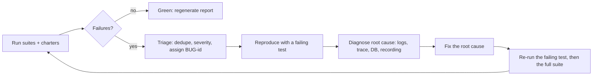

# 7. Testing

How we prove that every feature in [02-features.md](02-features.md) works, find bugs, fix them, and report all of it in an Excel workbook (`docs/testing/test-report.xlsx`).

## 7.1 Test levels

| Level | Tool | Covers | Runs | What a pass proves |
|---|---|---|---|---|
| **Static** | `tsc --noEmit` (client), ESLint | Whole codebase | Every commit, every Vercel build | Types match between components, store and API responses; no obvious mistakes |
| **Unit** | Vitest | Text parser, money/date helpers (VN time zone), i18n key completeness | Every commit (< 5 s) | Business rules behave exactly as specified, row by row |
| **API integration** | Vitest + Supertest + mongodb-memory-server (a real MongoDB in memory) | Every REST endpoint: methods, status codes, validation, auth, ownership, DB constraints | Every commit (~30 s) | The backend contract in [04-backend.md](04-backend.md) holds against a real database |
| **Webhook contract** | Vitest + Supertest, recorded Telegram/Zalo payloads, outbound `fetch` mocked with MSW | Secret checks, linking, parse → draft → confirm, idempotency, KIE errors (WhatsApp planned: signed payloads and a stubbed Graph API, §7.8.4) | Every commit | The bots work without a phone, and the exact JSON both platforms send is handled |
| **Component** | Vitest + React Testing Library + jsdom + MSW | Forms, QuickAdd, theme/language switch, error states | Every commit | Screens render loading/empty/error/data states and validate input |
| **KIE contract** | Vitest, real KIE container, sample receipts from the KIE repo (`data/test_degraded/*.jpg`) | `/analyze` response → draft mapping | Before demo, after KIE changes | Our mapping works on real OCR output, not just mocks |
| **End-to-end (E2E)** | Playwright (TypeScript), Chromium; **video + trace on** | Full user journeys in a real browser against local stack and the Vercel deployment | Before each deploy, run locally (CI runs only the Vitest suites, see [06-deployment.md](06-deployment.md)) | Frontend + API + DB work together the way a customer uses them |
| **Manual exploratory** | Claude in Chrome on your browser (recorded GIF, console + network capture), Vercel runtime logs, Atlas Data Explorer, real phones for Telegram/Zalo | Charters MT-01…MT-08 (§7.4) | Before demo, after big changes | Real-world use: real chat apps, real receipts, real devices |
| **Non-functional** | Playwright viewports, axe/Lighthouse, security probes | Responsive, dark mode, accessibility, injection, secrets, deploy smoke | Before demo | Slide requirements on responsiveness, security and deployment |

Versions to pin (npm, 2026-11-20): vitest 5.1.1, @testing-library/react 16.3.3, @testing-library/user-event 14.6.13, @testing-library/jest-dom 8.0.0, jsdom 31.0.1, msw 3.0.7, supertest 7.3.2, mongodb-memory-server 11.3.0, @playwright/test 1.65.1.

**Naming rule:** every automated test starts with its case ID, e.g. `test('TC-F1-05 refresh rotates token and detects reuse', …)`. The report tool matches results back to the catalogue by that ID.

## 7.2 Environments and test data

| Env | Web/API | Database | Bots | Used for |
|---|---|---|---|---|
| Unit/API/component | none / Supertest | mongodb-memory-server (fresh per file) | mocked | Fast automated suites |
| Local | `localhost:5300` + API `:4100` (+10 per worktree slot, `tools/wt-env.sh`) | Atlas `finance_wt<slot>` | dev bots via Cloudflare quick tunnel | E2E, debugging |
| Staging | `https://sochitieu-btl-staging.vercel.app` | Atlas `finance_staging` | none (the bots' one webhook points at production) | Charter runs and recorded retests with the test accounts |
| Production | `https://sochitieu-btl.vercel.app` | Atlas `finance` | `@sochitieu_btl_bot` + Zalo bot | Manual charters, demo smoke |

`npm run seed:test` creates **userA** (data owner), **userB** (attacker for ownership tests) and **admin** from the `TEST_USER_A_*`, `TEST_USER_B_*` and `SEED_ADMIN_*` variables. The fixed transactions whose totals are worked out by hand in `server/test/fixtures/expected-stats.json` are loaded by the statistics tests into the in-memory database, not by the seed.

## 7.3 Test catalogue

The full list (**159 cases**: 151 automated or semi-automated + 8 manual charters, each with steps, expected result and **what the test proves**) lives in [`docs/testing/test-cases.json`](testing/test-cases.json) and the **Test Cases** sheet of the Excel report. Summary:

| Feature | Cases | Key cases (what they prove) |
|---|---|---|
| F1 Auth | 25 | TC-F1-01 passwords stored as bcrypt hashes; TC-F1-05 refresh rotation + stolen-token reuse detection; TC-F1-06 logout really revokes server-side; TC-F1-08 reload keeps you logged in (silent refresh) |
| F2 Wallets | 8 | TC-F2-02 user B can't touch user A's wallet (404); TC-F2-04 balance excludes drafts and deleted items |
| F3 Categories | 6 | TC-F3-01 defaults seeded on register; TC-F3-03 deleting a category moves its transactions to "Other" |
| F4 Transactions | 13 | TC-F4-02 only positive integer VND accepted; TC-F4-07 month boundaries use Vietnam time |
| F5 Budgets | 7 | TC-F5-01 one budget per category per month (409); TC-F5-03 80 %/100 % warnings on web and bot |
| F6 Statistics | 7 | TC-F6-01 totals equal hand-computed fixture; TC-F6-03 daily grouping in VN time |
| F7 Bot linking | 9 | TC-F7-02 link codes are single-use and expire; TC-F7-03 one chat account → one web account |
| F8 Bot capture | 23 | TC-F8-01 parser table; TC-F8-03 bad webhook secret rejected; TC-F8-05 duplicate delivery → one draft; TC-F8-08 Zalo photo → KIE → draft |
| F9 Bot inbox | 6 | TC-F9-01 edit + confirm a draft from the web |
| F10 Receipt upload | 6 | TC-F10-01 real KIE output maps to the right amount; TC-F10-03 phone photo resized under Vercel's 4.5 MB limit |
| F11 Admin | 9 | TC-F11-01 non-admin gets 403; TC-F11-03 the last admin can't lock or demote themselves |
| F12 Preferences | 7 | TC-F12-01 theme persists; TC-F12-02 language changes UI, money format and bot replies |
| F13 Quick add | 7 | TC-F13-02 `phở 45k` + Enter saves on the web, no bot needed |
| Non-functional | 18 | TC-NF-02 responsive at 375/768/1280 px; TC-NF-04 NoSQL injection and XSS blocked; TC-NF-05 no `.env` in git; TC-NF-06 Vercel deploy smoke; TC-NF-15 the bot-e2e tool's `--help` and bad options |
| Manual charters | 8 | MT-01…MT-08 below |

**Planned for §2.10 (not in the counts above):** the one-tap linking and WhatsApp cases of §7.8. They have no IDs yet: each build PR takes the next free ID in `test-cases.json` at merge time.

## 7.4 Manual testing in the browser (recorded)

Run by Claude in your Chrome (or by you). Each charter is one recorded session.

**Before the session**
1. `npm run seed:test` on the target environment.
2. Open the backend logs:
   - Local: the API console (every line has a request id).
   - Production: Vercel → Project → **Logs** (live), or `npx vercel@66.6.0 logs <deployment-url>` (the CLI version pinned in `tools/deploy.sh`, see docs/06).
3. Open Atlas → **Data Explorer** on the right database, to check documents after each step.

**During the session**
1. Start recording with `gif_creator`, filename `MT-0x_<short-name>_<yyyymmdd>.gif`.
2. Follow the charter steps. At each checkpoint capture:
   - a screenshot
   - browser **console** errors (`read_console_messages`, pattern `error|warn`)
   - **network** calls with status codes (`read_network_requests`, filter `/api/`)
   - the matching **backend log** lines (same request id)
   - the **DB state** (Data Explorer)
3. Any difference from the expected result becomes a bug (§7.5). Note the timestamp in the recording.
4. Stop and export the GIF into `docs/testing/recordings/`. Its path goes in the *Evidence* column of the Excel report.

Playwright E2E runs also record automatically (`video: 'on'`, `trace: 'retain-on-failure'`), saved to `client/test-results/`. Open a trace with `npx playwright show-trace`.

**Charters**

| ID | Charter | Checkpoints | Proves |
|---|---|---|---|
| MT-01 | First-time customer on the web only: register → quick add `phở 45k`, `grab 32k hôm qua`, `+lương 15tr` → dashboard → edit → delete + undo | numbers on cards match the DB; no console errors; all API calls 2xx | A customer can track money on the website without any bot |
| MT-02 | Telegram: generate link code → tap deep link on phone → send `phở 45k` → ✅ → `/today` | draft then confirmed in DB; dashboard updates; webhook logs show 200 within 1 s | Telegram linking and capture work end to end |
| MT-03 | Zalo: `/link CODE` → `grab 32k` → `ok` → `huy` on a second draft | `pendingTransactionId` used; discarded draft soft-deleted | Zalo flow without buttons works |
| MT-04 | Receipt: photo of a real receipt to Telegram, Zalo and web upload | KIE timing in logs; total matches the receipt; failure message when the tunnel is stopped | KIE integration and its fallback message |
| MT-05 | Phone layout + dark mode + English: whole app at 375 px, toggle theme and language | no horizontal scroll; charts readable in dark; all strings translated | Responsive + theming + i18n requirement |
| MT-06 | Admin: lock userB, edit a default category, register userC | userB logged out everywhere; userC gets the new category | Roles and permissions |
| MT-07 | Security probing as userB: open userA's transaction URL, replay an old refresh cookie, send a webhook without the secret | 404 / 401 / 401; nothing changed in DB | Ownership isolation, token reuse detection, webhook auth |
| MT-08 | Demo rehearsal on Vercel: the full demo script, timed | under 10 min; zero errors in Vercel logs | Ready for the defense |

**Real-chat bot e2e.** MT-02 to MT-04 can also be run in the student's real Telegram and Zalo (Telegram Web / Zalo Web through Claude in Chrome, or a phone). [`tools/bot-e2e/bot-e2e.mjs`](../tools/bot-e2e/bot-e2e.mjs) then checks the expected bot replies, the buttons and the server state after each step, and sends the five real MC-OCR receipts through both chats to KIE. See the runbook [testing/bot-e2e.md](testing/bot-e2e.md) (TC-F7-08, TC-F8-16…18). WhatsApp (planned): the WhatsApp charter and the bot-e2e WhatsApp steps, §7.8.5.

## 7.5 Bugs: find → fix → retest (the refine loop)



Rules:
1. **Every bug gets an ID** (`BUG-001`, …) and a row in [`docs/testing/bugs.json`](testing/bugs.json) as soon as it is seen.
2. **Reproduce before fixing:** write or extend a test that fails because of the bug. The only exception is a purely visual issue, which gets a screenshot instead. That test stays forever as the **regression test**.
3. **Fix the root cause**, not the symptom. If a shared function is wrong, fix it there, and record the cause in the *Root cause* column.
4. **Retest:** the failing test turns green, then the **full** suite must pass (no new failures elsewhere).
5. **Close** only after retest, and record *how it was refined* (what changed and why) plus the commit hash.
6. **Automatic mode:** Claude runs the loop itself. It runs all suites, reads the JUnit results, fixes failures one by one, re-runs, logs every bug in `bugs.json`, and regenerates the Excel report. It stops after 5 rounds without progress, or when a fix needs your decision (e.g. a behaviour change), and lists those in the report as `Blocked`.

| Severity | Meaning | Example |
|---|---|---|
| S1 Critical | Data loss, security hole, or a core flow broken | User B can read user A's transactions |
| S2 Major | A feature doesn't work, with no workaround | Zalo `ok` doesn't confirm the draft |
| S3 Minor | Works, but wrong in some cases | Daily chart off by one day at midnight |
| S4 Trivial | Visual or text only | Untranslated label in English mode |

Statuses: `Open → In progress → Fixed (awaiting retest) → Closed`, or `Won't fix` / `Blocked` (each with a reason).

Bug log on 2026-11-22: **33 bugs** (BUG-001…BUG-033), **all Closed**, none open: 2 S2 Major, 19 S3 Minor, 12 S4 Trivial. Run history: **22 runs** (RUN-001…RUN-022).

**Exit criteria for the demo:** no open S1/S2 bugs, all P0 cases passing, MT-01…MT-04 recorded on Vercel.

## 7.6 The Excel report

`npm run report` (runs `tools/test-report/build-report.mjs`) rebuilds `docs/testing/test-report.xlsx` from:
- `docs/testing/test-cases.json`: the catalogue
- `docs/testing/bugs.json`: the bug log
- `docs/testing/runs.json`: run history
- optional JUnit XML from Vitest/Playwright (`--junit test-results/*.xml`), which fills in each case's latest result and adds a row to the run history

| Sheet | Columns |
|---|---|
| **Summary** | Live formulas: cases by result, bugs by status and severity, latest pass rate |
| **Test Cases** | ID · Feature · Level · Tool · Priority · Title · Steps · Expected result · **What this test proves** · Last result · Last run · Evidence |
| **Bugs** | Bug ID · Date found · Found by (test ID) · Feature · Severity · Title · Steps to reproduce · Expected · Actual · **Root cause** · **How it was refined (fix)** · Files / commit · Regression test · Status · Date closed · Evidence |
| **Runs** | Run ID · Date · Environment · Suite · Total · Passed · Failed · Skipped · Duration · Notes |
| **Legend** | Severity and status definitions, plus how to fill each column |

Dropdowns limit Status, Severity and Result to valid values, and failed or open rows are colour-coded.

## 7.7 Commands (once the code exists)

```bash
npm run typecheck                    # client tsc --noEmit
npm test                             # unit + API + webhook + component (Vitest), writes test-results/{server,client}-vitest.xml
npm run test:e2e                     # Playwright, writes test-results/e2e.xml + videos
node --test tools/bot-e2e/bot-e2e.test.mjs   # TC-NF-15: the bot-e2e tool's --help and bad options (not part of npm test)
npm run report -- --junit test-results/server-vitest.xml --junit test-results/client-vitest.xml --junit test-results/e2e.xml
```

The report tool on its own:

```bash
npm install --prefix tools/test-report          # once (exceljs 4.4.0)
node tools/test-report/junit.check.mjs          # self-check of the JUnit reader
node tools/test-report/build-report.mjs         # → docs/testing/test-report.xlsx (159 cases, last results from results.json)
```

## 7.8 One-tap linking and WhatsApp (planned, §2.10)

> **Planned, not built.** Nothing in this section runs yet. It turns every acceptance check in [02-features.md §2.10.6](02-features.md#2106-acceptance-checks) into test cases, so each PR that builds part of §2.10 knows what it must prove. The cases below have **no IDs yet**, because open PRs take IDs from the same append-only catalogue and a number reserved here can clash. Each case is named by a short *name*, the card that builds it (T32 #72, T33 #73, T34 #74) and its §2.10.6 row. Each build PR takes the next free ID in `test-cases.json` at merge time (TC-F7 in §7.8.2; TC-F8 in §7.8.3, except *source filter*, which is TC-F4; the next MT for the charter). Each build PR updates the planned sections in the docs its card's Scope lists; where a card's Scope doesn't list them (T32), the orchestrator opens a docs-only follow-up PR after the merge. So T33 and T34 write their IDs into these tables and §7.8.6 themselves, and T32's IDs are written in by that follow-up PR. Until then the cases are not counted in §7.3; each joins the catalogue and the Excel report in the PR that builds its part (§2.10.5). Quoted UI and bot texts are §2.10's English; the tests match whatever wording and i18n keys the builder settles (vi + en).

Levels and tools are the ones in §7.1: **API** and **Webhook** = Vitest + Supertest + mongodb-memory-server, outbound calls mocked with MSW; **Component** = Vitest + RTL + jsdom + MSW; **E2E** = Playwright against the hermetic E2E server; **Manual** = a real phone or Claude in Chrome, with the bot-e2e checker where noted.

### 7.8.1 What changes in today's cases

The last column says what has to change. Whether today's case takes the new check or leaves it to the planned case named there is up to the build PR.

| Case today | What it checks now | When §2.10 lands |
|---|---|---|
| TC-F7-01 | 201 `{code, expiresAt, telegramDeepLink}` | The body has `links: { telegram, whatsapp, zalo }` instead of `telegramDeepLink` (T32); the build PR decides whether TC-F7-01 checks `links` or leaves that to *link URLs* |
| TC-F7-02 | A reused or expired code gets the "invalid code" reply | From an unlinked chat, a wrong or expired code now counts as "anything" and gets a claim link (*code vs claim rows*, T33). Website codes are still single-use and expire |
| TC-F7-06 | Telegram link + QR, `/link CODE` for Zalo, no Telegram link when `telegramDeepLink` is `null` | The app part moves to *app picker* and *Zalo copy* (T32); countdown, expiry, unlink, Retry and 429 stay |
| TC-F8-10 | Unlinked chat: link instructions, nothing stored | Still no transaction, but the reply carries a claim link and `linkCodes` gets one claim-link row (*claim link issued*, T33) |
| TC-F8-14 | `setWebhooks` registers Telegram and Zalo; missing variables → `skipped` | A platform with missing settings is still `skipped`, WhatsApp included. Whether the script also registers the WhatsApp webhook is open (§7.8.7) |
| TC-F11-06 | Stats `chatLinks: {telegram, zalo}` and `transactionsBySource` | Both gain `whatsapp` |
| TC-NF-11 | The E2E stub answers the Telegram and Zalo Bot APIs and blocks every other host | It also answers the Graph API (§7.8.4); every other host stays blocked |
| TC-F9-01 (E2E) | Finds the link card and its QR by their Telegram/Zalo names | Same flow; the selectors follow the picker's names |
| TC-F7-09 (E2E) | Finds the link card by its region name "Liên kết Telegram / Zalo" to read the code | Same check; the selector follows the new card title, which names all three apps |

### 7.8.2 Linking (F7; T32, T33)

Card #72 (T32) doesn't list this doc in its Scope, so its IDs are written in here by the orchestrator's docs-only follow-up PR after its merge; T33 writes its own.

| Case | Card | Level | Pri | Steps, then **Expect** | Proves | §2.10.6 row |
|---|---|---|---|---|---|---|
| *link URLs* | T32 | API | P0 | `POST /api/chat-links/code` with every setting present, then with `TELEGRAM_BOT_USERNAME`, `WHATSAPP_NUMBER` and `ZALO_BOT_URL` each missing. **Expect:** 201 `{ code, expiresAt, links: { telegram, whatsapp, zalo } }` and no `telegramDeepLink`; `telegram` = `https://t.me/<bot>?start=<CODE>`, `whatsapp` = `https://wa.me/<WHATSAPP_NUMBER>?text=%2Flink%20<CODE>`, `zalo` = `ZALO_BOT_URL`; a missing setting makes only that app's link `null`; the DB still holds only the code's hash | The server builds the right URL for each app with the live code, and an app without settings has no link | 1 |
| *app picker* | T32 | Component | P1 | `/bot` with MSW: Generate code with all three links; again with Telegram already linked; again with `links.whatsapp: null`; again with Telegram linked and `links.whatsapp: null`; again with every shown app linked; switch the picker. **Expect:** the picker shows Telegram, WhatsApp, Zalo; the default is the first shown app (link not `null`) not linked yet, else the first shown app (WhatsApp when Telegram is linked; Zalo when Telegram is linked and `links.whatsapp` is `null`; Telegram when every shown app is linked); **Open Telegram** and **Open WhatsApp** point at `links.telegram` and `links.whatsapp`; the QR encodes the selected app's link and changes with the picker; an app whose link is `null` is not in the picker; "Linked ✓ <App> · <name>" appears once the 5 s check finds the new link; code, countdown and focus as in TC-F7-06 | Website linking for all three apps, with the QR always matching the chosen app | 1 |
| *Zalo copy* | T32 | Component | P1 | Zalo selected; `navigator.clipboard.writeText` stubbed to resolve, then to reject; press **Copy & open Zalo**. **Expect:** on success `writeText('/link CODE')` and `ZALO_BOT_URL` opened in a new tab, checked whichever way the card opens it ([05-frontend.md §5.9.1](05-frontend.md#591-link-card-on-bot-planned-2102)): a link with `href` = `ZALO_BOT_URL` and `target="_blank"`, or the URL a spied `window.open` gets; on rejection "Copy it yourself" shows and the `/link CODE` text stays on screen and selectable; the QR encodes `ZALO_BOT_URL` and the code stays large | Zalo linking never dead-ends, whether or not the browser lets the page copy | 2 |
| *link card E2E* | T32 (WhatsApp step with T34) | E2E | P1 | Chromium with clipboard permission granted: Generate code, read each button's URL, press **Copy & open Zalo** and read the clipboard (the new tab's request to `ZALO_BOT_URL` is answered by `context.route`, so no real Zalo page loads); again with `writeText` made to reject by an init script; then POST a signed WhatsApp text `/link CODE` to `/api/webhooks/whatsapp`. **Expect:** URLs as in *link URLs*; the clipboard holds `/link CODE`; the new tab's URL is `ZALO_BOT_URL`; the fallback text shows when copying fails; "Linked ✓ WhatsApp · <profile name>" shows within 5 s of the webhook (§2.10.6; see §7.8.7 for the check interval) | The link card works in a real browser with the real clipboard, and the `wa.me` text `/link CODE` links a WhatsApp chat end to end | 1, 2, 3 |
| *claim link issued* | T33 | Webhook | P0 | For Telegram, Zalo, and WhatsApp once its adapter exists: an unlinked chat sends `xin chào`; read the reply and `linkCodes`; the chat sends a second message; preview the first token. **Expect:** the reply has the vi + en "please link" text and `<APP_URL>/link?t=<token>` with a 32-character base64url token; `linkCodes` has one row for that chat holding the token's SHA-256, `chat: { platform, platformUserId, chatId, displayName }`, no `userId`, expiring in 10 minutes; no transaction; after the second message there is still exactly one row, with a new token, and the first token gets 404 `LINK_TOKEN_INVALID` | One live claim link per chat, stored as a hash only | 4 |
| *code vs claim rows* | T33 | Webhook | P0 | An unlinked chat sends `/link` with a wrong code, an expired code, a used code and a live claim-link token; then `/start CODE` with a live website code; a linked chat sends `xin chào`. **Expect:** the wrong, expired and used codes and the claim token each get a claim-link reply and link nothing (redeeming in the chat only matches rows with `userId`); the website code links the chat as today and adds no claim-link row; the linked chat gets its usual reply and no claim link | The two kinds of `linkCodes` row never work in each other's place, and linking with a code from the chat is unchanged | 4, 6 |
| *claim API* | T33 | API | P0 | Without login, call both claim endpoints. Logged in as userA: `POST /api/chat-links/claim/preview { token }` twice, `POST /api/chat-links/claim { token }`, then claim again; preview and claim with an unknown token, an expired one (`expiresAt` moved into the past in the DB) and a website code. **Expect:** 401 without login; preview 200 `{ platform, displayName }` both times (previewing does not spend the token); claim 201 `{ id, platform, displayName, createdAt, viaClaim: true }`, a `chatLinks` row for userA with the chat's ids and `viaClaim: true`, the claim-link row marked used; the bot sends that chat the same success text as `/link CODE` ("Đã liên kết với tài khoản <name>") in userA's language; the second claim and the unknown, expired and code-type tokens all get 404 `LINK_TOKEN_INVALID` | The claim rules: logged in only, single use, 10 minutes, claim links only, and the chat hears that it worked | 5, 6 |
| *claim conflict* | T33 | API | P0 | A claim link is issued for chat X; X is then linked to userB with `/link CODE`; userA claims, then claims again. Separately, userA and userB claim one fresh token at the same moment (`Promise.all`). **Expect:** 409 `CHAT_ALREADY_LINKED`, X stays linked to userB only, and the retry gets 404 `LINK_TOKEN_INVALID` (the token was spent); in the race exactly one 201 and one 404, and exactly one `chatLinks` row | The claim is one atomic update: a chat is never linked twice and a token never works twice | 6 |
| *link screen* | T33 | Component | P1 | `/link?t=<token>` with MSW: preview 200 then Cancel; preview 200 then Confirm; preview 404; claim 409. **Expect:** a loading state first; the token leaves the address bar (`history.replaceState`); the confirm screen asks to link **<Platform> · <name>** to **<user name> (<email>)** and shows the warning "Only confirm if you just messaged the bot yourself. The chat you link can see your spending and record money in this account." above Confirm and Cancel; Cancel goes to `/bot` without calling `/claim`; Confirm calls `/claim` and lands on `/bot` with "Linked ✓ <Platform> · <name>"; 404 shows "This link has expired or was already used. Send any message to the bot to get a new one."; 409 shows "This chat is already linked to an account."; both error screens have **Go to Bot inbox** | Every state of the `/link` screen, including the phishing warning | 5, 6, 10 |
| *claim E2E* | T33 | E2E | P0 | Register userA; POST an unlinked Zalo text to `/api/webhooks/zalo`; take the claim URL from the stubbed bot reply; open it logged out; log in; Confirm. A second run presses Cancel instead. **Expect:** `/link` drops `t` from the URL first, and no later URL (`/login`, back to `/link`, `/bot`) or history entry carries the token; login returns to `/link`; the confirm screen names Zalo · <name> and userA and shows the warning; Confirm → `/bot` with "Linked ✓ Zalo · <name>" and the notice "New chat linked from a chat link: Zalo · <name>. Not you? [Unlink]", `GET /api/chat-links` lists the chat with `viaClaim: true`, and the stub recorded the success message to that chat; dismissing the notice keeps it gone after a reload; in the network log the token appears only in the bodies of `/claim/preview` and `/claim`, never in an `/api/` URL. Cancel → `/bot`, and a preview of the same token still answers 200 (it is left to expire) | Linking from the chat works end to end for a logged-out user, the phishing warning and notice show, and the token never travels in a URL after the first page load | 5, 10 |
| *one-tap on phones* | T34 (after T32, T33) | Manual | P0 | After the Meta setup (§7.8.5), on real phones against the deployed app: **Open WhatsApp** → Send; scan the QR from a computer; **Copy & open Zalo** → paste → send, on iOS Safari and Android Chrome; from an unlinked Telegram, Zalo and WhatsApp chat send `xin chào`, tap the claim link, log in, Confirm. **Expect:** each chat is linked with one tap + Start / Send / paste, or one tap + Confirm; "Linked ✓" shows on `/bot` within 5 s; every chat gets the success message; nobody reads or types a code | The success measure of §2.10 holds in the real apps. A phone browser may block a tab opened after the asynchronous copy, which jsdom and desktop Chromium do not show | 2, 3, 5 |
| *claim notice API* | T33 | API | P0 | userA links chat X with `/link CODE` and claims chat Y's claim link; `GET /api/chat-links`; `PATCH /api/chat-links/<Y>/claim-notice` (no body) twice; `GET` again; then the same `PATCH` as userB, with an unknown id, and without login. **Expect:** the first `GET` has `viaClaim: false`, `claimNoticeDismissedAt: null` for X and `viaClaim: true`, `claimNoticeDismissedAt: null` for Y; each `PATCH` by userA → 204 and the next `GET` has a date in Y's `claimNoticeDismissedAt`; userB's `PATCH` and the unknown id → 404 and change nothing; no login → 401 | The server side of the "Not you? [Unlink]" notice: only claim-made links get it, and only their owner can dismiss it (§2.10.5) | 10 |
| *claim notice UI* | T33 | Component | P1 | Bot inbox with MSW: `GET /api/chat-links` returns one link with `viaClaim: true, claimNoticeDismissedAt: null`, one with `viaClaim: true` and a date, and one with `viaClaim: false`; press the notice's dismiss button; in a second run press its **Unlink**. **Expect:** exactly one notice, "New chat linked from a chat link: **<App> · <name>**. Not you? [Unlink]", for the first link only; dismiss sends `PATCH /api/chat-links/<id>/claim-notice` and the notice is gone after the refetch; Unlink opens the existing confirm dialog and sends `DELETE /api/chat-links/<id>`; focus lands on a heading, not `<body>` | The notice shows only for `viaClaim && !claimNoticeDismissedAt` and both of its actions work | 10 |

### 7.8.3 WhatsApp bot (F8, and F4 for *source filter*; T34)

| Case | Card | Level | Pri | Steps, then **Expect** | Proves | §2.10.6 row |
|---|---|---|---|---|---|---|
| *setup check* | T34 | Webhook | P0 | `GET /api/webhooks/whatsapp` with `hub.mode=subscribe`, `hub.verify_token` = `WHATSAPP_VERIFY_TOKEN` and `hub.challenge=<n>`; again with a wrong token, another `hub.mode`, and no parameters. **Expect:** 200 with exactly `<n>` as plain text; 403 for the others | Meta's setup check passes only with our verify token | 7 |
| *signature check* | T34 | Webhook | P0 | POST a recorded text message signed over its raw bytes with `WHATSAPP_APP_SECRET`; the same body with no `X-Hub-Signature-256`, with wrong hex, signed with another secret, and without the `sha256=` prefix; a body whose bytes differ from `JSON.stringify` of its parsed form (extra spaces, `\u` escapes), signed over those exact bytes. **Expect:** both good signatures get 200 and the message is handled (the second proves the check uses the raw body, not re-serialised JSON); every bad one gets 401, nothing is written to the DB and no Graph API call is made | Nobody can fake WhatsApp messages, and the check uses the bytes Meta signed | 7 |
| *WhatsApp off* | T34 | Webhook + API | P1 | Unset `WHATSAPP_ACCESS_TOKEN`, `WHATSAPP_PHONE_NUMBER_ID`, `WHATSAPP_APP_SECRET` and `WHATSAPP_VERIFY_TOKEN` one at a time (the other three and `WHATSAPP_NUMBER` set); each time send the good setup `GET` of *setup check*, POST a text signed as in *signature check*, and `POST /api/chat-links/code`. **Expect:** both webhook calls get 503 `FEATURE_NOT_CONFIGURED`, nothing is written to the DB and no Graph API call is made; `links.whatsapp` is `null` while `links.telegram` and `links.zalo` are unchanged | A server without the WhatsApp settings keeps working with WhatsApp hidden and its webhook off (card T34, #74; [04-backend.md §4.2](04-backend.md#42-configuration)) | 1, 7 |
| *statuses and retries* | T34 | Webhook | P0 | Signed payloads: one with only `statuses[]` (sent, delivered, read); one `messages[]` text with the same `id` (`wamid…`) delivered twice in a row and twice at the same moment. **Expect:** the status update gets 200, nothing stored, no reply; the repeated `wamid` gets 200 every time, exactly one draft and one button message | Meta's retries and status callbacks never double-count money | 7 |
| *payload mapping* | T34 | Unit + Webhook | P1 | The adapter's mapping on recorded payloads: `text`, `image`, `interactive` with `button_reply`, `audio`, `sticker`, `location`, and a text from a username user whose message has `from_user_id` but no `from`; a reply longer than 4096 characters; every draft button id. **Expect:** `platformUserId` and `chatId` = the BSUID (`from_user_id`), whether or not `from` is present, `displayName` = `value.contacts[0].profile.name`; text → `text.body`; image → a photo by `image.id`; `button_reply` → a button press with its id; audio, sticker and location → the help text, nothing stored; the long reply is sent as several messages of at most 4096 characters; each button id fits in WhatsApp's 256 characters and decodes back to the same action and draft id | WhatsApp's JSON reaches the bot core in the same shape as Telegram's and Zalo's | 8 |
| *draft buttons* | T34 | Webhook | P0 | A linked WhatsApp chat sends `phở 45k` and presses ✅ (a `button_reply` with the ✅ id); a second draft, ❌; a third, ✏️. **Expect:** a Graph `POST /<version>/<WHATSAPP_PHONE_NUMBER_ID>/messages` with `messaging_product: "whatsapp"`, `recipient_type: "individual"`, `recipient` = the chat's BSUID and no `to` field, `type: "interactive"`, `interactive.type: "button"` and three buttons ✅ Lưu, ❌ Huỷ, ✏️ Sửa; ✅ confirms the draft with `source: 'whatsapp'`; ❌ discards it as on Telegram (soft delete); ✏️ replies with `<APP_URL>/bot` and the draft keeps waiting; the access token travels only in the `Authorization` header | WhatsApp capture matches Telegram's, through the core's existing confirm/discard path | 8 |
| *receipt photo* | T34 | Webhook | P0 | A linked chat sends a receipt photo (`type: image`); MSW answers `GET /<version>/<image.id>` with a `url` and that `url` with the receipt bytes; KIE is stubbed as in TC-F8-08; the same photo is delivered again. **Expect:** both Graph calls carry `Authorization: Bearer <WHATSAPP_ACCESS_TOKEN>`; the bytes reach KIE; one receipt draft with `source: 'whatsapp'` and a button message; the second delivery calls neither Graph nor KIE again | Receipts from WhatsApp reach KIE like the other platforms' | 8 |
| *command parity* | T34 | Webhook | P2 | A linked WhatsApp chat: `/today`, `/month`, `/lang en`, `/help`, a draft that takes a budget past 80 %, then the user locked by an admin. **Expect:** the same replies as Telegram and Zalo in TC-F8-11, TC-F8-22, TC-F12-02, TC-F5-03 and TC-F8-15 | WhatsApp is one more adapter on the same core, with nothing left out (§2.10.4) | — |
| *BSUID only* | T34 | API | P0 | Two WhatsApp users: one whose messages carry `from_user_id` and no `from` (a username user), one whose messages also carry `from` = a test phone number. Link one by `/link CODE` and the other by claim link; make a text and a receipt draft for each and confirm one; dump every collection; call every endpoint that can return this data: `GET /api/chat-links`, `GET /api/transactions` (drafts and confirmed), `GET`/`PATCH /api/transactions/:id`, `POST /api/transactions/:id/confirm`, both claim endpoints, `GET /api/admin/stats`, `GET /api/admin/users`. **Expect:** the user without `from` links, gets drafts and confirms them, keyed by the BSUID; `chatLinks`, `linkCodes` and `transactions.chatRef` hold the BSUID; the test number's digits appear in no document and no response body; the web gets the WhatsApp profile name; admin stats count WhatsApp chats and WhatsApp transactions without identifiers | Identity is the BSUID, and no phone number is stored or returned | 9 |
| *source icon* | T34 | Component | P3 | Bot inbox and Transactions with a WhatsApp draft and a confirmed WhatsApp transaction. **Expect:** the WhatsApp source icon and label show where Telegram's and Zalo's do | People can tell an entry came from WhatsApp (§2.10.5) | — |
| *real WhatsApp chat* | T34 | Manual | P0 | After the Meta setup, the bot-e2e WhatsApp steps (§7.8.5) in the real chat: `phở 45k` → ✅; two lines → ❌ and ✅; ✏️; `/today`; `xin chào`; the five MC-OCR receipts, each then ❌. **Expect:** every reply and button matches; the server state is exact after each step; KIE reads each true total | Real WhatsApp replies, reply buttons and media downloads work end to end | 8 |
| *source filter* | T34 | API | P1 | Transactions with `source` `web`, `telegram` and `whatsapp` for userA; `GET /api/transactions?source=whatsapp`. **Expect:** 200 with only the WhatsApp transactions (not 400 `VALIDATION_ERROR`, which today's zod enum `['web','telegram','zalo','receipt']` gives) | The zod `source` filter in `routes/transactions.js` gains `whatsapp` (§2.10.5) | — |

### 7.8.4 Hermetic Graph API stub (no real Meta calls in CI)

CI runs only the Vitest suites (§7.1), and none of them reaches Meta:

- **Vitest (MSW).** Handlers answer `POST https://graph.facebook.com/:version/:phoneNumberId/messages`, `GET https://graph.facebook.com/:version/:mediaId`, and the media `url` that handler returns (pointing at a host the stub also answers). `:version` is a path parameter, so changing the pinned Graph API version (one constant in the adapter, §2.10.4) needs no test change. Each handler checks the `Authorization: Bearer` header and records what was sent (`recipient_type`, `recipient`, whether a `to` field is present, `type`, `interactive.type`, button ids, text); the tests assert the exact list of recorded calls, so an extra or missing Graph call fails them.
- **Signed requests.** Tests sign exactly the bytes they send, `X-Hub-Signature-256: sha256=<hex HMAC-SHA256 of the raw body with WHATSAPP_APP_SECRET>`, and send the body as a string so Supertest does not re-serialise it. Recorded Meta payloads (text with and without `from`, image, button reply, status updates, audio, sticker, location) go in a fixture next to `telegram-updates.json` and `zalo-events.json`.
- **Test settings.** Under `NODE_ENV=test`, `env.js` gives the bot variables harmless defaults today (`MONGODB_DB` and `SEED_*` stay unset). Giving `WHATSAPP_ACCESS_TOKEN`, `WHATSAPP_PHONE_NUMBER_ID`, `WHATSAPP_APP_SECRET`, `WHATSAPP_VERIFY_TOKEN`, `WHATSAPP_NUMBER` and `ZALO_BOT_URL` test defaults the same way is the builder's choice; either way the "missing setting" cases (*link URLs*, *app picker*, *WhatsApp off*) set or unset them per test.
- **E2E server.** `server/test/helpers/bot-api-stub.js` also answers the Graph API, like the Telegram and Zalo Bot APIs, so a Playwright run never messages a real WhatsApp number, and every other host stays blocked (TC-NF-11 extended). *Claim E2E* also needs the text of one stubbed reply, because it carries the claim URL; today the stub records only `{ platform, method, chatId }`.
- **Browser.** In *link card E2E* the new tab's request to `ZALO_BOT_URL` is answered by `context.route`, so the browser never opens a real chat app either.

### 7.8.5 Real WhatsApp chat (after the Meta setup)

*One-tap on phones*, *real WhatsApp chat* and the WhatsApp charter need the owner setup from §2.10.1: a Meta app with the WhatsApp use case, a Meta business portfolio, a phone number not already on WhatsApp, an approved display name and a permanent (system user) access token, with the webhook pointed at the deployment (docs/06). Until that exists they stay **Not run** in the report, never Fail.

- **bot-e2e extension (planned).** [`tools/bot-e2e/bot-e2e.mjs`](../tools/bot-e2e/bot-e2e.mjs) drives the TG-xx and ZL-xx steps in `scenarios.json` today. It gains WhatsApp steps (WA-xx, planned) that mirror TG-01…TG-11: `/link CODE` sent from the `wa.me` text, text → button message, ✅ / ❌ / ✏️, `/today`, `xin chào`, and the five MC-OCR receipts. The checker reads the server state through the API as today. The chat is driven on a phone or in WhatsApp Web through Claude in Chrome. [testing/bot-e2e.md](testing/bot-e2e.md) gets the WhatsApp rows in the PR that builds the adapter.
- **24-hour window.** The bot may reply only within 24 hours of the user's last message, so every run starts with a message from the user. A full run uses a few dozen bot replies, well inside the 1,000 free replies a month.

| ID | Charter | Checkpoints | Proves |
|---|---|---|---|
| *WhatsApp charter* (planned, T34; next free MT ID) | WhatsApp and one-tap linking on Vercel: Meta's webhook check from the app dashboard → link WhatsApp from a phone (**Open WhatsApp** → Send) and from a computer (QR) → `phở 45k` → ✅ → receipt photo → ❌ → **Copy & open Zalo** on iOS Safari and Android Chrome → a claim link from an unlinked Telegram, Zalo and WhatsApp chat, opened logged out | Vercel logs: the setup `GET` 200, every `POST` 200 (status updates too), no 401 for Meta's own calls; "Linked ✓" within 5 s; one `chatLinks` row per chat; the Bot inbox shows the profile name and no response in the network log contains the phone number; no console errors | One-tap linking and WhatsApp capture work on the deployed system with the real apps |

### 7.8.6 Acceptance checks → cases

IDs go next to the names in the same PR that writes them into §7.8.2 and §7.8.3: T33's and T34's own PRs, and for T32 the orchestrator's docs-only follow-up PR.

| §2.10.6 check | Cases (card) |
|---|---|
| 1. Link card: right URL per app, QR matches, app without settings hidden | *link URLs*, *app picker*, *link card E2E* (T32); *WhatsApp off* (T34) |
| 2. Zalo button: clipboard holds `/link CODE`; fallback when blocked | *Zalo copy*, *link card E2E* (T32); *one-tap on phones*, WhatsApp charter (T34) |
| 3. `/link CODE` from WhatsApp links; "Linked ✓" within 5 s | *link card E2E* (T32, WhatsApp step with T34; simulated webhook); *one-tap on phones*, WhatsApp charter (T34; real) |
| 4. Unlinked chat → claim link; a second message replaces it | *claim link issued*, *code vs claim rows* (T33) |
| 5. `/link?t=` logged out → login → Confirm → linked; chat told | *claim API*, *link screen*, *claim E2E* (T33); *one-tap on phones* (T34) |
| 6. Used, expired or code-type token → 404 `LINK_TOKEN_INVALID`; linked meanwhile → 409 | *code vs claim rows*, *claim API*, *claim conflict*, *link screen* (T33) |
| 7. WhatsApp webhook security and idempotency | *setup check*, *signature check*, *WhatsApp off*, *statuses and retries* (T34); TC-NF-11 (extended) |
| 8. WhatsApp capture matches Telegram | *payload mapping*, *draft buttons*, *receipt photo*, *real WhatsApp chat*, WhatsApp charter (T34) |
| 9. A message without `from` (username user) links and captures by BSUID; no phone number is stored or returned | *payload mapping*, *BSUID only*, WhatsApp charter (T34) |
| 10. A claim link opened by someone else shows the warning; after Confirm the Bot inbox shows the "Not you? Unlink" notice | *link screen*, *claim E2E*, *claim notice API*, *claim notice UI* (T33) |

### 7.8.7 Open points for the builder

§2.10 leaves these to the builder, or today's code meets them in a way the cases above will notice:

- **Left by §2.10:** how button ids are encoded within 256 characters (*payload mapping* checks only that they fit and decode back), the pinned Graph API version (the stub matches any), i18n keys and exact wording.
- **Not stated by §2.10, so no case asserts it yet:** whether a wrong or expired `/link CODE` reply keeps the "invalid code" sentence next to the claim link; whether the Zalo button still opens `ZALO_BOT_URL` when copying fails; whether the webhook-registration script registers the WhatsApp webhook or it is set in the Meta dashboard (TC-F8-14).
- **Check interval (*link card E2E*, *one-tap on phones*):** §2.10.6 asks for "Linked ✓" within 5 s, and the card checks `GET /api/chat-links` every 5 s (`CHECK_LINKS_MS`), so a link made just after a check shows only at the next one, plus the request time. The cases keep §2.10.6's 5 s; if they prove flaky, the interval or §2.10.6's wording has to change, not the test.
- **Logs:** the request log prints `req.originalUrl`, and Meta's setup `GET` carries `hub.verify_token` in the query, so `WHATSAPP_VERIFY_TOKEN` would reach the Vercel logs; §2.10 does not say whether that is acceptable.
- **Redirect (*claim E2E*):** behind `ProtectedRoute` the redirect to `/login` runs before the page's code and keeps `pathname + search`, so `t` would ride through the login page. `/link` therefore sits outside `ProtectedRoute` and removes `t` itself before sending the user to log in ([05-frontend.md §5.9.2](05-frontend.md#592-link-screen-planned-2103)); *claim E2E* checks that no later URL carries the token.
- **E2E reply text (*claim E2E*):** the stub must hand the test the claim URL from the bot's reply; how is up to the builder.
