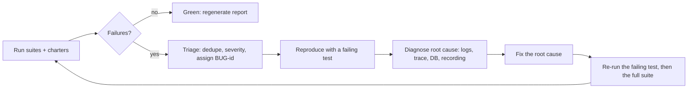

# 7. Testing

How we prove that every feature in [02-features.md](02-features.md) works, find bugs, fix them, and report all of it in an Excel workbook (`docs/testing/test-report.xlsx`).

## 7.1 Test levels

| Level | Tool | Covers | Runs | What a pass proves |
|---|---|---|---|---|
| **Static** | `tsc --noEmit` (client), ESLint | Whole codebase | Every commit, every Vercel build | Types match between components, store and API responses; no obvious mistakes |
| **Unit** | Vitest | Text parser, money/date helpers (VN time zone), i18n key completeness | Every commit (< 5 s) | Business rules behave exactly as specified, row by row |
| **API integration** | Vitest + Supertest + mongodb-memory-server (a real MongoDB in memory) | Every REST endpoint: methods, status codes, validation, auth, ownership, DB constraints | Every commit (~30 s) | The backend contract in [04-backend.md](04-backend.md) holds against a real database |
| **Webhook contract** | Vitest + Supertest, recorded Telegram/Zalo payloads, outbound `fetch` mocked with MSW | Secret checks, linking, parse → draft → confirm, idempotency, KIE errors | Every commit | The bots work without a phone, and the exact JSON both platforms send is handled |
| **Component** | Vitest + React Testing Library + jsdom + MSW | Forms, QuickAdd, theme/language switch, error states | Every commit | Screens render loading/empty/error/data states and validate input |
| **KIE contract** | Vitest, real KIE container, sample receipts from the KIE repo (`data/test_degraded/*.jpg`) | `/analyze` response → draft mapping | Before demo, after KIE changes | Our mapping works on real OCR output, not just mocks |
| **End-to-end (E2E)** | Playwright (TypeScript), Chromium; **video + trace on** | Full user journeys in a real browser against local stack and the Vercel deployment | Before each deploy; nightly on Vercel | Frontend + API + DB work together the way a customer uses them |
| **Manual exploratory** | Claude in Chrome on your browser (recorded GIF, console + network capture), Vercel runtime logs, Atlas Data Explorer, real phones for Telegram/Zalo | Charters MT-01…MT-08 (§7.4) | Before demo, after big changes | Real-world use: real chat apps, real receipts, real devices |
| **Non-functional** | Playwright viewports, axe/Lighthouse, security probes | Responsive, dark mode, accessibility, injection, secrets, deploy smoke | Before demo | Slide requirements on responsiveness, security and deployment |

Versions to pin (npm, 2026-11-20): vitest 5.1.1, @testing-library/react 16.3.3, @testing-library/user-event 14.6.13, @testing-library/jest-dom 8.0.0, jsdom 31.0.1, msw 3.0.7, supertest 7.3.2, mongodb-memory-server 11.3.0, @playwright/test 1.65.1.

**Naming rule:** every automated test starts with its case ID, e.g. `test('TC-F1-05 refresh rotates token and detects reuse', …)`. The report tool matches results back to the catalogue by that ID.

## 7.2 Environments and test data

| Env | Web/API | Database | Bots | Used for |
|---|---|---|---|---|
| Unit/API/component | none / Supertest | mongodb-memory-server (fresh per file) | mocked | Fast automated suites |
| Local | `localhost:5173` + `:3000` | Atlas `finance_dev` | dev bots via Cloudflare quick tunnel | E2E, debugging |
| Production | `https://<project>.vercel.app` | Atlas `finance` | `@sochitieu_btl_bot` + Zalo bot | Manual charters, demo smoke |

`npm run seed:test` creates **userA** (data owner), **userB** (attacker for ownership tests) and **admin**, plus a fixed set of transactions whose totals are worked out by hand in `server/test/fixtures/expected-stats.json`.

## 7.3 Test catalogue

The full list (**116 cases**: 108 automated or semi-automated + 8 manual charters, each with steps, expected result and **what the test proves**) lives in [`docs/testing/test-cases.json`](testing/test-cases.json) and the **Test Cases** sheet of the Excel report. Summary:

| Feature | Cases | Key cases (what they prove) |
|---|---|---|
| F1 Auth | 10 | TC-F1-01 passwords stored as bcrypt hashes; TC-F1-05 refresh rotation + stolen-token reuse detection; TC-F1-06 logout really revokes server-side; TC-F1-08 reload keeps you logged in (silent refresh) |
| F2 Wallets | 5 | TC-F2-02 user B can't touch user A's wallet (404); TC-F2-04 balance excludes drafts and deleted items |
| F3 Categories | 4 | TC-F3-01 defaults seeded on register; TC-F3-03 deleting a category moves its transactions to "Other" |
| F4 Transactions | 7 | TC-F4-02 only positive integer VND accepted; TC-F4-07 month boundaries use Vietnam time |
| F5 Budgets | 4 | TC-F5-01 one budget per category per month (409); TC-F5-03 80 %/100 % warnings on web and bot |
| F6 Statistics | 4 | TC-F6-01 totals equal hand-computed fixture; TC-F6-03 daily grouping in VN time |
| F7 Bot linking | 5 | TC-F7-02 link codes are single-use and expire; TC-F7-03 one chat account → one web account |
| F8 Bot capture | 13 | TC-F8-01 parser table; TC-F8-03 bad webhook secret rejected; TC-F8-05 duplicate delivery → one draft; TC-F8-08 Zalo photo → KIE → draft |
| F9 Bot inbox | 2 | TC-F9-01 edit + confirm a draft from the web |
| F10 Receipt upload | 3 | TC-F10-01 real KIE output maps to the right amount; TC-F10-03 phone photo resized under Vercel's 4.5 MB limit |
| F11 Admin | 5 | TC-F11-01 non-admin gets 403; TC-F11-03 the last admin can't lock or demote themselves |
| F12 Preferences | 3 | TC-F12-01 theme persists; TC-F12-02 language changes UI, money format and bot replies |
| F13 Quick add | 3 | TC-F13-02 `phở 45k` + Enter saves on the web, no bot needed |
| Non-functional | 8 | TC-NF-02 responsive at 375/768/1280 px; TC-NF-04 NoSQL injection and XSS blocked; TC-NF-05 no `.env` in git; TC-NF-06 Vercel deploy smoke |
| Manual charters | 8 | MT-01…MT-08 below |

## 7.4 Manual testing in the browser (recorded)

Run by Claude in your Chrome (or by you). Each charter is one recorded session.

**Before the session**
1. `npm run seed:test` on the target environment.
2. Open the backend logs:
   - Local: the API console (every line has a request id).
   - Production: Vercel → Project → **Logs** (live), or `npx vercel@latest logs <deployment-url>`.
3. Open Atlas → **Data Explorer** on the right database, to check documents after each step.

**During the session**
1. Start recording with `gif_creator`, filename `MT-0x_<short-name>_<yyyymmdd>.gif`.
2. Follow the charter steps. At each checkpoint capture:
   - a screenshot
   - browser **console** errors (`read_console_messages`, pattern `error|warn`)
   - **network** calls with status codes (`read_network_requests`, filter `/api/`)
   - the matching **backend log** lines (same request id)
   - the **DB state** (Data Explorer)
3. Any difference from the expected result becomes a bug (§7.5). Note the timestamp in the recording.
4. Stop and export the GIF into `docs/testing/recordings/`. Its path goes in the *Evidence* column of the Excel report.

Playwright E2E runs also record automatically (`video: 'on'`, `trace: 'retain-on-failure'`), saved to `client/test-results/`. Open a trace with `npx playwright show-trace`.

**Charters**

| ID | Charter | Checkpoints | Proves |
|---|---|---|---|
| MT-01 | First-time customer on the web only: register → quick add `phở 45k`, `grab 32k hôm qua`, `+lương 15tr` → dashboard → edit → delete + undo | numbers on cards match the DB; no console errors; all API calls 2xx | A customer can track money on the website without any bot |
| MT-02 | Telegram: generate link code → tap deep link on phone → send `phở 45k` → ✅ → `/today` | draft then confirmed in DB; dashboard updates; webhook logs show 200 within 1 s | Telegram linking and capture work end to end |
| MT-03 | Zalo: `/link CODE` → `grab 32k` → `ok` → `huy` on a second draft | `pendingTransactionId` used; discarded draft soft-deleted | Zalo flow without buttons works |
| MT-04 | Receipt: photo of a real receipt to Telegram, Zalo and web upload | KIE timing in logs; total matches the receipt; failure message when the tunnel is stopped | KIE integration and its fallback message |
| MT-05 | Phone layout + dark mode + English: whole app at 375 px, toggle theme and language | no horizontal scroll; charts readable in dark; all strings translated | Responsive + theming + i18n requirement |
| MT-06 | Admin: lock userB, edit a default category, register userC | userB logged out everywhere; userC gets the new category | Roles and permissions |
| MT-07 | Security probing as userB: open userA's transaction URL, replay an old refresh cookie, send a webhook without the secret | 404 / 401 / 401; nothing changed in DB | Ownership isolation, token reuse detection, webhook auth |
| MT-08 | Demo rehearsal on Vercel: the full demo script, timed | under 10 min; zero errors in Vercel logs | Ready for the defense |

## 7.5 Bugs: find → fix → retest (the refine loop)



Rules:
1. **Every bug gets an ID** (`BUG-001`, …) and a row in [`docs/testing/bugs.json`](testing/bugs.json) as soon as it is seen.
2. **Reproduce before fixing:** write or extend a test that fails because of the bug. The only exception is a purely visual issue, which gets a screenshot instead. That test stays forever as the **regression test**.
3. **Fix the root cause**, not the symptom. If a shared function is wrong, fix it there, and record the cause in the *Root cause* column.
4. **Retest:** the failing test turns green, then the **full** suite must pass (no new failures elsewhere).
5. **Close** only after retest, and record *how it was refined* (what changed and why) plus the commit hash.
6. **Automatic mode:** Claude runs the loop itself. It runs all suites, reads the JUnit results, fixes failures one by one, re-runs, logs every bug in `bugs.json`, and regenerates the Excel report. It stops after 5 rounds without progress, or when a fix needs your decision (e.g. a behaviour change), and lists those in the report as `Blocked`.

| Severity | Meaning | Example |
|---|---|---|
| S1 Critical | Data loss, security hole, or a core flow broken | User B can read user A's transactions |
| S2 Major | A feature doesn't work, with no workaround | Zalo `ok` doesn't confirm the draft |
| S3 Minor | Works, but wrong in some cases | Daily chart off by one day at midnight |
| S4 Cosmetic | Visual or text only | Untranslated label in English mode |

Statuses: `Open → In progress → Fixed (awaiting retest) → Closed`, or `Won't fix` / `Blocked` (each with a reason).

**Exit criteria for the demo:** no open S1/S2 bugs, all P0 cases passing, MT-01…MT-04 recorded on Vercel.

## 7.6 The Excel report

`npm run report` (runs `tools/test-report/build-report.mjs`) rebuilds `docs/testing/test-report.xlsx` from:
- `docs/testing/test-cases.json`: the catalogue
- `docs/testing/bugs.json`: the bug log
- `docs/testing/runs.json`: run history
- optional JUnit XML from Vitest/Playwright (`--junit test-results/*.xml`), which fills in each case's latest result and adds a row to the run history

| Sheet | Columns |
|---|---|
| **Summary** | Live formulas: cases by result, bugs by status and severity, latest pass rate |
| **Test Cases** | ID · Feature · Level · Tool · Priority · Title · Steps · Expected result · **What this test proves** · Last result · Last run · Evidence |
| **Bugs** | Bug ID · Date found · Found by (test ID) · Feature · Severity · Title · Steps to reproduce · Expected · Actual · **Root cause** · **How it was refined (fix)** · Files / commit · Regression test · Status · Date closed · Evidence |
| **Runs** | Run ID · Date · Environment · Suite · Total · Passed · Failed · Skipped · Duration · Notes |
| **Legend** | Severity and status definitions, plus how to fill each column |

Dropdowns limit Status, Severity and Result to valid values, and failed or open rows are colour-coded.

## 7.7 Commands (once the code exists)

```bash
npm run typecheck                    # client tsc --noEmit
npm test                             # unit + API + webhook + component (Vitest), writes test-results/{server,client}-vitest.xml
npm run test:e2e                     # Playwright, writes test-results/e2e.xml + videos
npm run report -- --junit test-results/server-vitest.xml --junit test-results/client-vitest.xml --junit test-results/e2e.xml
```

The report tool on its own:

```bash
npm install --prefix tools/test-report          # once (exceljs 4.4.0)
node tools/test-report/junit.check.mjs          # self-check of the JUnit reader
node tools/test-report/build-report.mjs         # → docs/testing/test-report.xlsx (116 cases, last results from results.json)
```
