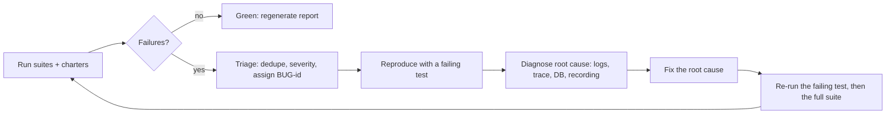

# 7. Testing

How we prove that every feature in [02-features.md](02-features.md) works, find bugs, fix them, and report all of it in an Excel workbook (`docs/testing/test-report.xlsx`).

## 7.1 Test levels

| Level | Tool | Covers | Runs | What a pass proves |
|---|---|---|---|---|
| **Static** | `tsc --noEmit` (client), ESLint | Whole codebase | Every commit, every Vercel build | Types match between components, store and API responses; no obvious mistakes |
| **Unit** | Vitest | Text parser, money/date helpers (VN time zone), i18n key completeness (planned: `classify`, `pace`, split, `services/agent.js` and the code email, §7.9.4, §7.10.2; the agent service's Python units, §7.9.2) | Every commit (< 5 s) | Business rules behave exactly as specified, row by row |
| **API integration** | Vitest + Supertest + mongodb-memory-server (a real MongoDB in memory) | Every REST endpoint: methods, status codes, validation, auth, ownership, DB constraints | Every commit (~30 s) | The backend contract in [04-backend.md](04-backend.md) holds against a real database |
| **Webhook contract** | Vitest + Supertest, recorded Telegram/Zalo payloads, outbound `fetch` mocked with MSW | Secret checks, linking, parse → draft → confirm, idempotency, KIE errors (WhatsApp: signed payloads and a stubbed Graph API, §7.8.4; assistant replies through a stubbed agent API and the daily cron planned, §7.9.4) | Every commit | The bots work without a phone, and the exact JSON both platforms send is handled |
| **Component** | Vitest + React Testing Library + jsdom + MSW | Forms, QuickAdd, theme/language switch, error states | Every commit | Screens render loading/empty/error/data states and validate input |
| **KIE contract** | Vitest, real KIE container, sample receipts from the KIE repo (`data/test_degraded/*.jpg`) | `/analyze` response → draft mapping | Before demo, after KIE changes (until KIE is retired: the receipt eval, §7.9.6, decides when `RECEIPT_READER` flips to `qwen`) | Our mapping works on real OCR output, not just mocks |
| **End-to-end (E2E)** | Playwright (TypeScript), Chromium; **video + trace on** | Full user journeys in a real browser against local stack and the Vercel deployment | Before each deploy, run locally (CI runs only the Vitest suites, see [06-deployment.md](06-deployment.md)) | Frontend + API + DB work together the way a customer uses them |
| **Manual exploratory** | Claude in Chrome on your browser (recorded GIF, console + network capture), Vercel runtime logs, Atlas Data Explorer, real phones for Telegram/Zalo | Charters MT-01…MT-08 (§7.4); planned charters in §7.8.5, §7.9.9 and §7.10.6 | Before demo, after big changes | Real-world use: real chat apps, real receipts, real devices |
| **Agent service** *(planned, §2.11)* | pytest with a fake chat model and a fake embedder (no GPU), the compiled LangGraph graph, FastAPI `TestClient`, a throwaway local `mongod` | The Python agent service: date rules, skill ranking, the guard, `check_total`, the typed query, caps, every graph path, the agent API (§7.9.2, §7.9.3) | Every commit once built | The agent's rules and paths work without a model or a GPU |
| **Agent evals and load** *(planned, §2.11)* | `python -m agent.eval skills \| receipts \| categories \| load` on the GPU host, real Qwen3.5-2B on vLLM and bge-m3 | The skill set (`agent/eval/skill_cases.yaml`), Qwen vs KIE on real receipts, the categorizer, 8 concurrent questions (§7.9.6, §7.9.7) | By hand before each agent deploy and before changing the model, a prompt or a skill | Skills are found, every number is exact, the guard leaks nothing, Qwen reads receipts at least as well as KIE, and the GPU copes |
| **Non-functional** | Playwright viewports, axe/Lighthouse, security probes | Responsive, dark mode, accessibility, injection, secrets, deploy smoke | Before demo | Slide requirements on responsiveness, security and deployment |

Versions to pin (npm, 2026-11-20): vitest 5.1.1, @testing-library/react 16.3.3, @testing-library/user-event 14.6.13, @testing-library/jest-dom 8.0.0, jsdom 31.0.1, msw 3.0.7, supertest 7.3.2, mongodb-memory-server 11.3.0, @playwright/test 1.65.1.

**Naming rule:** every automated test starts with its case ID, e.g. `test('TC-F1-05 refresh rotates token and detects reuse', …)`. The report tool matches results back to the catalogue by that ID.

## 7.2 Environments and test data

| Env | Web/API | Database | Bots | Used for |
|---|---|---|---|---|
| Unit/API/component | none / Supertest | mongodb-memory-server (fresh per file) | mocked | Fast automated suites |
| Local | `localhost:5300` + API `:4100` (+10 per worktree slot, `tools/wt-env.sh`) | Atlas `finance_wt<slot>` | dev bots via Cloudflare quick tunnel | E2E, debugging |
| Staging | `https://sochitieu-btl-staging.vercel.app` | Atlas `finance_staging` | none (the bots' one webhook points at production) | Charter runs and recorded retests with the test accounts |
| Production | `https://sochitieu-btl.vercel.app` | Atlas `finance` | `@sochitieu_btl_bot` + Zalo bot | Manual charters, demo smoke |

`npm run seed:test` creates **userA** (data owner), **userB** (attacker for ownership tests) and **admin** from the `TEST_USER_A_*`, `TEST_USER_B_*` and `SEED_ADMIN_*` variables. The fixed transactions whose totals are worked out by hand in `server/test/fixtures/expected-stats.json` are loaded by the statistics tests into the in-memory database, not by the seed.

## 7.3 Test catalogue

The full list (**213 cases**: 205 automated or semi-automated + 8 manual charters, each with steps, expected result and **what the test proves**) lives in [`docs/testing/test-cases.json`](testing/test-cases.json) and the **Test Cases** sheet of the Excel report. Summary:

| Feature | Cases | Key cases (what they prove) |
|---|---|---|
| F1 Auth | 25 | TC-F1-01 passwords stored as bcrypt hashes; TC-F1-05 refresh rotation + stolen-token reuse detection; TC-F1-06 logout really revokes server-side; TC-F1-08 reload keeps you logged in (silent refresh) |
| F2 Wallets | 12 | TC-F2-02 user B can't touch user A's wallet (404); TC-F2-04 balance excludes drafts and deleted items |
| F3 Categories | 6 | TC-F3-01 defaults seeded on register; TC-F3-03 deleting a category moves its transactions to "Other" |
| F4 Transactions | 13 | TC-F4-02 only positive integer VND accepted; TC-F4-07 month boundaries use Vietnam time |
| F5 Budgets | 7 | TC-F5-01 one budget per category per month (409); TC-F5-03 80 %/100 % warnings on web and bot |
| F6 Statistics | 7 | TC-F6-01 totals equal hand-computed fixture; TC-F6-03 daily grouping in VN time |
| F7 Bot linking | 23 | TC-F7-02 link codes are single-use and expire; TC-F7-03 one chat account → one web account; TC-F7-18 a claim link works once, for the logged-in user; TC-F7-23 linking from the chat, end to end |
| F8 Bot capture | 23 | TC-F8-01 parser table; TC-F8-03 bad webhook secret rejected; TC-F8-05 duplicate delivery → one draft; TC-F8-08 Zalo photo → KIE → draft; TC-F8-27 a WhatsApp POST needs a valid signature; TC-F8-37 no phone number is stored or returned |
| F9 Bot inbox | 6 | TC-F9-01 edit + confirm a draft from the web |
| F10 Receipt upload | 6 | TC-F10-01 real KIE output maps to the right amount; TC-F10-03 phone photo resized under Vercel's 4.5 MB limit |
| F11 Admin | 9 | TC-F11-01 non-admin gets 403; TC-F11-03 the last admin can't lock or demote themselves |
| F12 Preferences | 7 | TC-F12-01 theme persists; TC-F12-02 language changes UI, money format and bot replies |
| F13 Quick add | 7 | TC-F13-02 `phở 45k` + Enter saves on the web, no bot needed |
| F14 Assistant | 14 (built so far: the agent service scaffold, T44) | TC-F14-02 every agent path but `/health` needs the bearer; TC-F14-10 the agent's database role cannot change app data or create indexes; TC-F14-11 it cannot read `users`, sessions or link tokens; TC-F14-12 `usersForAgent` shows no e-mail or password hash |
| Non-functional | 18 | TC-NF-02 responsive at 375/768/1280 px; TC-NF-04 NoSQL injection and XSS blocked; TC-NF-05 no `.env` in git; TC-NF-06 Vercel deploy smoke; TC-NF-15 the bot-e2e tool's `--help` and bad options |
| Manual charters | 8 | MT-01…MT-08 below |

**Planned for §2.10 (not in the counts above):** the three WhatsApp cases that need the owner's Meta setup (*one-tap on phones*, *real WhatsApp chat*, the WhatsApp charter, §7.8.5). They have no IDs yet: each takes the next free ID in `test-cases.json` at merge time. Linking from the chat (T33) is built and counted: TC-F7-16…23. The WhatsApp bot (T34) is built and in the catalogue: TC-F8-26…43 (TC-F8-24 is left free: it may be taken by another card in flight), TC-F4-14 and TC-F9-07. The counts in this table are as of T33 and are brought up to date by the next docs refresh, with the cases of T34, T77 and T78.

**Planned for §2.11 and §2.12 (not in the counts above):** the assistant cases of §7.9 and the email-code cases of §7.10, named the same way and given IDs the same way. The first assistant cases are built (T43 #88, feature row F14 Assistant): **TC-F14-01…03**, the one comparison rule. They join the counts at the next docs refresh.

## 7.4 Manual testing in the browser (recorded)

Run by Claude in your Chrome (or by you). Each charter is one recorded session.

**Before the session**
1. `npm run seed:test` on the target environment.
2. Open the backend logs:
   - Local: the API console (every line has a request id).
   - Production: Vercel → Project → **Logs** (live), or `npx vercel@66.6.0 logs <deployment-url>` (the CLI version pinned in `tools/deploy.sh`, see docs/06).
3. Open Atlas → **Data Explorer** on the right database, to check documents after each step.

**During the session**
1. Start recording with `gif_creator`, filename `MT-0x_<short-name>_<yyyymmdd>.gif`.
2. Follow the charter steps. At each checkpoint capture:
   - a screenshot
   - browser **console** errors (`read_console_messages`, pattern `error|warn`)
   - **network** calls with status codes (`read_network_requests`, filter `/api/`)
   - the matching **backend log** lines (same request id)
   - the **DB state** (Data Explorer)
3. Any difference from the expected result becomes a bug (§7.5). Note the timestamp in the recording.
4. Stop and export the GIF into `docs/testing/recordings/`. Its path goes in the *Evidence* column of the Excel report.

Playwright E2E runs also record automatically (`video: 'on'`, `trace: 'retain-on-failure'`), saved to `client/test-results/`. Open a trace with `npx playwright show-trace`.

**Charters**

| ID | Charter | Checkpoints | Proves |
|---|---|---|---|
| MT-01 | First-time customer on the web only: register → quick add `phở 45k`, `grab 32k hôm qua`, `+lương 15tr` → dashboard → edit → delete + undo | numbers on cards match the DB; no console errors; all API calls 2xx | A customer can track money on the website without any bot |
| MT-02 | Telegram: generate link code → tap deep link on phone → send `phở 45k` → ✅ → `/today` | draft then confirmed in DB; dashboard updates; webhook logs show 200 within 1 s | Telegram linking and capture work end to end |
| MT-03 | Zalo: `/link CODE` → `grab 32k` → `ok` → `huy` on a second draft | `pendingTransactionId` used; discarded draft soft-deleted | Zalo flow without buttons works |
| MT-04 | Receipt: photo of a real receipt to Telegram, Zalo and web upload | KIE timing in logs; total matches the receipt; failure message when the tunnel is stopped | KIE integration and its fallback message |
| MT-05 | Phone layout + dark mode + English: whole app at 375 px, toggle theme and language | no horizontal scroll; charts readable in dark; all strings translated | Responsive + theming + i18n requirement |
| MT-06 | Admin: lock userB, edit a default category, register userC | userB logged out everywhere; userC gets the new category | Roles and permissions |
| MT-07 | Security probing as userB: open userA's transaction URL, replay an old refresh cookie, send a webhook without the secret | 404 / 401 / 401; nothing changed in DB | Ownership isolation, token reuse detection, webhook auth |
| MT-08 | Demo rehearsal on Vercel: the full demo script, timed | under 10 min; zero errors in Vercel logs | Ready for the defense |

**Real-chat bot e2e.** MT-02 to MT-04 can also be run in the student's real Telegram and Zalo (Telegram Web / Zalo Web through Claude in Chrome, or a phone). [`tools/bot-e2e/bot-e2e.mjs`](../tools/bot-e2e/bot-e2e.mjs) then checks the expected bot replies, the buttons and the server state after each step, and sends the five real MC-OCR receipts through both chats to KIE. See the runbook [testing/bot-e2e.md](testing/bot-e2e.md) (TC-F7-08, TC-F8-16…18). WhatsApp (planned): the WhatsApp charter and the bot-e2e WhatsApp steps, §7.8.5. Assistant in Telegram, receipts read by Qwen and the evening digest (planned): §7.9.9. Sign-up and password reset with a real inbox (planned): §7.10.6.

## 7.5 Bugs: find → fix → retest (the refine loop)



Rules:
1. **Every bug gets an ID** (`BUG-001`, …) and a row in [`docs/testing/bugs.json`](testing/bugs.json) as soon as it is seen.
2. **Reproduce before fixing:** write or extend a test that fails because of the bug. The only exception is a purely visual issue, which gets a screenshot instead. That test stays forever as the **regression test**.
3. **Fix the root cause**, not the symptom. If a shared function is wrong, fix it there, and record the cause in the *Root cause* column.
4. **Retest:** the failing test turns green, then the **full** suite must pass (no new failures elsewhere).
5. **Close** only after retest, and record *how it was refined* (what changed and why) plus the commit hash.
6. **Automatic mode:** Claude runs the loop itself. It runs all suites, reads the JUnit results, fixes failures one by one, re-runs, logs every bug in `bugs.json`, and regenerates the Excel report. It stops after 5 rounds without progress, or when a fix needs your decision (e.g. a behaviour change), and lists those in the report as `Blocked`.

| Severity | Meaning | Example |
|---|---|---|
| S1 Critical | Data loss, security hole, or a core flow broken | User B can read user A's transactions |
| S2 Major | A feature doesn't work, with no workaround | Zalo `ok` doesn't confirm the draft |
| S3 Minor | Works, but wrong in some cases | Daily chart off by one day at midnight |
| S4 Trivial | Visual or text only | Untranslated label in English mode |

Statuses: `Open → In progress → Fixed (awaiting retest) → Closed`, or `Won't fix` / `Blocked` (each with a reason).

Bug log on 2026-11-22: **33 bugs** (BUG-001…BUG-033), **all Closed**, none open: 2 S2 Major, 19 S3 Minor, 12 S4 Trivial. Run history: **22 runs** (RUN-001…RUN-022).

**Exit criteria for the demo:** no open S1/S2 bugs, all P0 cases passing, MT-01…MT-04 recorded on Vercel.

## 7.6 The Excel report

`npm run report` (runs `tools/test-report/build-report.mjs`) rebuilds `docs/testing/test-report.xlsx` from:
- `docs/testing/test-cases.json`: the catalogue
- `docs/testing/bugs.json`: the bug log
- `docs/testing/runs.json`: run history
- optional JUnit XML from Vitest/Playwright (`--junit test-results/*.xml`), which fills in each case's latest result and adds a row to the run history

| Sheet | Columns |
|---|---|
| **Summary** | Live formulas: cases by result, bugs by status and severity, latest pass rate |
| **Test Cases** | ID · Feature · Level · Tool · Priority · Title · Steps · Expected result · **What this test proves** · Last result · Last run · Evidence |
| **Bugs** | Bug ID · Date found · Found by (test ID) · Feature · Severity · Title · Steps to reproduce · Expected · Actual · **Root cause** · **How it was refined (fix)** · Files / commit · Regression test · Status · Date closed · Evidence |
| **Runs** | Run ID · Date · Environment · Suite · Total · Passed · Failed · Skipped · Duration · Notes |
| **Legend** | Severity and status definitions, plus how to fill each column |

Dropdowns limit Status, Severity and Result to valid values, and failed or open rows are colour-coded.

## 7.7 Commands (once the code exists)

```bash
npm run typecheck                    # client tsc --noEmit
npm test                             # unit + API + webhook + component (Vitest), writes test-results/{server,client}-vitest.xml
npm run test:agent                   # the agent service's pytest (Python 3.12, agent/.venv), writes test-results/agent-pytest.xml
npm run test:e2e                     # Playwright, writes test-results/e2e.xml + videos
node --test tools/bot-e2e/bot-e2e.test.mjs   # TC-NF-15: the bot-e2e tool's --help and bad options (not part of npm test)
npm run report -- --junit test-results/server-vitest.xml --junit test-results/client-vitest.xml --junit test-results/e2e.xml
```

The report tool on its own:

```bash
npm install --prefix tools/test-report          # once (exceljs 4.4.0)
node tools/test-report/junit.check.mjs          # self-check of the JUnit reader
node tools/test-report/build-report.mjs         # → docs/testing/test-report.xlsx (213 cases, last results from results.json)
```

## 7.8 One-tap linking and WhatsApp (§2.10)

> **Mostly built.** The link card (T32 #72), linking from the chat (T33 #73, **TC-F7-16…23**) and the WhatsApp bot (T34 #74, **TC-F8-26…43**, TC-F4-14, TC-F9-07) are built and in the catalogue. Still planned: the cases that need the owner's real Meta setup (*one-tap on phones*, *real WhatsApp chat*, the WhatsApp charter) and the WhatsApp step of *link card E2E* (a Playwright change outside T34's Scope). This section turns every acceptance check in [02-features.md §2.10.6](02-features.md#2106-acceptance-checks) into test cases, so each PR that builds part of §2.10 knows what it must prove. A case without an ID has **none yet**, because open PRs take IDs from the same append-only catalogue and a number reserved here can clash. Each case is named by a short *name*, the card that builds it (T32 #72, T33 #73, T34 #74) and its §2.10.6 row. Each build PR takes the next free ID in `test-cases.json` at merge time (TC-F7 in §7.8.2; TC-F8 in §7.8.3, except *source filter*, which is TC-F4; the next MT for the charter). Each build PR updates the planned sections in the docs its card's Scope lists; where a card's Scope doesn't list them (T32), the orchestrator opens a docs-only follow-up PR after the merge. So T33 and T34 write their IDs into these tables and §7.8.6 themselves, and T32's IDs are written in by that follow-up PR. Until then the cases are not counted in §7.3; each joins the catalogue and the Excel report in the PR that builds its part (§2.10.5). Quoted UI and bot texts are §2.10's English; the tests match whatever wording and i18n keys the builder settles (vi + en).

Levels and tools are the ones in §7.1: **API** and **Webhook** = Vitest + Supertest + mongodb-memory-server, outbound calls mocked with MSW; **Component** = Vitest + RTL + jsdom + MSW; **E2E** = Playwright against the hermetic E2E server; **Manual** = a real phone or Claude in Chrome, with the bot-e2e checker where noted.

### 7.8.1 What changes in today's cases

The last column says what has to change. Whether today's case takes the new check or leaves it to the planned case named there is up to the build PR.

| Case today | What it checks now | When §2.10 lands |
|---|---|---|
| TC-F7-01 | 201 `{code, expiresAt, telegramDeepLink}` | The body has `links: { telegram, whatsapp, zalo }` instead of `telegramDeepLink` (T32); the build PR decides whether TC-F7-01 checks `links` or leaves that to *link URLs* |
| TC-F7-02 | A reused or expired code gets the "invalid code" reply | Done (T33): from an unlinked chat, a wrong or expired code now counts as "anything" and gets the "invalid code" text plus a claim link (TC-F7-17). Website codes are still single-use and expire |
| TC-F7-06 | Telegram link + QR, `/link CODE` for Zalo, no Telegram link when `telegramDeepLink` is `null` | The app part moves to *app picker* and *Zalo copy* (T32); countdown, expiry, unlink, Retry and 429 stay |
| TC-F8-10 | Unlinked chat: link instructions, nothing stored | Done (T33): still no transaction, but the reply carries a claim link and `linkCodes` gets one claim-link row (TC-F7-16) |
| TC-F8-14 | `setWebhooks` registers Telegram and Zalo; missing variables → `skipped` | Done (T34): WhatsApp is `skipped` without its settings and `manual: …` (the URL to enter in Meta's dashboard, no Graph call) with them |
| TC-F11-06 | Stats `chatLinks: {telegram, zalo}` and `transactionsBySource` | Done (T34): both gain `whatsapp` |
| TC-NF-11 | The E2E stub answers the Telegram and Zalo Bot APIs and blocks every other host | Done (T34): it also answers the Graph API's `messages` call (§7.8.4); every other host, the Graph API's media lookup included, stays blocked |
| TC-F9-01 (E2E) | Finds the link card and its QR by their Telegram/Zalo names | Same flow; the selectors follow the picker's names |
| TC-F7-09 (E2E) | Finds the link card by its region name "Liên kết Telegram / Zalo" to read the code | Same check; the selector follows the new card title, which names all three apps |

### 7.8.2 Linking (F7; T32, T33)

Card #72 (T32) doesn't list this doc in its Scope, so its IDs are written in here by the orchestrator's docs-only follow-up PR after its merge; T33 writes its own.

| Case | Card | Level | Pri | Steps, then **Expect** | Proves | §2.10.6 row |
|---|---|---|---|---|---|---|
| *link URLs* | T32 | API | P0 | `POST /api/chat-links/code` with every setting present, then with `TELEGRAM_BOT_USERNAME`, `WHATSAPP_NUMBER` and `ZALO_BOT_URL` each missing. **Expect:** 201 `{ code, expiresAt, links: { telegram, whatsapp, zalo } }` and no `telegramDeepLink`; `telegram` = `https://t.me/<bot>?start=<CODE>`, `whatsapp` = `https://wa.me/<WHATSAPP_NUMBER>?text=%2Flink%20<CODE>`, `zalo` = `ZALO_BOT_URL`; a missing setting makes only that app's link `null`; the DB still holds only the code's hash | The server builds the right URL for each app with the live code, and an app without settings has no link | 1 |
| *app picker* | T32 | Component | P1 | `/bot` with MSW: Generate code with all three links; again with Telegram already linked; again with `links.whatsapp: null`; again with Telegram linked and `links.whatsapp: null`; again with every shown app linked; switch the picker. **Expect:** the picker shows Telegram, WhatsApp, Zalo; the default is the first shown app (link not `null`) not linked yet, else the first shown app (WhatsApp when Telegram is linked; Zalo when Telegram is linked and `links.whatsapp` is `null`; Telegram when every shown app is linked); **Open Telegram** and **Open WhatsApp** point at `links.telegram` and `links.whatsapp`; the QR encodes the selected app's link and changes with the picker; an app whose link is `null` is not in the picker; "Linked ✓ <App> · <name>" appears once the 5 s check finds the new link; code, countdown and focus as in TC-F7-06 | Website linking for all three apps, with the QR always matching the chosen app | 1 |
| *Zalo copy* | T32 | Component | P1 | Zalo selected; `navigator.clipboard.writeText` stubbed to resolve, then to reject; press **Copy & open Zalo**. **Expect:** on success `writeText('/link CODE')` and `ZALO_BOT_URL` opened in a new tab, checked whichever way the card opens it ([05-frontend.md §5.9.1](05-frontend.md#591-link-card-on-bot-planned-2102)): a link with `href` = `ZALO_BOT_URL` and `target="_blank"`, or the URL a spied `window.open` gets; on rejection "Copy it yourself" shows and the `/link CODE` text stays on screen and selectable; the QR encodes `ZALO_BOT_URL` and the code stays large | Zalo linking never dead-ends, whether or not the browser lets the page copy | 2 |
| *link card E2E* | T32 (WhatsApp step with T34) | E2E | P1 | Chromium with clipboard permission granted: Generate code, read each button's URL, press **Copy & open Zalo** and read the clipboard (the new tab's request to `ZALO_BOT_URL` is answered by `context.route`, so no real Zalo page loads); again with `writeText` made to reject by an init script; then POST a signed WhatsApp text `/link CODE` to `/api/webhooks/whatsapp`. **Expect:** URLs as in *link URLs*; the clipboard holds `/link CODE`; the new tab's URL is `ZALO_BOT_URL`; the fallback text shows when copying fails; "Linked ✓ WhatsApp · <profile name>" shows within 5 s of the webhook (§2.10.6; see §7.8.7 for the check interval) | The link card works in a real browser with the real clipboard, and the `wa.me` text `/link CODE` links a WhatsApp chat end to end | 1, 2, 3 |
| *claim link issued* (TC-F7-16) | T33 | Webhook | P0 | For Telegram, Zalo, and WhatsApp once its adapter exists: an unlinked chat sends `xin chào`; read the reply and `linkCodes`; the chat sends a second message; preview the first token. **Expect:** the reply has the vi + en "please link" text and `<APP_URL>/link?t=<token>` with a 32-character base64url token; `linkCodes` has one row for that chat holding the token's SHA-256, `chat: { platform, platformUserId, chatId, displayName }`, no `userId`, expiring in 10 minutes; no transaction; after the second message there is still exactly one row, with a new token, and the first token gets 404 `LINK_TOKEN_INVALID` | One live claim link per chat, stored as a hash only | 4 |
| *code vs claim rows* (TC-F7-17) | T33 | Webhook | P0 | An unlinked chat sends `/link` with a wrong code, an expired code, a used code and a live claim-link token; then `/start CODE` with a live website code; a linked chat sends `xin chào`. **Expect:** the wrong, expired and used codes and the claim token each get a claim-link reply and link nothing (redeeming in the chat only matches rows with `userId`); the website code links the chat as today and adds no claim-link row; the linked chat gets its usual reply and no claim link | The two kinds of `linkCodes` row never work in each other's place, and linking with a code from the chat is unchanged | 4, 6 |
| *claim API* (TC-F7-18) | T33 | API | P0 | Without login, call both claim endpoints. Logged in as userA: `POST /api/chat-links/claim/preview { token }` twice, `POST /api/chat-links/claim { token }`, then claim again; preview and claim with an unknown token, an expired one (`expiresAt` moved into the past in the DB) and a website code. **Expect:** 401 without login; preview 200 `{ platform, displayName }` both times (previewing does not spend the token); claim 201 `{ id, platform, displayName, createdAt, viaClaim: true }`, a `chatLinks` row for userA with the chat's ids and `viaClaim: true`, the claim-link row marked used; the bot sends that chat the same success text as `/link CODE` ("Đã liên kết với tài khoản <name>") in userA's language; the second claim and the unknown, expired and code-type tokens all get 404 `LINK_TOKEN_INVALID` | The claim rules: logged in only, single use, 10 minutes, claim links only, and the chat hears that it worked | 5, 6 |
| *claim conflict* (TC-F7-19) | T33 | API | P0 | A claim link is issued for chat X; X is then linked to userB with `/link CODE`; userA claims, then claims again. Separately, userA and userB claim one fresh token at the same moment (`Promise.all`). **Expect:** 409 `CHAT_ALREADY_LINKED`, X stays linked to userB only, and the retry gets 404 `LINK_TOKEN_INVALID` (the token was spent); in the race exactly one 201 and one 404, and exactly one `chatLinks` row. Then a claim link is issued for a chat, the chat is linked with `/link CODE` and unlinked again: **Expect:** preview and claim 404 `LINK_TOKEN_INVALID` and no `chatLinks` row; another user's failed unlink removes nothing, and another chat's claim link still works. The same unlink while a claim is held between spending the token and writing the `chatLinks` row: **Expect:** 404, no `chatLinks` row and no success message | The claim is one atomic update: a chat is never linked twice, a token never works twice, and no claim link outlives an unlink | 6 |
| *link screen* (TC-F7-20) | T33 | Component | P1 | `/link?t=<token>` with MSW: preview 200 then Cancel; preview 200 then Confirm; preview 404; claim 409. **Expect:** a loading state first; the token leaves the address bar (`history.replaceState`); the confirm screen asks to link **<Platform> · <name>** to **<user name> (<email>)** and shows the warning "Only confirm if you just messaged the bot yourself. The chat you link can see your spending and record money in this account." above Confirm and Cancel; Cancel goes to `/bot` without calling `/claim`; Confirm calls `/claim` and lands on `/bot` with "Linked ✓ <Platform> · <name>"; 404 shows "This link has expired or was already used. Send any message to the bot to get a new one."; 409 shows "This chat is already linked to an account."; both error screens have **Go to Bot inbox** | Every state of the `/link` screen, including the phishing warning | 5, 6, 10 |
| *claim E2E* (TC-F7-23) | T33 | E2E | P0 | Register userA; POST an unlinked Zalo text to `/api/webhooks/zalo`; take the claim URL from the stubbed bot reply; open it logged out; log in; Confirm. A second run presses Cancel instead. **Expect:** `/link` drops `t` from the URL first, and no later URL (`/login`, back to `/link`, `/bot`) or history entry carries the token; login returns to `/link`; the confirm screen names Zalo · <name> and userA and shows the warning; Confirm → `/bot` with "Linked ✓ Zalo · <name>" and the notice "New chat linked from a chat link: Zalo · <name>. Not you? [Unlink]", `GET /api/chat-links` lists the chat with `viaClaim: true`, and the stub recorded the success message to that chat; dismissing the notice keeps it gone after a reload; in the network log the token appears only in the bodies of `/claim/preview` and `/claim`, never in an `/api/` URL. Cancel → `/bot`, and a preview of the same token still answers 200 (it is left to expire) | Linking from the chat works end to end for a logged-out user, the phishing warning and notice show, and the token never travels in a URL after the first page load | 5, 10 |
| *one-tap on phones* | T34 (after T32, T33) | Manual | P0 | After the Meta setup (§7.8.5), on real phones against the deployed app: **Open WhatsApp** → Send; scan the QR from a computer; **Copy & open Zalo** → paste → send, on iOS Safari and Android Chrome; from an unlinked Telegram, Zalo and WhatsApp chat send `xin chào`, tap the claim link, log in, Confirm. **Expect:** each chat is linked with one tap + Start / Send / paste, or one tap + Confirm; "Linked ✓" shows on `/bot` within 5 s; every chat gets the success message; nobody reads or types a code | The success measure of §2.10 holds in the real apps. A phone browser may block a tab opened after the asynchronous copy, which jsdom and desktop Chromium do not show | 2, 3, 5 |
| *claim notice API* (TC-F7-21) | T33 | API | P0 | userA links chat X with `/link CODE` and claims chat Y's claim link; `GET /api/chat-links`; `PATCH /api/chat-links/<Y>/claim-notice` (no body) twice; `GET` again; then the same `PATCH` as userB, with an unknown id, and without login. **Expect:** the first `GET` has `viaClaim: false`, `claimNoticeDismissedAt: null` for X and `viaClaim: true`, `claimNoticeDismissedAt: null` for Y; each `PATCH` by userA → 204 and the next `GET` has a date in Y's `claimNoticeDismissedAt`; userB's `PATCH` and the unknown id → 404 and change nothing; no login → 401 | The server side of the "Not you? [Unlink]" notice: only claim-made links get it, and only their owner can dismiss it (§2.10.5) | 10 |
| *claim notice UI* (TC-F7-22) | T33 | Component | P1 | Bot inbox with MSW: `GET /api/chat-links` returns one link with `viaClaim: true, claimNoticeDismissedAt: null`, one with `viaClaim: true` and a date, and one with `viaClaim: false`; press the notice's dismiss button; in a second run press its **Unlink**. **Expect:** exactly one notice, "New chat linked from a chat link: **<App> · <name>**. Not you? [Unlink]", for the first link only; dismiss sends `PATCH /api/chat-links/<id>/claim-notice` and the notice is gone after the refetch; Unlink opens the existing confirm dialog and sends `DELETE /api/chat-links/<id>`; focus lands on a heading, not `<body>` | The notice shows only for `viaClaim && !claimNoticeDismissedAt` and both of its actions work | 10 |

### 7.8.3 WhatsApp bot (F8, and F4 for *source filter*; T34)

Built by card T34 (#74) in `server/test/whatsapp.test.js` (webhook and API cases, with the recorded-shape payloads in `server/test/fixtures/whatsapp-webhooks.json`), `server/test/env.test.js` (TC-F8-41, the settings), `client/src/features/bot/BotInboxPage.test.tsx` (TC-F9-07) and the existing admin, transactions, telegram and e2e-server tests (TC-F11-06, TC-F4-14, TC-F8-14, TC-NF-11). The steps below were the plan; the tests follow them except where the case names say otherwise. *Real WhatsApp chat* stays planned (it needs the Meta setup, §7.8.5).

| Case | Card | Level | Pri | Steps, then **Expect** | Proves | §2.10.6 row |
|---|---|---|---|---|---|---|
| *setup check* (TC-F8-26, log TC-F8-43) | T34 | Webhook | P0 | `GET /api/webhooks/whatsapp` with `hub.mode=subscribe`, `hub.verify_token` = `WHATSAPP_VERIFY_TOKEN` and `hub.challenge=<n>`; again with a wrong token, another `hub.mode`, and no parameters. **Expect:** 200 with exactly `<n>` as plain text; 403 for the others. With the request log on, the log lines for a good token, a mistyped one and a disabled webhook (503) show `GET /api/webhooks/whatsapp` and the status only: no query, no token | Meta's setup check passes only with our verify token, and the token never reaches the app's logs | 7 |
| *signature check* (TC-F8-27, raw bytes TC-F8-28, log line TC-F8-42) | T34 | Webhook | P0 | POST a recorded text message signed over its raw bytes with `WHATSAPP_APP_SECRET`; the same body with no `X-Hub-Signature-256`, with wrong hex, signed with another secret, and without the `sha256=` prefix; a body whose bytes differ from `JSON.stringify` of its parsed form (extra spaces, `\u` escapes), signed over those exact bytes. **Expect:** both good signatures get 200 and the message is handled (the second proves the check uses the raw body, not re-serialised JSON); every bad one gets 401, nothing is written to the DB and no Graph API call is made. Each refusal also writes one warning with its request id: `signature mismatch` for a raw body with a missing or wrong signature, `no raw body (content-type …)` when the parser kept no bytes (a `text/plain` body, or none); no printed line holds a signature or a secret | Nobody can fake WhatsApp messages, the check uses the bytes Meta signed, and the first real Meta POST can be diagnosed from the log | 7 |
| *WhatsApp off* (TC-F8-38) | T34 | Webhook + API | P1 | Unset `WHATSAPP_ACCESS_TOKEN`, `WHATSAPP_PHONE_NUMBER_ID`, `WHATSAPP_APP_SECRET` and `WHATSAPP_VERIFY_TOKEN` one at a time (the other three and `WHATSAPP_NUMBER` set); each time send the good setup `GET` of *setup check*, POST a text signed as in *signature check*, and `POST /api/chat-links/code`. **Expect:** both webhook calls get 503 `FEATURE_NOT_CONFIGURED`, nothing is written to the DB and no Graph API call is made; `links.whatsapp` is `null` while `links.telegram` and `links.zalo` are unchanged | A server without the WhatsApp settings keeps working with WhatsApp hidden and its webhook off (card T34, #74; [04-backend.md §4.2](04-backend.md#42-configuration)) | 1, 7 |
| *statuses and retries* (TC-F8-29, TC-F8-30) | T34 | Webhook | P0 | Signed payloads: one with only `statuses[]` (sent, delivered, read); one `messages[]` text with the same `id` (`wamid…`) delivered twice in a row and twice at the same moment. **Expect:** the status update gets 200, nothing stored, no reply; the repeated `wamid` gets 200 every time, exactly one draft and one button message | Meta's retries and status callbacks never double-count money | 7 |
| *payload mapping* (TC-F8-39, limits TC-F8-35) | T34 | Unit + Webhook | P1 | The adapter's mapping on recorded payloads: `text`, `image`, `interactive` with `button_reply`, `audio`, `sticker`, `location`, `reaction`, `system`, and a text from a username user whose message has `from_user_id` but no `from`; a reply longer than 4096 characters; every draft button id. **Expect:** `platformUserId` and `chatId` = the BSUID (`from_user_id`), whether or not `from` is present, `displayName` = `value.contacts[0].profile.name`; text → `text.body`; image → a photo by `image.id`; `button_reply` → a button press with its id; audio, sticker and location → the help text, nothing stored; a reaction and a system note (Meta's "the user's ID changed") → nothing sent, nothing stored; the long reply is sent as several messages of at most 4096 characters; each button id fits in WhatsApp's 256 characters and decodes back to the same action and draft id | WhatsApp's JSON reaches the bot core in the same shape as Telegram's and Zalo's | 8 |
| *draft buttons* (TC-F8-33; linking TC-F8-31, TC-F8-32) | T34 | Webhook | P0 | A linked WhatsApp chat sends `phở 45k` and presses ✅ (a `button_reply` with the ✅ id); a second draft, ❌; a third, ✏️. **Expect:** a Graph `POST /<version>/<WHATSAPP_PHONE_NUMBER_ID>/messages` with `messaging_product: "whatsapp"`, `recipient_type: "individual"`, `recipient` = the chat's BSUID and no `to` field, `type: "interactive"`, `interactive.type: "button"` and three buttons ✅ Lưu, ❌ Huỷ, ✏️ Sửa; ✅ confirms the draft with `source: 'whatsapp'`; ❌ discards it as on Telegram (soft delete); ✏️ replies with `<APP_URL>/bot` and the draft keeps waiting; the access token travels only in the `Authorization` header | WhatsApp capture matches Telegram's, through the core's existing confirm/discard path | 8 |
| *receipt photo* (TC-F8-34) | T34 | Webhook | P0 | A linked chat sends a receipt photo (`type: image`); MSW answers `GET /<version>/<image.id>` with a `url` and that `url` with the receipt bytes; KIE is stubbed as in TC-F8-08; the same photo is delivered again. **Expect:** both Graph calls carry `Authorization: Bearer <WHATSAPP_ACCESS_TOKEN>`; the bytes reach KIE; one receipt draft with `source: 'whatsapp'` and a button message; the second delivery calls neither Graph nor KIE again | Receipts from WhatsApp reach KIE like the other platforms' | 8 |
| *command parity* (TC-F8-40) | T34 | Webhook | P2 | A linked WhatsApp chat: `/today`, `/month`, `/lang en`, `/help`, a draft that takes a budget past 80 %, then the user locked by an admin. **Expect:** the same replies as Telegram and Zalo in TC-F8-11, TC-F8-22, TC-F12-02, TC-F5-03 and TC-F8-15 | WhatsApp is one more adapter on the same core, with nothing left out (§2.10.4) | — |
| *BSUID only* (TC-F8-36, TC-F8-37) | T34 | API | P0 | Two WhatsApp users: one whose messages carry `from_user_id` and no `from` (a username user), one whose messages also carry `from` = a test phone number. Link one by `/link CODE` and the other by claim link; make a text and a receipt draft for each and confirm one; dump every collection; call every endpoint that can return this data: `GET /api/chat-links`, `GET /api/transactions` (drafts and confirmed), `GET`/`PATCH /api/transactions/:id`, `POST /api/transactions/:id/confirm`, both claim endpoints, `GET /api/admin/stats`, `GET /api/admin/users`. **Expect:** the user without `from` links, gets drafts and confirms them, keyed by the BSUID; `chatLinks`, `linkCodes` and `transactions.chatRef` hold the BSUID; the test number's digits appear in no document and no response body; the web gets the WhatsApp profile name; admin stats count WhatsApp chats and WhatsApp transactions without identifiers | Identity is the BSUID, and no phone number is stored or returned | 9 |
| *source icon* (TC-F9-07) | T34 | Component | P3 | Bot inbox and Transactions with a WhatsApp draft and a confirmed WhatsApp transaction. **Expect:** the WhatsApp source icon and label show where Telegram's and Zalo's do | People can tell an entry came from WhatsApp (§2.10.5) | — |
| *real WhatsApp chat* | T34 | Manual | P0 | After the Meta setup, the bot-e2e WhatsApp steps (§7.8.5) in the real chat: `phở 45k` → ✅; two lines → ❌ and ✅; ✏️; `/today`; `xin chào`; the five MC-OCR receipts, each then ❌. **Expect:** every reply and button matches; the server state is exact after each step; KIE reads each true total | Real WhatsApp replies, reply buttons and media downloads work end to end | 8 |
| *source filter* (TC-F4-14) | T34 | API | P1 | Transactions with `source` `web`, `telegram` and `whatsapp` for userA; `GET /api/transactions?source=whatsapp`. **Expect:** 200 with only the WhatsApp transactions (not 400 `VALIDATION_ERROR`, which today's zod enum `['web','telegram','zalo','receipt']` gives) | The zod `source` filter in `routes/transactions.js` gains `whatsapp` (§2.10.5) | — |

### 7.8.4 Hermetic Graph API stub (no real Meta calls in CI)

CI runs only the Vitest suites (§7.1), and none of them reaches Meta:

- **Vitest (MSW).** (Built: `server/test/whatsapp.test.js` keeps its own handlers.) Handlers answer `POST https://graph.facebook.com/:version/:phoneNumberId/messages`, `GET https://graph.facebook.com/:version/:mediaId`, and the media `url` that handler returns (pointing at a host the stub also answers). `:version` is a path parameter, so changing the pinned Graph API version (one constant in the adapter, §2.10.4) needs no test change. Each handler checks the `Authorization: Bearer` header and records what was sent (`recipient_type`, `recipient`, whether a `to` field is present, `type`, `interactive.type`, button ids, text); the tests assert the exact list of recorded calls, so an extra or missing Graph call fails them.
- **Signed requests.** Tests sign exactly the bytes they send, `X-Hub-Signature-256: sha256=<hex HMAC-SHA256 of the raw body with WHATSAPP_APP_SECRET>`, and send the body as a string so Supertest does not re-serialise it. Recorded Meta payloads (text with and without `from`, image, button reply, status updates, audio, sticker, location) go in a fixture next to `telegram-updates.json` and `zalo-events.json`.
- **Test settings.** Under `NODE_ENV=test`, `env.js` gives the bot variables harmless defaults (`MONGODB_DB` and `SEED_*` stay unset), the four WhatsApp settings included (`test-whatsapp-token`, `1234567890`, `test-whatsapp-secret`, `test-whatsapp-verify-token`); the "missing setting" cases (*link URLs*, *app picker*, *WhatsApp off*) unset them per test.
- **E2E server.** `server/test/helpers/bot-api-stub.js` also answers the Graph API's `POST /<version>/<phone number ID>/messages` (T34), like the Telegram and Zalo Bot APIs, so a Playwright run never messages a real WhatsApp number, and every other host stays blocked (TC-NF-11 extended). It records `{ platform: 'whatsapp', method: 'messages', chatId: <BSUID> }` and writes the reply text to the same temp file as the other bots. Only the `messages` call is stubbed: the media lookup (`GET /<version>/<media id>`) is not, so a photo in the E2E server fails loudly. *Claim E2E* (TC-F7-23) needs the text of a stubbed reply, because it carries the claim URL: the stub appends every reply to `e2e-bot-replies-<API port>.jsonl` in the system temp folder, which `client/e2e/link.spec.ts` reads.
- **Browser.** In *link card E2E* the new tab's request to `ZALO_BOT_URL` is answered by `context.route`, so the browser never opens a real chat app either.

### 7.8.5 Real WhatsApp chat (after the Meta setup)

*One-tap on phones*, *real WhatsApp chat* and the WhatsApp charter need the owner setup from §2.10.1: a Meta app with the WhatsApp use case, a Meta business portfolio, a phone number not already on WhatsApp, an approved display name and a permanent (system user) access token, with the webhook pointed at the deployment (docs/06). Until that exists they stay **Not run** in the report, never Fail.

- **bot-e2e extension (planned).** [`tools/bot-e2e/bot-e2e.mjs`](../tools/bot-e2e/bot-e2e.mjs) drives the TG-xx and ZL-xx steps in `scenarios.json` today. It gains WhatsApp steps (WA-xx, planned) that mirror TG-01…TG-11: `/link CODE` sent from the `wa.me` text, text → button message, ✅ / ❌ / ✏️, `/today`, `xin chào`, and the five MC-OCR receipts. The checker reads the server state through the API as today. The chat is driven on a phone or in WhatsApp Web through Claude in Chrome. [testing/bot-e2e.md](testing/bot-e2e.md) gets the WhatsApp rows in the PR that builds the adapter.
- **24-hour window.** The bot may reply only within 24 hours of the user's last message, so every run starts with a message from the user. A full run uses a few dozen bot replies, well inside the 1,000 free replies a month.

| ID | Charter | Checkpoints | Proves |
|---|---|---|---|
| *WhatsApp charter* (planned, T34; next free MT ID) | WhatsApp and one-tap linking on Vercel: Meta's webhook check from the app dashboard → link WhatsApp from a phone (**Open WhatsApp** → Send) and from a computer (QR) → `phở 45k` → ✅ → receipt photo → ❌ → **Copy & open Zalo** on iOS Safari and Android Chrome → a claim link from an unlinked Telegram, Zalo and WhatsApp chat, opened logged out | Vercel logs: the setup `GET` 200, every `POST` 200 (status updates too), no 401 for Meta's own calls; "Linked ✓" within 5 s; one `chatLinks` row per chat; the Bot inbox shows the profile name and no response in the network log contains the phone number; no console errors | One-tap linking and WhatsApp capture work on the deployed system with the real apps |

### 7.8.6 Acceptance checks → cases

IDs go next to the names in the same PR that writes them into §7.8.2 and §7.8.3: T33's and T34's own PRs, and for T32 the orchestrator's docs-only follow-up PR.

| §2.10.6 check | Cases (card) |
|---|---|
| 1. Link card: right URL per app, QR matches, app without settings hidden | *link URLs*, *app picker*, *link card E2E* (T32); *WhatsApp off* (T34) |
| 2. Zalo button: clipboard holds `/link CODE`; fallback when blocked | *Zalo copy*, *link card E2E* (T32); *one-tap on phones*, WhatsApp charter (T34) |
| 3. `/link CODE` from WhatsApp links; "Linked ✓" within 5 s | *link card E2E* (T32, WhatsApp step with T34; simulated webhook); *one-tap on phones*, WhatsApp charter (T34; real) |
| 4. Unlinked chat → claim link; a second message replaces it | *claim link issued* (TC-F7-16), *code vs claim rows* (TC-F7-17) (T33) |
| 5. `/link?t=` logged out → login → Confirm → linked; chat told | *claim API* (TC-F7-18), *link screen* (TC-F7-20), *claim E2E* (TC-F7-23) (T33); *one-tap on phones* (T34) |
| 6. Used, expired or code-type token → 404 `LINK_TOKEN_INVALID`; linked meanwhile → 409 | *code vs claim rows* (TC-F7-17), *claim API* (TC-F7-18), *claim conflict* (TC-F7-19), *link screen* (TC-F7-20) (T33) |
| 7. WhatsApp webhook security and idempotency | *setup check* (TC-F8-26), *signature check* (TC-F8-27, TC-F8-28), *WhatsApp off* (TC-F8-38), *statuses and retries* (TC-F8-29, TC-F8-30) (T34); TC-NF-11 (extended) |
| 8. WhatsApp capture matches Telegram | *payload mapping* (TC-F8-39, TC-F8-35), *draft buttons* (TC-F8-33), *receipt photo* (TC-F8-34), *command parity* (TC-F8-40) (T34); *real WhatsApp chat*, WhatsApp charter (planned) |
| 9. A message without `from` (username user) links and captures by BSUID; no phone number is stored or returned | *BSUID only* (TC-F8-36, TC-F8-37) (T34); WhatsApp charter (planned) |
| 10. A claim link opened by someone else shows the warning; after Confirm the Bot inbox shows the "Not you? Unlink" notice | *link screen* (TC-F7-20), *claim E2E* (TC-F7-23), *claim notice API* (TC-F7-21), *claim notice UI* (TC-F7-22) (T33) |

### 7.8.7 Open points for the builder

§2.10 leaves these to the builder, or today's code meets them in a way the cases above will notice:

- **Settled by T34:** button ids are Telegram's `c:<id>` / `x:<id>` plus `e:<id>` (27 characters, TC-F8-35 checks they fit); the Graph API version is pinned as `v26.0` (the stub matches any); the result of a ✅ / ❌ press is a new text message.
- **Settled by T33:** a wrong or expired `/link CODE` reply keeps the "invalid code" sentence before the claim link (TC-F7-17).
- **Not stated by §2.10, so no case asserts it yet:** whether the Zalo button still opens `ZALO_BOT_URL` when copying fails; ~~whether the webhook-registration script registers the WhatsApp webhook~~ (settled by T34: it does not, Meta takes the callback URL in its dashboard, so the script prints what to enter, TC-F8-14).
- **Check interval (*link card E2E*, *one-tap on phones*):** §2.10.6 asks for "Linked ✓" within 5 s, and the card checks `GET /api/chat-links` every 5 s (`CHECK_LINKS_MS`), so a link made just after a check shows only at the next one, plus the request time. The cases keep §2.10.6's 5 s; if they prove flaky, the interval or §2.10.6's wording has to change, not the test.
- **Logs (settled by T34):** the request log and the 5xx log print `req.originalUrl`, and Meta's setup `GET` carries `hub.verify_token` in the query, so the route cuts its URL down to the path before it answers (TC-F8-43 reads both logs). Each refused WhatsApp `POST` logs which check failed, without the header or any secret (TC-F8-42); [04-backend.md §4.10](04-backend.md).
- **Redirect (TC-F7-23, settled by T33):** behind `ProtectedRoute` the redirect to `/login` would run before the page's code and keep `pathname + search`, so `t` would ride through the login page. `/link` therefore sits outside `ProtectedRoute`, and `t` leaves the address bar as the app starts, before its first request ([05-frontend.md §5.9.2](05-frontend.md#592-link-screen-planned-2103)). The first page load itself (the document and its scripts) still carries the token in its address.

## 7.9 Assistant and agent features (planned, §2.11)

> **Planned, not built.** Nothing in this section runs yet. It turns every acceptance check in [02-features.md §2.11.8](02-features.md#2118-acceptance-checks) into test cases, so each PR that builds part of §2.11 knows what it must prove. As in §7.8, the cases have **no IDs yet**: open PRs take IDs from the same append-only catalogue, and a number reserved here can clash. Each case is named by a short *name*, the build step of §2.11.7 that brings it (R1…R5 for Stage R, which needs no model; AI for Stage AI, which needs vLLM) and its §2.11.8 check, by short name (§7.9.10). No cards exist yet for §2.11, so the build PR of each step takes the next free ID in `test-cases.json` at merge time (TC-F13 for *parse question* and *QuickAdd chip*; a new feature row, F14 Assistant, for the rest; the next MT for the charters), writes it into these tables and §7.9.10, and adds the case to the catalogue and the Excel report. Until then the cases are not counted in §7.3. Quoted texts are §2.11's Vietnamese; the tests match whatever wording and i18n keys the builder settles (vi + en).

**Two code bases, two test stacks.** Express keeps `classify`, capture, commands, writes, auth and the cron entry point; it is tested with the levels of §7.1. The **agent service** (`agent/`, Python 3.12, FastAPI + LangGraph, Qwen3.5-2B on vLLM, bge-m3 embeddings; §2.11.4) gets its own:

| Level | Tool | Runs | GPU |
|---|---|---|---|
| **Py unit** | pytest, fake chat model and fake embedder | Every commit (CI) | No |
| **Graph** | pytest on the compiled `StateGraph` with a fake chat model returning fixed JSON, against a throwaway local `mongod` | Every commit (CI) | No |
| **Agent API** | pytest + FastAPI `TestClient`, same fakes | Every commit (CI) | No |
| **Eval** | `python -m agent.eval skills \| receipts \| categories` with the real vLLM and bge-m3, against a seeded throwaway MongoDB | By hand on the GPU host, before each agent deploy and before changing the model, a prompt or a skill | Yes |
| **Load** | `python -m agent.eval load` ⚑ (an asyncio script) against the running service | By hand on the GPU host, before the demo | Yes |

⚑ The throwaway `mongod` is the binary mongodb-memory-server already downloads, started by a pytest fixture on a free port, so Python and Vitest test against the same MongoDB version. Every test that crosses a time boundary sets the clock (fake timers, an injected `now`, or `today` in the request body) in Asia/Ho_Chi_Minh.

### 7.9.1 What changes in today's cases

| Case today | What it checks now | When §2.11 lands |
|---|---|---|
| TC-F13-01 | Parse preview saves nothing | Unchanged for a capture. A question now answers `question: true` with empty drafts (*parse question*) |
| TC-F8-01, TC-F8-02 | The parser table and its edge cases | `classify` runs first (§2.11.1), so every capture row must still be read as a capture (*classify table*); the parser gains `chia N` (*split*) |
| TC-F8-20 | A Zalo amount-only reply corrects the waiting draft | Still true, except a bare `1`–`3` within 24 h of an expired ask-back, which gets "Câu hỏi đã hết hạn, hãy hỏi lại" (*ask-back*) |
| TC-F8-08, TC-F10-01 | A photo → KIE → draft; real KIE output maps to the right amount | Unchanged while `RECEIPT_READER=kie`. With `qwen` the same draft mapping is checked against the agent stub (*receipt reader switch*); KIE stays the fallback until it is retired |
| TC-F8-11, TC-F8-22, TC-F5-03 | `/today`, `/month`, the budget warning | Budget lines may gain A2's pace; it must equal the Budgets chip and the agent's `get_budget_pace` (*pace everywhere*) |
| TC-NF-14 | The weekly comparison and the dashboard sentence | The sentence compares the same days, "cùng kỳ tháng trước"; the weekly columns are unchanged (*compare same days*, built: TC-F14-03, with the sentence's day fixed by the test) |
| TC-F1-11, TC-F1-18 | Profile and preferences | `PATCH /users/me` also takes `assistantOn` and `notify` (*Settings switch*) |
| TC-F12-03 | Translation completeness | Covers the new `assistant` namespace and the new keys with no change to the test |
| TC-NF-11 | The E2E server stubs the bot APIs and blocks every other host | The E2E server also stubs the agent API (`AGENT_URL` points at the stub); any other call out is still a bug |

### 7.9.2 Python unit tests (agent service, no GPU)

pytest in `agent/tests/`. The chat model is a fake that returns fixed JSON and counts calls; the embedder is a fake that maps a text to a fixed 1024-float vector (as the reference repo's tests pass a fake embedder). No test loads a model or downloads weights.

| Case | Step | Level | Pri | Steps, then **Expect** | Proves |
|---|---|---|---|---|---|
| *period rules* | R3 | Py unit | P0 | `period.py` on hôm nay, hôm qua, tuần này/trước, tháng này/trước, tháng 10, năm 2025, 20/11, 7 ngày qua, cuối tuần, with `today` = Wed 25/11/2026; then rows dated Sun 22/11 23:59 +07, Mon 23/11 00:00 +07 and 30/11 23:30 +07. **Expect:** a week is Monday–Sunday; the Sunday row is in last week and the Monday row in this week; the 30/11 row is in November; the phrase's words are consumed | Vietnam-time boundaries |
| *lexicon linking* | R3 | Py unit | P0 | `rewrite_question`'s rule part on "an uong thang nay", "momo con bao nhieu", "cà phê", a category and a wallet with the same name, and a word no category owns. **Expect:** accent-folded words link to the user's own category and wallet ids; a tie is reported, not guessed; an unknown word links nothing; `method: rule` (no model call) | Questions are read without the model when the rules can |
| *skill ranking* | R3 | Py unit | P0 | `find_skills` with the fake embedder on: an exact trigger ("/dubao"); a clear lexical winner; two skills within a 0.15 score gap; a text no skill fits; a disabled skill's trigger. **Expect:** RRF (k = 60) fuses the lexical and vector lists; `retrieval: direct` for the trigger and the clear winner, `choose` with the top 3 for the close pair, `none` for the unknown text; a disabled skill is never a candidate | Retrieval picks the right skill, or says it is unsure |
| *guard* | AI | Py unit | P0 | `guard_output` on model text with: a digit; "hai triệu"; "gấp đôi"; "vượt", "tăng", "giảm", "over", "more"; a URL; an @handle; an email; an ObjectId; a JSON fragment; an unknown `[[id]]`; "đã đặt ngân sách" with no done action; and a clean text with `[[f1]]` and `[[f2]]`. **Expect:** every bad one fails; the clean one passes and each `[[id]]` becomes `label: display` from the facts | No number in an answer comes from the model |
| *check_total* | AI | Py unit | P0 | `check_total` on reader output whose total is: on a TỔNG CỘNG line; on a THANH TOÁN line after VAT; missing, with the largest money value after VAT; a year (2026); a date; a phone number; a number with a leading zero; an invoice number; nothing money-shaped. **Expect:** the payable total in the first three; `NO_TOTAL` for the rest, never a guessed amount | §2.6's "payable total only" holds for the new reader |
| *typed query* | R3 | Py unit | P1 | The IR compiler with another user's category id, `start > end`, `end` after today, a 401-day span, `min > max`, an unknown field; then a valid IR. **Expect:** each bad IR is refused; the pipeline always starts with `{userId}` from the context and `status: 'confirmed'`, excludes soft-deleted rows, sets `maxTimeMS(5000)` and puts `$limit` after totals and shares; the model never writes MongoDB | Query skills read only the user's own confirmed data |
| *forbidden args* | R3 | Py unit | P0 | The tool registry with LLM args that set `userId`, `token` or `query`; a preset that the LLM args try to override; a tool's pydantic model given an extra field and a `limit` of 50. **Expect:** FORBIDDEN_ARGS are dropped and logged as a guard event; presets win over LLM args; the extra field is refused; `limit` is clamped to 20; every handler receives `userId` only from the request context | The model can never choose whose data it reads |
| *to model* | AI | Py unit | P0 | The serializer that builds the model's input, on tool results with a 75-character note, a note holding a 10-digit run and an email, and a user with name, email, phone and chat ids. **Expect:** every number, date, period and verdict is a fact `{ id, label, display }`; the note is cut to 60 characters; the digit run and the email become `•••`; no name, email, phone, chat name, BSUID or chat id is in the prompt | The model sees only what it needs (§2.11.4, privacy rule) |
| *caps* | AI | Py unit | P0 | The cap counter with today's `agentTurns` at 29/30 on the web, 19/20 Telegram, 9/10 Zalo, 4/5 WhatsApp, and today's `receiptReads` at 29/30; rows from yesterday (Vietnam time) and rows with `clearedAt`. **Expect:** one more is allowed, the next is `capped` (the cap line plus the plain commands); yesterday's rows don't count; cleared rows still count ("Xoá" never resets the cap) | Caps and concurrency |
| *same days* (Vitest half built in T43: **TC-F14-01** `compareRange()` on every fixture row and its refusals, **TC-F14-02** the browser's `sameDays()` gives the fixture's ranges, `compareRange(…, 'month')` gives the same ones except on the last day of the current month when the month before is longer, and `vnToday()` is Vietnam's date; the Py half comes with the agent service) | R3 | Py unit | P0 | `compare_periods`' range rule on Mon 23–Wed 25/11, 01–25/11, 01–31/10, 01–31/03 and 01–30/03 in a leap and a normal year, plus the units and the whole-month rows (a whole February against all of January), read from `shared/fixtures/compare-range.json` ⚑. **Expect:** 16–18/11; 01–25/10; 01–30/09; the shorter month's last day caps the range; for a month to date, 28/02 meets 01–28/01, 30/04 meets 01–30/03 and 30/11 meets 01–30/10, not the whole month before (`compareRange()` alone takes 01–28/02 for a whole February, a gap fill the fixture marks). The client's MonthCompare test reads the same file (*compare same days*) | One comparison rule |
| *pace* | R2 | Py unit + Unit | P0 | `get_budget_pace` (Python) and `pace()` in `services/budgets.js` (Vitest) on one shared fixture: §2.11.2's A2 example; day 4 and day 5; spent over the limit; the last day; spent 0. **Expect:** both give "còn 900.000 ₫ cho 6 ngày → tối đa 150.000 ₫/ngày", a month-end of about 8.520.000 ₫ and an over-budget date of about 29/11; nothing before day 5; over the limit gives no daily allowance and no negative number | One pace number everywhere (*pace everywhere*) |
| *suggested budgets* | R5 | Py unit | P2 | `suggest_budgets` on 3 months of spending per category, one category with only 2 months. **Expect:** the median of the last 3 months, rounded up to 50.000 ₫; the rule for a short history is the one §2.11.2 states | B4's suggestions are right |
| *re-embedding* | R3 | Py unit | P2 | Start the sync twice with the same skills; then change one skill's examples and one category's keywords. **Expect:** the second start embeds nothing; afterwards only the changed rows are re-embedded (`embedHash` = SHA-256 of the text) | Embeddings stay current without re-work |
| *categorizer choice* | AI | Py unit | P0 | `categorize_graph` with fake vectors where: one category is clearly nearest; the top two are within 0.05; the model answers an id that is not the user's. **Expect:** `method: embedding` with no model call; `method: llm` with one call whose guided-JSON enum lists only the user's category ids; an id outside the enum is refused and the embedding winner is returned | The model only picks among the user's own categories |

### 7.9.3 Graph tests (agent service, no GPU)

One test per trigger path through the compiled graph. The fake chat model returns fixed JSON per node; each test asserts the run's `steps` equal the expected node list and counts model calls.

| Case | Step | Level | Pri | Steps, then **Expect** | Proves |
|---|---|---|---|---|---|
| *pipeline path* | R3 | Graph | P0 | `trigger: chat`, "tháng này ăn uống hết bao nhiêu?" for the seed user; then the first example of each of the 8 v1 skills (`thu_chi_ky`, `tong_ket_tuan`, `tong_ket_thang`, `chi_theo_danh_muc`, `so_sanh_ky`, `top_khoan_chi`, `so_du_vi`, `ngan_sach_con_lai`), with the fake model set to fail the test on any call (vLLM stopped). **Expect:** steps `ingress, load_context, rewrite_question, recall_memory, find_skills, decide, act, generate_answer, guard_output, suggest_followups, save_turn`; 0 model calls; `route: rules`; every number equals `expected-stats.json` and the matching `/api/stats` or `/api/wallets` figure; each reply names its period and filter; `facts`, `sources` and 2–3 `followups` from the skill; one `agentTurns` row with tool calls and timings | Rules answer on their own |
| *choose path* | AI | Graph | P0 | A question whose top two skills are close; the fake model picks the second. **Expect:** `decide` makes one guided-JSON call whose enums hold only the top 3 skills and the user's ids; the chosen skill runs | `choose` lets the model pick only from what retrieval offered |
| *agent path* | AI | Graph | P1 | `hoi_tu_do` with a fake model that asks for 5 tool rounds. **Expect:** at most 4 rounds of `decide ⇄ act` (`max_steps`); then the template answer from the facts gathered | Agent mode is bounded |
| *guard fallback* | AI | Graph | P0 | Agent mode where the fake model's wording has a raw digit, "hai triệu", "vượt", a URL or an unknown `[[id]]`; then raises, times out (25 s chat budget, fake clock) or returns invalid JSON. **Expect:** each time the template answer built from this turn's facts, `route: fallback`, `guard: fail` in `agentTurns`; never the model's text | The guard, end to end |
| *follow-up* | AI | Graph | P1 | "tháng này ăn uống hết bao nhiêu?" then "còn tháng trước?" in the same thread; again in another thread. **Expect:** the second is rewritten to a standalone question about last month (one model call in `rewrite_question`) and answered; in another thread nothing is carried | Short-term memory is per thread |
| *ingress gate* | AI | Graph | P0 | A question that needs the model (a `choose` pair, and one no skill fits), with in turn: `ASSISTANT_ENABLED` false; the runtime switch off; `assistantOn` false; the channel not in `ASSISTANT_CHANNELS`; vLLM down (`/health` `vllm: down`); then a pipeline question with the cap reached; a 501-character text; control characters. **Expect:** with the gate closed, 0 model calls: the `choose` pair asks back with numbered options, the other gets the help text, and a pipeline question is still answered (`route: rules`); with the cap reached, the cap line plus the plain commands and 0 tool calls; 400 for the length; control characters stripped. With every condition true, the model is called | The model gate |
| *two users* | R3 | Graph | P0 | A second user with the same category and wallet names and transactions on the same days, other amounts. Run *pipeline path* and *agent path* as the first user; then the second user sends a follow-up and a `confirm` naming the first user's `pendingActions` id. **Expect:** no number of the second user's appears; the follow-up carries nothing from the first user; the confirm finds nothing (404 to Express) | No data leaks between users |
| *C3 proposal* | AI | Graph | P0 | `de_xuat_thao_tac` for "đặt ngân sách đi lại 600k" and "xoá khoản phở hôm qua", with the fake model calling `propose_action`; then the fake model calling a write it has no tool for. **Expect:** the only write is one `pendingActions` row per proposal, returned as `action`; no app collection changes; the unknown tool is refused | The model proposes, it never writes |
| *confirm path* | AI | Graph | P0 | `trigger: confirm` with the action id after Express ran the write; then a declined and an expired action. **Expect:** steps `ingress, load_context, act, generate_answer, guard_output, suggest_followups, save_turn` for the confirm; `load_context → generate_answer` for declined and expired; 0 model calls | The confirm reply is a template |
| *schedule path* | R4 | Graph | P0 | `trigger: schedule`, `skill: ban_tin_toi`, for a user with spending today, 2 waiting drafts, a budget on day 12 and a 5-day streak; `tong_ket_tuan` on a Sunday; `tong_ket_thang` on day 1. **Expect:** steps skip `rewrite_question`, `recall_memory` and `find_skills`; the digest has today's total, the 2 drafts, A2's daily limit and the streak; the reports match the chat commands' text | B1 and B4 say the right things |
| *receipt path* | AI | Graph | P0 | `receipt_graph` with the fake VLM returning: a clean receipt; a total that is a year; no total; items that don't add up. **Expect:** steps `ingress, read_receipt, check_total, reconcile, save_turn`; the first gives `{total, merchant, date, items, reconciliation}`; the second and third `NO_TOTAL`; the fourth keeps the total and flags the reconciliation; one `receiptReads` row each, never the image | The new reader keeps §2.6's rules |
| *memory write* | R5 | Graph | P2 | An A7 tap confirmed in Express, then `remember`; 201 memory rows for one user. **Expect:** one `agentMemory` row "cafe → Ăn uống"; `recall_memory` finds it by cosine ≥ 0.6; the oldest unused row is dropped at 200 | Long-term memory stays small and comes only from the user's own taps |

**Agent API** (pytest + `TestClient`, P0): every `POST` without `Authorization: Bearer ${AGENT_SECRET}`, or with a wrong one, → 401; a body missing `userId`, `channel`, `requestId` or `today` → 422; `GET /health` needs no auth and returns only `{vllm, embedder, model, gpuFreeMb}`; the same `requestId` twice for one user → one `agentTurns` row (unique index), and the second request gets the first answer or 409 (docs/04 decides); with 16 requests waiting on a fake slow model, the 17th → 503 `AGENT_BUSY` at once. **DB role** (P0 since decision D15): the test `mongod` runs with auth and the `sochitieu_agent` custom role of docs/03 (built from `agent/role.json`); an `insert` into `transactions`, `budgets` or `categories` as that user → unauthorized; `find` on them and writes to `agent*` and `pendingActions` succeed; `find` on `users`, `sessions`, `chatLinks`, `linkCodes` and `emailCodes` is unauthorized; for a user that has an e-mail and a password hash, `usersForAgent` returns only `_id`, `language` and `assistantOn`.

**Built by T44 (the agent service scaffold):** the health, bearer, startup-refusal, error-shape and log checks above are TC-F14-01 … TC-F14-05; the embedder interface TC-F14-06; the setup command TC-F14-07 … TC-F14-09 (collections, indexes, the view, a second run, `--help`); the DB role TC-F14-10 … TC-F14-12; the JUnit case-ID hook TC-F14-13 and the hermetic rules TC-F14-14. The duplicate-`requestId`, 17th-request and body-validation checks wait for `/v1/turn` (T45).

### 7.9.4 Express tests: unit, API and webhook (Vitest, agent API stubbed)

`services/agent.js` and every route that uses it are tested against an **MSW stub of the agent API** on a dummy `AGENT_URL`: `/v1/turn`, `/v1/receipt` and `/v1/categorize` answer canned JSON per test, record the calls, and can answer 503 `AGENT_BUSY`, 500, or nothing (timeout).

| Case | Step | Level | Pri | Steps, then **Expect** | Proves |
|---|---|---|---|---|---|
| *classify table* | R1 | Unit | P0 | `classify(text, { followUp })` on one row per rule of §2.11.1, in order. Questions: "tháng 10 thu bao nhiêu", "tháng 3 năm 2025 tiêu bao nhiêu", "7 ngày qua tiêu bao nhiêu", "?phở 45k", "45k là nhiều chưa", "momo còn bao nhiêu", "tìm phở", "tổng kết tuần trước", "sao tháng này tiêu nhiều vậy", a no-amount text with `followUp: true`. Captures: "phở 45k", "phở 45", "cà phê không đường 25", "sửa xe 150k", "tim heo 50", "crop top 120", two lines that each look like a question, "may 50" without diacritics. **Expect:** each row gets its rule's answer; a year or a day count is never an amount; the function touches no database and no network | Questions never become money data, and capture is unchanged |
| *split* | R5 | Unit | P1 | The split rule on "cơm 1tr2 chia 4", "100k chia 3", `chia 1`, `chia 2`, `chia 50`, `chia 51`. **Expect:** 300.000 ₫ with the note "(1.200.000 ₫ ÷ 4)"; 34.000 ₫ (ceil to 1.000); N = 2 and 50 split; N = 1 and 51 do not | Split the bill |
| *recurring detection* | R5 | Unit | P2 | `detectRecurring()` on 180 days with "tiền nhà" monthly, a merchant seen twice, one seen 3 times within 5 days, and a noisy monthly one. **Expect:** groups by the note's first 2 words, ≥ 3 times, ≥ 6 days apart; confidence = 0.2 + 0.4·min(n/10, 1) + 0.4·clamp(1 − CV); only ≥ 0.7 (≥ 0.85 on Zalo) is due | B3 finds bills, not coincidences |
| *draft hints* | R5 | Unit | P2 | `draftHints()` with an amount 5× the category's 90-day median and 5 samples; the same with 4 samples; a guessed amount 3× the median; the same amount and category drafted 5 minutes earlier. **Expect:** the first, third and fourth get a hint line, at most 2 per draft; the second gets none | A6 warns without noise |
| *agent client* | R3 | Unit | P0 | `services/agent.js` against the stub: a turn from the web and from Telegram; then the stub answers 503 `AGENT_BUSY`, 500, a refused connection, and nothing (fake timers: 25 s chat, 40 s web, 60 s receipts). **Expect:** `Authorization: Bearer <AGENT_SECRET>`; the body has `userId`, `channel`, `threadKey`, `language`, `requestId` and `today` as the Vietnam date (23:30 +07 on 25/11 sends `2026-11-25`); `AGENT_BUSY` passes through; 500, refused and timeout map to `AGENT_UNAVAILABLE`; the timeouts fire at their budgets | Express talks to the agent the one agreed way |
| *parse question* | R1 | API | P0 | `POST /api/transactions/parse` with the three question texts, then "phở 45k". **Expect:** the questions answer 200 `{ question: true, drafts: [], noAmountLines: [], truncated: false }`; "phở 45k" answers as today; no call to the agent stub; the transaction count never changes | The web never drafts a question |
| *questions in chat* | R1, R3 | Webhook | P0 | In Telegram and Zalo, a linked chat sends the three question texts, `/hoi tháng này ăn uống hết bao nhiêu`, then the capture texts, a photo, and `ok` with a draft waiting. **Expect:** each question makes one `/v1/turn` call and gets the stub's text, no draft; each capture gets a draft as today and no `/v1/turn` call; the photo goes to the reader `RECEIPT_READER` names; `ok` still confirms | The router puts questions and captures in the right place |
| *assistant endpoints* | R3 | API | P0 | No login; a 0- and a 501-character message; `month: "2026-13"`; one `requestId` sent twice (and twice at the same moment); `GET` and `DELETE /api/assistant/thread` as two users; "phở 45k" as a message; then the stub down, then busy. **Expect:** 401; 400 `VALIDATION_ERROR`; 400; one 200 and one 409 `DUPLICATE`, one `/v1/turn` call; each user sees and clears only their own thread, and the cap is not reset by the clear; "phở 45k" answers with `capture`, saves nothing and never calls the stub; 503 `AGENT_UNAVAILABLE`; 503 `AGENT_BUSY`. The 200 carries `route`, `text`, `facts`, `sources`, `followups` and `remainingToday` | The drawer's API contract |
| *webhook idempotency* | R3 | Webhook | P0 | The same Telegram update and the same Zalo event delivered twice in a row and twice at once. **Expect:** one reply each time; one `/v1/turn` call (counted by MSW) | Redelivered webhooks answer once |
| *ask-back* | R3 | Webhook | P1 | The stub answers a question with a numbered ask-back (`choose` with the model gate closed): on Telegram, then on Zalo; on Zalo reply `2` within 10 minutes; ask again and reply `2` after 11 minutes; then reply `2` after 25 hours. **Expect:** numbered options (buttons on Telegram, callback data ≤ 64 bytes); `2` in time sends option 2 to `/v1/turn`; `2` after 11 minutes gets "Câu hỏi đã hết hạn, hãy hỏi lại", no draft and no amount correction; after 25 hours `2` is handled as today | Ask-backs never turn into money data |
| *agent down in chat* | R3 | Webhook | P0 | The stub refuses connections; Telegram and Zalo send a question, a capture, a photo (with and without `KIE_URL`) and a Khác/Other capture. **Expect:** the question gets the help text plus the plain commands (`/today`, `/month`); the capture gets its draft as today; the photo falls back to KIE when `KIE_URL` is set, else "hãy gõ số tiền"; the Khác draft stays Khác with no suggestion; nothing throws | The bots work with the agent service down |
| *receipt reader switch* | AI | Webhook + API | P0 | A photo on Telegram and `POST /api/receipts` on the web, with `RECEIPT_READER=kie`, then `qwen`; the stub answers a clean read, then `NO_TOTAL`, then 30 reads in one day for one user. **Expect:** `kie` → only the KIE stub is called; `qwen` → only `/v1/receipt`, with the image and its mime; the same draft as §2.6 (total → amount, merchant → note, date, items, reconciliation); `NO_TOTAL` → the bot asks the user to type the amount; the 31st read that day is refused with the cap text | Qwen can replace KIE without changing the draft |
| *category suggestion* | AI | Webhook + API | P1 | A Telegram capture "abc 50k" that falls back to Khác; the stub answers `/v1/categorize` in 1 s, then in 4 s; a capture with a keyword match; the web categorize endpoint with a note, and with the stub down. **Expect:** the draft message is sent first, then the suggestion (buttons as A7) when it comes within 3 s; at 4 s no suggestion is sent; a keyword match calls nothing; the web endpoint returns only one of the user's category ids, or 503 `AGENT_UNAVAILABLE` | Suggestions never slow capture down |
| *learns words* | R5 | Webhook | P2 | A Khác draft; tap the suggested category; repeat with a word another category owns. **Expect:** the draft moves; the note's first word joins that category's `keywords`; Express asks the agent to `remember` the hint once; the owned word is not added | A7, with the suggestion |
| *C3 confirm* | AI | API + Webhook | P0 | The stub returns an `action` in five cases: a note "xoá giao dịch này"; a question with no change verb; "đặt ngân sách đi lại 600k" with the action's limit 900k; a `delete_transaction` id not in this turn's `agentTurns.toolCalls`; a valid "đặt ngân sách đi lại 600k". Then confirm the valid card on the web, as another user, twice, and after 11 minutes; Telegram `ao:`/`an:`, Zalo `/dongy`/`/thoi`. **Expect:** no card for the first four; the valid card's limit is 600.000 ₫ (from `findAmount()` on the user's message); the confirm flips the row `pending → done` atomically, runs the budget write through the same service as the web, once, then calls `/v1/turn` with `trigger: confirm`; another user → 404; the second confirm → 409; expired → 404 | C3 safety |
| *Settings switch* | AI | API | P1 | `PATCH /users/me { assistantOn: false, notify: 'daily' }`; a question afterwards; the runtime switch as admin and as a user; a new user; `aiOptIn` or `aiGranted` in the body. **Expect:** saved; the question is still answered by a pipeline skill, with no model call; the new user has `assistantOn: true`; admin-only endpoints answer 403 to a user; the runtime switch takes effect on the next question with no restart; the old fields are refused (400 or ignored, as docs/04 says) | The model gate needs no redeploy |
| *daily cron* | R4 | API | P0 | `GET /api/cron/daily` with no header, a wrong Bearer and the right `CRON_SECRET`; run it twice; users: reminder on with spending, on with a quiet day, on with nothing logged, off, linked on Telegram and Zalo; Zalo `channelUsage` at 1,999 and 2,000; the stub down for one user; `POST /api/admin/cron/daily` as user and admin. **Expect:** 401 without the right secret; one `/v1/turn` (`trigger: schedule`) per reminder-on user; each notice is sent once over both runs (`notices` row written before the send); the quiet day sends nothing; the off user gets nothing; the multi-app user gets Telegram only; Zalo proactive sends stop at 2,000; the user whose turn failed is skipped and the loop goes on; 403 for the user's "Chạy ngay" | Proactive engine |
| *channel limits* | R4, AI | Webhook | P1 | A long stub answer on Telegram, Zalo and WhatsApp; Zalo `channelUsage` at 2,399, 2,400, 2,849 and 2,850; WhatsApp at 799, 800, 949 and 950; a slow stub answer on Telegram. **Expect:** one message ≤ 1,500 characters, Zalo never split; Zalo assistant answers off from 2,400, only capture replies from 2,850; WhatsApp assistant off from 800, no replies from 950 but the capture still lands in the Bot inbox; Telegram "typing" every 4 s | The free chat quotas are never blown |
| *recurring drafts* | R5 | API | P0 | 3 monthly "tiền nhà" rows; run the cron the day before the next one is due, then again. **Expect:** one draft in one chat, never a confirmed transaction; its `chatRef.messageId` is `rec:<date>:<key>`; the rerun creates no second draft | Recurring drafts stay drafts |
| *split in chat* | R5 | Webhook | P1 | "cơm 1tr2 chia 4"; a waiting receipt draft, then `chia 3`. **Expect:** a 300.000 ₫ draft with "(1.200.000 ₫ ÷ 4)"; the receipt draft divided by 3, rounded up to 1.000 | Split the bill |
| *undo in chat* | R5 | Webhook | P1 | Confirm a draft, then `hoàn tác`, then `khôi phục`; `/sua 50k` with a draft waiting, then with none and one confirmed 10 minutes ago, then 20 minutes ago; "sửa xe 150k". **Expect:** `hoàn tác` deletes the last confirmed (soft), `khôi phục` restores it; `/sua` edits the waiting draft, else the one confirmed within 15 minutes, else says there is nothing to fix; "sửa xe 150k" is a capture | Undo, and `/sua` never catches a real expense |
| *private logs* | R3, AI | API + Py unit | P1 | Capture the Express log during *assistant endpoints* and *C3 confirm*, and the agent log during *guard fallback*; read the `agentTurns` and `receiptReads` indexes. **Expect:** log lines carry only the request id, the node or stage, timings and the error class: no question text, note, figure or tool argument; `agentTurns` has a 30-day TTL, `receiptReads` 90 days and no image field | Questions and money stay out of the logs |

### 7.9.5 Component and E2E tests

| Case | Step | Level | Pri | Steps, then **Expect** | Proves |
|---|---|---|---|---|---|
| *QuickAdd chip* | R1 | Component | P0 | QuickAdd with MSW answering `question: true`; type, press Enter, press Save, press the chip. **Expect:** the chip "Đây là câu hỏi · Hỏi Sổ chi tiêu ›" instead of preview chips; no `POST /api/transactions`; the chip opens the drawer and sends the text | Enter never saves a question |
| *drawer* | R3 | Component | P1 | The drawer with MSW: open it empty; press a starter chip; answer with `route: 'rules'`, then `'agent'`, each with facts, sources and 2 follow-ups; press a follow-up chip; a slow answer, then **Dừng**; **Xoá**; a `capture` answer, then save; close. **Expect:** 4 chips when empty; badges "Theo mẫu" and "AI"; the facts list and the sources line; follow-up chips only under the newest answer, and pressing one sends its text; Dừng aborts the request; Xoá calls `DELETE /api/assistant/thread`; the capture card saves only when pressed; focus goes to the input on open and back to the opener on close; the list is `role="log"`, the finished answer is announced once ([05-frontend.md §5.10.8](05-frontend.md#5108-accessibility-planned-2115)) | The drawer's states and accessibility rules |
| *drawer errors* | R3 | Component | P1 | MSW answers 503 `AGENT_UNAVAILABLE`, then 503 `AGENT_BUSY`, then a network error; press **Thử lại** each time; then `ai.on` false (`assistantOn` off), then `remainingToday: 0`. **Expect:** the texts of [05-frontend.md §5.10.1](05-frontend.md#5101-the-hỏi-sổ-chi-tiêu-drawer-planned-2115) for each state, announced once; the question stays in the input after an error; Thử lại resends the same `requestId`; with the switch off a question is still sent and its "Theo mẫu" answer shown; at the cap a capture still gets its card | The drawer fails politely |
| *action card* | AI | Component | P1 | An answer with `action`; press Đồng ý (200), then a card whose confirm answers 404, then 409; a delete card, then Thôi. **Expect:** Đồng ý refetches budgets, stats, transactions, drafts and wallets; a delete shows the undo snackbar; 404 and 409 show their texts; every outcome removes the buttons; button names say the action in full | The web confirm card |
| *category chip* | AI | Component | P1 | QuickAdd "abc 50k" whose preview falls back to Khác; MSW answers the categorize endpoint with Ăn uống; tap the chip, press Enter. Then a Khác draft in Transactions; then the endpoint answers 503, and then after 4 s. **Expect:** "Gợi ý: Ăn uống ›" appears only on the Khác line; the tap changes the preview's category and saves nothing; Enter saves with Ăn uống; the draft's change goes with its edit request; no chip on 503 or after 3 s, and saving still works | The suggestion helps and never blocks |
| *compare same days* (built in T43: **TC-F14-03**) | R3 | Component | P1 | MonthCompare on `shared/fixtures/compare-range.json`, for the current month on the 25th, on the last day of February, April and November, and for a past month; and with income only on 29/10 and none in November. **Expect:** the sentence's difference equals the Python *same days* result on the same file and says "cùng kỳ tháng trước"; the weekly columns are unchanged; "no transactions in these two months" appears only when both whole months are empty, otherwise the sentence says 0 ₫ | One comparison rule on screen and in chat |
| *pace chip* | R2 | Component | P2 | Budgets with MSW budgets carrying a pace, on day 4 and day 5. **Expect:** no chip on day 4; on day 5 the chip shows the server's daily limit (*pace everywhere*) | One pace number everywhere |
| *Settings and admin switches* | AI | Component | P2 | Settings: toggle "Trợ lý" (on for a new user), pick a reminder; Admin · Users: flip the runtime switch, press "Chạy ngay". **Expect:** the line is read with the switch (`aria-describedby`); each sends the right request; there is no per-user AI toggle | The switches send what docs/04 expects |
| *drawer E2E* | R3 | E2E | P0 | The E2E server with `AGENT_URL` on its agent stub (canned answers for the questions used). userA; Dashboard at 1280 and 375 px; type "tháng 10 thu bao nhiêu" in QuickAdd and press Enter; press the chip; then type "phở 45k" in the drawer and save; run axe with the drawer open; switch the stub to 503 and ask again; close. **Expect:** nothing saved by Enter (transaction count through the API); the drawer opens (420 px, then full width) with the stub's answer, badge and sources; "phở 45k" saves only after the button; the unavailable bubble on 503; no axe violations; focus back on the opener | The web assistant works in a real browser |

The E2E stub answers fixed text, so *drawer E2E* proves the screens, not the numbers. The numbers are proven by the skill eval (§7.9.6) and *pipeline path*.

### 7.9.6 Evals (on the GPU host, real model)

The evals are the only tests that use the real Qwen3.5-2B and bge-m3. They run by hand on the GPU host, against a seeded throwaway MongoDB, before each agent deploy and before changing the model, a prompt, a skill or a threshold. Each writes a Markdown and a JSON report into the git-ignored `agent/eval/out/<VN date>/`; the build PR attaches the numbers to its description.

**Skill eval** (`python -m agent.eval skills`, cases in `agent/eval/skill_cases.yaml`, after the reference repo's `copilot_skill_cases.yaml`).
- **Fixture:** a seeded demo user with a known month: the rows of `server/test/fixtures/expected-stats.json` plus about 150 fixed rows from 01/09 to 25/11/2026 in three wallets (Tiền mặt, MoMo, Vietcombank), a few drafts and November budgets; `today: 2026-11-25`. A second user "other" with the same names is used for isolation. Expected numbers come from a plain oracle in the runner (a filter and a sum over the fixture), never from the tools, so the check is not circular.
- **Runner:** sends each case through `POST /v1/turn`, reads the turn's `agentTurns` row (skill search, tool calls, steps and timings), fills each case's `actual:` block and writes `skill-results.{md,json}`.
- **Fields** of a case: `turns` (earlier turns in the same thread, asked first, not scored); `expect.rewrite` (the standalone question's linked categories, wallets and dates, and `method: rule|llm`); `expect.retrieval` (`skill`, `rank_max` = the RRF rank it must reach, `decision: direct|choose|none`, `absent` = skills that must not be candidates); `expect.tools` (calls in order with their key `args` compared exactly, and `forbid`); `expect.answer` (`numbers` exact in ₫, `must` phrases, `lang`); `budget_ms` (3500 for a pipeline skill, 8000 for agent mode).

```yaml
defaults: {user: demo, lang: vi, budget_ms: 3500}
cases:
  - id: S01
    question: Tháng này ăn uống hết bao nhiêu?
    expect:
      rewrite: {method: rule, categories: [an_uong], start: 2026-11-01, end: 2026-11-25}
      retrieval: {skill: chi_theo_danh_muc, rank_max: 1, decision: direct}
      tools:
        calls: [{name: get_category_totals, args: {start: 2026-11-01, end: 2026-11-25, type: expense}}]
      answer:
        numbers: [{oracle: category_total, args: {category: an_uong, month: 2026-11}}]
        must: [[Ăn uống], [tháng 11, 11/2026]]
    actual: {skill: null, decision: null, candidates: [], tools: [], answer: null, latency_ms: null, pass: null}
  - id: S02
    turns: [Tháng này ăn uống hết bao nhiêu?]
    question: còn tháng trước?
    expect:
      rewrite: {method: llm, categories: [an_uong], start: 2026-10-01, end: 2026-10-31}
      retrieval: {skill: chi_theo_danh_muc, rank_max: 1}
      answer: {numbers: [{oracle: category_total, args: {category: an_uong, month: 2026-10}}]}
    actual: {skill: null, decision: null, candidates: [], tools: [], answer: null, latency_ms: null, pass: null}
```

- **Rows:** at least two questions per skill of §2.11.3 (one with diacritics, one without), follow-ups, the starter chips, questions no skill fits (`hoi_tu_do`, ≤ 4 steps), C3 requests (`de_xuat_thao_tac`: a card, never a write), captures sent to `/v1/turn` by mistake (no draft, no write), the second user's questions (no first-user number), and English questions.
- **Gates (one miss blocks the deploy):** skill accuracy ≥ 90 % (hit@1); every number exact (100 %); 0 guard leaks (no model-written digit reaches an answer); write safety 100 % (no app collection changes; C3 only makes `pendingActions` rows). **Reported:** hit@3, MRR, rewrite accuracy, argument accuracy, follow-up accuracy, p50/p95 latency against `budget_ms`, model calls per question.
- Grow the set from real `agentTurns` rows: a misrouted question becomes a new case, with its numbers worked out by the oracle.

**Receipt eval** (`python -m agent.eval receipts`).
- **Set:** the 5 MC-OCR receipts in `server/test/fixtures/receipts/` plus at least 25 more real receipts collected for the eval (`agent/eval/receipts/`, git-ignored if they show personal data), each with its true payable total, merchant and date in a labels file.
- **Run:** every receipt through Qwen (`/v1/receipt`) and through KIE (`/analyze`), side by side.
- **Report:** total exact-match rate, merchant and date match, `NO_TOTAL` rate, wrong-total rate (a total given but wrong is worse than `NO_TOTAL`), ms p50/p95, per reader.
- **Gate to flip `RECEIPT_READER=qwen`:** Qwen's total accuracy ≥ KIE's on the same set, and p95 ≤ 15 s. Until it passes, the default stays `kie`. After the flip, the KIE contract row of §7.1 and TC-F10-01 move to Qwen, and KIE is retired.

**Categorizer eval** (`python -m agent.eval categories`).
- **Set:** 100 labelled notes for the default categories: Vietnamese with and without diacritics, slang and brand names ("trà sữa", "grab về nhà", "tiền điện t11", "shopee"), each with the right category.
- **Report:** top-1 accuracy of the keyword rules alone, of the suggestion alone, and on the notes where the rules fall back to Khác/Other; share answered by embedding vs by the model; p95 ms.
- **Gate:** on the Khác/Other fallbacks the suggestion is right more often than leaving Khác, and it never returns an id outside the user's categories.

### 7.9.7 Load test (on the GPU host)

`python -m agent.eval load` ⚑ against the running agent service, with the seeded demo user:
- **8 concurrent questions** (vLLM's `--max-num-seqs 8`), half pipeline, half agent mode, for 2 minutes. **Expect:** no error; p95 within the budgets (3.5 s pipeline, 8 s agent); `/health` stays `ok`.
- **A burst of 24** while 8 are running. **Expect:** up to 16 wait in the queue and are answered; every request beyond that gets 503 `AGENT_BUSY` at once, not a timeout; the service recovers with no restart.
- **Receipts:** 4 receipt reads during the 8-question run. **Expect:** each under 15 s; questions still within budget.
- The report records GPU memory before and after (`nvidia-smi`), so the 0.25 share of §2.11.4 is checked against the other services on the host.

### 7.9.8 Hermetic rules (no real GPU or model in CI)

- **Python.** CI runs pytest with the fake chat model and fake embedder only. `HF_HUB_OFFLINE=1` and no `VLLM_BASE_URL`: a test that tries to download weights or reach vLLM fails. The evals and the load test are not part of CI. Built (T44, TC-F14-14): every agent test runs with `HF_HUB_OFFLINE=1` and `VLLM_BASE_URL` unset, and a connection or DNS lookup to any host but this machine raises.
- **Express (Vitest).** The agent API is always the MSW stub on a dummy `AGENT_URL`; tests assert the exact number of calls. In *parse question* and the capture cases, the handler fails the test if it is called at all. `AGENT_SECRET` in tests is a dummy.
- **E2E server.** `AGENT_URL` points at an agent stub inside the E2E server (next to `bot-api-stub.js`), which answers canned turns and can be switched to 503. Every other host stays blocked (TC-NF-11). `CRON_SECRET` has a test value, and E2E drives the cron through "Chạy ngay".
- **No third party.** No test, eval or charter calls a hosted model API. The only model is ours.
- **Clock.** Fake timers, an injected `now`, or `today` in the request body for every 10-minute, 15-minute, 24-hour, daily-cap, weekly and monthly window and for the cron's evening.

### 7.9.9 Manual charters (recorded)

Run like MT-01…MT-08 (§7.4), and recorded. The chat and digest charters show chat text, so their recordings go to the git-ignored `charter-runs/<VN date>/` folder, like the bot-e2e evidence ([testing/bot-e2e.md](testing/bot-e2e.md)); the Excel *Evidence* column gets that local path. The bots' webhook and the cron run in production only (Hobby crons fire once a day), so those charters run on production, with the agent service up on the GPU host and its tunnel live.

| ID | Charter | Checkpoints | Proves |
|---|---|---|---|
| *Assistant on the web* (planned; next free MT ID) | Staging or production, userA: QuickAdd "tháng 10 thu bao nhiêu" + Enter → chip → drawer; the 4 starter chips; a follow-up chip; a question no skill fits; an action card → Đồng ý; "phở 45k" in the drawer → save; then the admin flips the runtime switch off, asks the same questions, and flips it on again | No transaction from a question; each number equals the Dashboard's; badges "Theo mẫu" and "AI"; facts, sources and follow-ups shown; "Còn N câu hỏi hôm nay" goes down; with the switch off the pipeline questions give the same numbers ("Theo mẫu") and the free question gets the help text, with no redeploy; no console errors; Vercel and agent logs hold no question text | The web assistant works for a real user |
| *Assistant in Telegram* (planned; next free MT ID) | Production, the student's real Telegram: the three questions of §2.11.8; `/hoi`, `/dubao`, `/visao`, `/tuan`; a follow-up; "cơm 1tr2 chia 4" → ✅; `hoàn tác` → `khôi phục`; a free question; a C3 card → ✅ Đồng ý | No draft from a question; replies ≤ 1,500 characters; the C3 change appears on the web; numbers match the Dashboard | The bot assistant works in the real chat app |
| *Receipt read by Qwen* (planned, after the receipt eval passes; next free MT ID) | Production with `RECEIPT_READER=qwen`: a real receipt photo on Telegram and on Zalo; the web upload; then stop the agent service and send one more | The draft's total matches the paper receipt; the time to the draft is logged; with the agent stopped the photo falls back to KIE (if it still runs) or asks for the amount | Qwen reads real receipts in the real chats |
| *Category suggestion* (planned; next free MT ID) | Production: in Telegram a capture with no keyword ("trà sữa 45k" with no matching keyword); on the web the same in QuickAdd | The draft comes first, the suggestion within 3 s; the tap moves the draft; the next "trà sữa" goes straight to that category | The suggestion and A7 work together |
| *Evening digest* (planned; next free MT ID) | Production: `/nhac toi` in Telegram; log a few expenses and leave one draft; the admin presses "Chạy ngay", then again; the next evening, wait for the real cron (20:00–20:59) | One digest per run day, not two; the waiting draft comes with working buttons; one `notices` row per send in Atlas; the real cron fires in its window | The proactive engine works on schedule |
| *Agent service stopped* (planned; next free MT ID) | Production: `docker compose -p sochitieu-agent stop agent`; ask in the drawer and in Telegram; send a capture and a photo; start it again and ask again | The drawer shows the unavailable bubble; Telegram answers with the help text and the plain commands; the capture still drafts; nothing hangs; after the start, answers come back with no redeploy | The app degrades politely when the GPU host is down |

### 7.9.10 Acceptance checks → cases

Each check of [02-features.md §2.11.8](02-features.md#2118-acceptance-checks) is named by its *Proves* text, in the table's order (18 rows). The names are used instead of row numbers so that a row added later does not shift the mapping.

| §2.11.8 check | Cases |
|---|---|
| Questions never become money data | *classify table*, *parse question*, *questions in chat*, *ask-back*, *QuickAdd chip*, *drawer E2E*, skill eval write-safety gate; *Assistant on the web*, *Assistant in Telegram* |
| Capture is unchanged | *classify table*, *questions in chat*, today's TC-F8-01/02 and TC-F13-02 |
| Rules answer on their own | *pipeline path* (the 8 v1 skills with vLLM stopped), skill eval number gate; *Assistant on the web* |
| One comparison rule | *same days* (TC-F14-01, -02), *compare same days* (TC-F14-03) |
| No data leaks between users | *two users*, *typed query*, *forbidden args*, *categorizer choice* (enum), skill eval isolation rows |
| Vietnam-time boundaries | *period rules*, *agent client* (the `today` field) |
| Idempotency | *assistant endpoints*, *webhook idempotency*, the Agent API `requestId` test |
| The model gate | *ingress gate*, *Settings switch*, *Settings and admin switches* |
| The guard | *guard*, *to model*, *guard fallback*, skill eval guard-leak gate |
| Caps and concurrency | *caps*, *assistant endpoints* (Xoá keeps the count), the Agent API `AGENT_BUSY` test, the load test (§7.9.7) |
| Receipt gate before `RECEIPT_READER=qwen` | *check_total*, *receipt path*, *receipt reader switch*, the receipt eval gate; *Receipt read by Qwen* |
| Categorizer suggestion | *categorizer choice*, *category suggestion*, *category chip*, *learns words*, the categorizer eval gate; *Category suggestion* |
| Agent-down fallbacks | *agent client*, *agent down in chat*, *drawer errors*; *Agent service stopped* |
| C3 safety | *C3 proposal*, *C3 confirm*, *action card* |
| Proactive engine | *daily cron*, *schedule path*, *channel limits*; *Evening digest* |
| Recurring drafts stay drafts | *recurring detection*, *recurring drafts* |
| Split the bill | *split*, *split in chat* |
| Undo | *undo in chat* |

Not a row of §2.11.8, but the rule at the top of §2.11 ("nothing goes to a third-party model"): §7.9.8's hermetic rules, *private logs* and the DB role test.

### 7.9.11 Open points for the builder

§2.11 and the design brief leave these open, or state them in a way a test can't fully check:

- **Word lists end in "…".** The guard's number and verdict words and `classify`'s cue words are given as examples. The tests check the listed words; each word added should get a row.
- **Who counts the cap for `remainingToday`.** The agent's `ingress` counts `agentTurns`; Express needs the same number for the drawer. *caps* and *assistant endpoints* must use one rule.
- **`requestId` twice at the agent.** Return the stored answer or 409: docs/04 decides, and the Agent API test follows it.
- **The eval set is small.** 30 receipts and 100 notes prove a trend, not a rate; the gates compare Qwen with KIE and with the rules on the same set, never with a fixed target.
- **Evals are not in CI.** They need the GPU. A missed run before a deploy is caught only by the PR checklist.
- **Some skill examples are not questions to `classify`.** "5 khoản chi lớn nhất tuần trước" and "đã mua gì ở Circle K tháng này" have no `?`, no `bao nhiêu` and no strong marker, so in chat they fall to capture (no amount → help text). They work in the drawer or with `?` or `/hoi`. Either the cue list grows or the examples change.
- **`CRON_SECRET` unset:** §2.11 doesn't say whether the cron route then answers 401, 503 or is off. *daily cron* needs one answer.
- **The real cron** can't run locally or in CI. "Chạy ngay" proves the code path; only the *Evening digest* charter proves the schedule.
- **The web proactive banner** (§2.11.6) has no endpoint or design, so no case covers it yet.
- **Delivery-dependent rules** (Zalo "rides on the next reply", WhatsApp's 24-hour window) are checked with stubs only; WhatsApp waits for §2.10.
- **The tunnel URL changes on restart.** No automated test can catch a stale `AGENT_URL` on Vercel; the demo-day checks of docs/06 and the *Agent service stopped* charter cover it.

## 7.10 Email codes: verified sign-up and password reset (planned, §2.12)

> **Planned, not built.** Nothing in this section runs yet. It turns every acceptance check in [02-features.md §2.12.6](02-features.md#2126-acceptance-checks) into test cases. As in §7.8, the cases have **no IDs yet**: each is named by a short *name*, the part of §2.12 it tests and its §2.12.6 row, counted from the top of that table (1–11). The build PR takes the next free TC-F1 ID (F1 Auth) in `test-cases.json` at merge time, and the next MT for the charters, writes them into these tables and §7.10.7, and adds the cases to the catalogue and the Excel report. Until then they are not counted in §7.3. Quoted texts are §2.12's English; the tests match whatever wording and i18n keys the builder settles (vi + en).

Levels and tools as in §7.9. **No test ever sends real mail** (§7.10.5).

### 7.10.1 What changes in today's cases

Under test, `GMAIL_*` is unset, so register answers **202** and logs the code instead of sending it (§2.12.4). Today's tests expect 201.

| Case today | What it checks now | When §2.12 lands |
|---|---|---|
| Helpers | `registerUser()` in `server/test/helpers/auth.js` and in `client/e2e/helpers.ts` expect 201 | They register, read the code from the mail mock (Vitest) or the mail stub (E2E), call `/register/verify`, and return the same `{ accessToken, user, cookie }` as today. Every suite that registers through them needs no other change |
| TC-F1-01 | Register stores a bcrypt hash and opens a session | Register answers 202 with no cookie; the hash and the session come with the verify (*sign-up with code*) |
| TC-F1-02 | Duplicate email → 409 | Also: no mail is sent (*taken email*) |
| TC-F3-01, TC-F11-04 | Defaults are seeded on register | Seeded on verify (`onUserRegistered()`), through the helper |
| TC-F1-08 | E2E register, reload, logout | Passes through `/verify-email` with the stub's code |
| TC-F1-16, TC-F1-24 | The Register form's checks and errors | Also a 202 → `/verify-email`, and 503 `EMAIL_SEND_FAILED` shown on the form (*register 201 or 202*) |
| TC-F1-14 | Seeding users is idempotent | Unchanged: the seed writes users directly, and existing accounts are left as they are |
| TC-NF-11 | The E2E server stubs outbound HTTP | It also loads the mail stub. SMTP is not HTTP, so the host block can't catch a real send (*mail is hermetic*) |
| MT-01, MT-06 | Register on the deployment | With mail on there, the register step needs the code from the inbox; *Sign-up with a real code* covers it |

### 7.10.2 Unit tests

| Case | Part | Level | Pri | Steps, then **Expect** | Proves | §2.12.6 row |
|---|---|---|---|---|---|---|
| *code helpers* | §2.12.1 | Unit | P0 | Make 1,000 codes with `crypto.randomInt` stubbed to return 4,215 once; hash a code; compare a right and a wrong code; mask `an.nguyen@gmail.com`. **Expect:** always 6 digits, "004215" keeps its zeros; only the SHA-256 is kept; the comparison uses `timingSafeEqual`; the mask is `a***@gmail.com` | Codes are well formed and stored safely | 3, 9 |
| *code email* | §2.12.1 | Unit | P1 | `sendCode({ to, purpose, code, language })` through nodemailer's built-in `jsonTransport` (it builds the message and sends nothing), for sign-up and reset, vi and en. **Expect:** from `"Sổ chi tiêu" <GMAIL_USER>`; subject "Mã xác nhận Sổ chi tiêu: 123456" / "Your Sổ chi tiêu code: 123456"; a text and an HTML part; the body names the purpose, says 10 minutes and "If you didn't ask for this, ignore this email"; no `http`, no `<a`, no `<img` | The mail says what it should and carries no link to scan | 1 |

### 7.10.3 API tests

Vitest + Supertest + mongodb-memory-server. `services/mail.js` is replaced with `vi.mock`; each test reads the code from the mock's records. Time windows are moved with fake timers or by moving `codeExpiresAt` and `sends` in the database.

| Case | Part | Level | Pri | Steps, then **Expect** | Proves | §2.12.6 row |
|---|---|---|---|---|---|---|
| *sign-up with code* | §2.12.2 | API | P0 | `POST /api/auth/register`; read `users`, `emailCodes` and the mock; `POST /api/auth/register/verify` with the code. **Expect:** 202 `{ email: "a***@gmail.com", resendAfter: 60 }`, no cookie, no user; one `emailCodes` row (`purpose: 'signup'`, `codeHash`, `signup.passwordHash` a bcrypt hash); one mail with a 6-digit code. Verify → 201 `{ accessToken, user }` + the `rt` cookie; the row is gone; the Cash wallet and the default categories exist | Verified sign-up works end to end | 1 |
| *taken email* | §2.12.2 | API | P0 | Register with userA's email; then register a new address, create that user directly, and verify. **Expect:** 409 `EMAIL_TAKEN` and no mail; the verify answers 409 `EMAIL_TAKEN` and no second user exists | Existing accounts are safe | 2 |
| *wrong tries and expiry* | §2.12.2 | API | P0 | 5 wrong codes, then the right one; a fresh code tried after 10 minutes. **Expect:** 400 `CODE_INVALID` with `details.attemptsLeft` 4, 3, 2, 1, 0; then 400 `CODE_EXPIRED` even for the right code; after 10 minutes `CODE_EXPIRED` | Codes can't be guessed or used late | 3 |
| *verify race* | §2.12.2 | API | P0 | The right code sent twice at once (`Promise.all`). **Expect:** one 201 and one 400 `CODE_EXPIRED`; exactly one user, one wallet set | Single use under a race | 4 |
| *resend limits* | §2.12.2 | API | P0 | Resend at once; at 61 s; register again with the same address; send until the 6th in an hour; verify with the code before the last resend; resend for an address with no pending sign-up. **Expect:** 429 `RATE_LIMITED` with `details.retryAfter`; 202 `{ resendAfter: 60 }` and a new code; registering again counts as a send; the 6th send → 429; the old code → `CODE_INVALID`; the unknown address → the same 202 body | Resend limits, replaced codes, no list of pending sign-ups | 5 |
| *mail rate limit* | §2.12.1 | API | P0 | From one IP, 10 code emails across register, resend and forgot (all successful); an 11th; the same from a second IP; the first IP after 15 minutes. **Expect:** the 11th → 429 and no mail; the second IP is not limited; after 15 minutes it works again. `mailRateLimit` is reset between tests, like `authRateLimit` | The Gmail account is protected from abuse | 6 |
| *forgot without enumeration* | §2.12.3 | API | P0 | `POST /api/auth/password/forgot` for an unknown, a locked and an active email; the mock delays its send by 2 s. **Expect:** the same status and body (202 `{ resendAfter: 60 }`) for all three; only the active one gets a mail; every answer returns before the 2 s send ends (the send runs in `waitUntil()`) | No account enumeration | 7 |
| *password reset* | §2.12.3 | API | P0 | userA logged in on two devices; forgot → reset with the right code and a new password; refresh both devices; log in with the old and the new password; a sign-up code used for reset and a reset code used for sign-up; a new password of 7 characters and of 73 bytes. **Expect:** 204; both refreshes → 401; old password → 401, new → 200; the cross-purpose codes → `CODE_EXPIRED` or `CODE_INVALID`, never a success; 400 for both bad passwords | Password reset, every session revoked | 8 |
| *locked during reset* | §2.12.3 | API | P1 | Forgot for userB, then an admin locks userB, then reset with the right code; again with the right code. **Expect:** 403 `ACCOUNT_LOCKED`; the code is spent (the second try fails) | A locked account can't be taken back by email | 8 |
| *send failure* | §2.12.2 | API | P1 | The mock throws on send; register. **Expect:** 503 `EMAIL_SEND_FAILED`; no `emailCodes` row is left | A failed send leaves nothing behind | 1 |
| *storage and logs* | §2.12.5 | API | P0 | After *sign-up with code* and *password reset*, dump `emailCodes` and `users`; run a sign-up with `NODE_ENV=production` and mail on (transport stubbed) and capture the log. **Expect:** neither the code nor the password appears in any document; the production log has no code and only the masked email | Storage and logging rules | 9 |
| *no mail configured* | §2.12.4 | API | P0 | With the real `services/mail.js` and `GMAIL_*` unset: a development/test sign-up, reading the code from the log line; then `NODE_ENV=production`: register, then forgot. **Expect:** the log line `[mail] signup code for a***@gmail.com: <code>` and the flow completes; in production register → 201 + cookie (logged in, no code) and forgot → 503 `FEATURE_NOT_CONFIGURED` | Works without mail; the escape hatch | 10 |
| *nothing else changes* | §2.12 | API | P0 | The whole existing suite: F1 login, refresh, sessions and lock cases, the webhook suites, and logins of seeded users. **Expect:** all pass with no change other than the register helpers of §7.10.1 | Option B touches nothing else | 11 |
| *indexes* | §2.12.5 | API | P2 | Read the `emailCodes` indexes. **Expect:** unique `(purpose, email)` and a TTL index on `expiresAt` | Old rows clean themselves up | — |

### 7.10.4 Component and E2E tests

| Case | Part | Level | Pri | Steps, then **Expect** | Proves | §2.12.6 row |
|---|---|---|---|---|---|---|
| *register 201 or 202* | §2.12.2, §2.12.4 | Component | P0 | Register with MSW answering 201, then 202, then 503 `EMAIL_SEND_FAILED`. **Expect:** 201 → `/` logged in, as today; 202 → `/verify-email`, the email in `sessionStorage` and the password nowhere in storage; 503 → the message on the form | The Register page handles both answers ([05-frontend.md §5.11.1](05-frontend.md#5111-register-page-planned-2122-2124)) | 1, 10 |
| *verify screen* | §2.12.2 | Component | P0 | `/verify-email` with MSW: type 6 digits; paste 6 digits; a 400 `CODE_INVALID` with `attemptsLeft: 3`; a `CODE_EXPIRED`; Resend before and after the countdown; a 429 with `retryAfter: 30`; "Change it"; open the page with no `sessionStorage` entry. **Expect:** the input has `inputmode="numeric"`, `autocomplete="one-time-code"` and `maxLength` 6; it submits on the 6th digit; the tries left show and focus returns to the box; Resend is off for 60 s, then sends; the countdown restarts from 30; "Change it" goes to `/register` filled in; with no entry → `/register` | Every state of the verify screen | 1, 3, 5 |
| *forgot screen* | §2.12.3 | Component | P1 | Login shows the link; `/forgot-password` with MSW: step 1 → 202; step 2 with a short password, then a valid one → 204; again with step 1 → 503. **Expect:** the link is under the password field; step 1's text doesn't say whether the account exists; the password checks match Register's; 204 → `/login` with "Password changed, please log in"; 503 → "Password reset by email isn't set up; ask the admin" | The reset screens | 8, 10 |
| *sign-up E2E* | §2.12.2 | E2E | P0 | Register a new address in Chromium; read the code from the E2E mail stub; type one wrong code, then the right one. **Expect:** `/verify-email` shows the masked address; the wrong code shows the tries left; the right one lands on the Dashboard with the Cash wallet; reload keeps the session | Verified sign-up in a real browser | 1, 3 |
| *forgot E2E* | §2.12.3 | E2E | P1 | userA logged in in a second browser context; in the first, Forgot password → code from the stub → new password. **Expect:** `/login` with the message; the new password logs in; the second context is sent to `/login` on its next refresh | Reset logs out every device | 8 |

### 7.10.5 Hermetic mail (never real Gmail in tests)

- **SMTP is not HTTP.** `nodemailer` opens a TLS socket to `smtp.gmail.com:465`. MSW and `bot-api-stub.js` see only HTTP, so their "block every other host" rule can't stop a real send. The mail module itself must be replaced in every test run.
- **Vitest.** `services/mail.js` is replaced with `vi.mock`, which records `{ to, purpose, code, language }` and sends nothing. The test setup also deletes `GMAIL_USER` and `GMAIL_APP_PASSWORD`, so a real `server/.env` can never turn mail on in a test, and *no mail configured* runs the real module in its log-only mode. Only *code email* builds a real message, through nodemailer's `jsonTransport`, which has no network.
- **E2E server.** A test-only mail stub, like `bot-api-stub.js`, that never loads in production (§2.12.4). It records each code so the Playwright test can read it. How the test reads it (a test-only route on the E2E server, a file, or the server log) is the builder's choice, as with the claim URL in §7.8.7.
- **Real inboxes only in the charters** (§7.10.6), against staging with `GMAIL_*` set.

### 7.10.6 Manual charters (recorded, real inbox)

These read the tester's real mailbox (the student's own Gmail; an Outlook address too if there is one). The recordings show private mail, so they go to the git-ignored `charter-runs/<VN date>/` folder, like the bot-e2e evidence, not to `docs/testing/recordings/`; the Excel *Evidence* column gets that local path. Run on staging with `GMAIL_*` set on that Vercel project.

| ID | Charter | Checkpoints | Proves |
|---|---|---|---|
| *Sign-up with a real code* (planned; next free MT ID) | Register a new address that is the tester's real inbox → time until the mail arrives → check the spam folder → type one wrong code → wait out the Resend countdown and resend → use the old code, then the new one; a second run uses "Wrong email? Change it" | The mail arrives in about 5–15 s (Gmail to Gmail about 5 s, to Outlook about 10 s); it is in the inbox, not spam; subject, language and body as in §2.12.1, no links or images; the old code fails after a resend; the Dashboard opens with the Cash wallet and default categories; Vercel logs show no code and only the masked email; in Atlas the `emailCodes` row is gone | Verified sign-up works with real mail on the deployed system |
| *Forgot password with a real code* (planned; next free MT ID) | Log in as the same account in two browsers → in one, "Forgot password?" → code from the inbox → new password; then "Forgot password?" for an address with no account | The other browser is logged out on its next refresh; the old password fails and the new one works; the unknown address gets the same screen and no mail arrives | Password reset works with real mail, and the page reveals no accounts |

### 7.10.7 Acceptance checks → cases

| §2.12.6 check (row) | Cases |
|---|---|
| 1. Register → 202 and one mail; no user yet; the right code → 201 with wallet and categories | *sign-up with code*, *send failure*, *code email*, *register 201 or 202*, *verify screen*, *sign-up E2E*; *Sign-up with a real code* |
| 2. A taken email → 409, no mail; a user created meanwhile → verify 409 | *taken email* |
| 3. 5 wrong codes, then `CODE_EXPIRED`; expired after 10 minutes | *wrong tries and expiry*, *code helpers*, *verify screen*, *sign-up E2E* |
| 4. The same right code twice at once → one 201 | *verify race* |
| 5. Resend within 60 s → 429; the 6th in an hour → 429; the old code fails | *resend limits*, *verify screen*; *Sign-up with a real code* |
| 6. The 11th code email from one IP in 15 minutes → 429 | *mail rate limit* |
| 7. `forgot` for unknown, locked and active → the same 202; only the active one gets mail | *forgot without enumeration*; *Forgot password with a real code* |
| 8. Reset → 204; old password fails; every session revoked; codes don't cross purposes | *password reset*, *locked during reset*, *forgot screen*, *forgot E2E*; *Forgot password with a real code* |
| 9. No plain code or password stored; no code in production logs | *storage and logs*, *code helpers* |
| 10. No `GMAIL_*`: code in the log in development; production logs straight in and `forgot` → 503 | *no mail configured*, *register 201 or 202*, *forgot screen* |
| 11. Login, refresh, the bots and the test users behave as before | *nothing else changes* |

### 7.10.8 Open points for the builder

- **429 can leak what 202 hides.** `forgot` and `register/resend` must answer the same whether or not an account or pending sign-up exists, yet "the same 60 s / 5 per hour limits apply". If the limits count only real sends, a 429 appears only for real accounts. Count every request per address, whether or not a mail goes out? *forgot without enumeration* and *resend limits* need that answer.
- **"Equally fast"** can't be measured reliably in a test. *forgot without enumeration* checks only that the answer does not wait for the send.
- **The 5–15 s delivery time** depends on Gmail; only the charter measures it, and it is not a pass/fail gate.
- **Google stopping the account** (the escape hatch in §2.12.4) can't be tested without abusing Gmail. *no mail configured* proves only that production without the secrets still signs people up.
- **`mailRateLimit` is in memory per instance**, so on Vercel it is best-effort, like `authRateLimit`. The API test proves one instance.
- **Verify answering 409** (registered meanwhile): §2.12.2 doesn't say whether the `emailCodes` row is then deleted. The TTL removes it either way.
