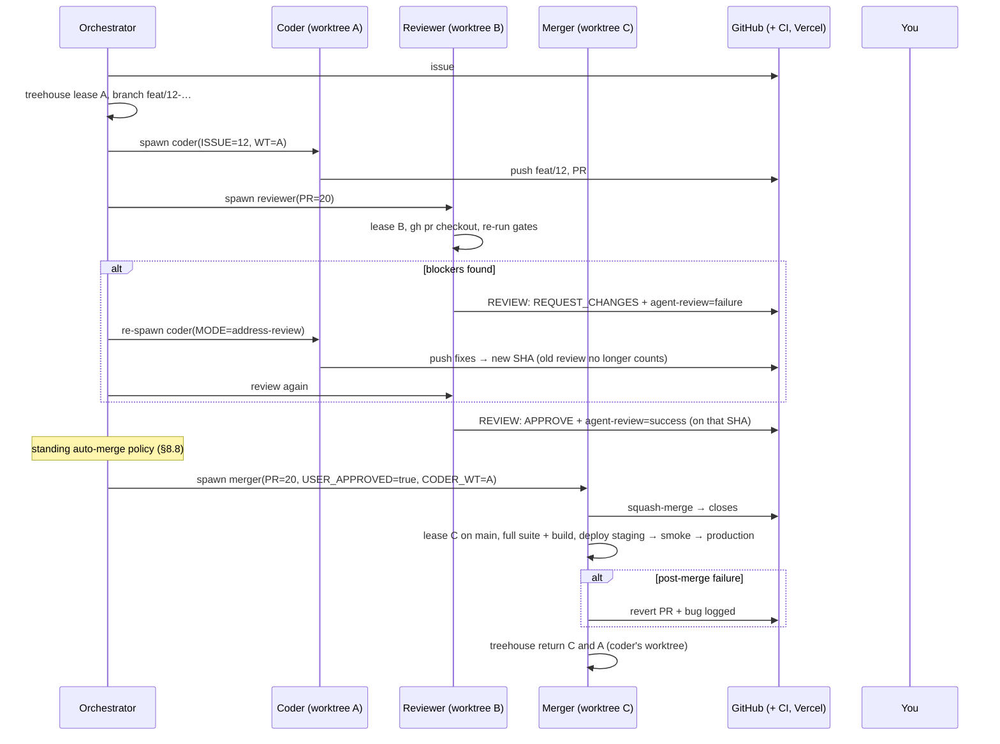

# 8. Multi-agent workflow (coders, reviewer, merger on treehouse worktrees)

Several Claude agents build the app in parallel. Each works in its **own git worktree** from a [treehouse](https://github.com/kunchenguid/treehouse) pool, so they never step on each other's files, ports or dev database. Nothing reaches `main` without an independent review, green CI and your OK.

## 8.1 Roles and scope

| Agent | Who | Does | Never does | Definition |
|---|---|---|---|---|
| **Orchestrator** | the main Claude session, with you | Turns the plan into task cards (issues), leases worktrees, spawns agents, routes results, hands approved PRs to the merger (standing auto-merge policy, §8.8), runs recorded manual charters, logs bugs, returns the worktrees of abandoned tasks (the merger returns the coder's worktree after a merge) | Write feature code itself | this document |
| **Coder** (up to 3 at once) | `coder` subagent | Implements ONE task card in its leased worktree: tests first, local gates, opens a PR to `main`, addresses review | Edit outside the card's scope, push anything but its own branch, merge, weaken tests | [`.claude/agents/coder.md`](../.claude/agents/coder.md) |
| **Reviewer** | `reviewer` subagent | Leases its **own fresh worktree**, checks out the PR, re-runs every gate, reviews against spec + security + modern-web-guidance, posts the verdict and the `agent-review` status | Edit code, commit, push, merge | [`.claude/agents/reviewer.md`](../.claude/agents/reviewer.md) |
| **Merger** (1, serial) | `merger` subagent | Merge queue: checks CI + `agent-review` + your approval, squash-merges, verifies `main` in a fresh worktree and on Vercel, opens a revert PR if `main` broke | Merge more than one PR at a time, resolve conflicts, push to `main` | [`.claude/agents/merger.md`](../.claude/agents/merger.md) |
| **You** | the student | Approve the task list; read each PR's "How it works" and approve the merge; do the phone steps (Telegram/Zalo) during manual charters | n/a | n/a |

Why the reviewer gets a separate worktree: it rebuilds from the pushed branch with no leftovers from the coder's machine state. "It works in my worktree" can't pass review.

## 8.2 Worktrees with treehouse

One-time config (committed):
- `treehouse.toml` sets `base_branch = "main"`, `unique_leaf = true` (slots are named `<repo>-<n>`), and `max_trees = 9` (3 coders, up to 3 reviewers, 1 merger, 2 spare).
- `.worktreeinclude` lists `server/.env`, so each worktree gets the secrets copied in. They stay git-ignored.

| Who | Command (run from the main checkout) | Lease holder | Released |
|---|---|---|---|
| Coder for issue #12 | `treehouse get --lease --lease-holder coder-12 -b feat/12-wallets-api --json` | `coder-12` | by the merger after the PR is merged (the orchestrator passes it as `CODER_WT`); by the orchestrator only if the task is abandoned |
| Reviewer for PR #20 | `treehouse get --lease --lease-holder reviewer-pr20 --json`, then `gh pr checkout 20 --detach` (the coder's worktree holds the branch) | `reviewer-pr20` | by the reviewer at the end of its run |
| Merger for PR #20 | `treehouse get --lease --lease-holder merger-pr20 --json` (latest `main`) | `merger-pr20` | by the merger at the end of its run |

- **Isolation per worktree:** `eval "$(tools/wt-env.sh)"` gives slot *n* its own API port (`4100+10n`), Vite port (`5300+10n`) and dev database (`MONGODB_DB=finance_wt<n>` on the same Atlas cluster). Automated tests use mongodb-memory-server, so they share nothing at all.
- **Pool hygiene:** `treehouse status` shows who holds what. Never `return --force` a slot with uncommitted work. Treehouse keeps `node_modules` between uses, so a reused slot starts fast.

## 8.3 Lifecycle of one task



**Labels** (created once): `status:ready`, `status:in-progress`, `status:in-review`, `status:changes-requested`, `review:approved`, `review:changes-requested`, `needs-update`, `auto-merge`, `revert`, `bug`.

**Required checks on `main`** (branch protection, set once): PR required, no direct pushes or force-pushes, status checks `ci` (GitHub Actions) and `agent-review` (set by the reviewer) must pass on the head commit, and the branch must be up to date.

## 8.4 Orchestrator procedure (main session)

1. **Plan:** keep the task cards (§8.7) as GitHub issues with label `status:ready`. Only tasks whose dependencies are merged are dispatchable.
2. **Dispatch** up to 3 ready tasks whose **scopes don't overlap**. For each:
   - lease a worktree (`-b feat/<issue>-<slug>`)
   - set `status:in-progress`
   - spawn `coder` (background, `ISSUE`, `WT`, `MODE=implement`)
3. **On `CODER: DONE`:** spawn `reviewer` for the PR. **On `CODER: BLOCKED`:** read the reason. Either widen the scope (by editing the card, after you agree) or split off a new task.
4. **On `REVIEW: REQUEST_CHANGES`:** re-spawn the same coder with `MODE=address-review` and `PR`, in the same worktree. **On `REVIEW: APPROVE`:** spawn `merger` with `PR`, `CODER_WT` (the coder's worktree) and `USER_APPROVED=true`. That is the standing auto-merge policy (§8.8); without it, first ask you to merge, quoting the PR's "How it works" and test results.
5. **Handle the merger's result:**
   - `NEEDS_UPDATE` or `CI_FAILED` → coder `address-review` with `PR` and the merger's reason (merge `main` in, or read the failed CI log and fix it), then review again.
   - `WAITING_FOR_USER` → only without the standing policy: ask you, quoting the merger's 3-line summary.
   - `MERGED` → the merger has already returned the coder's worktree (check `treehouse status`); dispatch the next unblocked task. With `deploy=PENDING_SECRETS` the code is on `main` but the deploy waits for the student's secrets: once they are in, deploy from a fresh lease cut from the latest `main`, never from the main checkout (it may be on another branch or stale): `WT=$(treehouse get --lease --lease-holder deploy --json | python3 -c 'import sys,json;print(json.load(sys.stdin)["path"])')`, then `cd "$WT" && tools/deploy.sh staging`, smoke it, `tools/deploy.sh production`, smoke it, and `treehouse return "$WT"`.
   - `REVERT_OPENED` → log the bug and send the task back to its coder.
   - A task that is abandoned or closed without merging → the orchestrator returns its coder's worktree. Each worktree has exactly one owner that returns it, so a slot is never released after it has been leased again.
6. **After each wave:** run the manual charters from [07-testing.md §7.4](07-testing.md) that the wave unlocked, recorded in your Chrome. Log any bugs in `docs/testing/bugs.json` and regenerate the Excel report. Report changes reach `main` through a small `chore(report)` PR (label `auto-merge` allowed, docs-only).
7. **Never** leave a lease without an owner: `treehouse status` should match the open PRs.

## 8.5 Conflict-avoidance rules (so parallel PRs merge cleanly)

| Hotspot | Rule |
|---|---|
| Express route registration | Each feature has its own router file; `server/src/routes/index.js` gets **one line per feature**, added only by that feature's task |
| RTK Query | `app/api.ts` holds only the base API. Each feature adds endpoints in its own file with `api.injectEndpoints` |
| i18n | One JSON file per feature and language: `client/src/i18n/{vi,en}/<feature>.json` |
| Router | Feature routes live in `features/<x>/routes.tsx`; `router.tsx` imports them, one line per feature |
| Navigation | `client/src/components/navItems.tsx` lists the pages; a feature card adds or edits only its own entry |
| Mongoose models | One file per model; only the owning task edits it, and changes to another task's model go through that task's card |
| `package.json` dependencies | Added only by T01, unless a card lists the dependency |
| `docs/testing/test-cases.json` | Append-only; new IDs use the card's feature prefix |

These one-line registrations (routes index, i18n namespace, router, navigation entry, test-case append) count as in scope for every card, so a coder never stops with `BLOCKED` for them (orchestrator decision, 2026-11-20). When merging `main`, a conflict on these lines is resolved by keeping both sides.

## 8.6 PR template (filled in by the coder)

```markdown
Closes #<issue>

## What
<one paragraph>

## How it works (for the defense)
<3–6 sentences: request flow, key function names, where data is stored>

## Tests
| Case ID | Level | Result |
|---|---|---|
| TC-F2-01 | API | ✅ |

Gates: typecheck ✅ · lint ✅ · unit/API ✅ (n/n) · e2e (scoped) ✅

## modern-web-guidance
- `<guide-id>`: what it changed (UI tasks only)

## Scope check
Changed paths are all inside the card's scope: ✅  (or: justification for exceptions)

## Risk / follow-ups
<anything the reviewer or merger should know>
```

## 8.7 Task cards (initial backlog)

Each card becomes one GitHub issue: Goal, Spec sections, Scope (paths the coder may change), Test case IDs, Depends on, Done when. **T01 must merge first.** The orchestrator then dispatches up to three unblocked cards at a time.

| ID | Task | Depends on | Scope (paths) | Test IDs |
|---|---|---|---|---|
| T01 | **Scaffold + live skeleton**: npm workspaces, `client` (Vite react-ts, strict), `server` (Express app/local, config/env, db with `MONGODB_DB`), `api/index.js`, `vercel.json`, `GET /api/health`, error/notFound middleware, Vitest + Playwright config, GitHub Actions `ci` workflow | — | repo root config, `api/`, `client/` skeleton, `server/src/{app,local}.js`, `server/src/config/`, `server/src/middleware/{error,notFound}.js`, `.github/workflows/ci.yml` | TC-NF-01, TC-NF-06, TC-NF-07 |
| T02 | **Auth API**: User + Session models, register/login/refresh/logout/me, sessions, rate limit, `requireAuth`/`requireRole`, `PATCH /users/me` | T01 | `server/src/models/{User,Session}.js`, `routes|controllers|services/{auth,sessions,users}*`, `middleware/{auth,requireRole}.js` | TC-F1-01…07, 09, 10 |
| T03 | **App shell**: theme (light/dark/system), i18n setup, responsive layout (drawer/bottom nav), router, store + base API with refresh, AuthContext, Login/Register pages | T01 | `client/src/{app,auth,components,theme,i18n,router.tsx,main.tsx}`, `client/src/features/auth/` | TC-F1-08, TC-F12-01…03, TC-NF-02 |
| T04 | **Text parser** (pure function + rule-table tests) | T01 | `server/src/bot/parser.js`, its tests | TC-F8-01, TC-F8-02, TC-F4-07 |
| T05 | **Wallets + categories API** + default templates seed + seeding on register | T02 | `server/src/models/{Wallet,Category}.js`, routes/controllers/services for wallets and categories, `server/src/seed/` | TC-F2-01…04, TC-F3-01…03 |
| T06 | **Wallets + categories screens** | T03, T05 | `client/src/features/{wallets,categories}/` | TC-F2-05, TC-F3-04 |
| T07 | **Transactions API** + `POST /transactions/parse` | T04, T05 | `server/src/models/Transaction.js`, transactions routes/controllers/services | TC-F4-01…05, TC-F13-01 |
| T08 | **Transactions screen + QuickAdd** | T06, T07 | `client/src/features/transactions/`, `client/src/components/QuickAdd*` | TC-F4-06, TC-F13-02, 03 |
| T09 | **Budgets + statistics API** | T07 | `server/src/models/Budget.js`, budgets + stats routes/services | TC-F5-01, 02, TC-F6-01…03 |
| T10 | **Dashboard + budgets screens** | T08, T09 | `client/src/features/{dashboard,budgets}/` | TC-F5-04, TC-F6-04 |
| T11 | **Bot core + Telegram + linking** | T07 | `server/src/bot/{core,telegram,messages.*}.js`, models `ChatLink`, `LinkCode`, chat-links routes, webhooks route (telegram) | TC-F7-01…04, TC-F8-03…06, 10, 11, TC-F5-03 |
| T12 | **Zalo adapter** | T11 | `server/src/bot/zalo.js`, webhooks route (zalo part) | TC-F8-07 |
| T13 | **KIE client + receipts** (+ KIE `X-KIE-Key` patch and Docker/tunnel notes) | T11 | `server/src/services/receipts.js`, receipts route | TC-F8-08, 09, TC-F10-01, 02 |
| T14 | **Bot inbox screen** (link card, drafts, receipt upload with resize) | T08, T11, T13 | `client/src/features/bot/` | TC-F9-01, 02, TC-F10-03 |
| T15 | **Admin API + screens** | T05, T03 | admin routes/services, `client/src/features/admin/` | TC-F11-01…05 |
| T16 | **Settings/sessions page + full E2E journeys + non-functional suite** | T10, T14, T15 | `client/src/features/settings/`, `client/e2e/` | TC-NF-02…05, MT prep |

Waves that follow from the dependencies: **W0** T01 → **W1** T02, T03, T04 → **W2** T05, then T06 + T07 → **W3** T08, T09, T11 → **W4** T10, T12, T13, T15 → **W5** T14, T16.

## 8.8 Decisions recorded (2026-11-20)

- **Auto-merge:** a PR that the reviewer approved and CI passed is merged by the merger without asking each time. Every PR still keeps its "How it works" section for the defense, and a broken `main` gets a revert PR.
- **Scope of the unattended run:** all task cards T01–T16, then the full test run, recorded charters and the Excel report.
- **Hosting:** Vercel projects `sochitieu-btl` (production, DB `finance`) and `sochitieu-btl-staging` (test site, DB `finance_staging`). Recorded browser sessions in your Chrome run on **staging only**, with test accounts. Deploys go through `tools/deploy.sh` (CLI), because the repo isn't Git-connected to Vercel. `tools/vercel-env-push.sh` copies `server/.env` into each project's env vars without printing the values.
- **Ports on the dev server:** the API uses `4100+10n` and Vite `5300+10n`, because 3000/5173/8000 are taken.

## 8.9 One-time setup checklist

- [ ] First commit on `main` and push. Treehouse needs a default branch to cut worktrees from.
- [ ] Create the labels in §8.3. gh 2.4 has no `gh label`, so use the API: `gh api repos/{owner}/{repo}/labels -f name=<label> -f color=<hex>`.
- [ ] Branch protection on `main` with required checks `ci` + `agent-review`. Do this after T01 merges, so the `ci` check exists.
- [ ] Two Vercel projects (`sochitieu-btl`, `sochitieu-btl-staging`) linked by ID in `server/.env`. Do **not** Git-connect them: deploys go through `tools/deploy.sh`, staging first (§8.8).
- [ ] Turn the task cards in §8.7 into issues (`gh issue create`, label `status:ready` for T01).
- [ ] Start a **new Claude session** in the repo, so the project agents in `.claude/agents/` load.
