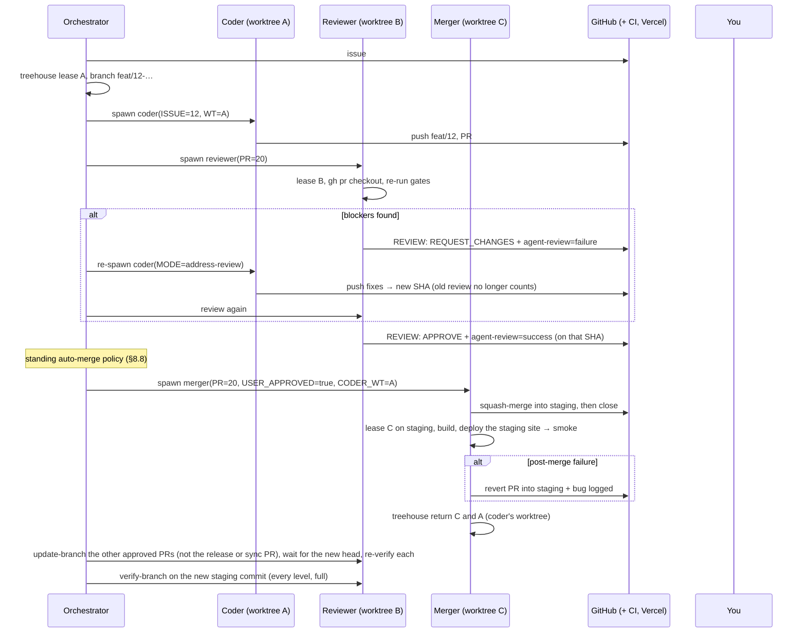
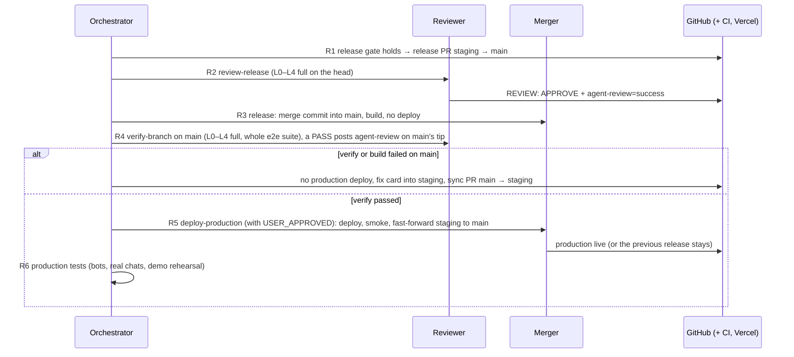

# 8. Multi-agent workflow (coders, reviewer, merger on treehouse worktrees)

Several Claude agents build the app in parallel. Each works in its **own git worktree** from a [treehouse](https://github.com/kunchenguid/treehouse) pool, so they never step on each other's files, ports or dev database. Every PR gets an independent review and green CI before it merges. Cards merge into `staging`; `main` and production change only through a release, after `main` has passed every test level.

## 8.1 Roles and scope

| Agent | Who | Does | Never does | Definition |
|---|---|---|---|---|
| **Orchestrator** | the main Claude session, with you | Turns the plan into task cards (issues), leases worktrees, spawns agents, routes results, hands approved PRs to the merger (standing auto-merge policy, §8.8), runs recorded manual charters, logs bugs, opens the release PR and, when needed, the sync PR (§8.4), returns the worktrees of abandoned tasks (the merger returns the coder's worktree after a merge) | Write feature code itself | [`.claude/agents/orchestrator.md`](../.claude/agents/orchestrator.md) (run with `claude --agent orchestrator`) |
| **Coder** (as many as there are independent cards) | `coder` subagent | Implements ONE task card in its leased worktree: tests first, local gates, opens a PR into `staging`, addresses review | Edit outside the card's scope, push anything but its own branch, merge, weaken tests | [`.claude/agents/coder.md`](../.claude/agents/coder.md) |
| **Reviewer** | `reviewer` subagent | Leases its **own fresh worktree** and re-runs every gate. Modes: `review` and `review-docs` (a card, docs or revert PR into `staging`: spec, security, modern-web-guidance; posts the verdict and the `agent-review` status), `re-verify` (the same diff on a newer base, and the sync PR), `verify-branch` (the newest `staging` or `main` commit, no PR, full test levels; a PASS on `main` also posts the `agent-review` success status on that commit, which is what lets the merger's fast-forward of `staging` through the protection, R4 and R5 in §8.4), `review-release` (the release PR, which has no card: its scope is the run's merged PRs). The `agent-review` status goes on the commit the reviewer tested; if the PR's head moved while it ran (an `update-branch` refresh), it posts nothing and reports `REVIEW: STALE` | Edit code, commit, push, merge | [`.claude/agents/reviewer.md`](../.claude/agents/reviewer.md) |
| **Merger** (1, serial) | `merger` subagent | Merge queue, one PR at a time, after CI + `agent-review` + your approval. Modes: `merge` (a card PR: squash-merge into `staging`, close the card, deploy the staging site, open a revert PR into `staging` if that broke), `release` (merge the release PR `staging → main`, or the sync PR `main → staging`, with a merge commit; no deploy), `deploy-production` (only after `main` verified, and only with your approval or the standing policy: deploy, smoke, fast-forward `staging` to `main`) | Merge more than one PR at a time, resolve conflicts, push to `staging` or `main` (except that one fast-forward), squash a release, revert on `main` | [`.claude/agents/merger.md`](../.claude/agents/merger.md) |
| **You** | the student | Approve the task list; read each PR's "How it works" and approve the merge; do the phone steps (Telegram/Zalo) during manual charters | n/a | n/a |

Why the reviewer gets a separate worktree: it rebuilds from the pushed branch with no leftovers from the coder's machine state. "It works in my worktree" can't pass review.

## 8.2 Worktrees with treehouse

One-time config (committed):
- `treehouse.toml` sets `base_branch = "staging"`, `unique_leaf = true` (slots are named `<repo>-<n>`), and `max_trees = 32` (no fixed number of agents; the orchestrator raises it when the pool is full).
- `.worktreeinclude` lists `server/.env`, so each worktree gets the secrets copied in. They stay git-ignored.

| Who | Command (run from the main checkout) | Lease holder | Released |
|---|---|---|---|
| Coder for issue #12 | `treehouse get --lease --lease-holder coder-12 --base staging -b feat/12-wallets-api --json` | `coder-12` | by the merger after the PR is merged (the orchestrator passes it as `CODER_WT`); by the orchestrator if the task is abandoned, or if the merger reports `coder_wt=kept` (the slot was dirty or on another commit) |
| Reviewer for PR #20 | `treehouse get --lease --lease-holder reviewer-pr20 --json`, then `gh pr checkout 20 --detach` (the coder's worktree holds the branch) | `reviewer-pr20` | by the reviewer at the end of its run |
| Merger for PR #20 | `treehouse get --lease --lease-holder merger-pr20 --base staging --json` (latest `staging` for `merge`; `--base main` for `release` of the release PR, to build `main`, and for `deploy-production`). The sync PR needs no lease: it builds and deploys nothing | `merger-pr20` | by the merger at the end of its run |

- **Isolation per worktree:** `eval "$(tools/wt-env.sh)"` gives slot *n* its own API port (`4100+10n`), Vite port (`5300+10n`) and dev database (`MONGODB_DB=finance_wt<n>` on the same Atlas cluster). Automated tests use mongodb-memory-server, so they share nothing at all. Run the script once per shell, before you start the slot's servers: a port another program holds moves to the next free one, so running it again while the slot's own servers are listening moves the ports.
- **Pool hygiene:** `treehouse status` shows who holds what. Never `return --force` a slot with uncommitted work. Treehouse keeps `node_modules` between uses, so a reused slot starts fast.

## 8.3 Lifecycle of one task



A release is a separate run through the same agents. Steps R1 to R6 are the numbered steps in §8.4; production is touched only in R5, after R4 has passed on `main`:



**Branches:** card PRs target `staging`, and the merger deploys the staging site after each merge; a reviewer then verifies the newest `staging` commit (every test level in full). When a run's cards are all in `staging` and it is clean, one release PR `staging → main` is reviewed, merged with a merge commit, verified on `main`, and only then deployed to production; `staging` is then fast-forwarded to `main`. Every PR, docs included, is reviewed. Details: §8.4 and [`.claude/agents/orchestrator.md`](../.claude/agents/orchestrator.md) ("Branches"). `main` stays the default branch.

**Closing cards:** a `Closes #12` line in a PR into `staging` does not close the issue, because GitHub only acts on it when the PR merges into the default branch (`main`). So the merger closes the card itself after the squash-merge, with a comment "Merged into staging in #<PR>; ships with the next release". The board shows the card as merged, and as released after R5.

**Labels** (created once): `status:ready`, `status:in-progress`, `status:in-review`, `status:changes-requested`, `review:approved`, `review:changes-requested`, `needs-update`, `auto-merge`, `revert`, `bug`.

**Required checks on `main` and `staging`** (branch protection, set once for each): the status checks `ci` (GitHub Actions) and `agent-review` (set by the reviewer) must pass on the head commit, the branch must be up to date, and the rules apply to admins too. There is no "require a pull request" or required-reviews setting: the agents' rule is that nobody pushes to either branch, except the merger's one fast-forward of `staging` to `main`, and the two required checks keep any commit that was not reviewed off both branches. That fast-forward passes the protection only because `main`'s tip has both checks: a green `ci` from the push to `main`, and `agent-review`, which the reviewer posts on that commit when `verify-branch` passes on `main` (R4). If either is missing, GitHub refuses the fast-forward. The `ci` job also runs the agent service's pytest (`npm run test:agent`, from T44), so the one required `ci` check covers both the npm gates and the Python gate. A card that changes `agent/` runs it locally too (Python 3.12 in `agent/.venv`, see [06-deployment.md §6.10](06-deployment.md#610-ci)).

## 8.4 Orchestrator procedure (main session)

1. **Plan:** keep the task cards (§8.7) as GitHub issues with label `status:ready`. Only tasks whose dependencies are merged are dispatchable.
2. **Dispatch continuously, not in waves:** a coder on every ready task whose **scope doesn't overlap** a running one, highest critical path first (rules in [`.claude/agents/orchestrator.md`](../.claude/agents/orchestrator.md)). For each:
   - lease a worktree cut from `staging` (`--base staging -b feat/<issue>-<slug>`)
   - set `status:in-progress`
   - spawn `coder` (background, `ISSUE`, `WT`, `MODE=implement`)
3. **On `CODER: DONE`:** spawn `reviewer` for the PR. **On `CODER: BLOCKED`:** read the reason. Either widen the scope (by editing the card, after you agree) or split off a new task.
4. **On `REVIEW: REQUEST_CHANGES`:** re-spawn the same coder with `MODE=address-review` and `PR`, in the same worktree. A docs or `chore(report)` PR has no coder: the orchestrator fixes it itself (docs only) and a reviewer checks it again. A revert PR has no coder either: it goes to you as `blocked`. **On `REVIEW: APPROVE`:** spawn `merger` (`MODE=merge`) with `PR`, `CODER_WT` (the coder's worktree) and `USER_APPROVED=true`. That is the standing auto-merge policy (§8.8); without it, first ask you to merge, quoting the PR's "How it works" and test results.
5. **Handle the merger's result** (card, docs and revert PRs into `staging`; the release PR and the sync PR are in step 7):
   - `MERGED` into `staging` → the merger has already closed the card (if it had one). Its line ends with `coder_wt=returned`, `kept` or `none`: `kept` means the coder's worktree was dirty or on another commit, so the orchestrator owns that lease now and returns it only after a look (`treehouse status`). `staging` moved, so every other approved PR is now behind it, **except the release PR and the sync PR**: their heads are `staging` and `main`, so `update-branch` on them would be a direct push (step 7). The orchestrator refreshes the queue: it reads each PR's `mergeStateStatus` and calls `update-branch` only on a `BEHIND` one. A PR that is already up to date answers HTTP 422 "no new commits", which is a no-op and never a reason to send a coder back. A `DIRTY` PR conflicts: a card PR goes back to its coder (`address-review`, "merge `staging`"). The call answers 202 and the head moves a moment later, so the orchestrator waits until the PR's head SHA has changed before it fast-forwards the coder's slot and spawns the `re-verify` reviewer on the new head. Until that re-verify returns `APPROVE` the PR stays out of the merge queue: the merger never meets a PR with no `agent-review` on its head, and no second reviewer starts next to the re-verify. Then spawn a `verify-branch` reviewer on the new `staging` commit and dispatch the next unblocked task. With `deploy=PENDING_SECRETS` the code is on `staging` but the staging deploy waits for your secrets: once they are in, deploy from a fresh lease cut from the latest `staging`, never from the main checkout (it may be on another branch or stale): `WT=$(treehouse get --lease --lease-holder deploy --base staging --json | python3 -c 'import sys,json;print(json.load(sys.stdin)["path"])')`, then `cd "$WT" && tools/deploy.sh staging`, smoke it, and `treehouse return "$WT"`. Production is not deployed here; see step 7.
   - `NEEDS_UPDATE` (card, revert or docs PR) → the fallback, for a PR that fell behind before the refresh above reached it: the same refresh for that one PR (`update-branch`, wait for the new head, re-verify); on a conflict, a card PR goes to its coder (`address-review` with `PR`, merge `staging` in), a docs PR to the orchestrator, a revert PR to you as `blocked`. The release PR and the sync PR never get `update-branch`: see step 7.
   - `CI_FAILED` (card PR) → coder `address-review` with the failed CI log, then review again. A docs or `chore(report)` PR: the orchestrator fixes the failing step itself and a reviewer checks it again. A revert PR: `blocked` with the failing step.
   - `REFUSED` → the reason names the failed gate. Not approved, or no `agent-review` on the head: spawn the reviewer again (`review-release` for the release PR, `re-verify` for the sync PR), unless a re-verify of that PR is already pending because it was refreshed: then wait for it. A `mergeStateStatus` other than `CLEAN` (`BLOCKED`, `UNSTABLE`, `HAS_HOOKS`) while both are fine: read it once more, then mark the PR `blocked` and tell you, because a new review can't fix it. Wrong base or head, draft or closed: `blocked`.
   - `WAITING_FOR_USER` (a merge, or `deploy-production`) → only without the standing policy: ask you, quoting the merger's 3-line summary. Under the policy the orchestrator passes `USER_APPROVED=true` to every merger run (`merge`, `release` and `deploy-production`), because the merger's gate checks it in all three.
   - `REVIEW: STALE` (from a reviewer) → the PR's head moved while it ran, and it posted nothing. If a re-verify of the new head is already pending, wait for it; otherwise spawn the same review step again on the new head.
   - `REVERT_OPENED` → log the bug, and handle `coder_wt` as for `MERGED`. The merger's revert PR goes into `staging` and is routed like a card PR: reviewer (`review`), then merger (`merge`). The card goes back to a coder after the revert merges. Nothing is ever reverted on `main`. If `REVERT_OPENED` arrives during a release freeze (step 7), the freeze ends: the broken commit is in `staging`, the release head, so the release approval is stale, and a revert PR can't merge under a freeze. The revert merges first, and R2 runs again after it.
   - A task that is abandoned or closed without merging → the orchestrator returns its coder's worktree. Each worktree has exactly one owner that returns it, so a slot is never released after it has been leased again.
6. **Verify and test staging.** After each merge, a reviewer in `verify-branch` mode runs every test level in full on the newest `staging` commit (older commits are skipped). `VERIFY: FAIL` is a bug: log it in `docs/testing/bugs.json` and file a fix card into `staging`. A sync PR merge (step 7) adds nothing to `staging`'s tree, so it gets no verify: the commit before it keeps its result. Run the manual charters from [07-testing.md §7.4](07-testing.md) that the merges unlocked on the staging site, recorded in your Chrome, then regenerate the Excel report. Report changes reach `staging` through a small `chore(report)` PR (label `auto-merge` allowed, docs-only) and ship with the next release.
7. **Release.** It opens only when every card of the run is merged into `staging`, the newest `staging` commit has `VERIFY: PASS`, the staging charters are done, no S1 or S2 bug is open, and no earlier release is still waiting for secrets or for your yes. Steps R1 to R6 run one release at a time:
   - **R1** The orchestrator opens the release PR `staging → main` (`gh pr create --base main --head staging`), listing the merged PRs and the fixed bugs. It gives the reviewer `SINCE`, the commit date of `main`'s tip: that is the previous release, because nothing else changes `main`.
   - **R2** A reviewer (`review-release`) runs every test level in full on its head. A release PR has no card, so the card's Scope list does not apply. The diff may hold only this run's merged PRs: those merged into `staging` since `SINCE`, sync PRs not counted.
   - **R3** The merger (`release`, with `USER_APPROVED=true` like every merger run) merges it with a **merge commit** (never a squash, never deleting `staging`) and builds `main`. Nothing is deployed to production yet.
   - **R4** A reviewer (`verify-branch`, `BRANCH=main`) runs every level in full, the whole end-to-end suite included. On a PASS it also posts the `agent-review` success status on `main`'s tip. Without that status, and a green `ci` from the push to `main`, the protected `staging` refuses R5's fast-forward.
   - **R5** Only if R4 passed, and only with `USER_APPROVED=true` (the standing policy, or your yes; without it the merger prints `DEPLOY: WAITING_FOR_USER` and the orchestrator asks you), the merger (`deploy-production`) deploys production, smokes it, and fast-forwards `staging` to `main`. If `main` moved since R4, it stops with `reason=main moved`, with no `staging=` field: the orchestrator verifies the new tip and calls it again. If the deploy fails, Vercel keeps the previous release live. If it lacks a secret of yours (`DEPLOY: PENDING_SECRETS`), production keeps the previous release and the orchestrator lists the missing names under "Needs you"; once they are in, it calls `deploy-production` again. A refused fast-forward means `staging` got commits after the release was cut, or `ci` or `agent-review` is missing on `main`'s tip; the merger waits for a `ci` run that is still going, re-runs a completed failed one once (gh 2.4 can only rerun a completed run), and otherwise reports `staging=left`.
   - **R6** The orchestrator runs the production charters that staging can't: bots and real chats, the assistant, the digest, the cron, and the demo rehearsal.
   - **Fixed forward:** if R3's build or R4 fails, nothing is deployed and nothing is reverted on `main`. The bug gets a fix card into `staging`, and the fix ships in the next release.
   - **Release PR sent back:** the reasons differ, and so does the route. `REQUEST_CHANGES` from R2: each finding becomes a fix card into `staging`, and R2 runs again after the fixes merge. `MERGE: CI_FAILED`: the failing step is logged as a bug and gets a fix card, and R2 runs again after it merges. `MERGE: REFUSED` goes by its reason: no approval or no `agent-review` on the head → a fresh `review-release`, with no findings and no fix card; a `mergeStateStatus` other than `CLEAN` (`BLOCKED`, `UNSTABLE`, `HAS_HOOKS`) → the release is `blocked` and the value goes under "Needs you"; a wrong base or head, a draft or a closed PR → `blocked`. Each of these ends the freeze (below), and the next approval starts it again. `NEEDS_UPDATE` on it means `main` has a commit `staging` lacks: open the sync PR, and run R2 again when it merges.
   - **Sync PR:** whenever `staging` can't be fast-forwarded to `main` (R3 or R4 failed, or the fast-forward was refused), and when the release PR comes back `NEEDS_UPDATE`, the orchestrator opens a PR `main → staging`. A reviewer checks that it adds nothing to `staging`'s tree (the `agent-review` status it posts on `main`'s tip means only that, never "`main` is good"), and the merger merges it with a merge commit (never a squash, never deleting `main`) and needs no lease. Never `update-branch` the release PR or the sync PR: their heads are `staging` and `main`, so that would be a direct push. If the reviewer finds that it changes the tree, something reached `main` outside a release: the release is `blocked` for you. If `staging` moves past a sync PR (`NEEDS_UPDATE (sync)`), it is `blocked` too: you bring `staging` up to date with `main`. If its `ci` fails, the orchestrator waits for the run if it is still going, re-runs a completed failed one once (`gh run rerun`), then asks you.
   - **Freeze:** from the release PR's approval until the release is over, no card PR merges into `staging`, because a sync PR (head `main`) can't be brought up to date once `staging` has moved. The release is over when a `DEPLOY:` line (`OK`, `FAILED` or `PENDING_SECRETS`) ends with `staging=fast-forwarded` or `already`, or when the sync PR has merged. A line with no `staging=` field (`main moved`, `WAITING_FOR_USER`) stopped before the fast-forward, so the freeze stays. Approved PRs wait; coders and reviewers keep working. If a card merge is already running when the release PR is approved, it lands first and moves `staging`, so that approval is stale: R2 runs again before the merger releases. If that merge broke `staging`, the merger answers `REVERT_OPENED` instead: the release head holds the broken commit and the revert PR can't merge under a freeze, so the freeze ends, the revert merges first, and R2 runs again after it. **Ending the freeze restarts the merge queue.** A fast-forward or a sync merge leaves every approved PR behind `staging`, so the orchestrator refreshes them as in step 5 (`update-branch` on a `BEHIND` one, wait for the new head, `re-verify`) and spawns the merger for the next queued PR, instead of letting each PR find out through `NEEDS_UPDATE` and a wasted merger run.
8. **Never** leave a lease without an owner: `treehouse status` should match the open PRs.

## 8.5 Conflict-avoidance rules (so parallel PRs merge cleanly)

| Hotspot | Rule |
|---|---|
| Express route registration | Each feature has its own router file; `server/src/routes/index.js` gets **one line per feature**, added only by that feature's task |
| RTK Query | `app/api.ts` holds only the base API. Each feature adds endpoints in its own file with `api.injectEndpoints` |
| i18n | One JSON file per feature and language: `client/src/i18n/{vi,en}/<feature>.json` |
| Router | Feature routes live in `features/<x>/routes.tsx`; `router.tsx` imports them, one line per feature |
| Navigation | `client/src/components/navItems.tsx` lists the pages; a feature card adds or edits only its own entry |
| Mongoose models | One file per model; only the owning task edits it, and changes to another task's model go through that task's card |
| `package.json` dependencies | Added only by T01, unless a card lists the dependency |
| `docs/testing/test-cases.json` | Append-only; new IDs use the card's feature prefix |

These one-line registrations (routes index, i18n namespace, router, navigation entry, test-case append) count as in scope for every card, so a coder never stops with `BLOCKED` for them (orchestrator decision, 2026-11-20). When merging `staging` into a branch, a conflict on these lines is resolved by keeping both sides.

## 8.6 PR template (filled in by the coder)

The PR targets `staging`. The `Closes` line is for the merger, which reads the card number from it and closes the card after the merge (§8.3).

```markdown
Closes #<issue>

## What
<one paragraph>

## How it works (for the defense)
<3–6 sentences: request flow, key function names, where data is stored>

## Tests
| Case ID | Level | Result |
|---|---|---|
| TC-F2-01 | API | ✅ |

Gates: typecheck ✅ · lint ✅ · unit/API ✅ (n/n) · agent pytest ✅ (n/n, cards that change `agent/`) · e2e (scoped) ✅

## modern-web-guidance
- `<guide-id>`: what it changed (UI tasks only)

## Scope check
Changed paths are all inside the card's scope: ✅  (or: justification for exceptions)

## Risk / follow-ups
<anything the reviewer or merger should know>
```

## 8.7 Task cards (initial backlog)

Each card becomes one GitHub issue: Goal, Spec sections, Scope (paths the coder may change), Test case IDs, Depends on, Done when. **T01 must merge first.** The orchestrator then keeps every unblocked, non-overlapping card in progress at once.

| ID | Task | Depends on | Scope (paths) | Test IDs |
|---|---|---|---|---|
| T01 | **Scaffold + live skeleton**: npm workspaces, `client` (Vite react-ts, strict), `server` (Express app/local, config/env, db with `MONGODB_DB`), `api/index.js`, `vercel.json`, `GET /api/health`, error/notFound middleware, Vitest + Playwright config, GitHub Actions `ci` workflow | — | repo root config, `api/`, `client/` skeleton, `server/src/{app,local}.js`, `server/src/config/`, `server/src/middleware/{error,notFound}.js`, `.github/workflows/ci.yml` | TC-NF-01, TC-NF-06, TC-NF-07 |
| T02 | **Auth API**: User + Session models, register/login/refresh/logout/me, sessions, rate limit, `requireAuth`/`requireRole`, `PATCH /users/me` | T01 | `server/src/models/{User,Session}.js`, `routes|controllers|services/{auth,sessions,users}*`, `middleware/{auth,requireRole}.js` | TC-F1-01…07, 09, 10 |
| T03 | **App shell**: theme (light/dark/system), i18n setup, responsive layout (drawer/bottom nav), router, store + base API with refresh, AuthContext, Login/Register pages | T01 | `client/src/{app,auth,components,theme,i18n,router.tsx,main.tsx}`, `client/src/features/auth/` | TC-F1-08, TC-F12-01…03, TC-NF-02 |
| T04 | **Text parser** (pure function + rule-table tests) | T01 | `server/src/bot/parser.js`, its tests | TC-F8-01, TC-F8-02, TC-F4-07 |
| T05 | **Wallets + categories API** + default templates seed + seeding on register | T02 | `server/src/models/{Wallet,Category}.js`, routes/controllers/services for wallets and categories, `server/src/seed/` | TC-F2-01…04, TC-F3-01…03 |
| T06 | **Wallets + categories screens** | T03, T05 | `client/src/features/{wallets,categories}/` | TC-F2-05, TC-F3-04 |
| T07 | **Transactions API** + `POST /transactions/parse` | T04, T05 | `server/src/models/Transaction.js`, transactions routes/controllers/services | TC-F4-01…05, TC-F13-01 |
| T08 | **Transactions screen + QuickAdd** | T06, T07 | `client/src/features/transactions/`, `client/src/components/QuickAdd*` | TC-F4-06, TC-F13-02, 03 |
| T09 | **Budgets + statistics API** | T07 | `server/src/models/Budget.js`, budgets + stats routes/services | TC-F5-01, 02, TC-F6-01…03 |
| T10 | **Dashboard + budgets screens** | T08, T09 | `client/src/features/{dashboard,budgets}/` | TC-F5-04, TC-F6-04 |
| T11 | **Bot core + Telegram + linking** | T07 | `server/src/bot/{core,telegram,messages.*}.js`, models `ChatLink`, `LinkCode`, chat-links routes, webhooks route (telegram) | TC-F7-01…04, TC-F8-03…06, 10, 11, TC-F5-03 |
| T12 | **Zalo adapter** | T11 | `server/src/bot/zalo.js`, webhooks route (zalo part) | TC-F8-07 |
| T13 | **KIE client + receipts** (+ KIE `X-KIE-Key` patch and Docker/tunnel notes) | T11 | `server/src/services/receipts.js`, receipts route | TC-F8-08, 09, TC-F10-01, 02 |
| T14 | **Bot inbox screen** (link card, drafts, receipt upload with resize) | T08, T11, T13 | `client/src/features/bot/` | TC-F9-01, 02, TC-F10-03 |
| T15 | **Admin API + screens** | T05, T03 | admin routes/services, `client/src/features/admin/` | TC-F11-01…05 |
| T16 | **Settings/sessions page + full E2E journeys + non-functional suite** | T10, T14, T15 | `client/src/features/settings/`, `client/e2e/` | TC-NF-02…05, MT prep |
| T17 (#37) | **UI redesign**: design system, app shell, dashboard and sign-in pages | T16 | `client/src/{theme,components}/`, presentation code in `client/src/features/*/`, `client/src/i18n/{vi,en}/` (display strings), client fonts/icons | TC-NF-12, TC-NF-13 |
| T18 (#39) | **UI draft 3**: soft sky/pink theme, weekly column chart, light/dark/system | T17 | same as T17 (font `@fontsource/be-vietnam-pro`) | TC-NF-13, TC-NF-14 |
| T19 (#42) | **Real-chat bot e2e**: type into Telegram and Zalo, check replies and server state | T12, T13 | `tools/bot-e2e/`, `docs/testing/bot-e2e.md`, `docs/testing/{test-cases,runs,results}.json` | TC-F7-08, TC-F8-16…18 |
| T20 (#44) | **Charter bugs**: stale Bot inbox (BUG-004), language change keeps old names (BUG-005) | T14 | `client/src/features/bot/` (draft list), `client/src/auth/usersApi.ts`, `docs/testing/bugs.json` | TC-F9-04, TC-F12-04 |
| T21 (#46) | **BUG-003**: 30 s grace window for refresh-token reuse | T02 | `server/src/services/auth.js` (refresh), `docs/04-backend.md` §4.3 | TC-F1-05, TC-F1-19 |
| T22 (#49) | **BUG-006**: revoke-all races a parallel rotation | T21 | `server/src/services/{auth,sessions}.js`, `server/src/models/{User,Session}.js`, docs/03–04 | TC-F1-20 |
| T23 (#51) | **Tooling**: pin the Vercel CLI, bot-e2e `--help` (BUG-007), refresh stale test counts | T19 | `tools/{deploy,vercel-env-push}.sh`, `tools/bot-e2e/`, `README.md`, docs/06–07 | TC-NF-15 |
| T24 (#53) | **Auth hardening** (round 2): bcrypt 72-byte limit, revoke races, 403 after a lock, register checks (BUG-009…012) | T22 | `server/src/{services,routes}/{auth,sessions,users}.js`, `server/src/models/{User,Session}.js`, `client/src/features/auth/`, `client/src/auth/session.ts`, `PasswordForm.tsx` | TC-F1-21…24, TC-F11-02 |
| T25 (#54) | **Money correctness** (round 2): stale inbox confirm (S2), archived default wallet, quick add drops lines, 10^13 ceiling (BUG-008, 016…018) | — | `server/src/services/{transactions,wallets,stats,budgets}.js` + routes/models, `QuickAdd.tsx`, `client/src/features/bot/{DraftCard,DraftList,botApi}`, `WalletsPage.tsx` | TC-F2-07, 08, TC-F4-12, TC-F9-05, 06, TC-F13-05, 06 |
| T26 (#55) | **Bot capture** (round 2): lines lost on a failed reply, Zalo `55k` correction, ok/huy reach every draft, `/month` category budgets (BUG-026…029) | — | `server/src/bot/**`, `tools/bot-e2e/{bot-e2e.mjs,scenarios.json}`, `docs/testing/bot-e2e.md` | TC-F8-19…22 |
| T27 (#56) | **Dashboard** (round 2): budget bar threshold, category warnings, amount wrapping, error states, chart Tab stops, plurals (BUG-019…024) | — | `client/src/features/dashboard/**`, `MoneyText.tsx`, `client/src/features/budgets/` (shared level helper), `client/src/i18n/{vi,en}/{dashboard,transactions}.json` | TC-F5-07, TC-F6-06, 07, TC-F12-05, TC-NF-16, 17 |
| T28 (#57) | **Client UI** (round 2): logout landing, preference warning, admin retry, avatar initials, long chat names, receipt error language (BUG-013…015, 025, 030, 031) | — | `client/src/{auth,components}/`, `client/src/features/{settings,admin}/`, `client/src/features/bot/{LinkedAccounts,ReceiptUpload}.tsx` | TC-F1-25, TC-F7-09, TC-F10-06, TC-F11-09, TC-F12-06, 07 |
| T29 (#63) | **Money ceiling follow-up**: balance card fits 14-digit totals, amount fields check the ceiling, parser rejects over-cap amounts (BUG-018 UI, BUG-032, BUG-033) | T25, T27 | `DashboardPage.tsx`, `client/src/features/{transactions,budgets,wallets,bot}/` amount fields, `server/src/bot/{parser,core}.js` | TC-F4-13, TC-F8-23, TC-F13-07, TC-NF-18 |
| T30 (#67) | Receipt totals from the tester's sheet: VAT total, voucher numbers, years, torn and sideways receipts (BUG-034…037). **Paused** by the owner (PR #70) | — | `server/src/services/receipts.js`, `server/src/models/Transaction.js`, `server/src/bot/core.js`, `server/src/bot/messages.{vi,en}.js`, `client/src/features/bot/DraftCard.tsx`, `client/src/i18n/{vi,en}/bot.json`, `server/test/receipts.test.js`, `server/test/kie.contract.test.js`, `server/test/fixtures/`, `tools/bot-e2e/`, `docs/02-features.md`, `docs/04-backend.md`, `docs/06-deployment.md`, `docs/testing/test-cases.json` | new F10 / F8 ids |
| T31 (#68) | Wallets: only credit wallets may start with a negative balance (BUG-038) | — | `server/src/routes/wallets.js`, `server/src/models/Wallet.js`, `server/src/services/wallets.js`, `client/src/features/wallets/`, `client/src/i18n/{vi,en}/wallets.json`, `server/test/wallets.test.js`, `client/e2e/wallets-categories.spec.ts`, `docs/03-database.md`, `docs/04-backend.md`, `docs/testing/test-cases.json` | TC-F2-09…12 |
| T32 (#72) | One-tap link card: one button per chat app (Telegram, WhatsApp, Zalo) + QR | — | `server/src/services/chatLinks.js`, `server/src/config/env.js`, `server/.env.example`, `server/test/chatLinks*.test.js`, `client/src/features/bot/LinkCard.tsx`, `client/src/features/bot/LinkedAccounts.tsx`, `client/src/features/bot/botApi.ts`, `client/src/features/bot/`, `client/src/types/api.ts`, `client/src/i18n/{vi,en}/bot.json`, `client/e2e/`, `docs/04-backend.md`, `docs/05-frontend.md`, `docs/06-deployment.md`, `docs/testing/test-cases.json` | new F7 ids (docs/07 §7.8.2) |
| T33 (#73) | Link from the chat: one-time tap-to-link + `/link` confirm screen | T32 | `server/src/models/LinkCode.js`, `server/src/models/ChatLink.js`, `client/src/features/bot/LinkedAccounts.tsx`, `server/src/services/chatLinks.js`, `server/src/routes/chatLinks.js`, `server/src/bot/core.js`, `server/src/bot/messages.{vi,en}.js`, `client/src/features/link/`, `client/src/i18n/{vi,en}/link.json`, `client/src/auth/`, `client/src/types/api.ts`, `client/e2e/`, `docs/01-architecture.md`, `docs/03-database.md`, `docs/04-backend.md`, `docs/05-frontend.md`, `docs/07-testing.md`, `docs/testing/test-cases.json` | new F7 ids (docs/07 §7.8.2) |
| T34 (#74) | WhatsApp bot on the Cloud API (link, drafts with buttons, receipts) | T33 | `server/src/bot/whatsapp.js`, `server/src/routes/webhooks.js`, `server/src/app.js`, `server/src/bot/core.js`, `server/src/config/env.js`, `server/.env.example`, `server/src/models/ChatLink.js`, `server/src/models/Transaction.js`, `server/src/routes/transactions.js`, `server/src/services/admin.js`, `client/src/features/bot/sourceIcon.tsx`, `client/src/i18n/{vi,en}/bot.json`, `tools/`, `tools/bot-e2e`, `docs/01-architecture.md`, `docs/03-database.md`, `docs/04-backend.md`, `docs/05-frontend.md`, `docs/06-deployment.md`, `docs/07-testing.md`, `docs/testing/test-cases.json` | new F8 / F4 ids (docs/07 §7.8.3) |
| T77 (#77) | Parser: a year or month typed before the amount is saved as the amount (BUG-039) | — | `server/src/bot/parser.js`, `server/test/parser.test.js`, `server/test/transactions.test.js`, `server/test/telegram.test.js`, `docs/02-features.md`, `docs/testing/test-cases.json` | next free id |
| T78 (#78) | Login that overlaps a password change keeps a working session (BUG-040) | — | `server/src/services/auth.js`, `server/test/auth.test.js`, `docs/04-backend.md`, `docs/testing/test-cases.json` | next free TC-F1 id |
| T79 (#122) | Qwen reads receipts instead of KIE: a KIE-compatible Qwen service (no app change) | — | `agent/receipts/`, `.github/workflows/ci.yml`, `.gitignore`, `.env.example`, `docs/02-features.md`, `docs/04-backend.md`, `docs/06-deployment.md`, `docs/07-testing.md`, `docs/testing/test-cases.json` | new receipt cases |

T17–T29 were added after the initial backlog. Their full cards (Goal, Spec, Scope, Test case IDs, Done when) are the GitHub issues in the ID column. T20–T29 are bug-fix cards: T20–T23 come from the first charter runs, code review and the deploy check (BUG-003…007), and T24–T29 from the round-2 charters, their verification and the real-chat runs (BUG-008…033). Each bug's row in `docs/testing/bugs.json` names its card and PR. T30–T34 were added with §2.10 and the tester's bug sheet. T77 and T78 are bug-fix cards (BUG-039, BUG-040) and T79 switches receipts to Qwen; they are numbered after the cards in §8.7.1.

Waves that follow from the dependencies: **W0** T01 → **W1** T02, T03, T04 → **W2** T05, then T06 + T07 → **W3** T08, T09, T11 → **W4** T10, T12, T13, T15 → **W5** T14, T16. **W6** T32 → T33 → T34, with T79 (Qwen receipts) alongside, then the bug cards T77 and T78. **W7** email codes T35–T40. **W8** the assistant T41–T76 in the docs/02 §2.11.7 order.

### 8.7.1 Email-code and assistant cards (T35–T76)

Written from docs/02 §2.11 (assistant) and §2.12 (email codes) and filed as issues on 2026-11-25; the full card (Goal, Spec, Scope, Tests, Done when, owner steps) is in the issue. T75 and T76 are held until their real-model evals pass. Test IDs are the next free ids when each card merges (docs/07 §7.8–§7.10).

**Receipts:** on 2026-11-25 the owner asked to use Qwen for receipts instead of KIE. **T79** does that now with a service that speaks KIE's contract. Do not build T71, T72, T73 or T76 as written; they will be rewritten on top of T79.

| ID | Task | Depends on | Scope (paths) | Defaults (§8.7.2) |
|---|---|---|---|---|
| T35 (#80) | Email codes 1: mailer (services/mail.js), Gmail settings, and a remove option for secrets | T32 | `server/package.json`, `package-lock.json`, `server/src/config/env.js`, `.env.example`, `server/src/services/mail.js`, `server/vitest.config.js`, `server/test/helpers/`, `server/test/mail.test.js`, `server/test/env.test.js`, `server/test/secret-tools.test.js`, `tools/set-secret.sh`, `tools/vercel-env-push.sh`, `docs/01-architecture.md`, `docs/02-features.md`, `docs/04-backend.md`, `docs/06-deployment.md`, `docs/07-testing.md`, `docs/testing/test-cases.json` | — |
| T36 (#81) | Email codes 2: one register helper in the browser tests; the real-chat tool stops creating accounts | T32 | `client/e2e/`, `tools/bot-e2e/bot-e2e.mjs`, `tools/bot-e2e/bot-e2e.test.mjs`, `docs/testing/bot-e2e.md`, `docs/07-testing.md`, `docs/testing/test-cases.json` | — |
| T37 (#82) | Email codes 3: sign-up screens (Register handles 201 or 202, new /verify-email) | T36 | `client/src/features/auth/`, `client/src/auth/{AuthContext.tsx,useAuth.ts,session.ts}`, `client/src/types/api.ts`, `client/src/i18n/{vi,en}/{auth,errors}.json`, `client/src/test/fakeApi.ts`, `client/e2e/auth.spec.ts`, `client/e2e/a11y.spec.ts`, `docs/02-features.md`, `docs/04-backend.md`, `docs/05-frontend.md`, `docs/07-testing.md`, `docs/testing/test-cases.json` | D1, D6 |
| T38 (#83) | Email codes 4: verified sign-up on the API (no account until the emailed code is entered) | T35, T36, T37 | `server/src/models/EmailCode.js`, `server/src/services/{emailCodes,auth,mail}.js`, `server/src/routes/auth.js`, `server/src/middleware/rateLimit.js`, `server/vitest.config.js`, `server/test/`, `emailCodes.test.js`, `client/e2e/`, `playwright.config.ts`, `client/src/features/auth/`, `docs/01-architecture.md`, `docs/02-features.md`, `docs/03-database.md`, `docs/04-backend.md`, `docs/05-frontend.md`, `docs/06-deployment.md`, `docs/07-testing.md`, `docs/testing/test-cases.json` | D1, D5, D6, D7, D8 |
| T39 (#84) | Email codes 5: password reset API (emailed code, new password, all sessions revoked) | T38, T78 | `server/src/services/{emailCodes,auth,chatLinks}.js`, `server/src/routes/auth.js`, `server/src/middleware/rateLimit.js`, `server/test/`, `docs/01-architecture.md`, `docs/02-features.md`, `docs/03-database.md`, `docs/04-backend.md`, `docs/07-testing.md`, `docs/testing/test-cases.json` | D2, D3, D4 |
| T40 (#85) | Email codes 6: 'Forgot password?' link and the /forgot-password screen | T37, T39 | `client/src/features/auth/`, `client/src/i18n/{vi,en}/auth.json`, `client/src/types/api.ts`, `client/src/test/fakeApi.ts`, `client/e2e/forgot-password.spec.ts`, `client/e2e/helpers.ts`, `client/e2e/auth.spec.ts`, `client/e2e/a11y.spec.ts`, `docs/01-architecture.md`, `docs/02-features.md`, `docs/03-database.md`, `docs/04-backend.md`, `docs/05-frontend.md`, `docs/06-deployment.md`, `docs/07-testing.md`, `README.md`, `docs/testing/test-cases.json` | D7 |
| T41 (#86) | Questions never become drafts: classify, never-amount words, /hoi, parse question flag, QuickAdd notice | T77 | `server/src/bot/{ask,period}.js`, `server/src/bot/parser.js`, `server/src/bot/core.js`, `server/src/bot/messages.{vi,en}.js`, `server/src/routes/transactions.js`, `server/test/`, `shared/fixtures/period.json`, `client/src/components/QuickAdd.tsx`, `client/src/features/transactions/{transactionsApi.ts,TransactionsPage.test.tsx}`, `client/src/i18n/{vi,en}/transactions.json`, `docs/02`, `docs/testing/test-cases.json` | D9, D10, D11, D12 |
| T42 (#87) | Budget pace and month-end forecast: pace(), /dubao, Budgets chip | T41 | `server/src/services/budgets.js`, `server/src/bot/core.js`, `server/src/bot/messages.{vi,en}.js`, `server/test/`, `shared/fixtures/pace.json`, `client/src/features/budgets/`, `client/src/features/dashboard/DashboardPage.test.tsx`, `client/src/i18n/{vi,en}/budgets.json`, `docs/02`, `docs/testing/test-cases.json` | D13 |
| T43 (#88) | One comparison rule: compareRange() and the Dashboard's 'cùng kỳ tháng trước' | — | `server/src/utils/vnTime.js`, `server/test/vnTime.test.js`, `shared/fixtures/compare-range.json`, `client/src/features/dashboard/`, `client/src/i18n/{vi,en}/dashboard.json`, `client/e2e/dashboard-budgets.spec.ts`, `docs/02`, `docs/testing/test-cases.json` | — |
| T44 (#89) | Agent service scaffold with CI: FastAPI /health, bearer auth, DB role test, setup command, compose | — | `agent/`, `agent/tests/`, `.github/workflows/ci.yml`, `.gitignore`, `.vercelignore`, `eslint.config.js`, `package.json`, `tools/test-report/junit.check.mjs`, `docs/01`, `README.md`, `docs/testing/test-cases.json` | D14, D15 |
| T45 (#90) | Agent turn pipeline: /v1/turn, graph, idempotency, caps, queue, first skill thu_chi_ky | T41, T44 | `agent/`, `shared/fixtures/`, `server/test/`, `server/src/bot/core.js`, `docs/01`, `docs/testing/test-cases.json` | D16 |
| T46 (#91) | Skill routing: registry sync, embeddings, hybrid find_skills, ask-back, category and wallet linking | T45 | `agent/`, `docs/01`, `docs/testing/test-cases.json` | D17 |
| T47 (#92) | The other five v1 pipeline skills with the shared comparison and pace rules | T42, T43, T46 | `agent/`, `shared/fixtures/`, `docs/01`, `docs/testing/test-cases.json` | D18 |
| T48 (#93) | Express agent client and web assistant API, with agent settings and the Vercel push mapping | T32, T41, T45, T46 | `server/src/config/env.js`, `.env.example`, `tools/vercel-env-push.sh`, `server/src/services/agent.js`, `server/src/models/AgentTurn.js`, `server/src/routes/assistant.js`, `server/src/routes/index.js`, `server/test/`, `client/src/i18n/{vi,en}/errors.json`, `docs/01`, `docs/testing/test-cases.json` | D19 |
| T49 (#94) | Zalo send counter and quota guards (channelUsage) | — | `server/src/models/ChannelUsage.js`, `server/src/services/channelUsage.js`, `server/src/bot/{zalo,core}.js`, `server/test/`, `docs/01`, `docs/testing/test-cases.json` | D20 |
| T50 (#95) | Telegram and Zalo questions are answered by the agent: follow-ups, ask-back, idempotency, down fallbacks | T46, T48, T49 | `server/src/bot/{core,telegram,zalo}.js`, `server/src/bot/messages.{vi,en}.js`, `server/src/models/AgentTurn.js`, `server/src/services/agent.js`, `server/test/`, `docs/01`, `docs/testing/test-cases.json` | — |
| T51 (#96) | Web drawer 'Hỏi Sổ chi tiêu' in rules-only mode and the QuickAdd question button | T41, T47, T48 | `client/src/features/assistant/`, `client/src/components/{AppLayout,QuickAdd}.tsx`, `client/src/components/icons.ts`, `client/src/features/dashboard/DashboardPage.tsx`, `client/src/features/transactions/TransactionsPage.test.tsx`, `client/src/app/{api.ts,uiSlice.ts}`, `client/src/types/api.ts`, `client/src/i18n/{vi,en}/{assistant,transactions}.json`, `client/src/test/`, `client/e2e/assistant.spec.ts`, `server/test/helpers/{e2e-server,bot-api-stub}.js`, `docs/05`, `docs/testing/test-cases.json` | — |
| T52 (#97) | Agent scheduled turns and the evening digest skill ban_tin_toi | T47 | `agent/`, `docs/02`, `docs/testing/test-cases.json` | — |
| T53 (#98) | Daily cron engine and evening digest: notices, delivery, /nhac, /tongket | T49, T50, T52 | `vercel.json`, `server/src/config/env.js`, `.env.example`, `server/src/models/{User,Notice}.js`, `server/src/services/cron.js`, `server/src/services/{agent,users}.js`, `server/src/routes/{cron.js (new),admin.js,users.js,index.js,webhooks.js}`, `server/src/bot/{core,telegram,zalo}.js`, `server/src/bot/messages.{vi,en}.js`, `server/test/`, `docs/02`, `docs/testing/test-cases.json` | D21, D22 |
| T54 (#99) | Reminder choice in Settings and the admin 'Chạy ngay' button | T53 | `client/src/features/{settings,admin}/`, `client/src/auth/usersApi.ts`, `client/src/types/api.ts`, `client/src/test/fakeApi.ts`, `client/src/i18n/{vi,en}/{settings,admin}.json`, `docs/05`, `docs/testing/test-cases.json` | — |
| T55 (#100) | Web banner for proactive messages on the next visit | T53, T54 | `server/src/models/Notice.js`, `server/src/routes/notices.js`, `server/src/routes/index.js`, `server/src/services/notices.js`, `server/test/`, `client/src/features/dashboard/`, `client/src/features/settings/`, `client/src/types/api.ts`, `client/src/test/fakeApi.ts`, `client/src/i18n/{vi,en}/{dashboard,settings}.json`, `docs/02`, `docs/testing/test-cases.json` | D23 |
| T56 (#101) | Split the bill (chia N) and draft check hints (A5, A6) | T41 | `server/src/bot/{parser,core}.js`, `server/src/bot/messages.{vi,en}.js`, `server/src/services/{stats,transactions}.js`, `server/src/services/draftHints.js`, `server/test/`, `client/src/components/QuickAdd.tsx`, `client/src/features/transactions/`, `client/src/i18n/{vi,en}/transactions.json`, `docs/02`, `docs/testing/test-cases.json` | — |
| T57 (#102) | Agent skills: why spending rose, month-end forecast, find transactions | T47 | `agent/`, `docs/01`, `docs/testing/test-cases.json` | — |
| T58 (#103) | /visao with a budget tip button, /ngansach, and NFC-normalised notes | T50, T51, T57 | `server/src/bot/{core,telegram,zalo,parser}.js`, `server/src/bot/messages.{vi,en}.js`, `server/src/services/budgets.js`, `server/src/models/Transaction.js`, `server/test/`, `client/src/features/assistant/`, `client/src/types/api.ts`, `client/src/i18n/{vi,en}/assistant.json`, `docs/02`, `docs/testing/test-cases.json` | D24 |
| T59 (#104) | Fix and undo from chat: /sua, hoàn tác, khôi phục (A4) | T56 | `server/src/models/ChatLink.js`, `server/src/bot/{core,parser}.js`, `server/src/bot/messages.{vi,en}.js`, `server/test/`, `docs/02`, `docs/testing/test-cases.json` | — |
| T60 (#105) | The bot learns your words from a category tap (A7, no model) | T59 | `server/src/bot/{core,telegram,zalo}.js`, `server/src/bot/messages.{vi,en}.js`, `server/src/services/categories.js`, `server/test/`, `docs/02`, `docs/testing/test-cases.json` | — |
| T61 (#106) | Early over-budget warning and weekly and monthly reports: /tuan, /thang, /chep, /dunggoiy (B2, B4) | T42, T47, T53 | `docs/01-architecture.md`, `server/src/services/{cron,budgets,stats}.js`, `server/src/bot/{core,telegram,zalo}.js`, `server/src/bot/messages.{vi,en}.js`, `server/test/`, `shared/fixtures/suggest-budgets.json`, `agent/`, `docs/02`, `docs/testing/test-cases.json` | — |
| T62 (#107) | Recurring bills become drafts the day before they are due: detectRecurring, /dinhky (B3) | T49, T53, T54, T59, T60 | `server/src/services/recurring.js`, `server/src/services/cron.js`, `server/src/models/Transaction.js`, `server/src/bot/{core,telegram,zalo}.js`, `server/src/bot/messages.{vi,en}.js`, `server/test/`, `client/src/i18n/{vi,en}/settings.json`, `docs/02`, `docs/testing/test-cases.json` | D25 |
| T63 (#108) | Agent model layer: vLLM client, health, model gate, 'choose' and follow-up rewriting (fake model in CI) | T46, T47 | `agent/`, `docs/01`, `docs/testing/test-cases.json` | — |
| T64 (#109) | Model gate in Express and web: ASSISTANT_ENABLED, channels, admin runtime switch, 'Trợ lý' setting | T51, T54, T63 | `server/src/config/env.js`, `.env.example`, `server/src/models/{User,AppSetting}.js`, `server/src/services/{agent,admin,users}.js`, `server/src/routes/{admin,users,assistant}.js`, `server/test/`, `client/src/features/{settings,admin,assistant}/`, `client/src/auth/usersApi.ts`, `client/src/types/api.ts`, `client/src/test/fakeApi.ts`, `client/src/i18n/{vi,en}/{settings,admin,assistant}.json`, `docs/01`, `docs/testing/test-cases.json` | D26 |
| T65 (#110) | Typed query tool query_transactions (validated query object, our own MongoDB compiler) | T47 | `agent/`, `docs/04`, `docs/testing/test-cases.json` | — |
| T66 (#111) | Agent mode: hoi_tu_do with model wording, fact placeholders and the output guard | T63, T64, T65 | `agent/`, `docs/04`, `docs/testing/test-cases.json` | — |
| T67 (#112) | Skill eval and load test runners (python -m agent.eval skills \| load) | T57, T66 | `agent/`, `.gitignore`, `docs/07`, `docs/testing/test-cases.json` | — |
| T68 (#113) | Agent proposals (C3): de_xuat_thao_tac, propose_action, confirm turn | T66, T67 | `agent/`, `docs/03`, `docs/testing/test-cases.json` | D27 |
| T69 (#114) | Confirm cards: Express checks, confirm and cancel, Telegram buttons, Zalo /dongy /thoi, web card | T58, T64, T68 | `server/src/models/{PendingAction.js (new),AgentTurn.js}`, `server/src/services/{pendingActions.js (new),agent.js}`, `server/src/routes/assistant.js`, `server/src/bot/{core,telegram,zalo,parser}.js`, `server/src/bot/messages.{vi,en}.js`, `server/test/`, `client/src/features/assistant/`, `client/src/types/api.ts`, `client/src/test/fakeApi.ts`, `client/src/i18n/{vi,en}/{assistant,errors}.json`, `docs/02`, `docs/testing/test-cases.json` | — |
| T70 (#115) | Assistant on WhatsApp under its quota and 24-hour rules | T34, T49, T53, T58, T60, T61, T62, T69 | `server/src/bot/{whatsapp,core}.js`, `server/src/bot/messages.{vi,en}.js`, `server/src/models/{ChatLink,ChannelUsage}.js`, `server/src/services/{channelUsage,cron,recurring}.js`, `server/test/`, `client/src/i18n/{vi,en}/settings.json`, `docs/02`, `docs/testing/test-cases.json` | D28 |
| T71 (#116) | Agent receipt reading: /v1/receipt, check_total, receiptReads (fake model in CI) | T63 | `agent/`, `docs/01`, `docs/testing/test-cases.json` | D29 |
| T72 (#117) | RECEIPT_READER switch in Express with KIE fallback (default stays kie) | T50, T64, T71 | `server/src/config/env.js`, `.env.example`, `server/src/services/{agent,receipts}.js`, `server/src/services/receiptQwen.js`, `server/src/models/Transaction.js`, `server/src/bot/core.js`, `server/src/bot/messages.{vi,en}.js`, `server/test/`, `client/src/i18n/{vi,en}/{bot,errors}.json`, `docs/02`, `docs/testing/test-cases.json` | D29 |
| T73 (#118) | Receipt eval runner: Qwen against KIE | T67, T71 | `agent/`, `.gitignore`, `docs/02`, `docs/testing/test-cases.json` | D30 |
| T74 (#119) | Agent category suggestion and memory: /v1/categorize, remember, categorizer eval | T52, T63 | `agent/`, `docs/02`, `docs/testing/test-cases.json` | — |
| T75 (#120) | Category suggestion in bots and web (chip, 3-second limit, learning on accept) **Held** until its real-model eval passes. | T60, T64, T69, T74 | `server/src/services/{agent,categories,transactions}.js`, `server/src/routes/{assistant,transactions}.js`, `server/src/middleware/rateLimit.js`, `server/src/bot/{core,telegram,zalo,whatsapp}.js`, `server/src/bot/messages.{vi,en}.js`, `server/test/`, `client/src/components/QuickAdd.tsx`, `client/src/features/{transactions,assistant,bot}/`, `client/src/types/api.ts`, `client/src/test/fakeApi.ts`, `client/src/i18n/{vi,en}/{transactions,assistant}.json`, `docs/02`, `docs/testing/test-cases.json` | — |
| T76 (#121) | Retire KIE (only after the receipt gate passed and Qwen runs in production) **Held** until its real-model eval passes. | T72, T73 | `server/src/services/{receipts,receiptQwen,receiptTotal}.js`, `server/src/routes/receipts.js`, `server/src/bot/core.js`, `server/src/bot/messages.{vi,en}.js`, `server/src/models/Transaction.js`, `server/src/config/env.js`, `.env.example`, `tools/vercel-env-push.sh`, `tools/bot-e2e/`, `server/test/`, `client/src/features/bot/`, `client/src/test/`, `client/e2e/bot.spec.ts`, `client/src/i18n/{vi,en}/{bot,errors}.json`, `agent/eval/`, `README.md`, `docs/01`, `docs/testing/{test-cases.json,bot-e2e.md}` | D19 |

### 8.7.2 Decision defaults

These cards change or extend the spec in the places below. On 2026-11-25 the owner said to finish the docs without more questions, so each row takes its recommended answer as a **default, not an approval**. To change one, edit the issue (and this row) before its card is built. Each card that applies a default also updates the spec section it changes.

**Email codes (before T37)**

| # | Cards | The question | Default taken |
|---|---|---|---|
| D1 | T37, T38 | A sign-up token so only the browser that registered can finish sign-up; without it the address owner can create an account with someone else's password. | Add it. |
| D2 | T39 | Password reset writes a code row for every address, so answers do not reveal which addresses have accounts. | Do it. |
| D3 | T39 | A password reset leaves linked chats connected, so a thief's linked chat keeps access. | A reset also unlinks all chats. |
| D4 | T39 | Extend the login re-check to every "sign out everywhere", not only password changes (T78 already fixes password changes). | No; drop it from T39. |
| D5 | T38 | Anyone can resend 5 times for another person's address and block their sign-up for an hour, with no mail sent. | A resend with no pending sign-up writes nothing. |
| D6 | T37, T38 | A failed resend still answers "sent" (hides pending sign-ups) instead of the send-failed error in docs/05. | Keep the hidden answer. |
| D7 | T38, T40 | Verify and reset get no per-IP limit (only 5 tries per code); "Resend" on forgot-password calls forgot again. | Accept both. |
| D8 | T38 | Gmail secrets are set only in the Vercel dashboard, so worktrees never send real mail. | Yes. |

**Assistant basics (before T41–T47)**

| # | Cards | The question | Default taken |
|---|---|---|---|
| D9 | T41 | Capture rules change: words after which a number is never an amount (T77 already covers years and months). | Accept, and write them into docs/02 §2.5 and §2.11.1. |
| D10 | T41 | "5 khoản chi lớn nhất tuần trước" and "top 3 cafe" count as questions, not expenses. | Accept. |
| D11 | T41 | Within 10 minutes of an answer, a follow-up with a bare number ("còn 3 tháng trước") becomes a 3.000 ₫ draft. | A bare number in a follow-up is not an amount. |
| D12 | T41 | Until the drawer ships, the question notice does nothing and Shift+Enter opens a form with the question as the note. | Shift+Enter does nothing. |
| D13 | T42 | In chat `/dubao` is Express's own reply; the web drawer uses the agent, so there are two code paths. | Accept. |
| D14 | T44 | The agent's database role cannot create indexes; you run setup after index changes. | Accept. |
| D15 | T44 | The agent's database role can read password hashes (MongoDB roles cannot limit fields). | Give it a view without them (changes docs/02, 03, 06). |
| D16 | T45 | Commands such as `/tuan` count against the daily question limit. | Do not count commands. |
| D17 | T46 | New skill-routing thresholds (the spec's 0.15 score gap cannot happen with its scoring). | Accept. |
| D18 | T47 | The weekly report adds a same-days comparison with last week. | Accept; it meets §2.11.8. |

**Later agent cards**

| # | Cards | The question | Default taken |
|---|---|---|---|
| D19 | T48, T76 | Staging can never reach the agent, and after KIE is retired it has no receipt reader, so these cards cannot be checked on staging before production. | Staging keeps `AGENT_URL` unset; T48's push tool also allows an explicit staging push. How staging reads receipts is decided before T76. |
| D20 | T49 | From 2,850 Zalo messages a month, link and help replies also stop. | Keep the linking replies. |
| D21 | T53 | Who gets which proactive messages: weekly users never get the evening digest or early warning. | Confirm the card. |
| D22 | T53 | Zalo digests can reach 2,000 characters, over the 1,500 limit. | Keep 1,500. |
| D23 | T55 | A new web banner (new fields and endpoints) that the spec does not design. | Accept. |
| D24 | T58 | One tap on a tip creates or replaces a budget without asking. | Add a confirm step. |
| D25 | T62 | Recurring-bill drafts only for users who turned reminders on; chat "ok" skips drafts you have not seen. | Accept both. |
| D26 | T64 | `ASSISTANT_ENABLED=false` no longer silences the assistant (templates still answer). | Accept; unset `AGENT_URL` to switch it off. |
| D27 | T68 | Removes one of two checks on amounts the model proposes (Express still checks). | Accept. |
| D28 | T70 | WhatsApp sends digests first (within 24 h), changing the §2.2 "bot only replies" non-goal. | Accept. |
| D29 | T71, T72 | With `RECEIPT_READER=qwen`, switching the assistant off does not stop Qwen reading receipts. | The same off switch covers receipts (fall back to KIE or typing the amount). |
| D30 | T73 | Which KIE result is the baseline when deciding to retire KIE. | The T30 reading if PR #70 is merged by then, else today's. |


## 8.8 Decisions recorded

**2026-11-20**

- **Auto-merge:** a PR that the reviewer approved and CI passed is merged by the merger without asking each time. Every PR still keeps its "How it works" section for the defense. (The rule for a broken `main` changed on 2026-11-27, below.)
- **Scope of the unattended run:** all task cards T01–T16, then the full test run, recorded charters and the Excel report.
- **Hosting:** Vercel projects `sochitieu-btl` (production, DB `finance`) and `sochitieu-btl-staging` (test site, DB `finance_staging`). Recorded browser sessions in your Chrome run on **staging only**, with test accounts. Deploys go through `tools/deploy.sh` (CLI), because the repo isn't Git-connected to Vercel. `tools/vercel-env-push.sh` copies `server/.env` into each project's env vars without printing the values.
- **Ports on the dev server:** the API uses `4100+10n` and Vite `5300+10n`, because 3000/5173/8000 are taken.

**2026-11-27 (staging-first flow, PR #133)**

- **Two branches:** card PRs merge into `staging`; `main` changes only through a release PR after `staging` has passed every test level, and production deploys only after `main` has passed them too (§8.4).
- **Auto-merge scope:** the standing policy covers the card merges into `staging`, the release merge and `deploy-production`: the orchestrator passes `USER_APPROVED=true` to each, because the merger checks it in every mode. A merge that breaks `staging` gets a revert PR into `staging`. A broken `main` is never reverted: it is fixed forward (a fix card into `staging`, then a sync PR), because production deploys only after `main` has passed every test level.
- **Deploys:** the merger deploys the staging site after each merge into `staging`, and production only after `main` has verified (R5). Recorded browser sessions still run on staging only.

## 8.9 One-time setup checklist

- [ ] First commit on `main` and push. Treehouse needs a default branch to cut worktrees from, and `main` stays the default branch.
- [ ] Create `staging` from `main`: `gh api repos/{owner}/{repo}/git/refs -f ref=refs/heads/staging -f sha=<main's commit SHA>`. Card PRs target it, and `treehouse.toml` cuts worktrees from it. Open card PRs that still target `main` move over with `gh api -X PATCH repos/{owner}/{repo}/pulls/<n> -f base=staging`.
- [ ] Create the labels in §8.3. gh 2.4 has no `gh label`, so use the API: `gh api repos/{owner}/{repo}/labels -f name=<label> -f color=<hex>`.
- [ ] Branch protection on `main` and on `staging`, the same on both: required status checks `ci` + `agent-review`, branch up to date, applies to admins. Do this after T01 merges, so the `ci` check exists. For each branch: `gh api -X PUT repos/{owner}/{repo}/branches/<branch>/protection --input protection.json`, with `{"required_status_checks":{"strict":true,"contexts":["ci","agent-review"]},"enforce_admins":true,"required_pull_request_reviews":null,"restrictions":null}` in the file. `.github/workflows/ci.yml` already runs on pushes to both branches.
- [ ] Two Vercel projects (`sochitieu-btl`, `sochitieu-btl-staging`) linked by ID in `server/.env`. Do **not** Git-connect them: deploys go through `tools/deploy.sh`, staging first (§8.8).
- [ ] Turn the task cards in §8.7 into issues (`gh issue create`, label `status:ready` for T01).
- [ ] Start a **new Claude session** in the repo, so the project agents in `.claude/agents/` load.
